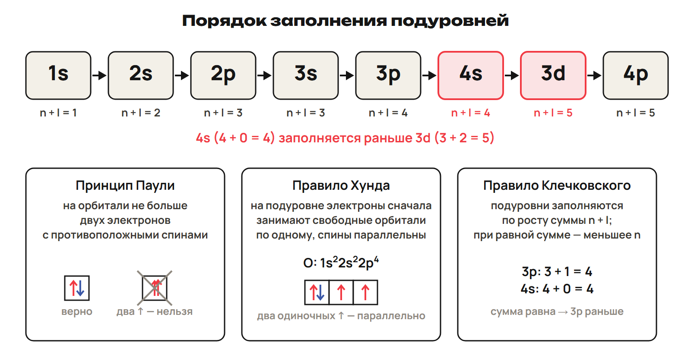

Заряд ядра определяет элемент. Электронная оболочка помогает объяснить его место в таблице и свойства. Начни с числа частиц, затем переходи к электронам и сравнению элементов.

После урока 11 прочитай разделы 1–5 за 25 минут. После урока 12 повтори раздел 6 и факты недели за 15 минут. Таблица конфигураций — опора для решения: используй её, чтобы проверить свою запись.

## 1. Состав атома

В ядерной модели атом состоит из положительно заряженного ядра и электронной оболочки. Ядро образуют протоны и нейтроны — нуклоны. Их удерживают ядерные силы. Почти вся масса атома сосредоточена в ядре.

| Частица | Где находится | Относительный заряд |
|---|---|---|
| Протон, p | Ядро | +1 |
| Нейтрон, n | Ядро | 0 |
| Электрон, e⁻ | Электронная оболочка | −1 |

Размер атома — около 10⁻⁸ см; ядро примерно в сто тысяч раз меньше. Масса электрона приблизительно в 1836 раз меньше массы протона.

Дж. Томсон открыл электрон в 1897 году. Э. Резерфорд предложил ядерную модель в 1911 году и открыл протон в 1919 году. Нейтрон открыл Дж. Чедвик. Н. Бор описал расположение электронов по слоям. Г. Мозли связал порядковый номер элемента с зарядом ядра.

> [!rule] Три числа
> Z — порядковый номер и число протонов. Заряд ядра в единицах элементарного заряда равен +Z.
> A — массовое число, общее число нуклонов. N — число нейтронов.
> A = Z + N; N = A − Z. У нейтрального атома число электронов e = Z.

В записи ¹⁹₉F верхнее число 19 — A, нижнее 9 — Z. Сначала прочитай Z, затем вычти его из A: в ядре 9 протонов и 10 нейтронов. У нейтрального атома 9 электронов.

Ион — заряженная частица, образованная при отдаче или присоединении электронов. Положительный ион — катион, отрицательный — анион. Металлы обычно отдают электроны, неметаллы — принимают.

> [!example] Атом и ион
> Атом F принимает один электрон: F + e⁻ → F⁻.
> Электронов стало 10. В ядре по-прежнему 9 протонов и 10 нейтронов.
> Для катиона с зарядом 2+ электронов Z − 2; для аниона с зарядом 2− электронов Z + 2.

> [!trap] Z, A и Ar
> Z определяет элемент, A относится к конкретному нуклиду. Ar — средняя относительная атомная масса элемента. Она не даёт точное число нейтронов: для N нужен A.

## 2. Нуклиды, изотопы и атомная масса

Нуклид — вид атомов с определёнными Z и A. Химический элемент — совокупность атомов с одинаковым зарядом ядра. Поэтому атомы одного элемента могут иметь разные массовые числа.

| Что сравниваем | Что одинаково | Пример |
|---|---|---|
| Изотопы | Z; различаются N и A | ³⁵₁₇Cl и ³⁷₁₇Cl |
| Изобары | A; элементы разные | ¹⁴₆C и ¹⁴₇N |
| Изотоны | N = A − Z | ¹⁵₇N и ¹⁶₈O: по 8 нейтронов |

Изотопы водорода: ¹H — протий, ²H — дейтерий, D, ³H — тритий, T. У олова 10 стабильных изотопов.

> [!trap] Похожее название — разный признак
> Для изотопов сравни Z, для изобар — A, для изотонов сначала вычисли A − Z. Массовое число само по себе не определяет элемент.

Атомная единица массы, или дальтон, равна 1/12 массы атома ¹²C: 1 а. е. м. ≈ 1,66 · 10⁻²⁷ кг. Относительная атомная масса Ar показывает среднюю массу атомов природной смеси изотопов относительно этой единицы. Ar безразмерна.

> [!rule] Средняя масса смеси
> Ar = сумма произведений доли каждого изотопа на его относительную атомную массу.
> Проценты переведи в доли; сумма долей равна 1. Массовые числа используй вместо относительных масс изотопов только при таком условии расчёта.

> [!example] Смесь изотопов хлора
> Доли ³⁵Cl и ³⁷Cl — 75,5 % и 24,5 %. Примем относительные массы изотопов равными 35 и 37.
> Ar = 0,755 × 35 + 0,245 × 37 = 35,49 ≈ 35,5.
> Это среднее значение. У отдельного атома хлора массовое число 35 или 37.

## 3. Радиоактивность и ядерные реакции

Радиоактивность — самопроизвольное превращение неустойчивых атомных ядер с испусканием частиц или излучения. Её открыл А. Беккерель; термин ввела М. Склодовская-Кюри. М. и П. Кюри открыли полоний и радий.

| Излучение | Что испускается | Изменение ядра |
|---|---|---|
| α | Ядро гелия ⁴₂He: 2 протона и 2 нейтрона, заряд +2 | A уменьшается на 4, Z на 2 |
| β⁻ | Электрон ⁰₋₁e, возникающий при превращении нейтрона | A не меняется, Z увеличивается на 1 |
| γ | Электромагнитное излучение без заряда и массы покоя | A и Z не меняются |

α-излучение задерживает лист бумаги, β-излучение — слой меди около 1 мм. γ-излучение обладает наибольшей проникающей способностью из этих трёх видов.

Правило смещения сформулировали К. Фаянс и Ф. Содди в 1913 году. Здесь β-распад означает β⁻-распад. При α- и β⁻-распаде получается другой элемент; при γ-излучении элемент остаётся тем же.

Ядерная реакция — превращение атомных ядер при взаимодействии друг с другом или с элементарными частицами. Первую ядерную реакцию осуществил Э. Резерфорд в 1919 году, действуя α-частицами на азот.

> [!rule] Баланс ядерного уравнения
> Сумма A слева равна сумме A справа. Отдельно проверь равенство сумм Z.
> Запиши известную частицу, найди A и Z неизвестного ядра, затем определи элемент по Z.

> [!example] Два вида распада
> ²²²₈₆Rn → ²¹⁸₈₄Po + ⁴₂He.
> Проверка: 222 = 218 + 4; 86 = 84 + 2.
> ²¹⁸₈₄Po → ²¹⁸₈₅At + ⁰₋₁e.
> Проверка: 218 = 218 + 0; 84 = 85 − 1.

Цепочка превращений: ²²⁶Ra → α → ²²²Rn → α → ²¹⁸Po → β⁻ → ²¹⁸At. Каждый переход проверяй отдельно.

Период полураспада — время, за которое распадается половина исходного числа атомов радиоактивного изотопа. Все элементы с Z > 84 нестабильны. Казахстан занимает первое место в мире по добыче урана.

> [!trap] Электрон при β⁻-распаде
> β⁻-частица возникает при превращении нейтрона в ядре. Это ядерный процесс; его не считай обычной отдачей электрона атомом при образовании катиона.

## 4. Уровни, подуровни, орбитали и квантовые числа

Энергетический уровень объединяет электроны с близкой энергией. Чем ближе уровень к ядру, тем меньше энергия электронов и прочнее их связь с ядром. Уровни обозначают числами 1, 2, 3… или буквами K, L, M, N…

| Номер уровня n | Обозначение | Максимальное число электронов e_max = 2n² |
|---|---|---|
| 1 | K | 2 |
| 2 | L | 8 |
| 3 | M | 18 |
| 4 | N | 32 |

Это вместимость уровня, а не число электронов, которое обязательно есть в каждом атоме. На уровне n находятся n подуровней и n² орбиталей. Внешний уровень с 8 электронами считается завершённым; у гелия завершён первый уровень с 2 электронами.

Атомная орбиталь — область пространства, где вероятность нахождения электрона наибольшая, около 90 %. Орбиталь не задаёт точную траекторию электрона.

| Подуровень | Форма орбитали | Орбиталей | Максимум электронов |
|---|---|---|---|
| s | Шар | 1 | 2 |
| p | Гантель | 3 | 6 |
| d | Более сложная | 5 | 10 |
| f | Более сложная | 7 | 14 |

Три p-орбитали ориентированы по трём осям. На одной орбитали может находиться не больше двух электронов.

Четыре квантовых числа описывают состояние электрона.

| Число | Что описывает | Допустимые значения |
|---|---|---|
| Главное n | Уровень и размер орбитали | 1, 2, 3… |
| Орбитальное l | Подуровень, форму орбитали | От 0 до n − 1; 0 — s, 1 — p, 2 — d, 3 — f |
| Магнитное mₗ | Ориентацию орбитали | От −l до +l; всего 2l + 1 значений |
| Спиновое mₛ | Спин электрона | +½ или −½ |

Например, на третьем уровне возможны l = 0, 1, 2: подуровни 3s, 3p, 3d. Для p-подуровня l = 1 и mₗ = −1, 0, +1. Стрелка ↑ обозначает mₛ = +½, стрелка ↓ — mₛ = −½.

> [!trap] Уровень и подуровень
> Число перед буквой — n, буква задаёт l. В 3p: n = 3, l = 1. Число нейтронов N и вместимость уровня e_max — разные величины.

## 5. Правила заполнения электронной оболочки

Электроны занимают орбитали в определённом порядке. Электронная формула показывает число электронов на подуровнях, электронно-графическая — ещё и их размещение по отдельным орбиталям.

> [!rule] Паули, Хунд, Клечковский
> Принцип Паули: в атоме нет двух электронов с одинаковым набором всех четырёх квантовых чисел. Одна клетка вмещает максимум два электрона с противоположными спинами: [↑↓].
> Правило Хунда: сначала заполняй свободные орбитали одного подуровня по одному электрону с параллельными спинами, затем образуй пары.
> Правило Клечковского: подуровни заполняются по возрастанию n + l; при равных суммах раньше заполняется подуровень с меньшим n.

У 3p и 4s сумма n + l равна 4: первым заполняется 3p. У 4s сумма 4, у 3d — 5: 4s заполняется раньше 3d. Правило n + l предложил Э. Маделунг в 1936 году; В. М. Клечковский сформулировал его в 1951 году.

Порядок заполнения: 1s → 2s → 2p → 3s → 3p → 4s → 3d → 4p → 5s → 4d → 5p → 6s → 4f → 5d → 6p…

Для нейтрального атома найди Z и размести Z электронов по этому порядку. Степень справа от буквы показывает число электронов на подуровне. Сумма всех степеней должна равняться Z.

> [!example] Кислород и фтор
> O, Z = 8: 1s²2s²2p⁴; по уровням 2, 6.
> 1s [↑↓]   2s [↑↓]   2p [↑↓][↑][↑].
> F, Z = 9: 1s²2s²2p⁵; по уровням 2, 7.
> 1s [↑↓]   2s [↑↓]   2p [↑↓][↑↓][↑].
> У O два неспаренных электрона, у F один.

Один электрон в клетке — неспаренный. Два электрона в одной клетке — спаренные. Размещение пары в первой из равных p-орбиталей — условный порядок записи; перестановка равных орбиталей сама по себе не нарушает правило Хунда.

> [!example] Натрий
> Na, Z = 11: 1s²2s²2p⁶3s¹; по уровням 2, 8, 1.
> 1s [↑↓]   2s [↑↓]   2p [↑↓][↑↓][↑↓]   3s [↑].
> Электрон внешнего уровня находится на 3s.

> [!trap] Пары и порядок
> Для p³ правильно [↑][↑][↑]. Запись [↑↓][↑][ ] нарушает правило Хунда.
> На одной орбитали [↑↑] недопустимо по принципу Паули. После 3p переходи к 4s, затем к 3d.

После урока 11 выполни закрепление P1–P6 за 20 минут и общую часть G за 35 минут. Запиши два вопроса к уроку 12.

## 6. Конфигурации и периодический закон — после урока 12

### Конфигурации элементов 1–4 периодов

Краткая запись заменяет заполненные внутренние подуровни символом благородного газа. [He] = 1s²; [Ne] = 1s²2s²2p⁶; [Ar] = 1s²2s²2p⁶3s²3p⁶. Чтобы получить полную формулу, раскрой эту часть.

| Период | Z | Элемент | Электронная формула нейтрального атома |
|---|---|---|---|
| 1 | 1 | H | 1s¹ |
| 1 | 2 | He | 1s² |
| 2 | 3 | Li | [He]2s¹ |
| 2 | 4 | Be | [He]2s² |
| 2 | 5 | B | [He]2s²2p¹ |
| 2 | 6 | C | [He]2s²2p² |
| 2 | 7 | N | [He]2s²2p³ |
| 2 | 8 | O | [He]2s²2p⁴ |
| 2 | 9 | F | [He]2s²2p⁵ |
| 2 | 10 | Ne | [He]2s²2p⁶ |
| 3 | 11 | Na | [Ne]3s¹ |
| 3 | 12 | Mg | [Ne]3s² |
| 3 | 13 | Al | [Ne]3s²3p¹ |
| 3 | 14 | Si | [Ne]3s²3p² |
| 3 | 15 | P | [Ne]3s²3p³ |
| 3 | 16 | S | [Ne]3s²3p⁴ |
| 3 | 17 | Cl | [Ne]3s²3p⁵ |
| 3 | 18 | Ar | [Ne]3s²3p⁶ |
| 4 | 19 | K | [Ar]4s¹ |
| 4 | 20 | Ca | [Ar]4s² |
| 4 | 21 | Sc | [Ar]3d¹4s² |
| 4 | 22 | Ti | [Ar]3d²4s² |
| 4 | 23 | V | [Ar]3d³4s² |
| 4 | 24 | Cr | [Ar]3d⁵4s¹ |
| 4 | 25 | Mn | [Ar]3d⁵4s² |
| 4 | 26 | Fe | [Ar]3d⁶4s² |
| 4 | 27 | Co | [Ar]3d⁷4s² |
| 4 | 28 | Ni | [Ar]3d⁸4s² |
| 4 | 29 | Cu | [Ar]3d¹⁰4s¹ |
| 4 | 30 | Zn | [Ar]3d¹⁰4s² |
| 4 | 31 | Ga | [Ar]3d¹⁰4s²4p¹ |
| 4 | 32 | Ge | [Ar]3d¹⁰4s²4p² |
| 4 | 33 | As | [Ar]3d¹⁰4s²4p³ |
| 4 | 34 | Se | [Ar]3d¹⁰4s²4p⁴ |
| 4 | 35 | Br | [Ar]3d¹⁰4s²4p⁵ |
| 4 | 36 | Kr | [Ar]3d¹⁰4s²4p⁶ |

У Cr и Cu происходит «провал» электрона: для этих атомов устойчивее наполовину заполненный d⁵ или полностью заполненный d¹⁰ подуровень. Формулы Cr и Cu запомни отдельно.

> [!example] Клетки Cr и Cu
> Cr: [Ar]   3d [↑][↑][↑][↑][↑]   4s [↑].
> Cu: [Ar]   3d [↑↓][↑↓][↑↓][↑↓][↑↓]   4s [↑].
> Внутри [Ar] все орбитали заполнены парами. У Cr шесть неспаренных электронов, у Cu один.

Для остальных формул используй готовые схемы подуровней. Сначала возьми нужное число клеток, затем расставь электроны по Паули и Хунду.

| Заполнение s или p | Клетки |
|---|---|
| s¹ | [↑] |
| s² | [↑↓] |
| p¹ | [↑][ ][ ] |
| p² | [↑][↑][ ] |
| p³ | [↑][↑][↑] |
| p⁴ | [↑↓][↑][↑] |
| p⁵ | [↑↓][↑↓][↑] |
| p⁶ | [↑↓][↑↓][↑↓] |

У d-подуровня пять клеток. По этой таблице можно построить электронно-графическую формулу каждого d-элемента четвёртого периода.

| Заполнение d | Клетки |
|---|---|
| d¹ | [↑][ ][ ][ ][ ] |
| d² | [↑][↑][ ][ ][ ] |
| d³ | [↑][↑][↑][ ][ ] |
| d⁴ | [↑][↑][↑][↑][ ] |
| d⁵ | [↑][↑][↑][↑][↑] |
| d⁶ | [↑↓][↑][↑][↑][↑] |
| d⁷ | [↑↓][↑↓][↑][↑][↑] |
| d⁸ | [↑↓][↑↓][↑↓][↑][↑] |
| d⁹ | [↑↓][↑↓][↑↓][↑↓][↑] |
| d¹⁰ | [↑↓][↑↓][↑↓][↑↓][↑↓] |

### Положение элемента по электронной формуле

Номер периода равен числу занятых энергетических уровней. Найди наибольшее n в конфигурации: у [Ar]3d⁶4s² это 4, поэтому Fe находится в четвёртом периоде.

s-, p-, d-, f-элементы различают по подуровню, который заполняется в соответствующем ряду элементов. s- и p-элементы относятся к главным подгруппам A, d-элементы Sc–Zn — к побочным подгруппам B. Лантаноиды Ce–Lu заполняют 4f.

> [!rule] Главные подгруппы
> IA: ns¹; IIA: ns²; IIIA–VIIIA: ns²np¹–ns²np⁶.
> Номер A-группы равен числу электронов внешнего уровня. Исключение — He: VIIIA, но только 2 электрона, 1s².
> В длинной таблице IA и IIA — группы 1 и 2; IIIA–VIIIA — группы 13–18.

Например, внешний уровень 3s²3p³ содержит 5 электронов: третий период, VA, p-элемент P. Внешний уровень 4s¹ соответствует K среди элементов главных подгрупп. Если дана только эта часть без указания подгруппы, она не определяет элемент однозначно: у Cr и Cu тоже 4s¹.

> [!trap] Последняя напечатанная буква
> Cr и Cu — d-элементы, хотя их запись заканчивается 4s¹. Для побочных подгрупп номер группы не равен числу электронов внешнего уровня.

### Закон и устройство таблицы

Д. И. Менделеев сформулировал периодический закон в 1869 году, связывая повторение свойств с атомным весом.

> [!rule] Современный периодический закон
> Свойства элементов и их соединений находятся в периодической зависимости от заряда ядер атомов.
> При увеличении Z периодически повторяется строение внешнего электронного уровня, поэтому повторяются свойства.

Период — горизонтальный ряд элементов в порядке возрастания заряда ядра. Первый период идёт от H до He; остальные начинаются щелочным металлом и заканчиваются благородным газом. Их типичные крайние конфигурации — ns¹ и ns²np⁶.

Число элементов в периодах 1–7: 2, 8, 8, 18, 18, 32, 32. Периоды 1–3 — малые, 4–7 — большие. Лантаноиды и актиноиды вынесены в нижние строки таблицы.

Группа — вертикальный ряд сходных элементов. Главная подгруппа A включает элементы малых и больших периодов, побочная B — только больших. В короткой таблице 8 групп, в длинной — 18.

> [!trap] Порядок элементов
> Современную таблицу читают по возрастанию Z. Возрастание средней атомной массы не задаёт порядок элементов.

### Периодические закономерности

В периоде растёт заряд ядра, а число занятых уровней сохраняется. Притяжение электронов в целом усиливается, радиус уменьшается. В главной подгруппе вниз добавляются уровни: радиус в целом растёт, внешние электроны легче отдать.

| Свойство | В периоде слева направо | В главной подгруппе сверху вниз |
|---|---|---|
| Заряд ядра | Растёт | Растёт |
| Радиус атома | Обычно уменьшается | Обычно увеличивается |
| Энергия ионизации | В целом растёт | В целом уменьшается |
| Сродство к электрону | Общая тенденция к росту | Общая тенденция к уменьшению |
| Металлические свойства | Ослабевают | Усиливаются |
| Неметаллические свойства | Усиливаются | Ослабевают |
| Высшая валентность / степень окисления в оксидах | Для применимых главных подгрупп растёт до номера группы | Для применимых главных подгрупп обычно равна номеру группы |

Энергия ионизации связана с удалением электрона: чем она ниже, тем легче атом отдаёт электрон. Сродство к электрону связано с его присоединением. Радиус катиона меньше радиуса исходного атома, радиус аниона — больше.

> [!trap] Тенденция имеет границы
> Таблица показывает общие направления. Радиус, энергия ионизации и сродство к электрону не образуют строго монотонные ряды без исключений. Благородные газы не становятся самыми склонными принимать электрон только потому, что стоят справа.

Наиболее выраженные металлические свойства у франция, затем цезия; неметаллические — у фтора, затем кислорода. Электроотрицательность — способность атома в молекуле притягивать общие электронные пары. Понятие ввёл Л. Полинг. Высокие значения характерны для F, O, N, Cl, низкие — для щелочных металлов.

### Оксиды, гидроксиды и водородные соединения

В периоде в целом усиливается кислотный характер оксидов и соответствующих гидроксидов, в главной подгруппе вниз — основной. Используй изученные формулы и свойства.

| Характер | Примеры |
|---|---|
| Основной | Na₂O, MgO; NaOH, Mg(OH)₂; CrO |
| Амфотерный | BeO, ZnO, Al₂O₃; Be(OH)₂, Zn(OH)₂, Al(OH)₃; Cr₂O₃ |
| Кислотный | B₂O₃, SiO₂, P₂O₅, SO₃, Cl₂O₇; CrO₃ |

У одного элемента характер разных оксидов может различаться: CrO — основной, Cr₂O₃ — амфотерный, CrO₃ — кислотный.

> [!trap] Не определяй класс только по числу
> Записи +3 и +4 сами по себе не означают амфотерность: B₂O₃ и SiO₂ — кислотные оксиды. CO и NO — нейтральные. BeO, ZnO и Al₂O₃ амфотерны.

Учебный ряд формул высших оксидов по группам I–VIII: R₂O, RO, R₂O₃, RO₂, R₂O₅, RO₃, R₂O₇, RO₄. Зависимость высшей валентности от номера группы имеет исключения. Формула RO₄ не означает, что каждый благородный газ образует такой оксид.

Летучие водородные соединения неметаллов IV–VII групп: RH₄, RH₃, H₂R, HR. Валентность по водороду равна 8 минус номер группы. Например, для VIA это H₂R, для VIIA — HR.

### Естественные семейства и свойства элементов

| Семейство | Элементы и подгруппа | Внешний уровень и свойства |
|---|---|---|
| Щелочные металлы | Li, Na, K, Rb, Cs, Fr; IA | ns¹; активные металлы, с водой образуют щёлочи и H₂ |
| Галогены | F, Cl, Br, I, At; VIIA | ns²np⁵; двухатомные молекулы, «рождающие соли»; активность от F к I падает |
| Благородные газы | He, Ne, Ar, Kr, Xe, Rn; VIIIA | ns²np⁶, у He 1s²; одноатомные, малоактивные |

В таблице металлы расположены преимущественно слева и ниже диагонали B–At, неметаллы — справа и выше. Между ними находятся металлоиды; кремний — полупроводник.

Алмаз — самый твёрдый материал в школьном ряду веществ; вольфрам — самый тугоплавкий металл; литий — самый лёгкий металл; водород — самый лёгкий неметалл; хром выделяется высокой твёрдостью среди металлов. У серебра, меди и алюминия высокая теплопроводность.

### Как охарактеризовать элемент

1. Назови Z, период, группу и подгруппу.
2. Для данного нуклида найди p, N и e; запиши конфигурацию и тип s/p/d.
3. Определи, металл это или неметалл.
4. Назови высший оксид, соответствующий гидроксид и их характер.
5. Для неметалла укажи летучее водородное соединение, если оно образуется.
6. Сравни свойства с соседями по периоду и главной подгруппе.

> [!example] Сера ³²₁₆S
> Z = 16; третий период, VIA, главная подгруппа.
> 16 протонов, 16 нейтронов, 16 электронов; [Ne]3s²3p⁴; по уровням 2, 8, 6; p-элемент, неметалл.
> Высший оксид SO₃ и соответствующий гидроксид H₂SO₄ имеют кислотный характер; водородное соединение H₂S.
> В ряду P, S, Cl радиус в целом уменьшается, неметаллические свойства усиливаются.

> [!rule] Факты ЕНТ недели
> - Томсон — электрон, 1897 год.
> - Беккерель — радиоактивность; Склодовская-Кюри — термин «радиоактивность».
> - Резерфорд — ядерная модель, 1911; протон и первая ядерная реакция, 1919.
> - Чедвик — нейтрон; Мозли — заряд ядра и порядковый номер Z.
> - ¹H — протий, ²H — дейтерий, ³H — тритий.
> - Правила заполнения связаны с именами Паули, Хунда и Клечковского.
> - Cr: [Ar]3d⁵4s¹; Cu: [Ar]3d¹⁰4s¹.
> - Менделеев — 1869; Fr — самый металлический элемент, F — самый неметаллический.

После урока 12 выполни один вариант A, B или C за 30 минут, исправь ошибки за 25 минут. Вместе с чтением, закреплением, общей частью и повторением — 150 минут самостоятельной работы за неделю.
