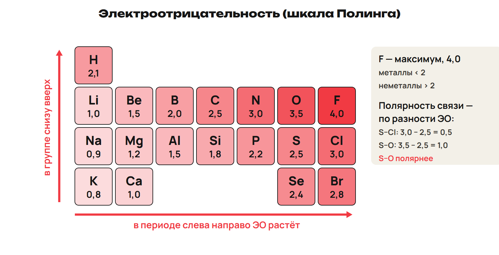
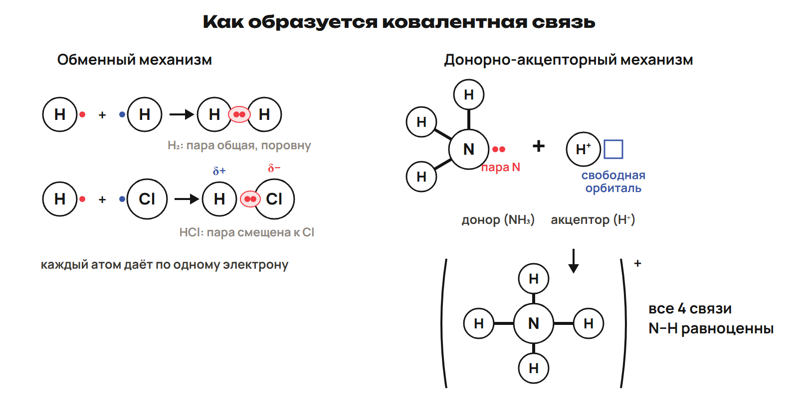
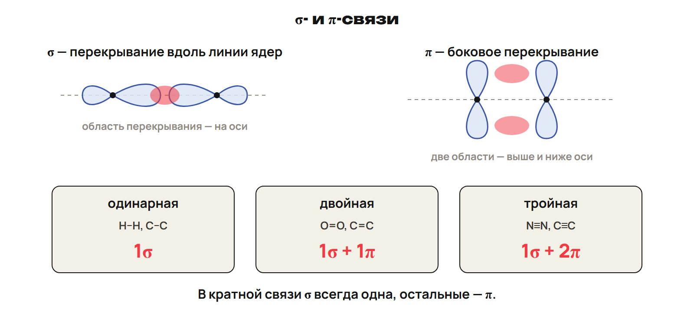
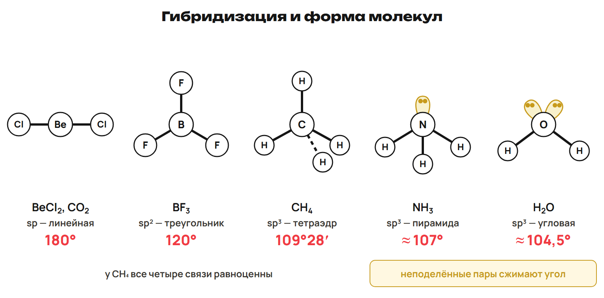

# Урок 13. Ковалентная связь, полярность и форма

14 декабря 2026; 90 минут. Группы 18:00–19:30 и 19:30–21:00.

Причина → алгоритм → разные примеры → ловушка → самостоятельная попытка. Ключи L показывать после попытки. Предварительное чтение перед первым уроком не требуется.

## План на 90 минут

| Время | Действие |
|---|---|
| 0–15 | 0–10 ЭО, таблица и пример S–Cl/S–O; 10–12 L1, 12–15 разбор. |
| 15–32 | 15–26 ковалентная связь, Льюис, обменный и донорно-акцепторный механизмы; 26–29 L2, 29–32 разбор. |
| 32–45 | 32–40 неполярная/полярная связь, диполь, CO₂/H₂O, гомо-/гетеролитический разрыв; 40–43 L3, 43–45 разбор. |
| 45–59 | 45–53 энергия/длина/направленность/насыщаемость, σ/π, пример N₂; 53–56 L4, 56–59 разбор. |
| 59–75 | 59–68 sp/sp²/sp³ и валентная модель Be/B/C; 68–71 L5, 71–75 разбор. |
| 75–90 | 75–81 NH₃/H₂O и алгоритм формы; 81–84 L6, 84–88 ключ и итог, 88–90 ДЗ. |

## 1. Электроотрицательность · 0–15 минут

**Вопрос:** К какому атому смещается общая пара?

**Связка:** Внешние электроны уже знакомы. Сравним способность атомов удерживать общую пару.

**ЭО и шкала.** ЭО — способность атома в соединении смещать общую электронную пару к себе. Шкала Полинга, 1932; Li 1,0 и F 4,0 в школьной таблице. ЭО обычно растёт по периоду вправо, по главной подгруппе вверх. Граница «металлы < 2, неметаллы > 2» приблизительна.

Назвать две Нобелевские премии Полинга — по химии и мира. Не подставлять нулевую ЭО благородных газов.

**Карта ЭО.** 

Дать таблицу конспекта; использовать её значения без смешения шкал.

**Разность, а не сумма.** S 2,5; Cl 3,0; O 3,5. S–Cl: Δ = 0,5; S–O: Δ = 1,0. S–O полярнее, потому что разность больше. На более электроотрицательном партнёре δ−, на другом δ+.

δ — частичный заряд; это не электронный баланс ОВР.

### L1

ЭО H 2,1; Cl 3,0; Br 2,8. Сравни H–Cl и H–Br. Найди Δ и направление смещения пары.

**Ответ и решение:** H–Cl: 0,9 к Cl; H–Br: 0,7 к Br. H–Cl полярнее: 0,9 > 0,7.

**Типичная ошибка и новая проверка:** Сложить ЭО вместо вычитания; повторить алгоритм с двумя числами.

## 2. Общая пара и механизмы · 15–32 минут

**Вопрос:** Кто даёт электроны общей пары?

**Связка:** Различили смещение пары. Объясним её образование.

**Связь и энергия.** При образовании связи из разделённых частиц энергия выделяется. Для разрыва той же связи энергию затрачивают. Валентные электроны могут образовать общие пары или участвовать в образовании ионов. Ковалентная связь — общие электронные пары; Льюис, 1916.

Различить энергию отдельного образования связи и полный энергетический эффект реакции.

**Два механизма.** 

Рассмотреть H₂, затем HCl; смещение пары не меняет обменный механизм.

**Донор и акцептор.** Обменный механизм: по одному электрону от каждого атома. Донорно-акцепторный: донор даёт пару, акцептор — свободную орбиталь. NH₃ + H⁺: донор N, акцептор H⁺. В готовом NH₄⁺ все четыре N–H равноценны.

Стрелка происхождения не означает отдельную более слабую связь в готовом ионе.

### L2

При образовании NH₄⁺ из NH₃ и H⁺ назови донора и акцептора. Что даёт каждый и чем отличаются четыре готовые связи?

**Ответ и решение:** N даёт неподелённую пару; H⁺ даёт свободную орбиталь. Готовые четыре связи равноценны; происхождение пары не делает одну иной.

**Типичная ошибка и новая проверка:** Назвать H⁺ донором электрона; проверить электронный состав H⁺.

## 3. Полярность и разрыв · 32–45 минут

**Вопрос:** Всегда ли полярная связь даёт полярную молекулу?

**Связка:** Пары образовались. Учтём геометрию и способы их разделения.

**Связь и диполь.** Одинаковая ЭО: пара не смещена, связь неполярная, как H₂ и N₂. Различие ЭО смещает пару, связь полярная, как HCl. Диполь — нейтральная система с разнесёнными центрами зарядов. Полярность молекулы зависит ещё и от геометрии.

Слова «разные неметаллы» — ориентир; при споре сравнить значения ЭО.

**Геометрия решает.** CO₂: полярные C–O направлены противоположно, молекула линейна и неполярна. H₂O: полярные O–H направлены под углом, молекула полярна.

Не называть δ полным зарядом атома; определение углов объясняется дальше.

**Как делится пара.** Гомолитический разрыв: каждому по одному электрону, получаются радикалы. Гетеролитический: оба электрона одному партнёру, получаются ионы. Модель Cl–Cl → два радикала отличается от модели H–Cl → H⁺ и Cl⁻.

Это судьба общей пары, не утверждение о самопроизвольном распаде в любых условиях.

### L3

Сравни полярность связей и молекул CO₂ и H₂O. Какую роль играет расположение связей?

**Ответ и решение:** В обеих молекулах связи полярны. Линейный симметричный CO₂ неполярен; угловая H₂O полярна.

**Типичная ошибка и новая проверка:** Решить по одной связи, не проверив компенсацию диполей.

## 4. Свойства и σ/π · 45–59 минут

**Вопрос:** Как посчитать компоненты кратных связей?

**Связка:** Полярность описывает распределение пары. Теперь сравним перекрывание и прочность.

**Характеристики связи.** Энергия разрыва — мера прочности, единица кДж/моль. Длина — межъядерное расстояние. Для сопоставимых связей рост кратности обычно уменьшает длину и увеличивает энергию. Насыщаемость — ограниченное число связей в модели; направленность — пространственная ориентация. В NH₃ → PH₃ → AsH₃ длина связи с H растёт, энергия падает.

Не применять длину как универсальную меру при любых разных атомных парах.

**Лобовое и боковое перекрывание.** 

Две области одной π-связи не превращать в две π-связи.

**Счёт в N₂.** N≡N: три общие пары. Между одной парой атомов одна σ, остальные π. Итого 1σ + 2π. В сопоставимом σ/π-перекрывании π слабее σ.

Ограничить рассуждение сравнимыми компонентами, не любыми связями.

### L4

Посчитай σ/π в O₂ с O=O и в N₂ с N≡N. Назови тип разрыва, если каждый партнёр получает по электрону пары.

**Ответ и решение:** O₂: 1σ + 1π; N₂: 1σ + 2π. Равный раздел пары — гомолитический, образуются радикалы.

**Типичная ошибка и новая проверка:** Считать в двойной две σ или получать ионы при равном разделе.

## 5. Гибридизация · 59–75 минут

**Вопрос:** Сколько орбиталей получилось после смешения?

**Связка:** Направления орбиталей известны. Объясним простые геометрические модели.

**Смешение орбиталей.** Гибридизация — смешение близких по энергии орбиталей одного атома. sp: одна s + одна p → 2 гибридные орбитали, 180°. sp²: одна s + две p → 3 орбитали, 120°. sp³: одна s + три p → 4 орбитали, 109°28′.

Число исходных орбиталей сохраняется; различать счёт орбиталей и электронную конфигурацию.

**Валентная модель.** Для объяснения связей используют возбуждённые конфигурации. Be*: 2s¹2p¹; B*: 2s¹2p²; C*: 2s¹2p³. Это модель числа доступных орбиталей и связей, не обязательная отдельная наблюдаемая стадия.

Не путать основное состояние из недели 6 и модель связанного атома.

**Формы.** 

Сначала разобрать первые три формы без неподелённых пар; NH₃/H₂O следующей частью.

### L5

Назови гибридизацию, число гибридных орбиталей и форму BeCl₂, BF₃ и CH₄. У центральных атомов в моделях нет неподелённых пар.

**Ответ и решение:** BeCl₂: sp, 2, линейная 180°. BF₃: sp², 3, плоский треугольник 120°. CH₄: sp³, 4, тетраэдр 109°28′.

**Типичная ошибка и новая проверка:** Принять число p за итоговое число орбиталей; добавить одну s.

## 6. Неподелённые пары и итог · 75–90 минут

**Вопрос:** Почему sp³ не всегда означает форму тетраэдра?

**Связка:** Модели без пар построили. Теперь отличим электронные области от положений атомов.

**Форма и неподелённые пары.** NH₃: три связи и одна неподелённая пара, пирамида, около 107°. H₂O: две связи и две неподелённые пары, угловая, около 104,5°. В обеих используется школьная sp³-модель четырёх электронных областей. Форму молекулы называют по положениям атомов, не по неподелённым парам.

Полный алгоритм AXₙEₘ и пять областей оставить в углублении A.

### L6

Объясни отличие NH₃ и H₂O от тетраэдрической молекулы CH₄. Назови число неподелённых пар, форму и угол NH₃/H₂O.

**Ответ и решение:** CH₄: четыре связи, нет неподелённых пар, тетраэдр. NH₃: одна пара, пирамида, около 107°. H₂O: две пары, угловая, около 104,5°.

**Типичная ошибка и новая проверка:** Сказать «sp³, значит тетраэдр» без учёта пар.

После урока 13: конспект 1–4 — 25 минут, P — 20, G — 35. После урока 14: один A/B/C — 30, исправления — 25, повторение 5–6 и фактов — 15, расчётный трек — 15. Всего 165 минут.
