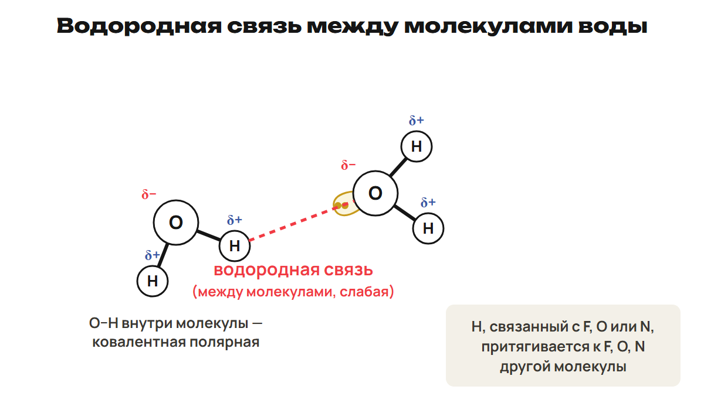
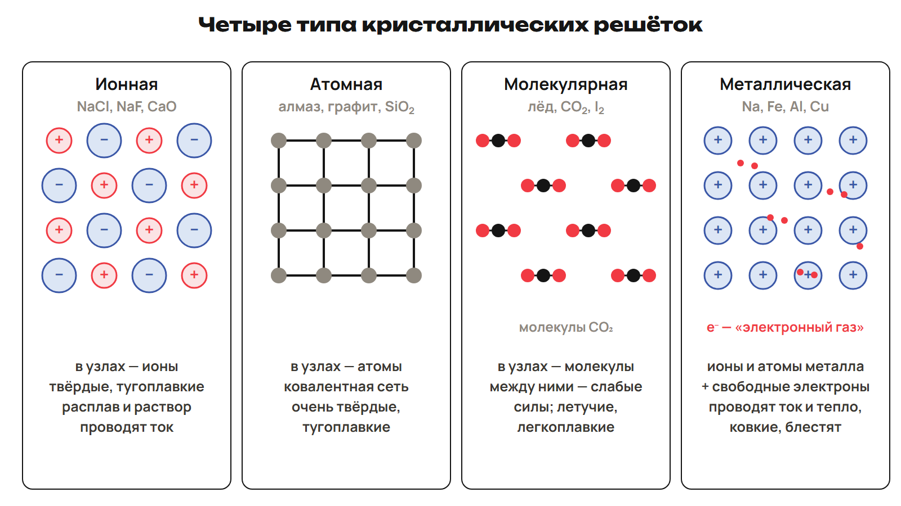

Сначала найди, какие частицы соединяются и как распределены электроны. Затем переходи от отдельной связи к форме молекулы и к строению всего вещества. Эти три уровня нельзя подменять друг другом.

После урока 13 прочитай разделы 1–4 за 25 минут, выполни P и G. После урока 14 повтори разделы 5–6 и факты за 15 минут. Таблицы — опора для решения.

## 1. Электроотрицательность

Электроотрицательность, ЭО, — способность атома в соединении смещать к себе электроны общих связей. Шкала Л. Полинга связана с 1932 годом; в школьной таблице Li имеет ЭО 1,0, F — 4,0. Фтор самый электроотрицательный. Полинг получил две Нобелевские премии — по химии и мира.

| Элемент | ЭО | Элемент | ЭО | Элемент | ЭО |
|---|---|---|---|---|---|
| H | 2,1 | Li | 1,0 | Be | 1,5 |
| B | 2,0 | C | 2,5 | N | 3,0 |
| O | 3,5 | F | 4,0 | Na | 0,9 |
| Mg | 1,2 | Al | 1,5 | Si | 1,8 |
| P | 2,2 | S | 2,5 | Cl | 3,0 |
| K | 0,8 | Ca | 1,0 | Se | 2,4 |
| Br | 2,8 | — | — | — | — |

ЭО в целом увеличивается по периоду слева направо, по главной подгруппе снизу вверх. У щелочных металлов она низкая. Правило «у металлов обычно меньше 2, у неметаллов больше 2» — ориентир, а не определение класса. Для благородных газов не подставляй выдуманную нулевую ЭО.

> [!rule] Алгоритм полярности
> Найди оба значения ЭО. Вычисли ΔЭО = |ЭО₁ − ЭО₂|.
> Общая пара смещена к атому с большей ЭО; на нём δ−, на другом δ+.
> Среди сравниваемых связей полярнее та, у которой больше ΔЭО.

> [!example] Две связи серы
> S–Cl: ΔЭО = 3,0 − 2,5 = 0,5; пара смещена к Cl.
> S–O: ΔЭО = 3,5 − 2,5 = 1,0; пара смещена к O.
> S–O полярнее, потому что разность больше.

> [!trap] Сравни разность
> Большие значения ЭО у обоих атомов сами по себе не означают более полярную связь. Разные неметаллы тоже требуют проверки таблицы, а не только названий элементов.

## 2. Ковалентная связь

Химическая связь удерживает частицы вместе. В школьной модели основную роль играют внешние электроны. При образовании связи из соответствующих разделённых частиц энергия выделяется, для разрыва той же связи энергию нужно затратить. Модель завершения внешнего уровня помогает объяснить простые соединения.

Ковалентная связь образуется общей электронной парой. Электронно-парную теорию предложил Г. Льюис в 1916 году.

| Механизм | Откуда берётся общая пара | Пример |
|---|---|---|
| Обменный | По одному электрону от каждого атома | H₂, Cl₂, HCl, N₂ |
| Донорно-акцепторный | Донор даёт неподелённую пару, акцептор — свободную орбиталь | N в NH₃ и H⁺ при образовании NH₄⁺ |

У H₂ каждый атом даёт по одному электрону: получается одна общая пара. В HCl пара смещена к Cl. В NH₄⁺ происхождение одной связи удобно описать переносом пары от N к H⁺, но в готовом ионе все четыре связи N–H равноценны.

Неполярная ковалентная связь — между атомами одинаковой ЭО; общая пара не смещена к одному из них. Примеры: H₂, O₂, Cl₂, N₂. При различии ЭО общая пара смещается: связь ковалентная полярная, как HCl, связи в H₂O и NH₃. δ+ и δ− — частичные, а не полные ионные заряды.

> [!trap] Связь и молекула
> В CO₂ связи C–O полярные, но линейная симметрия компенсирует их диполи: молекула неполярная.
> В H₂O угловая форма, диполи не компенсируются: молекула полярная.

Диполь — нейтральная система с разнесёнными центрами положительного и отрицательного зарядов. Полярность молекулы зависит и от связей, и от геометрии.

При гомолитическом разрыве общей пары каждому атому достаётся по электрону, образуются радикалы. При гетеролитическом оба электрона пары остаются у одного партнёра, образуются катион и анион. Это модели разрыва, а не правило, что любая связь самопроизвольно распадается.

## 3. Свойства связи, σ и π

Связь характеризуют энергия, длина, полярность, кратность, направленность и насыщаемость. Энергия разрыва измеряется в кДж/моль; при прочих равных большая энергия означает более прочную связь. Длина — расстояние между ядрами.

Для сопоставимых связей одних и тех же атомов увеличение кратности обычно уменьшает длину и увеличивает энергию. В ряду NH₃ → PH₃ → AsH₃ длина связи с H растёт, энергия уменьшается. Правило о длине не заменяет данных при сравнении произвольных разных связей.

| Кратность | Общих пар | σ | π |
|---|---|---|---|
| Одинарная | 1 | 1 | 0 |
| Двойная | 2 | 1 | 1 |
| Тройная | 3 | 1 | 2 |

σ-связь образуется перекрыванием вдоль линии ядер. У π-связи области перекрывания находятся по обе стороны от этой линии. В одной кратной связи только одна σ-компонента. В молекуле σ-связи разных пар атомов нужно сложить.

> [!example] N₂
> N≡N: три общие пары, одна σ-связь и две π-связи.
> Две области π-перекрывания не означают две отдельные π-связи для каждой пары орбиталей.

Насыщаемость означает ограниченное число ковалентных связей атома в данной модели; учитываются неспаренные электроны, пары и доступные орбитали. Направленность связана с пространственной ориентацией орбиталей и формой молекул. В сравнимой кратной связи π-компонента слабее σ; при присоединении удобно рассматривать изменение π-компоненты.

> [!trap] Счёт по структуре
> Сначала выпиши все соединённые пары атомов и дай каждой одну σ. Потом добавь π: одну на двойную, две на тройную. Индекс в молекулярной формуле сам по себе не показывает порядок всех связей.

## 4. Гибридизация и форма

Гибридизация — модель смешения близких по энергии орбиталей одного атома с образованием одинаковых гибридных орбиталей. Число смешиваемых орбиталей сохраняется.

| Тип | Смешиваются | Получается | Форма для указанных молекул | Примеры |
|---|---|---|---|---|
| sp | 1 s + 1 p | 2 орбитали, 180° | Линейная | BeCl₂, CO₂, HCN |
| sp² | 1 s + 2 p | 3 орбитали, 120° | Плоский треугольник | BF₃, BCl₃; CO₃²⁻, NO₃⁻ |
| sp³ | 1 s + 3 p | 4 орбитали, 109°28′ | Тетраэдр при четырёх связях без неподелённых пар | CH₄, CCl₄ |

В валентной модели перед образованием связей используют возбуждённые конфигурации Be* 2s¹2p¹, B* 2s¹2p², C* 2s¹2p³. Это способ объяснения числа связей, а не требование наблюдать отдельную стадию возбуждения в каждой реакции.

У NH₃ вокруг N три связывающие области и одна неподелённая пара: форма пирамидальная, угол около 107°. У H₂O две связи и две неподелённые пары: угловая форма, около 104,5°. Для обоих используется школьная sp³-модель, но форму по одним вершинам атомов нельзя назвать тетраэдром.

> [!trap] Орбитали и положения атомов
> Четыре электронные области могут включать неподелённые пары. Поэтому sp³ не означает, что у каждой молекулы четыре атома-партнёра и тетраэдрическая форма.

После урока 13: P1–P6 — 20 минут, G — 35 минут. Запиши два вопроса к уроку 14.

## 5. Ионная, металлическая и водородная связь — после урока 14

Ионная связь — электростатическое притяжение противоположно заряженных ионов. Для типичных солей металла и неметалла различие ЭО велико. Порог ΔЭО > 1,7 — приблизительный учебный ориентир, не универсальная граница: например, HF остаётся молекулой с ковалентной полярной связью.

Na отдаёт внешний электрон, становится Na⁺; Cl принимает электрон, становится Cl⁻. Ионная связь ненаправленная и ненасыщаемая в школьной модели решётки. В структуре NaF каждый Na⁺ имеет шесть ближайших F⁻ и наоборот.

В NaOH электростатическое взаимодействие существует между Na⁺ и OH⁻; внутри OH⁻ связь O–H ковалентная полярная. В Na₂SO₄ взаимодействуют Na⁺ и SO₄²⁻, внутри сульфат-иона связи ковалентные. Не своди многоатомный ион к набору независимых одноатомных ионов.

Металлическая связь связана с общими подвижными электронами в кристалле металла. Модель узлов с частицами металла и делокализованных электронов помогает объяснить электропроводность, теплопроводность, ковкость, пластичность и блеск. У типичных металлов внешних электронов немного; подробные степени окисления рассматриваются позже.

Водородная связь возникает между H, уже связанным с F, O или N, и подходящим электроотрицательным атомом с неподелённой парой. Обычно это взаимодействие разных молекул; возможно и внутри одной молекулы. Примеры: H₂O, HF, NH₃, спирты, уксусная кислота; водородные связи важны для белков и нуклеиновых кислот.

> [!trap] Любая связь с H — не водородная
> Внутри H₂O связь O–H ковалентная. Пунктир O···H между молекулами — водородная связь. У CH₄ нет обычной системы водородных связей этого типа.

Учебный диапазон энергии водородной связи — 10–40 кДж/моль; это значительно слабее обычной ковалентной, но не строго одинаковое соотношение для всех пар. Такие взаимодействия влияют на температуры кипения и растворимость. Этанол кипит при +78,3 °C, диметиловый эфир той же молярной массы — при −24 °C; молекулы этанола образуют между собой водородные связи.

Разделение связей на типы условно: они имеют общую электрическую природу. У преимущественно ионной связи возможен ковалентный вклад. Раствор HCl в воде проводит ток, в бензоле — нет: среда влияет на образование подвижных ионов.

## 6. Решётка и свойства вещества

Кристалл имеет упорядоченное расположение частиц; места их расположения — узлы решётки. Чистое кристаллическое вещество при заданном давлении обычно имеет определённую температуру плавления. Аморфные вещества, например стекло и янтарь, размягчаются постепенно.

| Решётка | Частицы в узлах и взаимодействия | Типичные свойства | Примеры |
|---|---|---|---|
| Ионная | Ионы, электростатическое притяжение | Твёрдые, часто тугоплавкие; ток в расплаве и проводящем растворе, не в обычном твёрдом кристалле | NaCl, NaF, KCl, CaO |
| Атомная | Атомы, ковалентная сеть | Нелетучие, обычно высокие температуры; свойства зависят от сети | Алмаз, графит, B, Si, SiO₂, SiC |
| Молекулярная | Молекулы, между ними межмолекулярные силы | Обычно сравнительно низкие температуры, летучесть и малая твёрдость | Лёд, CO₂, I₂, S, глюкоза, сахароза, нафталин |
| Металлическая | Частицы металла и общие подвижные электроны | Проводимость, ковкость, пластичность, блеск | Na, Ca, Fe, Al, Cu, сплавы |

Решётка описывает твёрдое состояние. CO₂ в твёрдом виде — «сухой лёд», молекулярный кристалл; SiO₂ — атомная сеть. У алмаза и графита решётки атомные: в алмазе у C четыре соседа, sp³-сеть; в графите sp²-слои со сравнительно слабыми взаимодействиями между ними. Поэтому графит расщепляется на чешуйки, а алмаз значительно твёрже.

> [!trap] Между молекулами и внутри
> В молекулярном кристалле между молекулами действуют межмолекулярные силы. Ковалентные связи удерживают атомы внутри молекулы. При плавлении льда не превращай молекулы H₂O в отдельные H и O.

Температуры плавления в сравнении: NaF значительно выше HF, HF выше F₂. В этом ряду прочная ионная решётка отличается от молекулярных веществ; между молекулами HF есть водородные связи. Не делай правило «любое полярное вещество плавится выше любого неполярного» без данных.

> [!rule] Факты ЕНТ недели
> - Шкала Полинга; максимальная ЭО у F, 4,0 в школьной таблице.
> - Льюис — электронно-парная теория, 1916 год.
> - В NH₄⁺ все четыре связи равноценны; N даёт пару при донорно-акцепторном образовании.
> - В N₂ одна σ- и две π-связи.
> - sp — 180°, sp² — 120°, sp³ — 109°28′ для соответствующих форм.
> - CO₂: полярные связи, неполярная линейная молекула.
> - Алмаз, графит, Si и SiO₂ — атомные решётки.
> - Лёд, твёрдый CO₂ и I₂ — молекулярные; NaCl — ионная решётка.

После урока 14 — один A/B/C за 30 минут, исправления за 25 минут, расчётный трек за 15 минут. Вся самостоятельная работа недели — 165 минут с чтением, P, G и повторением.
