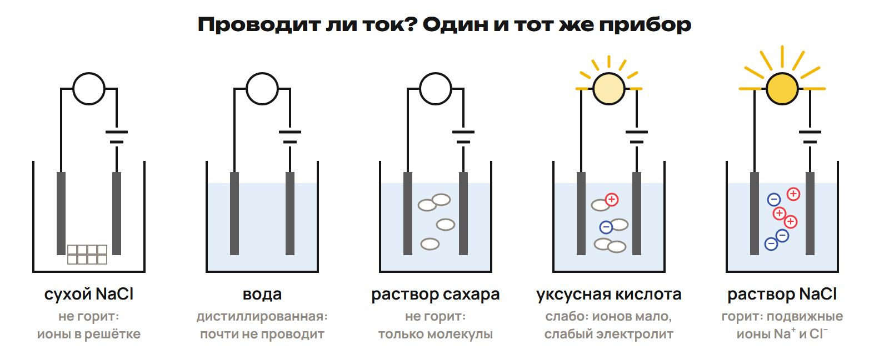
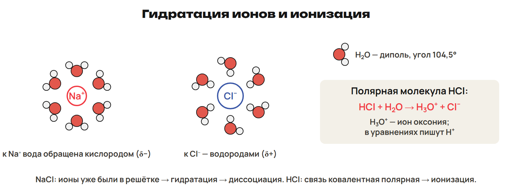
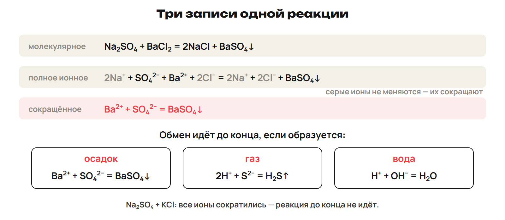

# Урок 15. Диссоциация и ионный обмен

21 декабря 2026; 90 минут. Группы 18:00–19:30 и 19:30–21:00.

Причина → алгоритм → разные примеры → ловушка → самостоятельная попытка. Ключи L показывать после попытки. Предварительное чтение перед первым уроком не требуется.

## План на 90 минут

| Время | Действие |
|---|---|
| 0–15 | 0–9 опыт/классы, 9–12 L1, 12–15 разбор. |
| 15–29 | 15–23 диполь/гидратация/энергия, 23–26 L2, 26–29 ключ. |
| 29–48 | 29–42 классы/ступени/соли, 42–45 L3, 45–48 разбор. |
| 48–62 | 48–56 α/списки/разбавление, 56–59 L4, 59–62 ключ. |
| 62–77 | 62–71 три уровня/три признака, 71–74 L5, 74–77 разбор. |
| 77–90 | 77–81 обратный алгоритм, 81–84 L6, 84–88 ключ/итог, 88–90 нагрузка. |

## 1. Носители тока · 0–15 минут

**Вопрос:** Почему соль меняет проводимость воды?

**Связка:** От состава и связи перейдём к подвижным частицам.

**Лампочка и раствор.** 

У соли различается подвижность ионов; сахар растворим, но остаётся молекулами.

**Электролит.** Растворы или подходящие расплавы электролитов проводят ток за счёт ионов. Кислоты, щёлочи, соли — электролиты. Сахар, спирт, глюкоза, бензин, O₂ и H₂ — неэлектролиты. Сухая соль и дистиллированная вода проводят очень слабо.

Не выводить электролитность из одной растворимости или полярности связей.

### L1

Сравни сахар, NaCl и HNO₃ в воде. Кто даёт ионы и почему сухая соль отличается от раствора?

**Ответ и решение:** NaCl и HNO₃ дают ионы; сахар остаётся молекулами. В сухой соли ионы закреплены, в растворе подвижны.

**Типичная ошибка и новая проверка:** Назвать сахар электролитом из-за растворимости.

## 2. Вода и частицы · 15–29 минут

**Вопрос:** Как вода помогает образованию раствора ионов?

**Связка:** Носителей нашли. Объясним их появление.

**Гидратация.** 

Угол воды 104,5°; гидратация — окружение молекулами воды, сольватация — другим растворителем.

**Ионы до и после растворения.** NaCl: разрушение решётки и гидратация уже существовавших ионов. HCl + H₂O → H₃O⁺ + Cl⁻: ионизация полярной молекулы. H⁺ — краткая водная запись гидратированного протона. Ион отличается от атома: Na⁺ не имеет свойств металлического Na. Cu²⁺ голубой; MnO₄⁻ малиновый.

HCl не сохраняется как молекула с заменённым типом связи; не всякая полярная молекула ионизируется.

**Теплота и теория.** Гидратация выделяет энергию; разрушение решётки требует энергии. LiCl, CaCl₂: растворение с нагреванием. NH₄NO₃, KNO₃, KCl: с охлаждением. Теория диссоциации: С. Аррениус, 1887; термины — М. Фарадей. Гидратация ионов: И. А. Каблуков и В. А. Кистяковский.

Сопоставлять суммарные затраты и выделение, а не объявлять любое растворение нагреванием.

### L2

Каким концом вода обращена к Na⁺ и Cl⁻? Запиши образование иона оксония из HCl.

**Ответ и решение:** К Na⁺ кислородом δ−, к Cl⁻ водородами δ+. HCl + H₂O → H₃O⁺ + Cl⁻.

**Типичная ошибка и новая проверка:** Развернуть диполь одинаково вокруг разных ионов.

## 3. Диссоциация и заряд · 29–48 минут

**Вопрос:** Как из формулы получить правильные ионы?

**Связка:** Механизм понятен. Сохраним состав и заряд в записи.

**Классы.** Кислота → H⁺ и анион остатка; HCl → H⁺ + Cl⁻. Основание → катион металла и OH⁻; NaOH → Na⁺ + OH⁻. Средняя соль: K₃PO₄ → 3K⁺ + PO₄³⁻. Катион соли может быть NH₄⁺; общих для всех солей ионов нет.

Коэффициент умножает число ионов, индекс сохраняет состав иона.

**Кислоты ступенчато.** H₂SO₄ → H⁺ + HSO₄⁻; HSO₄⁻ ⇄ H⁺ + SO₄²⁻. H₃PO₄ ⇄ H⁺ + H₂PO₄⁻. H₂PO₄⁻ ⇄ H⁺ + HPO₄²⁻. HPO₄²⁻ ⇄ H⁺ + PO₄³⁻. Следующая ступень кислоты слабее; обратный процесс — ассоциация.

Баланс заряда проверять на каждой ступени.

**Основание и кислая соль.** Ca(OH)₂ → Ca²⁺ + 2OH⁻ — итог для растворённой щёлочи. Формально: Ca(OH)₂ → CaOH⁺ + OH⁻; CaOH⁺ → Ca²⁺ + OH⁻. NaHSO₄ → Na⁺ + HSO₄⁻; HSO₄⁻ ⇄ H⁺ + SO₄²⁻. MgOHCl → MgOH⁺ + Cl⁻; MgOH⁺ ⇄ Mg²⁺ + OH⁻.

Формальная промежуточная частица CaOH⁺ не заменяет общий состав раствора сильной щёлочи.

### L3

Запиши ступени H₃PO₄ и начальную диссоциацию NaHSO₄. Проверь заряды последней ступени кислоты.

**Ответ и решение:** H₃PO₄ ⇄ H⁺ + H₂PO₄⁻; H₂PO₄⁻ ⇄ H⁺ + HPO₄²⁻. HPO₄²⁻ ⇄ H⁺ + PO₄³⁻: −2 = +1 − 3. NaHSO₄ → Na⁺ + HSO₄⁻.

**Типичная ошибка и новая проверка:** Выдать сразу PO₄³⁻ как единственную ступень кислой соли.

## 4. Сила и доля · 48–62 минут

**Вопрос:** Как отличить число ионов от степени диссоциации?

**Связка:** Знаем продукты. Посчитаем долю распавшихся частиц.

**Степень.** α = распавшиеся / исходные растворённые частицы; доля 0–1. Сильные α > 30 %; средние 3 % < α < 30 %; слабые α < 3 %. HCl, HBr, HI, HNO₃, H₂SO₄, щёлочи, растворимые соли — сильные. HF, H₂CO₃, H₂S, вода, водный аммиак — слабые. H₃PO₄ и HNO₂ — средние в данной учебной таблице.

Пограничные значения 3 и 30 % не проверять; α зависит от условий.

**Разбавление.** Для слабого электролита при разбавлении α растёт. Объём тоже растёт: концентрация ионов не обязана увеличиваться. 50/250 = 0,20 = 20 %, средний по учебной шкале. Катионы движутся к катоду, анионы — к аноду.

Число 10 % относится к средним по этой шкале, несмотря на ошибочное слово в книжном примере.

### L4

Распалось 12 частиц из 800. Найди α и категорию. Что обычно происходит с α слабого электролита при разбавлении?

**Ответ и решение:** 12/800 = 0,015 = 1,5 %, слабый. При разбавлении α растёт; это не утверждение о росте концентрации.

**Типичная ошибка и новая проверка:** Записать 0,015 % или увеличить концентрацию вслед за долей.

## 5. Ионный обмен · 62–77 минут

**Вопрос:** Почему одни смеси реагируют до конца, другие нет?

**Связка:** Переходим от отдельных электролитов к их взаимодействию.

**Три уровня.** 

Сильные растворимые разделить; слабые, осадки, газы и воду оставить целиком.

**Осадок.** Na₂SO₄ + BaCl₂ → BaSO₄↓ + 2NaCl. 2Na⁺ + SO₄²⁻ + Ba²⁺ + 2Cl⁻ → BaSO₄↓ + 2Na⁺ + 2Cl⁻. Ba²⁺ + SO₄²⁻ → BaSO₄↓; признак — белый осадок. Обратный путь: подобрать растворимые соли Ba²⁺ и SO₄²⁻.

Сокращать одинаковые ионы по обе стороны; BaSO₄ не делить на ионы.

**Газ, вода или отсутствие движущей силы.** Na₂S + 2HCl → 2NaCl + H₂S↑; S²⁻ + 2H⁺ → H₂S↑. KOH + HCl → KCl + H₂O; H⁺ + OH⁻ → H₂O. Na₂SO₄ + KCl: все ионы сокращаются, обмен до конца не идёт. Для сильных кислоты/щёлочи выделяется около 57 кДж на 1 моль воды.

H₂S — слабый электролит; его молекулярная запись не означает, что это неэлектролит.

### L5

Составь три уровня записи KOH + HCl. Назови ионы-наблюдатели и движущую силу.

**Ответ и решение:** KOH + HCl → KCl + H₂O. K⁺ + OH⁻ + H⁺ + Cl⁻ → K⁺ + Cl⁻ + H₂O. H⁺ + OH⁻ → H₂O; наблюдатели K⁺/Cl⁻, образуется вода.

**Типичная ошибка и новая проверка:** Разделить воду или оставить наблюдателей в сокращённом уравнении.

## 6. Обратный путь и итог · 77–90 минут

**Вопрос:** Как восстановить вещества по двум ионам?

**Связка:** Сокращать научились. Проверим восстановление и самостоятельный шаг.

### L6

Для Ca²⁺ + CO₃²⁻ → CaCO₃↓ подбери растворимые исходные соли. Запиши молекулярное и полное ионное уравнения.

**Ответ и решение:** CaCl₂ + Na₂CO₃ → CaCO₃↓ + 2NaCl. Ca²⁺ + 2Cl⁻ + 2Na⁺ + CO₃²⁻ → CaCO₃↓ + 2Na⁺ + 2Cl⁻. Сокращение даёт исходную схему; другие растворимые соли тоже допустимы.

**Типичная ошибка и новая проверка:** Подобрать нерастворимый источник иона; перепроверить таблицу.

После урока 15: конспект 1–3 — 25 минут, P — 20, G — 35. После урока 16: один A/B/C — 30, исправления — 25, повторение 4–6 и фактов — 15, расчётный трек — 15. Всего 165 минут.
