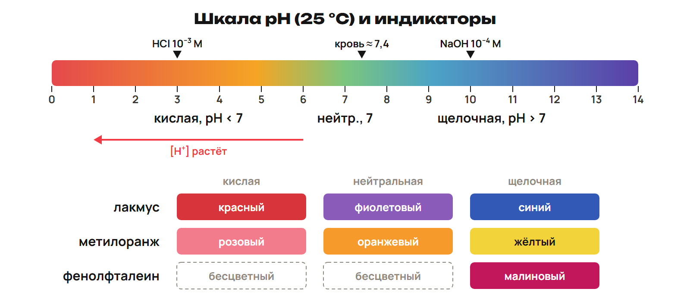
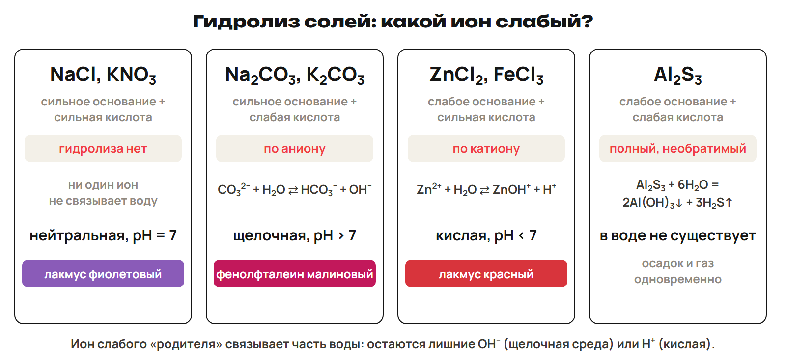
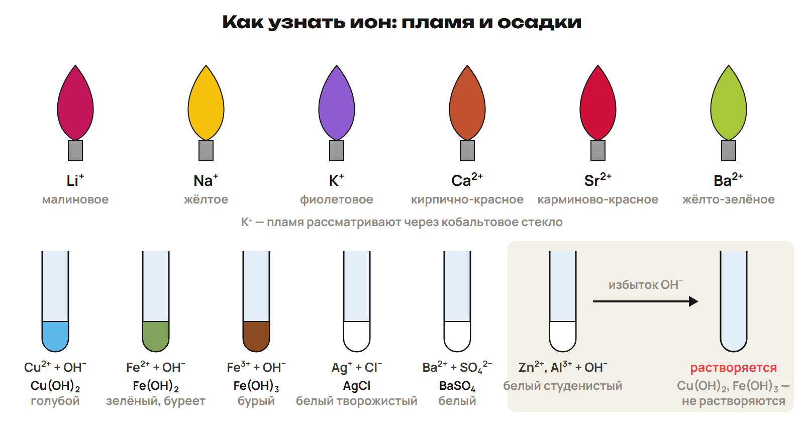

# Урок 16. pH, гидролиз и качественные реакции

24 декабря 2026; 90 минут. Группы 18:00–19:30 и 19:30–21:00.

Причина → алгоритм → разные примеры → ловушка → самостоятельная попытка. Ключи L показывать после попытки. Предварительное чтение перед первым уроком не требуется.

## План на 90 минут

| Время | Действие |
|---|---|
| 0–20 | 0–5 вопросы, 5–8 L7, 8–12 ключ; 12–15 L8, 15–20 ключ. |
| 20–35 | 20–22 вопросы G; 22–25 G9, 25–28 ключ; 28–30 G10, 30–33 ключ; 33–35 G11. |
| 35–51 | 35–45 классы/вода/формулы pH, 45–48 L9, 48–51 ключ. |
| 51–64 | 51–58 четыре типа/первые ступени, 58–61 L10, 61–64 ключ. |
| 64–78 | 64–70 таблица 12/пламя/избыток OH⁻, 70–72 L11, 72–74 ключ, 74–76 L12, 76–78 ключ. |
| 78–88 | Контроль без подсказок, отдельный ключ после сдачи. |
| 88–90 | Назначить один маршрут, приложение A не продлевает урок. |

## 1. Возврат · 0–20 минут

**Вопрос:** Какие прежние навыки нужны для ионной реакции?

**Связка:** Вернём заряды, растворимость и количество вещества.

### L7

Составь формулу Ca²⁺/Cl⁻ и назови класс NaOH. Что говорит таблица растворимости о BaSO₄?

**Ответ и решение:** CaCl₂; NaOH — щёлочь. BaSO₄ нерастворим, образует осадок.

**Типичная ошибка и новая проверка:** Потерять баланс заряда или разделить осадок.

### L8

В 0,5 л раствора содержится 0,10 моль соли. Найди c. Почему H–Cl полярна?

**Ответ и решение:** c = 0,10/0,5 = 0,20 моль/л. У H и Cl различная электроотрицательность, пара смещена к Cl.

**Типичная ошибка и новая проверка:** Умножить на объём или назвать молекулу HCl ионной решёткой.

## 2. Общая часть · 20–35 минут

**Вопрос:** Какие ионы действительно участвовали?

**Связка:** Возврат готов. Разберём домашние сокращения и моль осадка.

### G9

Na₂CO₃ + избыток HCl: три уровня записи и признак.

**Ответ и решение:** Na₂CO₃ + 2HCl → 2NaCl + H₂O + CO₂↑. 2Na⁺ + CO₃²⁻ + 2H⁺ + 2Cl⁻ → 2Na⁺ + 2Cl⁻ + H₂O + CO₂↑. CO₃²⁻ + 2H⁺ → H₂O + CO₂↑; выделение газа.

**Типичная ошибка и новая проверка:** Оставить наблюдателей в сокращённом уравнении.

### G10

0,12 моль BaCl₂ и избыток Na₂SO₄; M(BaSO₄) = 233 г/моль.

**Ответ и решение:** Ba²⁺ + SO₄²⁻ → BaSO₄↓. n(BaSO₄) = 0,12 моль; m = 0,12 × 233 = 27,96 г.

**Типичная ошибка и новая проверка:** Удвоить моли осадка по Cl⁻.

## 3. Классы и pH · 35–51 минут

**Вопрос:** Как ионы объясняют свойства и кислотность?

**Связка:** Реакцию разобрали. Сравним кислоту, основание и воду.

**Классы на языке ионов.** CuO + 2H⁺ → Cu²⁺ + H₂O; Cu(OH)₂ + 2H⁺ → Cu²⁺ + 2H₂O. CO₂ + 2OH⁻ → CO₃²⁻ + H₂O; Cu²⁺ + 2OH⁻ → Cu(OH)₂↓. 2Al + 6H⁺ → 2Al³⁺ + 3H₂↑ — разбавленная неокисляющая кислота. Нагревание: Cu(OH)₂ → CuO + H₂O; CaCO₃ → CaO + CO₂. 2KClO₃ → 2KCl + 3O₂ при нагревании.

Соль и кислота реагируют при наличии движущей силы; правило металла не переносить на HNO₃.

**Вода и показатель.** 2H₂O ⇄ H₃O⁺ + OH⁻; вода — слабый амфотерный электролит. При 25 °C [H⁺][OH⁻] = 10⁻¹⁴; нейтральные концентрации 10⁻⁷. pH = −lg[H⁺]; при 25 °C кислота < 7, нейтрально 7, щёлочь > 7. Сильная одноосновная кислота: [H⁺] ≈ c в разбавленном растворе. Щёлочь: сначала [OH⁻], затем [H⁺] = 10⁻¹⁴/[OH⁻].

Шкала 0–14 обычная школьная, не абсолютный предел; у слабой кислоты c не равно [H⁺].

**Шкала и индикаторы.** 

Сёренсен ввёл pH в 1909; средний pH крови около 7,4; известкование уменьшает кислотность почвы.

### L9

HCl 10⁻³ моль/л и NaOH 10⁻⁴ моль/л при 25 °C. Найди оба pH и цвет фенолфталеина.

**Ответ и решение:** HCl: [H⁺] = 10⁻³, pH = 3, бесцветный. NaOH: [H⁺] = 10⁻¹⁰, pH = 10, малиновый.

**Типичная ошибка и новая проверка:** Взять −lg[OH⁻] за pH.

## 4. Гидролиз · 51–64 минут

**Вопрос:** Почему соль меняет среду воды?

**Связка:** Кислотность измерили. Объясним её у солей.

**Четыре типа соли.** 

Гидролиз — взаимодействие соли с водой; для любых двух слабых родителей среду и полноту безусловно не обобщать.

**Первая ступень.** NaCl, KNO₃, BaCl₂: сильные родители, нет гидролиза, нейтрально. CO₃²⁻ + H₂O ⇄ HCO₃⁻ + OH⁻: щелочная среда. Zn²⁺ + H₂O ⇄ ZnOH⁺ + H⁺: кислая среда. Fe³⁺ + H₂O ⇄ FeOH²⁺ + H⁺: кислая среда. Al₂S₃ + 6H₂O → 2Al(OH)₃↓ + 3H₂S↑: полное разложение.

Средняя соль и нейтральный раствор — разные понятия; проверять заряд обеих сторон.

### L10

Сравни K₂CO₃ и ZnCl₂: какой ион взаимодействует с водой? Напиши первые ступени, среду и цвет лакмуса.

**Ответ и решение:** K₂CO₃: CO₃²⁻ + H₂O ⇄ HCO₃⁻ + OH⁻, щелочная, лакмус синий. ZnCl₂: Zn²⁺ + H₂O ⇄ ZnOH⁺ + H⁺, кислая, лакмус красный.

**Типичная ошибка и новая проверка:** Поменять катионный и анионный гидролиз.

## 5. Качественный анализ · 64–78 минут

**Вопрос:** Как по внешнему эффекту узнать ион?

**Связка:** Среду объяснили. Добавим реагент и наблюдение.

**Признаки ионов.** 

Читать полную таблицу раздела 6 по реагентам; качественный анализ — состав, количественный — количество.

**Реагенты и эффекты.** Ag⁺: Cl⁻ белый, Br⁻ желтоватый, I⁻ и PO₄³⁻ жёлтые осадки. OH⁻: Cu²⁺ голубой; Fe²⁺ зелёный, буреет; Fe³⁺ бурый. Zn²⁺/Al³⁺: белые студенистые гидроксиды, растворимые в избытке OH⁻. Ba²⁺ + SO₄²⁻: белый; Ca²⁺ + CO₃²⁻: белый. Fe³⁺ + роданид: кроваво-красная окраска; PbI₂ жёлтый, Cr(OH)₃ зелёный.

Cu(OH)₂ и Fe(OH)₃ не растворяются в избытке щёлочи в условиях этой проверки.

**Пламя и газы.** Na⁺ жёлтое; K⁺ фиолетовое через кобальтовое стекло. Li⁺ малиновое; Sr²⁺ карминово-красное; Ca²⁺ кирпично-красное; Ba²⁺ жёлто-зелёное. NH₄⁺ + OH⁻: аммиак; CO₃²⁻ + H⁺: CO₂, мутнит известковую воду. SO₃²⁻ + H⁺: SO₂; NO₃⁻ с Cu и концентрированной H₂SO₄: бурый газ/голубой раствор. H⁺ и OH⁻ определяют индикаторами.

Разбирать описания наблюдений; прямое определение токсичных газов по запаху не проводить.

### L11

Как отличить Cl⁻ от I⁻ одним указанным реагентом? Какой внешний эффект ожидается в каждом случае?

**Ответ и решение:** Ag⁺: Cl⁻ даёт белый AgCl; I⁻ даёт жёлтый AgI. Ag⁺ + Cl⁻ → AgCl↓; Ag⁺ + I⁻ → AgI↓.

**Типичная ошибка и новая проверка:** Выбирать реагент без различимого признака.

### L12

Два осадка — Al(OH)₃ и Cu(OH)₂. Как различить по виду и действию избытка щёлочи?

**Ответ и решение:** Al(OH)₃ белый студенистый и растворяется в избытке OH⁻. Cu(OH)₂ голубой и в условиях проверки не растворяется.

**Типичная ошибка и новая проверка:** Объявить все гидроксиды растворимыми в избытке OH⁻.

## 6. Рубеж и маршрут · 78–90 минут

**Вопрос:** Можешь ли ты объяснить раствор без таблицы?

**Связка:** Самостоятельно проверь запись, среду и признаки.

**Контроль Q1–Q6.** Работай по отдельному листу без подсказок. Q1–Q3 одна буква; Q4 все верные; Q5 две пары; Q6 решение. 10 минут, максимум 10 баллов.

Ответы на этом экране не показывать.

После урока 15: конспект 1–3 — 25 минут, P — 20, G — 35. После урока 16: один A/B/C — 30, исправления — 25, повторение 4–6 и фактов — 15, расчётный трек — 15. Всего 165 минут.

Контроль 78–88 минуты, 10 баллов; ключ отделить до выдачи. A — уверенная база, B — отдельные ошибки, C — нужна таблица; учитывать также диагностику, G и объяснение ученика. Приложение только для A, чтение внутри его 30 минут. Реальный темп проверить на пробном занятии; сокращать повторные примеры, сохраняя попытки L/Q.
