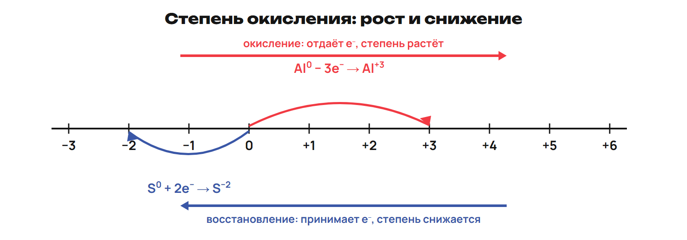
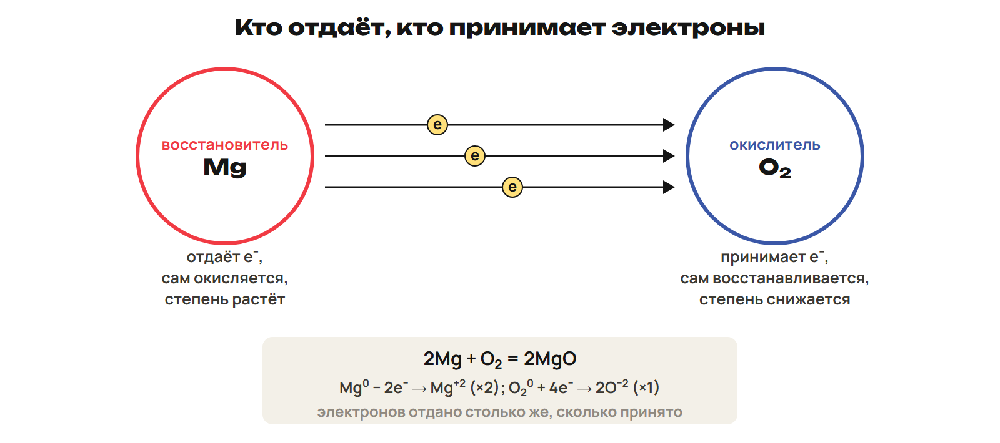
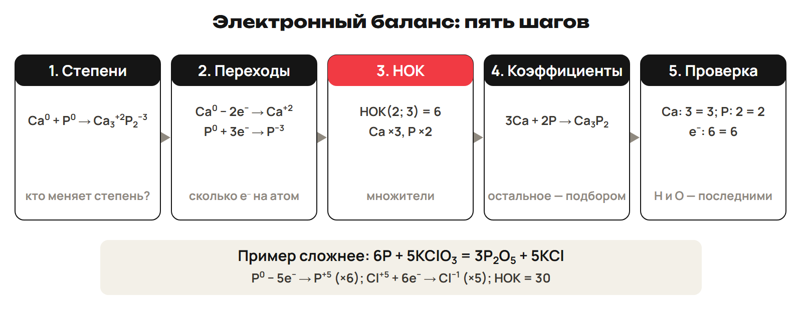

# Степень и заряд
? Почему условный заряд помогает считать электроны?
↳ После паузы вернём формулы и полярность.
> 0–9 определение/правила, 9–12 L1, 12–15 ключ.

## Понятие: Условный заряд
Степень окисления — условный заряд при отнесении пар к более электроотрицательному атому.
Простое вещество: 0; сумма нейтральной формулы: 0; сумма иона: его заряд.
Заряд Al³⁺ — цифра перед знаком; степень Al⁺³ — знак перед цифрой.
Степень атома не равна заряду всего многоатомного иона.
> Условная модель не означает свободные ионы в любой молекуле.

## Практика: L1
Найди S в H₂SO₄ и SO₄²⁻.
Почему заряд сульфата не является степенью S?
Ответы:
H₂SO₄: 2 + x − 8 = 0, S +6.
SO₄²⁻: x − 8 = −2, S +6; −2 относится ко всему иону.
> Самостоятельно до раскрытия ключа.

# Исключения
? Как не попасться на H и O?
↳ Общее правило дополним обязательными исключениями.
> 15–23 исключения/формулы, 23–26 L2, 26–29 ключ.

## Понятие: Три обязательных исключения
F в соединении −1; H обычно +1, но в NaH/CaH₂ −1.
O обычно −2; в H₂O₂/Na₂O₂/BaO₂ −1; в OF₂ +2.
В простых H₂/O₂/F₂ степень 0.
Типичные металлы: Na +1, Ca +2, Al +3.
Для изученных главных подгрупп использовать короткую нумерацию и исключения O/F.
> Нельзя подставлять современные группы 16/17 в N − 8; закономерность не универсальный закон.

## Практика: L2
Определи H в CaH₂, O в BaO₂ и OF₂, P в P₂O₅.
Ответы:
CaH₂: H −1; BaO₂: O −1; OF₂: O +2.
P₂O₅: 2x − 10 = 0, P +5.
> Самостоятельно до раскрытия ключа.

# Процесс и роль
? Почему восстановитель сам окисляется?
↳ Степени найдены. Проследим направление изменения.
> 29–39 определения/примеры, 39–42 L3, 42–45 ключ.

## Схема: Шкала

> Знак степени и направление её изменения — разные признаки.

## Схема: Передача электронов

> Число отданных равно числу принятых, оба процесса сопряжены.

## Пример: Магний и кислород
2Mg + O₂ → 2MgO.
Mg 0 → +2, восстановитель; O 0 → −2, окислитель.
Mg → Mg²⁺ + 2e⁻; формально O₂⁰ + 4e⁻ → 2O⁻².
O⁻² в балансе — степень атома, не свободный водный ион.
> Индекс 2 у O₂ даёт четыре принимаемых электрона.

## Практика: L3
CuO + H₂ → Cu + H₂O: кто меняется и каковы роли?
Ответы:
Cu +2 → 0 принимает 2e⁻; CuO — окислитель.
H 0 → +1 отдаёт, вся H₂ отдаёт 2e⁻; H₂ — восстановитель.
> Самостоятельно до раскрытия ключа.

# ОВР или обмен
? Можно ли определить ОВР только по схеме веществ?
↳ Названия ролей проверим на разных реакциях.
> 45–52 классификация/значение, 52–55 L4, 55–58 ключ.

## Понятие: Проверка изменений
ОВР: меняются степени окисления.
Обычный ионный обмен: степени сохраняются.
Изученное замещение металлом — ОВР.
Соединение/разложение бывают обоих видов: проверять атомы.
Горение, дыхание, коррозия и получение металлов связаны с ОВР.
> Признак осадка или газа сам по себе не доказывает ОВР.

## Практика: L4
Сравни NaOH + HCl → NaCl + H₂O и Zn + 2HCl → ZnCl₂ + H₂.
Ответы:
Нейтрализация не ОВР: степени сохранены.
Замещение ОВР: Zn 0 → +2, H +1 → 0.
> Самостоятельно до раскрытия ключа.

# Алгоритм баланса
? Как превратить электронный счёт в коэффициенты?
↳ Изменения нашли. Уравняем их общее число.
> 58–69 НОК/шаги/индексы, 69–72 L5, 72–75 ключ.

## Схема: Пять шагов

> H и O проверить последними; индексы веществ не менять.

## Пример: Фосфор и хлорат
6P + 5KClO₃ → 3P₂O₅ + 5KCl.
P 0 → +5: отдаёт 5e⁻ × 6.
Cl +5 → −1: принимает 6e⁻ × 5.
Общий счёт 30e⁻; проверить K, Cl, P и O.
> Множитель атома связывать с числом таких атомов в формуле.

## Практика: L5
Уравняй 3Ca + 2P → Ca₃P₂ электронным счётом.
Почему множители равны 3 и 2?
Ответы:
Ca 0 → +2 отдаёт 2e⁻; P 0 → −3 принимает 3e⁻.
НОК 6; 3Ca отдают 6, 2P принимают 6.
> Самостоятельно до раскрытия ключа.

# Кислота и итог
? Как учесть два атома водорода в H₂?
↳ Завершим балансом знакомой реакции металла.
> 75–81 алгоритм/индексы, 81–84 L6, 84–88 ключ, 88–90 нагрузка.

## Практика: L6
Уравняй Al + H₂SO₄(разб.) → Al₂(SO₄)₃ + H₂.
Ответы:
Al 0 → +3, отдаёт 3e⁻ × 2.
2H⁺ + 2e⁻ → H₂ × 3; общий счёт 6e⁻.
2Al + 3H₂SO₄ → Al₂(SO₄)₃ + 3H₂.
> Самостоятельно до раскрытия ключа.

## Дома: После урока 17
Конспект 1–3 — 25 минут; P — 20; G — 35.
Перед уроком 18 пришли G и вопросы.
Типы ОВР, среда и расчёты объясняются на уроке 18.
После него один A/B/C — 30, исправления — 25, повторение — 15.
Всего 165 минут с расчётным треком.
> Ключ после попытки.
