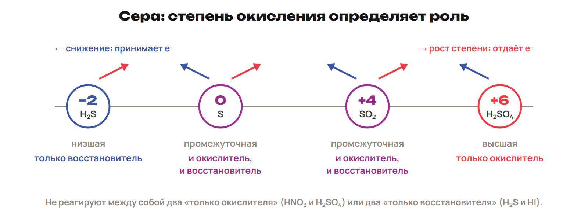
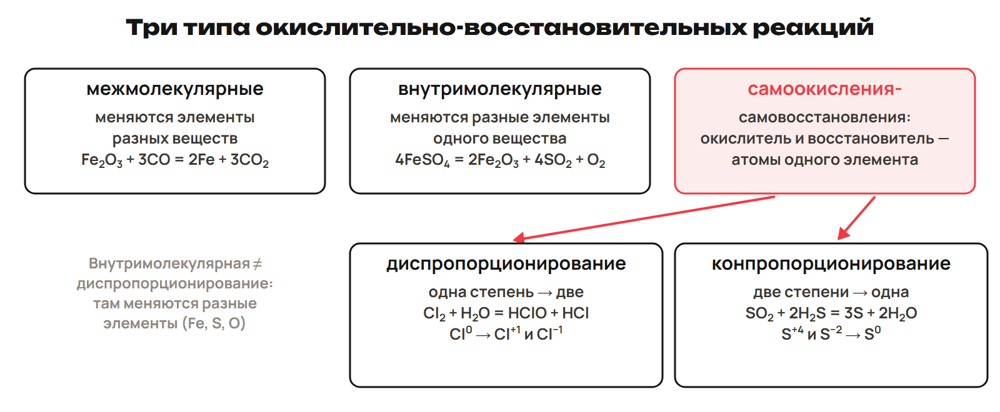
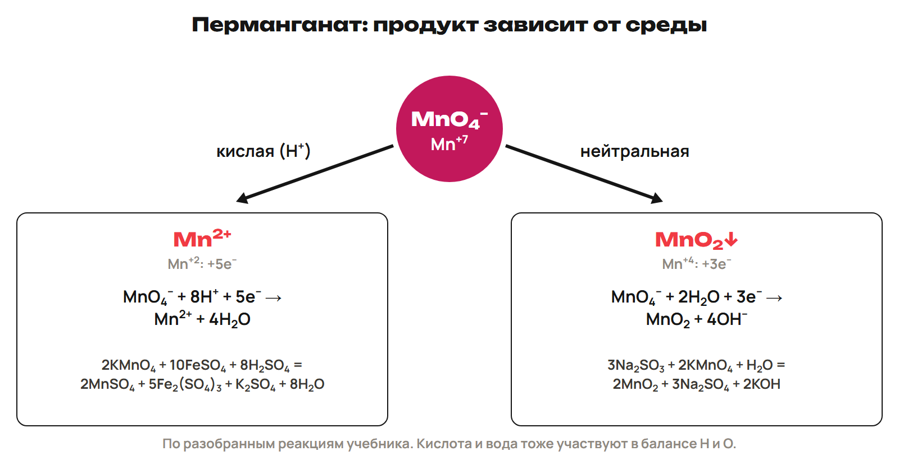

# Возврат
? Какие прежние записи нужны полуреакциям?
↳ Вернём формулы, ионы и количество газа.
> 0–5 вопросы; 5–8 L7, 8–12 ключ; 12–15 L8, 15–20 ключ.

## Практика: L7
Как записать HNO₃ и H₂O в полном ионном уравнении?
Почему нельзя менять SO₄ при сокращении?
Ответы:
HNO₃: H⁺ + NO₃⁻; H₂O целой формулой.
SO₄²⁻ — частица заданного состава; сокращаются одинаковые целые ионы.
> Самостоятельно до раскрытия ключа.

## Практика: L8
При н. у. V(H₂) = 0,672 л. Найди n при Vₘ = 22,4 л/моль.
Какую связь имеет H₂ и почему H–Cl полярна?
Ответы:
n = 0,672/22,4 = 0,030 моль.
H₂ неполярная ковалентная, H–Cl полярная из-за различной ЭО.
> Самостоятельно до раскрытия ключа.

# Разбор G
? Сколько электронов приходится на всю молекулу?
↳ Вернули счёт. Проверим домашние роли и индексы.
> 20–22 вопросы, 22–25 G9, 25–28 ключ; 28–30 G10, 30–33 ключ; 33–35 G11.

## Практика: G9
Fe + HCl → FeCl₂ + H₂: баланс, коэффициенты, роли.
Ответы:
Fe⁰ − 2e⁻ → Fe⁺²; 2H⁺ + 2e⁻ → H₂.
Fe + 2HCl → FeCl₂ + H₂; Fe восстановитель, H⁺ окислитель.
> Сначала исправить свою попытку.

## Практика: G10
N₂ + H₂ → NH₃: сколько электронов принимает N₂?
Ответы:
Два N принимают 6e⁻, одна H₂ отдаёт 2e⁻.
N₂ + 3H₂ → 2NH₃; N₂ окислитель, H₂ восстановитель.
> 33–35 G11: исключение OF₂ и отдача/окисление.

# Роли и типы
? Почему SO₂ бывает с двух сторон переноса?
↳ От конкретного баланса перейдём к возможным ролям.
> 35–44 сера/окислители/типы, 44–47 L9, 47–50 ключ.

## Схема: Сера

> Роль всего вещества проверять по конкретному уравнению; H⁺ кислоты тоже может участвовать.

## Понятие: Партнёры
Окислители: O₂, O₃, галогены, HNO₃, концентрированная H₂SO₄, H₂O₂.
Восстановители: H₂, металлы, C, CO.
Крайняя степень выбранного атома задаёт направление; промежуточная допускает оба.
H₂O₂ может играть обе роли: список не универсальный запрет.
> Не утверждать невозможность любой реакции целых веществ только по роли одного выбранного атома.

## Схема: Три семейства

> Для схемы FeSO₄ с заданными продуктами одновременно меняются Fe/S/O; не выдавать её за универсальный состав термического разложения.

## Практика: L9
Сравни Cl₂ + H₂O ⇄ HClO + HCl и SO₂ + 2H₂S → 3S + 2H₂O.
Ответы:
Cl 0 → +1/−1: диспропорционирование, одна степень в две.
S +4 и −2 → 0: конпропорционирование, две в одну.
> Самостоятельно до раскрытия ключа.

# Среда и частицы
? Почему MnO₄⁻ принимает не всегда пять электронов?
↳ Возможные роли известны. Учтём реальный раствор.
> 50–59 полуреакции/среда, 59–62 L10, 62–65 ключ.

## Схема: Перманганат

> Ионные полуреакции — реальные частицы; электроны уравнивают суммарный заряд.

## Понятие: Кислая и нейтральная
Кислая: MnO₄⁻ + 8H⁺ + 5e⁻ → Mn²⁺ + 4H₂O.
Fe²⁺ → Fe³⁺ + e⁻; умножить на 5 и сложить.
Нейтральная исходная: MnO₄⁻ + 2H₂O + 3e⁻ → MnO₂ + 4OH⁻.
SO₃²⁻ + H₂O → SO₄²⁻ + 2H⁺ + 2e⁻.
После сложения H⁺/OH⁻ дают воду; избыток OH⁻ меняет pH.
> Кислый алгоритм: O водой, H протонами, заряд электронами; водные оксид-ионы не вводить.

## Практика: L10
Сложи нейтральные исходные полуреакции MnO₄⁻/MnO₂ и SO₃²⁻/SO₄²⁻.
Ответы:
Первую × 2, вторую × 3, общий счёт 6e⁻.
2MnO₄⁻ + 3SO₃²⁻ + H₂O → 2MnO₂ + 3SO₄²⁻ + 2OH⁻.
Заряд −8 с каждой стороны; pH не обязан остаться нейтральным.
> Самостоятельно до раскрытия ключа.

# Сложный баланс и расчёт
? Как связать несколько переходов с молями?
↳ Добавим полный счёт и расчёт по уравнению.
> 65–69 два элемента/сплав, 69–71 L11, 71–73 ключ; 73–75 L12, 75–78 ключ.

## Пример: Два окисляемых элемента
P₂S₃ + 22HNO₃ → 2H₃PO₄ + 3SO₂ + 22NO₂ + 8H₂O.
Два P +3 → +5 отдают 4e⁻; три S −2 → +4 отдают 18e⁻.
Общая отдача 22e⁻; N +5 → +4 принимает 1e⁻ × 22.
> Продукты заданы условием, не предсказываются одним балансом; расчётное углубление с другими продуктами только A.

## Практика: L11
Сплав Al/Cu 2 г с разбавленной H₂SO₄ дал 1,12 л H₂ при н. у.
Реагирует только Al, M(Al) = 27; найди ω(Cu).
Ответы:
n(H₂) = 0,05; n(Al) = 2/3 × 0,05; m(Al) = 0,9 г.
m(Cu) = 1,1 г; ω = 55 %.
> Самостоятельно до раскрытия ключа.

## Практика: L12
0,92 г одновалентного металла с водой дают 0,448 л H₂ при н. у.
Найди M и металл; Vₘ = 22,4 л/моль.
Ответы:
n(H₂) = 0,020; 2Me + 2H₂O → 2MeOH + H₂.
n(Me) = 0,040; M = 23 г/моль, Na.
> Самостоятельно до раскрытия ключа.

# Контроль и маршрут
? Можешь ли ты уравнять новую схему?
↳ Проверь степени, роли и коэффициенты самостоятельно.
> 78–88 Q1–Q6; 88–90 маршрут; четыре приложения только A.

## Практика: Контроль Q1–Q6
Отдельный лист без таблиц.
Q1–Q3 одна буква; Q4 все верные; Q5 две пары; Q6 баланс.
10 минут, 10 баллов.
> На этом экране нет ключей.

## Дома: Один маршрут
Один A/B/C — 30, исправления — 25, повторение 4–6/фактов — 15 минут.
Приложения ниже только A внутри его 30 минут.
Самостоятельная за неделю: 25 + 20 + 35 + 30 + 25 + 15 = 150.
> Учитывать G, Q и объяснение.

## Понятие: Углубление A — три среды
Кислая: уравнять O водой, H ионами H⁺, заряд e⁻.
Щелочная: нейтрализовать H⁺ одинаковым добавлением OH⁻ с обеих сторон.
Сократить образовавшуюся воду; итог не содержит H⁺.
Нейтральная исходная: учитывать H₂O, итог может содержать H⁺/OH⁻.
> После сложения проверить атомы/заряды, а не опираться только на направление механического правила.

## Понятие: Углубление A — щелочное диспропорционирование
3I₂ + 6KOH → 5KI + KIO₃ + 3H₂O.
I₂ + 2e⁻ → 2I⁻.
I₂ + 12OH⁻ → 2IO₃⁻ + 6H₂O + 10e⁻.
Первую × 5, сложить, сократить общий множитель 2.
> Продукт зависит от заданных условий; для хлора в A указана горячая щёлочь.

## Понятие: Углубление A — двойственность SO₂
SO₂ + Br₂ + 2H₂O → H₂SO₄ + 2HBr: S +4 → +6, восстановитель.
SO₂ + 2H₂S → 3S + 2H₂O: S +4 → 0, окислитель.
Дисмутация = диспропорционирование; конмутация = конпропорционирование.
> Сравнить роль одного и того же вещества с разными партнёрами.

## Понятие: Углубление A — два элемента
Посчитать изменение на каждый атом, затем на целую формулу.
Суммировать отдачу всех окисляемых атомов.
Сопоставить с приёмом окислителя, найти НОК.
H/O уравнять после P/S/N; вода может оказаться слева.
> Не подменять заданные продукты знакомыми по другому примеру.
