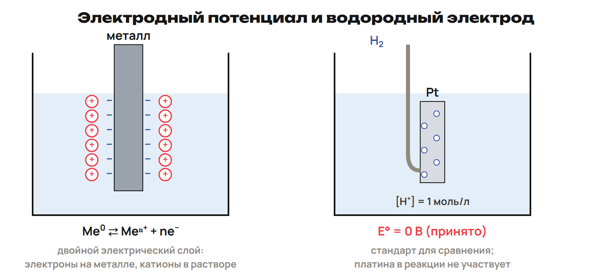
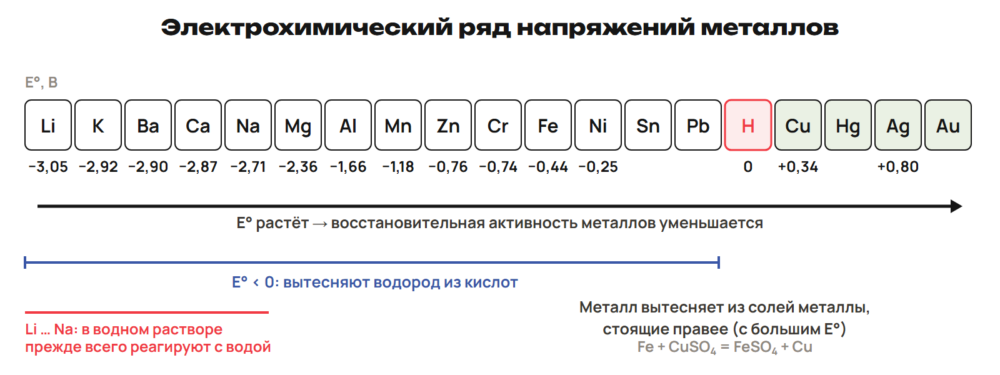
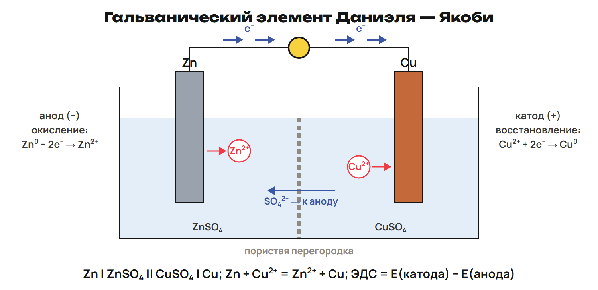
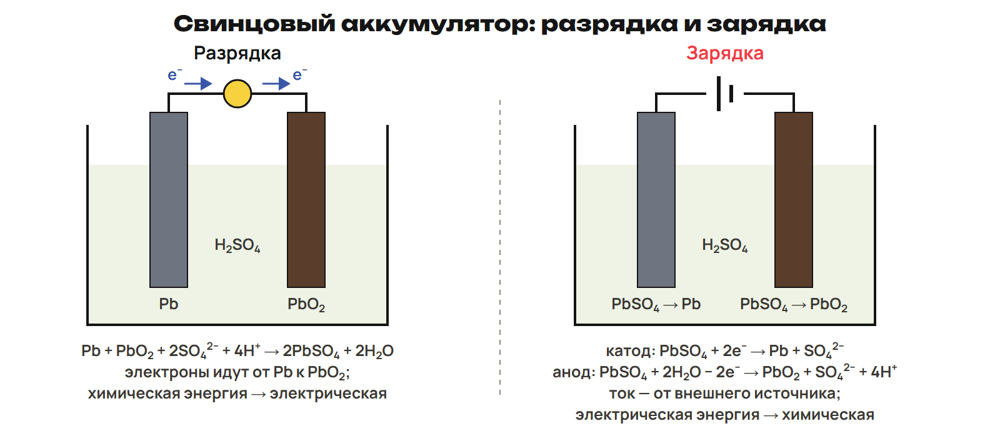

# Урок 19. Ряд напряжений, элемент и аккумулятор

18 января 2027; 90 минут. Группы 18:00–19:30 и 19:30–21:00.

Причина → алгоритм → разные примеры → ловушка → самостоятельная попытка. Ключи L показывать после попытки. Предварительное чтение перед первым уроком не требуется.

## План на 90 минут

| Время | Действие |
|---|---|
| 0–16 | 0–10 граница/стандарт/водородный, 10–13 L1, 13–16 ключ. |
| 16–32 | 16–26 ряд/кислота/вода, 26–29 L2, 29–32 ключ. |
| 32–48 | 32–42 устройство/процессы/перенос, 42–45 L3, 45–48 ключ. |
| 48–62 | 48–56 формула/пример/концентрационный, 56–59 L4, 59–62 ключ. |
| 62–77 | 62–71 типы/свинцовый/энергия, 71–74 L5, 74–77 ключ. |
| 77–90 | 77–81 интеграция, 81–84 L6, 84–88 ключ, 88–90 нагрузка. |

## 1. Потенциал · 0–16 минут

**Вопрос:** Как сравнить стремление металлов отдавать электроны?

**Связка:** Баланс ОВР связал роли. Теперь сравним электродные пары.

**Граница металл/раствор.** 

Потенциал относится к паре и условиям; Pt проводник/поверхность, не расходуемый реагент.

**Стандарт.** Me ⇄ Meⁿ⁺ + ne⁻; граница разделяет заряды. Потенциалы сравнивают с водородным, принятым за 0. Табличные E° — потенциалы восстановления Meⁿ⁺ + ne⁻ → Me. В школьной стандартной модели 25 °C и раствор 1 моль/л.

Произвольные концентрации требуют дополнительных данных, стандартную ЭДС не подменять поправленной.

### L1

Что означает принятый ноль H⁺/H₂ и что делает Pt? К какой частице относится запись Meⁿ⁺ + ne⁻ → Me?

**Ответ и решение:** Ноль — точка отсчёта потенциалов; Pt обеспечивает поверхность/проводимость. Это восстановление электродной пары, не потенциал металла без раствора.

**Типичная ошибка и новая проверка:** Считать Pt источником расходуемых протонов.

## 2. Ряд напряжений · 16–32 минут

**Вопрос:** Когда металл вытеснит другой из соли?

**Связка:** От точки отсчёта перейдём к порядку пар.

**Ряд Бекетова.** 

Читать все значения конспекта; у более правых пар в школьной модели сильнее ионы-окислители.

**Условия вытеснения.** Zn + CuSO₄ → ZnSO₄ + Cu; обратное замещение не идёт. До H: выделение H₂ из изученных разбавленных неокисляющих кислот. Li…Na в водных растворах прежде реагируют с водой. Учитывать плёнку/условия, не только положение элемента.

Не переносить правило H₂ на HNO₃ или концентрированную H₂SO₄.

### L2

Сравни Zn/CuSO₄, Cu/ZnSO₄ и Na/CuSO₄ в воде.

**Ответ и решение:** Zn вытесняет Cu; Cu не вытесняет Zn. Na прежде реагирует с водой, прямое осаждение по ряду не предсказывают.

**Типичная ошибка и новая проверка:** Применить один алгоритм без учёта растворителя.

## 3. Гальванический элемент · 32–48 минут

**Вопрос:** Как разделённая ОВР создаёт ток?

**Связка:** Ряд указал направление. Разделим два процесса по электродам.

**Даниэль — Якоби.** 

Электроны не текут через раствор как по металлическому проводу; ионы переносят заряд в электролите.

**Электроды.** Zn → Zn²⁺ + 2e⁻: анод −, цинк растворяется. Cu²⁺ + 2e⁻ → Cu: катод +, медь осаждается. Итог Zn + Cu²⁺ → Zn²⁺ + Cu. Химическая энергия превращается в электрическую.

Анод определён окислением, катод восстановлением; знак зависит от устройства.

### L3

Назови анод/катод и e⁻ в Zn/Cu-элементе. Как компенсируется заряд раствора у анода?

**Ответ и решение:** Zn анод −, Cu катод +, e⁻ Zn → Cu. Ионный перенос компенсирует накопление Zn²⁺; анионы направляются к анодной области.

**Типичная ошибка и новая проверка:** Перенести знак анода электролизёра на элемент.

## 4. ЭДС · 48–62 минут

**Вопрос:** Почему надо вычитать отрицательный потенциал?

**Связка:** Процессы разделены. Посчитаем разность.

**Никель/медь.** E°элемента = E°кат − E°ан. Ni −0,250 В, Cu +0,337 В. Ni анод, Cu катод; 0,337 − (−0,250) = 0,587 В. Химический элемент имеет разные пары; концентрационный может иметь одинаковые электроды.

У концентрационного Ag/AgNO₃ с разными c напряжение не находится простой разностью одинаковых E°.

### L4

Для Zn −0,76 В и Cu +0,337 В найди стандартную ЭДС.

**Ответ и решение:** Cu катод, Zn анод. E° = 0,337 − (−0,76) = 1,097 В.

**Типичная ошибка и новая проверка:** Считать 0,337 − 0,76 без скобок.

## 5. Аккумулятор · 62–77 минут

**Вопрос:** Как источник тока можно зарядить снова?

**Связка:** Направление энергии можно обратить внешним током.

**Заряд и разряд.** 

Кислотный свинцовый и щелочные Ni/Fe, Ni/Cd, Ag/Zn — разные системы; режимы обслуживания не назначать.

**Обратимая система.** Разряд: Pb + PbO₂ + 2H₂SO₄ → 2PbSO₄ + 2H₂O. Pb 0 → +2 окисляется; Pb +4 в PbO₂ → +2 восстанавливается. Зарядка: внешний ток запасает химическую энергию. Сульфатация — образование плохо работающего кристаллического слоя PbSO₄.

Нормальное образование PbSO₄ при разряде отличать от проблемного устойчивого слоя.

### L5

Назови окисляемый и восстанавливаемый Pb при разряде. Куда направлено превращение энергии при зарядке?

**Ответ и решение:** Pb металл 0 → +2, Pb в PbO₂ +4 → +2. Заряд электрическая → химическая, разряд химическая → электрическая.

**Типичная ошибка и новая проверка:** Отождествить обе степени Pb в исходных веществах.

## 6. Итог · 77–90 минут

**Вопрос:** Почему название электрода связано с процессом?

**Связка:** Соединим роль, знак и направление энергии.

### L6

Сформулируй определения анода и катода без знаков. Может ли одна пластина аккумулятора менять название при обращении реакции?

**Ответ и решение:** Анод окисление, катод восстановление. При обращении реакции процессы на пластинах меняются, значит меняются названия.

**Типичная ошибка и новая проверка:** Закрепить слово анод за одной пластиной навсегда.

После урока 19: конспект 1–3 — 25 минут, P — 20, G — 35. После урока 20: один A/B/C — 30, исправления — 25, повторение 4–6 и фактов — 15. Всего 150 минут.
