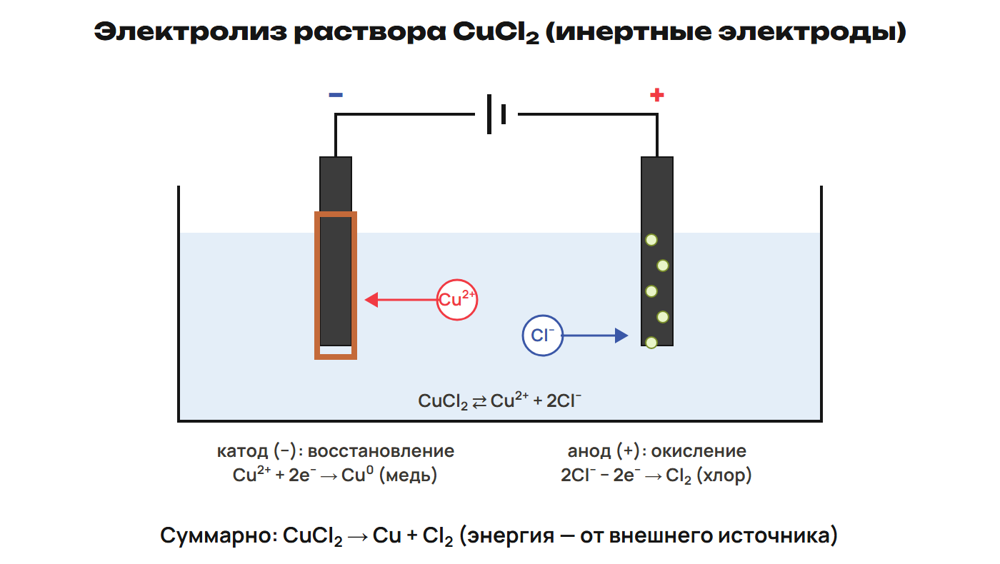
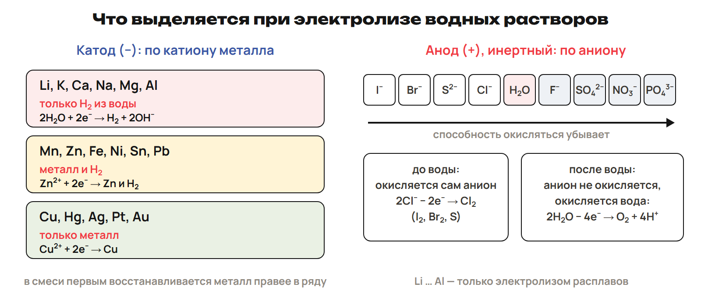
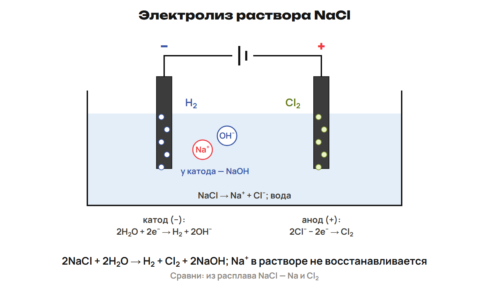

# Урок 20. Электролиз расплавов и растворов

21 января 2027; 90 минут. Группы 18:00–19:30 и 19:30–21:00.

Причина → алгоритм → разные примеры → ловушка → самостоятельная попытка. Ключи L показывать после попытки. Предварительное чтение перед первым уроком не требуется.

## План на 90 минут

| Время | Действие |
|---|---|
| 0–20 | 0–5 вопросы; 5–8 L7, 8–12 ключ; 12–15 L8, 15–20 ключ. |
| 20–34 | 20–22 вопросы, 22–25 G9, 25–28 ключ; 28–30 G10, 30–32 ключ; 32–34 G11. |
| 34–47 | 34–41 сущность/применение/расплав, 41–44 L9, 44–47 ключ. |
| 47–64 | 47–58 таблица/анионы/два раствора, 58–61 L10, 61–64 ключ. |
| 64–78 | 64–69 алгоритм/моль/выход; 69–71 L11, 71–73 ключ; 73–75 L12, 75–78 ключ. |
| 78–88 | Контроль без подсказок, отдельный ключ после сдачи. |
| 88–90 | Назначить один маршрут, приложение A не продлевает урок. |

## 1. Возврат · 0–20 минут

**Вопрос:** Как связать диссоциацию и электронный счёт?

**Связка:** Вернём ионы, моль и выход.

### L7

Запиши CuCl₂ → ионы и процесс Cu²⁺ → Cu. Назови окисление и восстановление по электронам.

**Ответ и решение:** CuCl₂ → Cu²⁺ + 2Cl⁻; Cu²⁺ + 2e⁻ → Cu. Окисление отдаёт e⁻, восстановление принимает.

**Типичная ошибка и новая проверка:** Потерять коэффициент Cl⁻.

### L8

При н. у. 1,12 л газа: найди n при Vₘ = 22,4. Теоретически 8 г продукта, выход 75 %: практическая масса?

**Ответ и решение:** n = 0,050 моль; 8 × 0,75 = 6 г.

**Типичная ошибка и новая проверка:** Делить на выход при поиске практической массы.

## 2. Разбор G · 20–34 минут

**Вопрос:** Как выбрать анод и посчитать ЭДС?

**Связка:** Применим таблицу к двум новым парам.

### G9

Fe −0,44 В; Cu +0,337 В: процессы, знаки, e⁻, ЭДС.

**Ответ и решение:** Fe анод −, Cu катод +; e⁻ Fe → Cu. Fe → Fe²⁺ + 2e⁻; Cu²⁺ + 2e⁻ → Cu; E° = 0,777 В.

**Типичная ошибка и новая проверка:** Вычитать модули.

### G10

Cd −0,40 В; Co −0,28 В: реакция и ЭДС.

**Ответ и решение:** Cd + Co²⁺ → Cd²⁺ + Co; Cd растворяется, Co осаждается. E° = −0,28 − (−0,40) = 0,12 В.

**Типичная ошибка и новая проверка:** Запретить реакцию из-за двух отрицательных E°.

## 3. Электролиз · 34–47 минут

**Вопрос:** Как ток заставляет реакцию идти?

**Связка:** Теперь направление энергии противоположное элементу.

**CuCl₂.** 

В принятой хлоридной модели, без опытов с газами; анод окисление, катод восстановление.

**Применение и расплав.** Электрическая энергия обеспечивает ОВР через раствор/расплав. Расплав NaCl без воды: 2NaCl → 2Na + Cl₂. Cu²⁺ + 2e⁻ → Cu; 2Cl⁻ → Cl₂ + 2e⁻. Рафинирование использует растворимый анод; гальваностегия покрывает изделие-катод. Гальванопластика — точные копии, Якоби 1837; Al получают в Павлодаре.

Электролитическое получение Al: Холл/Эру 1886; не смешивать покрытие и копию.

### L9

В расплаве NaCl назови катодный/анодный процессы и итог. Почему H₂ не обязан появляться?

**Ответ и решение:** Na⁺ + e⁻ → Na; 2Cl⁻ → Cl₂ + 2e⁻. 2NaCl → 2Na + Cl₂; воды в расплаве нет.

**Типичная ошибка и новая проверка:** Перенести водный процесс на расплав.

## 4. Вода конкурирует · 47–64 минут

**Вопрос:** Как выбрать продукты раствора и остаток?

**Связка:** Добавим воду и условия электродов.

**Выбор продуктов.** 

Таблица — учебная модель; концентрация, электроды, перенапряжение и условия могут менять конкуренцию.

**Полуреакции воды.** Катод: 2H₂O + 2e⁻ → H₂ + 2OH⁻. Инертный анод при SO₄²⁻/NO₃⁻: 2H₂O → O₂ + 4H⁺ + 4e⁻. Li, K, Ca, Na, Mg, Al в воде не осаждаются; Cu/Ag в модели дают металл. Mn, Zn, Fe, Ni, Sn, Pb допускают металл и H₂, точные доли не следуют из таблицы.

Ряд анионов: I⁻, Br⁻, S²⁻, Cl⁻ перед водой; F⁻, SO₄²⁻, NO₃⁻, PO₄³⁻ после. Для хлорида задать концентрацию/инертность.

**Раствор NaCl.** 

2NaCl + 2H₂O → H₂ + Cl₂ + 2NaOH; без разделения продуктов вторичные реакции меняют итог.

**Сульфат меди.** 2CuSO₄ + 2H₂O → 2Cu + O₂ + 2H₂SO₄. Cu²⁺ + 2e⁻ → Cu; вода у анода даёт O₂ и H⁺. Щёлочь образуется у водного катода, кислота у водного анода.

Кислота не означает окисление сульфата; кислород берётся из воды.

### L10

Сравни NaCl расплав/концентрированный раствор и CuSO₄ раствор. Укажи продукты при заданных инертных электродах.

**Ответ и решение:** NaCl расплав: Na/Cl₂; раствор с разделением: H₂/Cl₂, NaOH. CuSO₄ раствор: Cu/O₂, H₂SO₄.

**Типичная ошибка и новая проверка:** Получить Al/Na из воды или назвать SO₄²⁻ источником O₂.

## 5. Расчёт · 64–78 минут

**Вопрос:** Как электронный счёт связывает два электрода?

**Связка:** Продукты выбраны. Рассчитаем их количество.

**Порядок.** Условия → полуреакции/общий счёт → моль известного → отношение → масса/объём. Один O₂ соответствует 4e⁻, один Cu²⁺ требует 2e⁻, Ag⁺ требует 1e⁻. Практический продукт = теоретический × η. По практическому и η теоретический = практический / η.

Для средней катодной группы без разделения токов данных может не хватать.

### L11

Из раствора CuSO₄ на инертном аноде 6,72 л O₂ при н. у. M(Cu) = 64, Vₘ = 22,4; найди массу Cu без побочных процессов.

**Ответ и решение:** n(O₂) = 0,30; n(Cu) = 0,60 моль; m(Cu) = 38,4 г. Отношение Cu:O₂ = 2:1 по электронному счёту.

**Типичная ошибка и новая проверка:** Взять одинаковое количество двух продуктов.

### L12

В разделённой хлоридной модели получили 2,24 л Cl₂ при н. у. Найди массу NaOH при M = 40, Vₘ = 22,4.

**Ответ и решение:** n(Cl₂) = 0,10, n(NaOH) = 0,20; m = 8 г. 2NaCl + 2H₂O → H₂ + Cl₂ + 2NaOH.

**Типичная ошибка и новая проверка:** Потерять коэффициент щёлочи.

## 6. Рубеж и маршрут · 78–90 минут

**Вопрос:** Можешь ли ты выбрать продукт до расчёта?

**Связка:** Проверь условия, процессы и моли.

**Контроль Q1–Q6.** Отдельный лист, без таблиц. Q1–Q3 одна буква; Q4 все верные; Q5 две пары; Q6 расчёт. 10 минут, 10 баллов.

Ответов на экране нет.

После урока 19: конспект 1–3 — 25 минут, P — 20, G — 35. После урока 20: один A/B/C — 30, исправления — 25, повторение 4–6 и фактов — 15. Всего 150 минут.

Контроль 78–88 минуты, 10 баллов; ключ отделить до выдачи. A — уверенная база, B — отдельные ошибки, C — нужна таблица; учитывать также диагностику, G и объяснение ученика. Приложение только для A, чтение внутри его 30 минут. Реальный темп проверить на пробном занятии; сокращать повторные примеры, сохраняя попытки L/Q.
