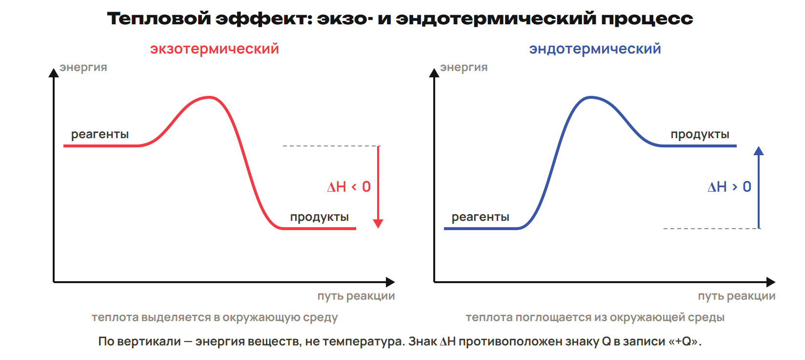
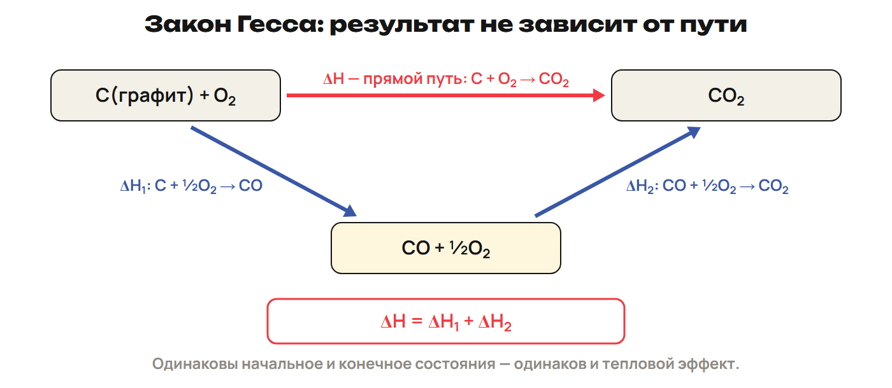

# Энергия и направление теплопередачи
? Где оказывается энергия при горении?
↳ Реагенты превращаются в продукты. Сначала проследим обмен энергией с окружением.
> 0–8 энергия, экзо/эндо и знаки; 8–11 L1; 11–14 ключ.

## Понятие: Система и окружение
Энергия не возникает из ничего и не исчезает: она переходит из одного вида в другой.
Химическая реакция сопровождается изменением энергии веществ.
Экзотермический процесс выделяет теплоту: например, горение топлива.
Эндотермический поглощает: например, разложение CaCO₃ при нагревании.
При разрыве связей энергия затрачивается, при образовании выделяется.
> Различать полный энергетический баланс реакции и энергию отдельного разрыва связи. Источник энергии фотосинтеза — свет.

## Схема: Энергия реагентов и продуктов

## Понятие: Q и ΔH: две записи
В термохимической записи Q положителен, когда теплота выделяется.
Экзо: +Q справа; при постоянном давлении ΔH < 0.
Эндо: −Q справа; при постоянном давлении ΔH > 0.
При принятом знаке выделенной теплоты ΔH = −Q.
Q измеряют в Дж или кДж; теплоту измеряют калориметром.
> Равенство применять при постоянном давлении и только работе расширения. Полученная системой теплота имеет знак ΔH, а не знак Q выделенной теплоты.

## Практика: L1
N₂(г) + O₂(г) → 2NO(г) − 180 кДж.
Теплота выделяется или поглощается? Назови тип процесса, знак Q и ΔH при p = const.
Ответы:
Поглощается 180 кДж на записанную реакцию; процесс эндотермический.
Q = −180 кДж, ΔH = +180 кДж.
> 8–11 попытка, 11–14 ключ.

# Термохимическое уравнение
? К какому количеству вещества относится число теплоты?
↳ Направление теплообмена определили. Прочитаем теплоту вместе с коэффициентами.
> 14–22 состояния, коэффициенты и обращение уравнения; 22–25 L2; 25–28 ключ.

## Понятие: Вся запись имеет значение
Термохимическое уравнение содержит уравнение реакции и тепловой эффект.
2H₂(г) + O₂(г) → 2H₂O(ж) + 572 кДж.
572 кДж относятся к 2 моль H₂, 1 моль O₂ и 2 моль H₂O.
Для 1 моль H₂ выделяется 572 ÷ 2 = 286 кДж.
Коэффициенты умножили в k раз → тепловой эффект тоже умножить в k раз.
> 572 кДж — округлённое учебное значение для жидкой воды. Не приписывать его водяному пару.

## Пример: Обратить и разделить
Прямо: 2H₂ + O₂ → 2H₂O(ж), ΔH ≈ −572 кДж.
Обратно: 2H₂O(ж) → 2H₂ + O₂, ΔH ≈ +572 кДж.
Половина прямой записи: H₂ + ½O₂ → H₂O(ж), ΔH ≈ −286 кДж.
Изменить направление — сменить знак; изменить масштаб — умножить величину.

## Понятие: Состояние тоже часть условия
Тепловой эффект зависит от природы веществ, температуры и агрегатных состояний.
H₂ + ½O₂ → H₂O(ж): ΔH° = −285,8 кДж.
H₂ + ½O₂ → H₂O(г): ΔH° = −241,8 кДж.
Образование пара и жидкой воды имеет разные эффекты.
Учебные стандартные условия: 298 К, 25 °C и 101,3 кПа.
> Сохранить точность данных условия. Эти стандартные условия не газовые н. у. с Vₘ = 22,4 л/моль.

## Практика: L2
По записи 2H₂ + O₂ → 2H₂O(ж) + 572 кДж найди Q для образования 0,5 моль H₂O.
Каков знак ΔH для обратного превращения этой порции?
Ответы:
Q = 572 × 0,5 ÷ 2 = 143 кДж выделяется.
Для обратного превращения ΔH = +143 кДж при p = const.
> 22–25 попытка, 25–28 ключ.

# Расчёт теплоты через моль
? Как перейти от массы или объёма к теплоте?
↳ Коэффициенты задают моли. Переведём условие в ту же величину.
> 28–37 алгоритм и пример по массе; 37–40 L3 по объёму; 40–44 ключ.

## Понятие: Алгоритм расчёта
1. Прочитай уравнение, коэффициент ν и теплоту Qзаписи.
2. Найди n: m/M или V/Vₘ при заданных условиях газа.
3. Qпорции = Qзаписи × n/ν.
4. Подпиши: теплота выделилась или поглотилась.
5. Если требуется ΔH, учти знак и масштаб порции.
> Для смесей и топлива удельную теплоту могут задавать на массу, например на 1 кг. Это не запрет использовать моль для чистого газообразного вещества.

## Пример: По массе водорода
Дано: 5 г H₂, избыток O₂; M(H₂) = 2 г/моль.
2H₂ + O₂ → 2H₂O(ж) + 572 кДж; реакция полная.
n(H₂) = 5 ÷ 2 = 2,5 моль.
Q = 572 × 2,5 ÷ 2 = 715 кДж.
Выделилось 715 кДж; при p = const ΔH порции = −715 кДж.

## Практика: L3
По тому же уравнению сгорело 6,72 л H₂ при н. у.; O₂ в избытке.
Vₘ = 22,4 л/моль. Найди количество H₂ и выделенную теплоту.
Ответы:
n(H₂) = 6,72 ÷ 22,4 = 0,3 моль.
Q = 572 × 0,3 ÷ 2 = 85,8 кДж выделяется.
> 37–40 попытка, 40–44 ключ.

# Уравнение из опыта и энтальпия
? Как записать тепловой эффект для целых коэффициентов?
↳ Мы считали теплоту по уравнению. Теперь восстановим число в уравнении по опыту.
> 44–51 данные опыта и смысл энтальпии; 51–54 L4; 54–58 ключ.

## Понятие: От опыта к записи
Сначала уравняй реакцию.
Из массы прореагировавшего вещества найди количество.
Сравни это количество с коэффициентом в выбранной записи.
Умножь теплоту опыта на такое же отношение.
Проверь знак, агрегатные состояния и единицы.

## Понятие: Что показывает ΔH
Энтальпия H — величина, характеризующая энергетическое состояние системы.
ΔH = Hпродуктов − Hреагентов.
При p = const и только работе расширения ΔH равно теплоте, полученной системой.
Экзо: система передаёт теплоту, её ΔH отрицательно.
ΔH — изменение энтальпии, а не температуры.
Величину на реакцию записывают в кДж; молярную — в кДж/моль.

## Практика: L4
При полном окислении 6,5 г Zn выделилось 34,8 кДж; M(Zn) = 65 г/моль.
Составь термохимическое уравнение с целыми минимальными коэффициентами.
Продукт ZnO(тв); укажи ΔH для всей записи при p = const.
Ответы:
n(Zn) = 6,5 ÷ 65 = 0,1 моль.
В записи 2Zn + O₂ → 2ZnO стоят 2 моль Zn.
Q = 34,8 × 2 ÷ 0,1 = 696 кДж.
2Zn(тв) + O₂(г) → 2ZnO(тв) + 696 кДж; ΔH = −696 кДж.
> 51–54 попытка, 54–58 ключ.

# Закон Гесса
? Изменится ли эффект, если пройти через промежуточное вещество?
↳ Теплота относится к изменению состояния. Сравним два пути между одинаковыми состояниями.
> 58–66 прямой и составной пути, действия с уравнениями; 66–69 L5; 69–73 ключ.

## Понятие: Начало и конец определяют эффект
Закон Гесса: тепловой эффект зависит от начального и конечного состояний.
Путь между ними не меняет суммарный эффект.
Ступени можно сложить: промежуточные вещества сокращаются.
При обращении ступени меняют знак ΔH.
При умножении уравнения умножают и ΔH.

## Схема: Углерод к CO₂ двумя путями

> Агрегатные состояния и количество вещества должны совпадать после сложения. Числа для промежуточных ступеней не требуются.

## Пример: Сложение и обращение
В учебной схеме X → Y: ΔH₁ = −40 кДж.
Y → Z: ΔH₂ = +15 кДж.
Сумма X → Z: ΔH = −40 + 15 = −25 кДж.
Обратно Z → X: ΔH = +25 кДж.
X, Y и Z обозначают состояния одного и того же количества системы.

## Практика: L5
Для учебной схемы X → Y дано ΔH₁ = +60 кДж, для Y → Z — ΔH₂ = −95 кДж.
Найди ΔH пути X → Z и обратного пути Z → X.
Ответы:
X → Z: +60 − 95 = −35 кДж.
Z → X: +35 кДж.
> 66–69 попытка, 69–73 ключ.

# Энтальпии образования и итог
? Как найти ΔH, если даны значения для отдельных веществ?
↳ Сложение путей даёт готовое правило: продукты минус реагенты с коэффициентами.
> 73–80 энтальпии образования и следствие; 80–83 L6; 83–88 ключ и итог; 88–90 ДЗ.

## Понятие: Образовать ровно 1 моль
Стандартная энтальпия образования ΔH°f — эффект образования 1 моль вещества.
Исходные вещества — простые, в стандартных состояниях.
Для элемента в его стандартной форме ΔH°f = 0.
Ноль не относится автоматически ко всем аллотропным формам.
Агрегатное состояние продукта обязательно сохраняют.

## Понятие: Следствие закона Гесса
ΔH°реакции = ΣνΔH°f(продуктов) − ΣνΔH°f(реагентов).
1. Уравняй реакцию и подпиши состояния.
2. Умножь каждую ΔH°f на коэффициент.
3. От суммы продуктов вычти сумму реагентов.
4. Сохрани знаки табличных величин внутри скобок.

## Пример: Образование жидкой воды
2H₂(г) + O₂(г) → 2H₂O(ж).
Дано: ΔH°f(H₂O, ж) = −285,8 кДж/моль; H₂ и O₂ в стандартных формах — 0.
ΔH° = 2 × (−285,8) − [2 × 0 + 0] = −571,6 кДж.
Это около −572 кДж после округления.
Получен экзотермический эффект на всю запись.

## Практика: L6
2H₂O(г) → 2H₂(г) + O₂(г).
Дано ΔH°f(H₂O, г) = −241,8 кДж/моль; H₂ и O₂ в стандартных формах — 0.
Найди ΔH° и определи тип процесса.
Ответы:
ΔH° = [2 × 0 + 0] − 2 × (−241,8) = +483,6 кДж.
Процесс эндотермический; для разложения данной порции пара нужна энергия.
> 80–83 попытка, 83–88 ключ.

## Дома: После урока 21
Конспект 1–3 — 25 минут; закрепление P — 20; общая часть G — 35.
До урока 22 пришли решения и два вопроса.
Скорость, её факторы и катализ объясняются на уроке 22.
После него один A/B/C — 30 минут; исправления — 25; повторение — 15.
Всего 150 минут самостоятельной работы.
> 88–90 минуты. Не требовать предварительного чтения перед первым уроком.
