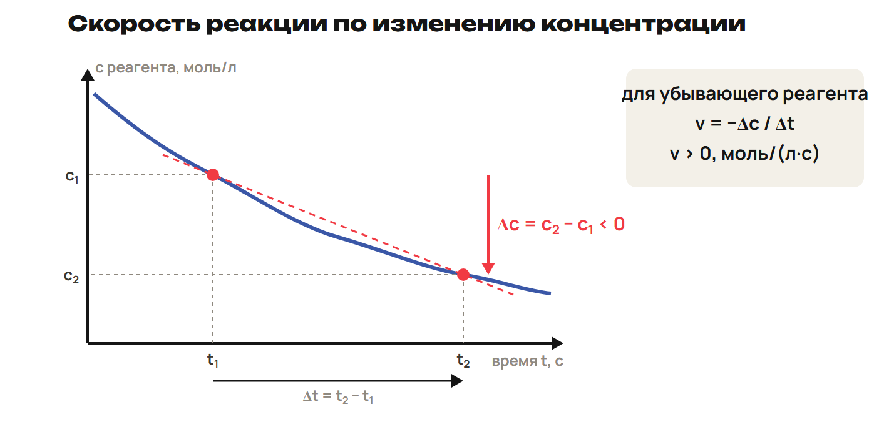
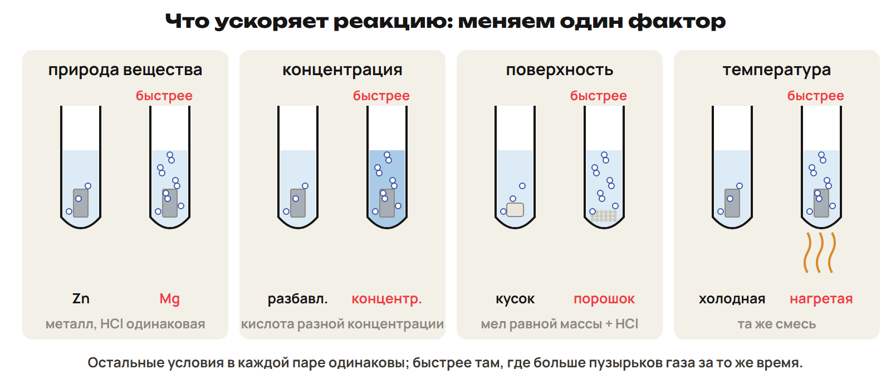
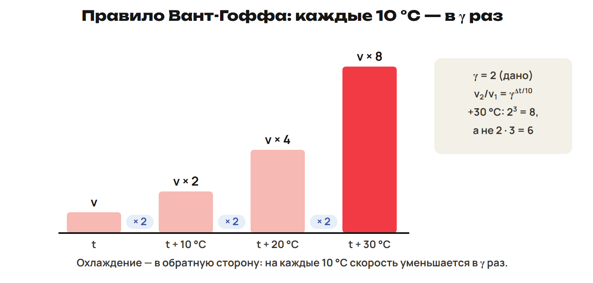
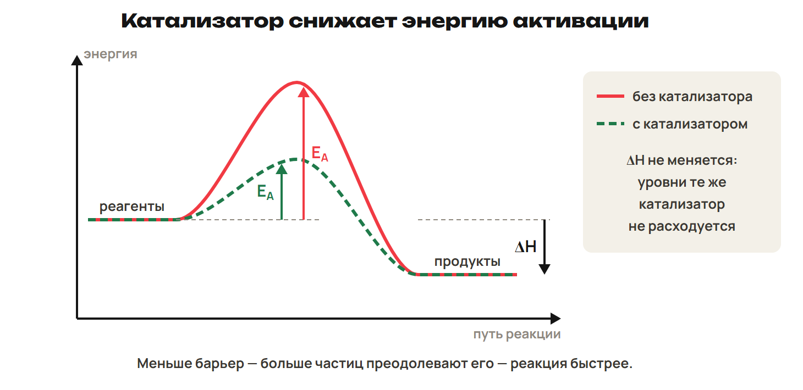
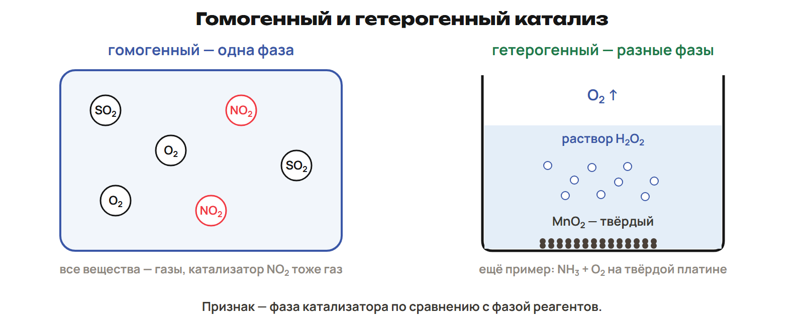

# Возврат и вопросы
? Что надо восстановить до расчётов теплоты и скорости?
↳ Начнём с молей, концентрации и знакомых превращений; затем вернём вопросы по G.
> 0–5 вопросы и знаки Q/ΔH; 5–8 L7, 8–12 ключ; 12–16 L8, 16–20 ключ.

## Практика: L7
Газ занимает 4,48 л при н. у.; Vₘ = 22,4 л/моль. Найди n.
В растворе 0,15 моль вещества в объёме 0,5 л. Найди молярную концентрацию.
Чем отличается эта концентрация от массовой доли?
Ответы:
n = 4,48 ÷ 22,4 = 0,2 моль.
c = 0,15 ÷ 0,5 = 0,3 моль/л.
Массовая доля — отношение массы вещества к массе раствора, безразмерная величина.
> 5–8 попытка, 8–12 ключ.

## Практика: L8
Запиши сокращённое ионное уравнение реакции сильной кислоты с щёлочью.
В Zn + 2H⁺ → Zn²⁺ + H₂ укажи восстановитель и число отданных электронов.
Какая из двух реакций является ОВР?
Ответы:
H⁺ + OH⁻ → H₂O.
Восстановитель Zn: Zn⁰ − 2e⁻ → Zn²⁺.
ОВР — реакция цинка с H⁺; нейтрализация не меняет степени окисления.
> 12–16 попытка, 16–20 ключ.

# Разбор G и средняя скорость
? Как изменение концентрации превратить в скорость?
↳ Теплоту G проверили через моль и Гесса. Теперь различим энергетический эффект и темп реакции.
> 20–23 G9, 23–26 G10 и G11; 26–33 скорость, график и фазы; 33–35 L9; 35–38 ключ.

## Практика: G9 · теплота порции
Fe(тв) + S(тв) → FeS(тв) + 97,4 кДж.
Полностью прореагировало 11,2 г Fe с избытком S; M(Fe) = 56 г/моль.
Найди выделенную теплоту и ΔH порции при p = const.
Ответы:
n(Fe) = 11,2 ÷ 56 = 0,2 моль.
Q = 97,4 × 0,2 = 19,48 кДж выделяется.
ΔH порции = −19,48 кДж.
> 20–23: сначала объяснение ученика, затем ключ и проверка масштаба.

## Практика: G10 · продукты минус реагенты
ZnO(тв) + CO(г) → Zn(тв) + CO₂(г).
Учебные округлённые ΔH°f, кДж/моль: ZnO −348; CO −110; CO₂ −394; Zn 0.
Найди ΔH°, тип процесса и знак Q при p = const.
Ответы:
ΔH° = [0 − 394] − [−348 − 110] = +64 кДж.
Процесс эндотермический, Q = −64 кДж на всю запись.
> 23–26: проверить скобки и G11; ноль для Zn в стандартном состоянии.

## Понятие: Кинетика и два разных вопроса
Химическая кинетика изучает скорость реакций и влияние условий на неё.
Тепловой эффект показывает энергетическое изменение, а не время реакции.
Нейтрализация может идти быстро; коррозия железа — медленно.
Для реагента: vубывания = (c₁ − c₂)/(t₂ − t₁).
Для продукта: vнакопления = (c₂ − c₁)/(t₂ − t₁).
Единицы зависят от времени: например моль/(л·с).

## Схема: Убывание концентрации

> Назвать вещество, по которому считают скорость. Нулевое изменение за интервал даёт нулевую среднюю скорость.

## Понятие: Объём и поверхность
Гомогенная реакция идёт в одной фазе, например в однородном растворе.
Её скорость относят к объёму: |Δn|/(V·Δt), если объём постоянен.
Гетерогенная идёт на границе фаз, например мел и раствор кислоты.
Её скорость относят к поверхности: |Δn|/(S·Δt).
Величина |Δc|/Δt для выбранного вещества ещё не делится на его коэффициент.
Для единой стехиометрически нормированной скорости учитывают коэффициенты.
> В задачах явно различать скорость убывания конкретного вещества и нормированную скорость реакции. Для поверхности единица, например моль/(м²·с).

## Практика: L9
В однородном растворе c реагента снизилась с 0,72 до 0,42 моль/л за 15 с.
Найди среднюю скорость убывания именно этого вещества.
К чему относят скорость реакции твёрдого мела с кислотой?
Ответы:
v = (0,72 − 0,42) ÷ 15 = 0,02 моль/(л·с).
Скорость гетерогенной реакции относят к площади поверхности контакта.
> 33–35 попытка, 35–38 ключ.

# Факторы и закон скорости
? Что изменилось в опыте и как это входит в расчёт?
↳ Среднюю скорость измерили. Объясним, как изменить частоту эффективных столкновений.
> 38–46 природа, поверхность, концентрации, давление и заданный закон; 46–49 L10; 49–52 ключ.

## Схема: Сравнить условия опытов

> Сравнение факторов требует одинаковых остальных существенных условий.

## Понятие: Частицы, фазы и столкновения
Природа: Mg с HCl реагирует быстрее Zn в одинаковых условиях.
Концентрация: больше частиц в объёме — больше столкновений.
Поверхность: порошок мела реагирует быстрее куска той же массы.
В школьном законе концентрацию чистого твёрдого вещества не записывают.
Его измельчение меняет поверхность, а не «концентрацию в растворе».
Не каждое столкновение приводит к реакции: нужны энергия и ориентация.

## Понятие: Граница закона действующих масс
Гульдберг и Вааге, 1867: скорость связана с концентрациями реагентов.
Для элементарной aA + bB: v = k·cᵃ(A)·cᵇ(B).
Показатели равны коэффициентам только для элементарной реакции.
Для сложной реакции закон задают по данным; медленная стадия может лимитировать процесс.
При неизменной температуре сравнивают скорости при одном k.
Задано v = k·c²(A)·c(B): c(A) × 2 и c(B) × 3 дают v × 2² × 3 = 12.

## Понятие: Давление: проверь причину
Для каждого газа в смеси c = n/V = p/(RT), где p — его парциальное давление.
Сжатие при постоянной температуре повышает концентрации газовых реагентов.
Их влияние считают по заданному закону скорости.
Добавление инертного газа при постоянных V и T не меняет концентрации реагентов.
Само увеличение полного давления ещё не означает ускорения.
> Школьная модель относится к концентрационному влиянию на газовые реакции. Не переносить на неё неизвестные механизмы и влияние среды.

## Практика: L10
Дано v = k·c²(A)·c(B), A и B — газы. T постоянна.
Смесь сжали: объём стал в 2 раза меньше. Во сколько раз выросла скорость?
Сравни с добавлением инертного газа при прежних V и T.
Ответы:
При сжатии обе концентрации удвоились: v₂/v₁ = 2² × 2 = 8.
При добавлении инертного газа концентрации A и B прежние; скорость по этому закону не меняется.
> 46–49 попытка, 49–52 ключ.

# Температура и правило Вант-Гоффа
? Сколько десятиградусных шагов произошло?
↳ Количество столкновений зависит от состава. Температура меняет и долю достаточно энергичных частиц.
> 52–58 правило, степень и обратное изменение времени; 58–61 L11; 61–64 ключ.

## Понятие: Возвести коэффициент в степень
В небольшом интервале при нагревании на 10 °C скорость часто растёт в 2–4 раза.
γ — температурный коэффициент.
v₂/v₁ = γ^((t₂ − t₁)/10).
При охлаждении показатель отрицателен: скорость уменьшается.
Правило приближённое и не применяется без границ к любой температуре.

## Схема: Последовательные температурные шаги

## Пример: Скорость и время
При γ = 3 нагревание на 20 °C даёт v₂/v₁ = 3² = 9.
До одинаковой степени превращения время обратно скорости.
Если раньше требовалось 18 минут, теперь 18 ÷ 9 = 2 минуты.
Одинаковая степень превращения и остальные условия обязательны.
> Обратную пропорциональность использовать в заданной учебной модели с одинаковым изменением количества вещества.

## Практика: L11
γ = 2; при 30 °C одинаковое превращение занимает 12 минут.
Сколько времени потребуется при 50 °C?
Во сколько раз изменится скорость при охлаждении с 30 до 10 °C?
Ответы:
Нагревание: v₂/v₁ = 2² = 4; время 12 ÷ 4 = 3 минуты.
Охлаждение: v₂/v₁ = 2⁻² = ¼, то есть скорость в 4 раза меньше.
> 58–61 попытка, 61–64 ключ.

# Активация и катализ
? Почему катализатор ускоряет реакцию, не меняя её тепловой эффект?
↳ Температура помогла частицам преодолеть барьер. Катализатор предлагает другой путь с меньшим барьером.
> 64–71 энергия активации и виды катализа; 71–75 L12; 75–78 ключ.

## Схема: Барьер и тепловой эффект

> Катализатор меняет путь и барьер, но не разность энергий начального и конечного состояний.

## Понятие: Эффективное столкновение
Энергия активации Eₐ — минимальный энергетический барьер реакции; единицы кДж/моль.
Нужны столкновение, достаточная энергия и подходящая ориентация.
Активированный комплекс — кратковременное состояние на пути к продуктам.
Катализатор увеличивает скорость через другой путь с меньшей Eₐ.
Он участвует в промежуточных стадиях и восстанавливается в суммарном процессе.
> При прочих равных более высокий барьер означает меньшую скорость. Не утверждать, что катализатор вообще не взаимодействует с реагентами.

## Схема: Одна фаза или граница фаз

## Понятие: Примеры и вещества-помощники
Гомогенный катализ: реагенты и катализатор в одной фазе.
Гетерогенный: в разных фазах, реакция связана с поверхностью катализатора.
MnO₂ ускоряет 2H₂O₂ → 2H₂O + O₂; платина — окисление NH₃.
Рассматриваемые ферменты — белковые биокатализаторы, обладают специфичностью.
В сыром картофеле фермент действует; при варке белковая структура нарушается.
Работы казахстанской школы катализа связаны с академиком Д. В. Сокольским.

## Понятие: Ингибитор, яд и промотор
Ингибитор замедляет реакцию.
Каталитический яд снижает активность катализатора.
Промотор повышает его активность.
Ускорение не означает расход катализатора в суммарной реакции.
Активность конкретного катализатора зависит от условий.
> Ферменты этой темы белковые; не распространять это утверждение на все возможные биологические катализаторы.

## Практика: L12
Раствор H₂O₂ разлагается быстрее после добавления твёрдого MnO₂.
Назови вид катализа и изменение Eₐ и ΔH при сравнении одинаковых начальных/конечных состояний.
Как назвать вещество, которое замедлило реакцию?
Ответы:
Катализ гетерогенный: раствор и твёрдый катализатор — разные фазы.
Eₐ каталитического пути ниже; ΔH не меняется.
Замедляющее вещество — ингибитор.
> 71–75 попытка, 75–78 ключ.

# Контроль и маршрут
? Различаешь ли ты теплоту, скорость и условия опыта?
↳ Причины и формулы разобраны. Проверь их без подсказок.
> 78–88 Q1–Q6 без подсказок; 88–90 один A/B/C и исправления.

## Понятие: Контроль Q1–Q6
Работай по листу контроля самостоятельно 10 минут.
Q1–Q3 — одна буква; Q4 — все верные; Q5 — две пары; Q6 — решение.
Максимум 10 баллов.
Сдай ответы до открытия ключа.
> Это обычный контроль недели. Обсуждение и ключ после сдачи.

## Дома: После урока 22
Прочитай конспект 4–6 и выполни один назначенный A/B/C за 30 минут.
Четыре приложения в конце презентации входят в эти 30 минут только для A.
Исправления — 25 минут; повторение и факты — 15.
Для C используй таблицы знаков и алгоритмы конспекта.
Вместе с работой после урока 21 — 165 минут с расчётным треком.

## Понятие: Углубление A · Внутренняя энергия и энтропия
U — сумма кинетической и потенциальной энергий частиц; рассчитывают изменение ΔU.
H = U + pV: не смешивай U и H.
При V = const теплота, полученная системой, равна ΔU; при p = const — ΔH.
S — энтропия, связанная с числом возможных состояний и беспорядком.
Для одного вещества обычно S(газ) > S(жидкость) > S(твёрдое).
У идеального кристалла при 0 К S = 0; в изолированной системе самопроизвольный процесс повышает S.
> Приложение читать внутри времени A; равенства для теплоты предполагают только работу расширения. Энтропия одной подсистемы может уменьшаться.

## Понятие: Углубление A · Энергия Гиббса
ΔG = ΔH − TΔS.
T задают в кельвинах, а единицы ΔH и TΔS приводят к одному масштабу.
ΔS в Дж/(моль·К) нужно разделить на 1000 для сочетания с кДж/моль.
При постоянных T и p знак ΔG < 0 указывает возможное самопроизвольное направление.
Отрицательное ΔG не означает быструю реакцию.
Скорость зависит от кинетического пути и энергетического барьера.
> Сначала проверить единицы и температуру, затем знак. Не делать вывод о времени реакции только по ΔG.

## Понятие: Углубление A · Диаграмма и Аррениус
Eₐ — от уровня реагентов до вершины энергетического барьера.
ΔH — от уровня реагентов до уровня продуктов.
Для обратного пути Eₐ отсчитывают от уровня продуктов.
k = A·e^(−Eₐ/RT).
Качественно: при прочих равных увеличение T или уменьшение Eₐ повышает k.
Катализатор уменьшает барьер, сохраняя ΔH для тех же состояний.
> Численные расчёты по Аррениусу не назначать. При сравнении путей сохранять одинаковое начало и конец.

## Понятие: Углубление A · Калориметр
qраствора = c·m·Δt; c, m и Δt должны иметь согласованные единицы.
Нагрелся раствор: qраствора > 0, реакция передала ему энергию.
В модели без потерь и теплоёмкости прибора qреакции = −qраствора.
Молярное изменение энтальпии при p = const: ΔHм = −qраствора/n.
Чётко укажи, к какому количеству n отнесён эффект.
Для нейтрализации n удобно считать по количеству образовавшейся воды.
> Это расчётная модель, не инструкция опыта. При заданной теплоёмкости прибора её вклад прибавляют к поглощённой теплоте.
