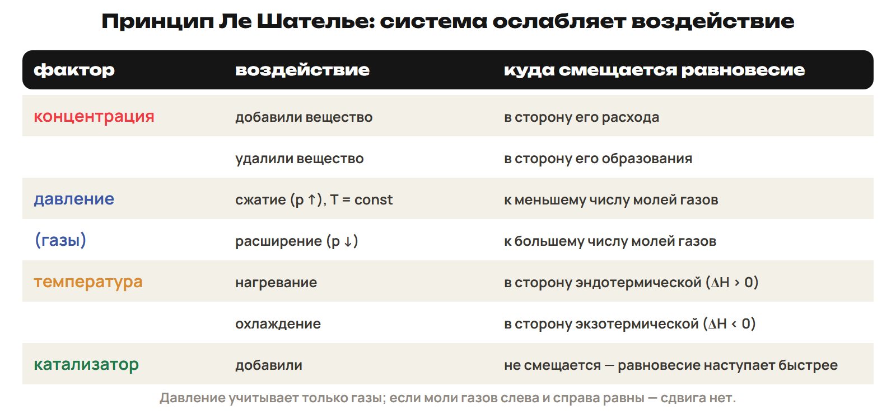
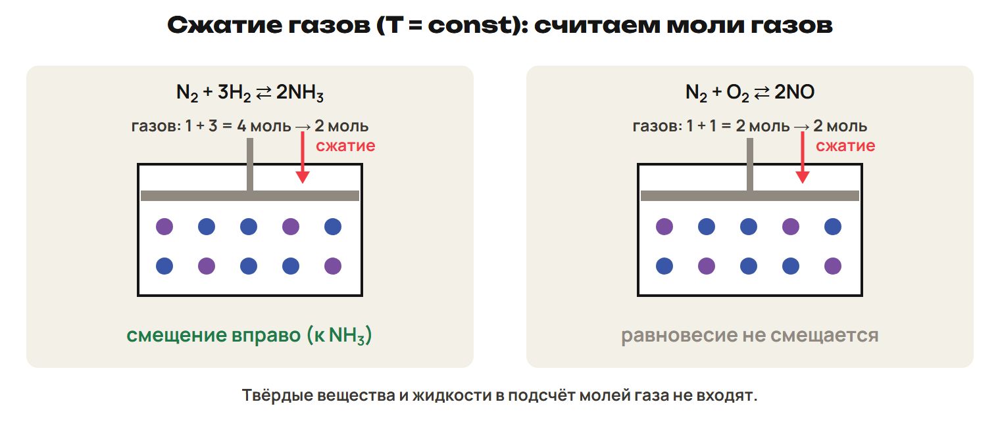
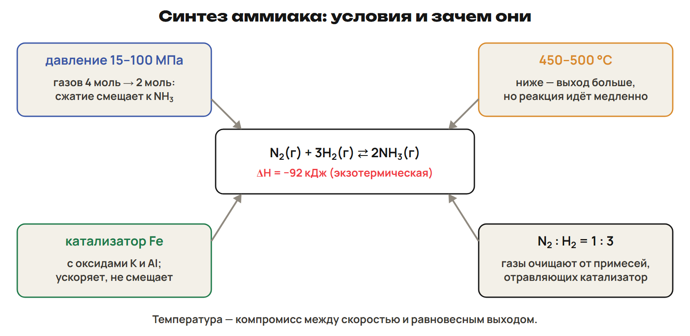

# Урок 24. Смещение равновесия, аммиак и рубеж по неделям 11–12

4 февраля 2027, четверг; 90 минут. Группы 18:00–19:30 и 19:30–21:00.

Причина → алгоритм → разные примеры → ловушка → самостоятельная попытка. Ключи L показывать после попытки. Предварительное чтение перед первым уроком не требуется.

## План на 90 минут

| Время | Действие |
|---|---|
| 0–20 | 0–4 вопросы; 4–9 G9; 9–14 G10; 14–18 L7; 18–20 ключ. |
| 20–32 | 20–27 принцип и алгоритм концентрации; 27–30 L8; 30–32 ключ. |
| 32–44 | 32–39 изотермическое сжатие и подсчёт только газов; 39–42 L9; 42–44 ключ. |
| 44–56 | 44–51 знак ΔH, температура и роль катализатора; 51–54 L10; 54–56 ключ. |
| 56–78 | 56–63 аммиак и опыты; 63–66 L11; 66–67 ключ; 67–72 алгоритм «было — изменилось — стало»; 72–75 L12; 75–78 ключ. |
| 78–88 | Контроль без подсказок, отдельный ключ после сдачи. |
| 88–90 | Назначить один маршрут, приложение A не продлевает урок. |

## 1. Возврат к K, теплоте и скорости · 0–20 минут

**Вопрос:** Как отличить ошибку в степени от ошибки в знаке или единице?

**Связка:** Начнём с вопросов по G и восстановим опоры для рубежа.

### G9 · квадрат концентрации

H₂(г) + I₂(г) ⇄ 2HI(г). Равновесные [H₂] = 0,20; [I₂] = 0,50; [HI] = 0,70 моль/л. Проверь формулу, квадрат и итоговый K в своём решении.

**Ответ и решение:** K = [HI]²/([H₂] · [I₂]) = 0,70²/(0,20 × 0,50). K = 0,49/0,10 = 4,9.

**Типичная ошибка и новая проверка:** Забыть квадрат или заменить равновесную концентрацию исходной.

### G10 · чистая твёрдая фаза

C(тв) + CO₂(г) ⇄ 2CO(г); чистый C присутствует. Равновесные [CO₂] = 0,30; [CO] = 0,90 моль/л. Какие данные входят в K? Проверь результат.

**Ответ и решение:** K = [CO]²/[CO₂] = 0,90²/0,30 = 2,7. Масса чистой твёрдой фазы C в это выражение не входит.

**Типичная ошибка и новая проверка:** Поставить C в знаменатель или решить, что отсутствие C в формуле означает отсутствие углерода в сосуде.

### L7

N₂(г) + 3H₂(г) → 2NH₃(г) + 92 кДж; образовалось 0,50 моль NH₃. Найди выделенную теплоту и ΔH этой порции при p = const. В другом опыте c реагента снизилась с 0,60 до 0,48 моль/л за 20 с. Найди среднюю скорость убывания именно этого вещества.

**Ответ и решение:** Q = 92 × 0,50/2 = 23 кДж выделяется; ΔH порции = −23 кДж. Средняя скорость убывания: (0,60 − 0,48)/20 = 0,006 моль/(л·с).

**Типичная ошибка и новая проверка:** Забыть 2 перед NH₃, перепутать Q и ΔH или указать отрицательную скорость убывания.

## 2. Концентрация: расходовать добавленное · 20–32 минут

**Вопрос:** В какую сторону система отвечает на добавление или удаление вещества?

**Связка:** K при заданной температуре фиксировано. После вмешательства смесь стремится к новому равновесному составу.

**Принцип Ле Шателье — Брауна.** Изменение условий смещает равновесие в сторону, противодействующую этому изменению. Ле Шателье сформулировал принцип в 1885 году, Браун — в 1887 году. Добавили компонент — смещение в сторону его расходования. Удалили компонент — смещение в сторону его образования. При неизменной температуре значение K сохраняется.

Для концентрационного правила держать остальные существенные условия постоянными; чистую твёрдую фазу не трактовать как растворённый реагент.

**Четыре фактора.** 

**Сначала назови изменённое вещество.** H₂(г) + I₂(г) ⇄ 2HI(г), температура постоянна. Добавили H₂ при прежнем объёме → смещение вправо. Удалили HI → смещение вправо, восполняя продукт. Добавили HI → смещение влево. Новый равновесный состав отличается, но K при прежней температуре тот же.

### L8

CO(г) + H₂O(г) ⇄ CO₂(г) + H₂(г), T и V постоянны. Сравни два отдельных воздействия: добавили CO₂; удалили H₂. Для каждого назови направление смещения и вещество, изменение которого компенсируется. Меняется ли K?

**Ответ и решение:** Добавили CO₂ → влево, часть добавленного CO₂ расходуется. Удалили H₂ → вправо, H₂ образуется. При прежней температуре K не меняется.

**Типичная ошибка и новая проверка:** Сдвигать любое равновесие вправо при любой добавке или объявить увеличение K следствием добавления реагента.

## 3. Сжатие и число молей газа · 32–44 минут

**Вопрос:** Почему одинаковое сжатие смещает одно равновесие и не смещает другое?

**Связка:** Добавление одного компонента изменяло состав избирательно. Сжатие меняет концентрации всех газов.

**Четыре моля и два; два и два.** 

**Уточни причину роста давления.** При постоянной T сжатие смещает равновесие к меньшему числу молей газа. Расширение — к большему числу молей газа. При равном числе молей газа смещения в этой модели нет. Твёрдые вещества в этот подсчёт не входят. Инертный газ при прежних T и V повышает полное давление, но не меняет концентрации реагентов.

Сравнение относится к идеальной газовой школьной модели. Не применять правило по одному полному давлению без уточнения объёма, температуры и причины его изменения.

### L9

Каждую систему отдельно сжали при постоянной температуре. X: C(тв) + CO₂(г) ⇄ 2CO(г). Y: S(тв) + O₂(г) ⇄ SO₂(г). Посчитай газовые коэффициенты и укажи направление смещения. Что будет вместо сжатия при добавлении инертного газа при прежних V и T?

**Ответ и решение:** X: 1 ⇄ 2 моль газа, сжатие смещает влево. Y: 1 ⇄ 1 моль газа, сжатие не смещает. При добавлении инертного газа с прежними V и T смещения в этой модели нет.

**Типичная ошибка и новая проверка:** Посчитать C и S как газовые моли или приравнять добавление инертного газа к сжатию.

## 4. Нагревание и катализатор · 44–56 минут

**Вопрос:** Может ли реакция идти быстрее, но давать меньшую равновесную долю продукта?

**Связка:** Изменение объёма меняло газовые концентрации. Температура меняет и скорости, и само значение K.

**Теплота задаёт направление.** Нагревание смещает равновесие в эндотермическую сторону. Охлаждение — в экзотермическую. При ΔHпрямой < 0 нагревание смещает влево. При ΔHпрямой > 0 нагревание смещает вправо. При изменении температуры K может измениться.

**Катализатор: быстрее к тому же состоянию.** Катализатор ускоряет прямое и обратное превращения. При прежней температуре K не меняется. Равновесный состав и выход не изменяются. Меняется время установления равновесия. Увеличение скорости и смещение — разные результаты воздействия.

Не считать катализатор способом увеличить равновесный выход. Состав после короткого одинакового времени может различаться до установления равновесия.

### L10

2CO(г) + O₂(г) ⇄ 2CO₂(г), ΔHпрямой = −577 кДж. Куда сместится равновесие при нагревании, куда — при охлаждении? C(тв) + CO₂(г) ⇄ 2CO(г), ΔHпрямой = +172 кДж: куда при нагревании? Что изменит катализатор при прежней температуре?

**Ответ и решение:** Для образования CO₂ нагревание — влево, охлаждение — вправо. Для образования CO нагревание — вправо, в эндотермическую сторону. Катализатор ускорит установление равновесия, но не изменит K и равновесный выход.

**Типичная ошибка и новая проверка:** По слову «нагрев» всегда выбирать вправо или смешать быстрый процесс с большим равновесным выходом.

## 5. Аммиак, наблюдение и расчёт состава · 56–78 минут

**Вопрос:** Как связать условия производства, цвет раствора и коэффициенты в расчёте?

**Связка:** Правила факторов готовы. Применим их к производству и опытам, затем найдём состав по изменению.

**Условия синтеза аммиака.** 

**Почему выбирают компромисс.** Ф. Габер осуществил синтез аммиака в 1908 году. Повышенное давление выгодно: 4 моль газа превращаются в 2. Низкая температура выгодна для равновесия, но скорость мала. 450–500 °C — школьный диапазон компромисса между скоростью и выходом. Катализатор — железо с промоторами на основе оксидов калия и алюминия. Подают N₂ и H₂ в отношении 1 : 3; газы очищают от каталитических ядов.

Давления и выход зависят от режима установки. Приведённое в учебнике «не более 20 %» не принимать за универсальный предел синтеза; 450–500 °C — учебное описание режима, а не условие максимального равновесного выхода.

**Четыре стакана с красным раствором.** 

Это наблюдения конкретной растворной системы. Эффект KCl зависит от состава и побочных хлоридных комплексов; не объяснять его только «добавлением продукта KCl». Не считать Fe(SCN)₃ единственной красной частицей в воде.

**Два опыта с индикатором.** Раствор ацетата натрия с фенолфталеином: при нагревании окраска усиливается. При охлаждении она ослабевает; повторное нагревание возвращает окраску. В раствор аммиака с фенолфталеином добавляют NH₄Cl — окраска ослабевает. Условия и наблюдения сравнивай с исходным образцом.

Разбирать готовые наблюдения без домашнего химического опыта. Цвет зависит от равновесий раствора, а не служит универсальным прямым измерителем K любой реакции.

### L11

Для синтеза NH₃ объясни выбор повышенного давления, компромиссной температуры и катализатора. Какой фактор ускоряет установление равновесия, сохраняя K? В четырёх стаканах FeCl₃/KSCN после FeCl₃ и KSCN цвет усилился, после KCl ослаб. Какой стакан нужен для сравнения и что можно заключить об эффекте KCl именно в этом опыте?

**Ответ и решение:** Давление смещает к 2 моль NH₃; температура — компромисс выхода и скорости. Катализатор ускоряет установление равновесия и не меняет K при прежней T. Нужен контроль без добавки; KCl в данных условиях ослабляет красную окраску. Этого наблюдения недостаточно для универсального правила о действии любой соли.

**Типичная ошибка и новая проверка:** Назвать катализатор причиной смещения или без учёта растворной системы объяснить KCl только как продукт формальной молекулярной записи.

**Было — изменилось — стало.** Запиши начальные концентрации и обозначь прореагировавшую порцию x. Изменения концентраций связаны коэффициентами уравнения. Для A₂ + B₂ ⇄ 2AB: −x, −x, +2x. При постоянном объёме: [A₂] = c₀(A₂) − x; [B₂] = c₀(B₂) − x. [AB] = c₀(AB) + 2x; проверь, что все значения неотрицательны. В K подставляй строку «стало», соответствующую равновесию.

«Таблица» служит устному разбору и записи в тетради; не требовать заполнения печатного бланка. Не вычитать 2x из каждого реагента только потому, что у продукта коэффициент 2.

### L12

A₂ + B₂ ⇄ 2AB, одна газовая фаза и постоянный объём. Начальные концентрации: A₂ — 1,20; B₂ — 1,80; AB — 0 моль/л. В равновесии [AB] = 0,60 моль/л. Найди [A₂], [B₂] и K; проверь расход по коэффициентам.

**Ответ и решение:** 2x = 0,60, значит, x = 0,30 моль/л. [A₂] = 1,20 − 0,30 = 0,90; [B₂] = 1,80 − 0,30 = 1,50 моль/л. K = 0,60²/(0,90 × 1,50) = 4/15 ≈ 0,267. На 0,60 моль/л AB расходуется по 0,30 моль/л каждого реагента.

**Типичная ошибка и новая проверка:** Вычесть 0,60 из каждого реагента или подставить в K начальные 1,20 и 1,80.

## 6. Рубеж и маршрут · 78–90 минут

**Вопрос:** Можешь ли ты различить теплоту, скорость и положение равновесия?

**Связка:** Применили факторы и рассчитали состав. Проверь навыки двух недель без подсказок.

**Рубеж Q1–Q6.** Работай самостоятельно 10 минут; максимум 10 баллов. Темы: тепловой эффект, скорость, константа и смещение равновесия. Q1–Q3 — одна буква; Q4 — все верные; Q5 — две пары; Q6 — расчёт с ходом. Сдай ответ до разбора и открытия отдельного ключа.

Ключ рубежа отделить от ученической страницы; не показывать ответы до сдачи.

После урока 23: конспект 1–3 — 25 минут, P — 20, G — 35. После урока 24: один A/B/C — 30, исправления — 25, повторение 4–6 и фактов — 15. Всего 150 минут.

Контроль 78–88 минуты, 10 баллов; ключ отделить до выдачи. A — уверенная база, B — отдельные ошибки, C — нужна таблица; учитывать также диагностику, G и объяснение ученика. Приложение только для A, чтение внутри его 30 минут. Реальный темп проверить на пробном занятии; сокращать повторные примеры, сохраняя попытки L/Q.

План насыщенный. На пробном занятии измерить время объяснений и самостоятельных попыток. При замедлении сокращать повторное чтение таблиц, сохраняя самостоятельные L и рубеж. Базовые определения сначала объяснить на уроке, затем закреплять дома.
