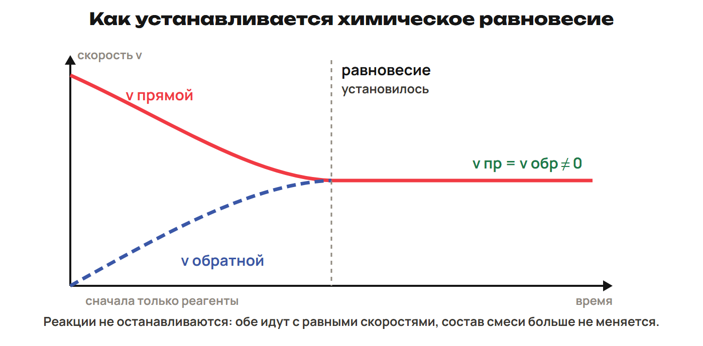
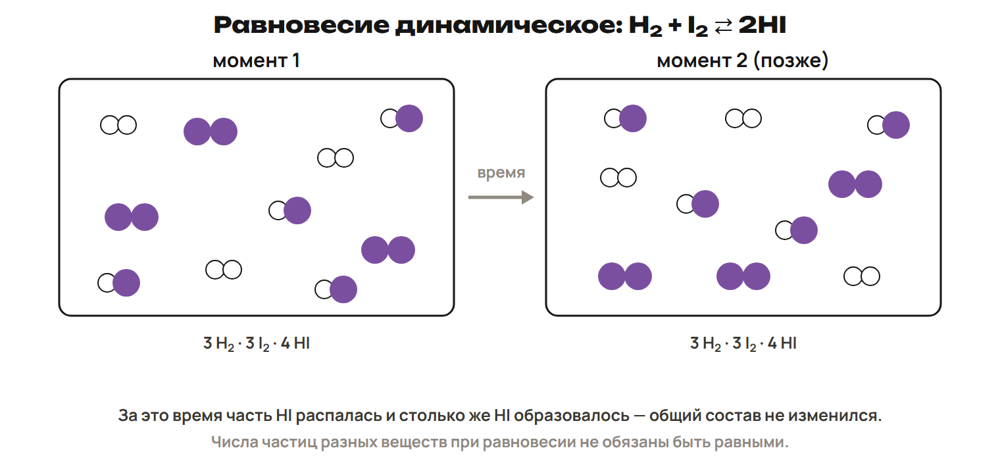
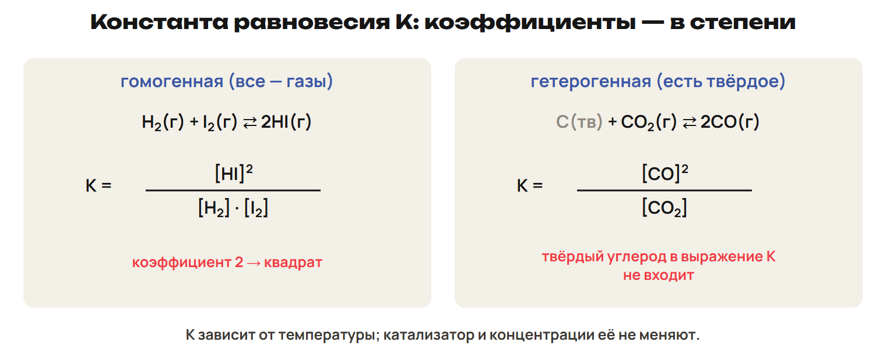
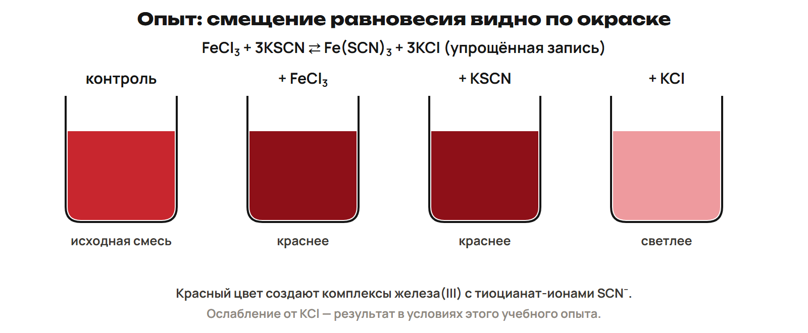

Если в сосуде перестал меняться состав смеси, реакция могла не остановиться. Продукты продолжают образовываться и превращаться обратно. Разберём, как узнать такое состояние и изменить состав равновесной смеси.

После урока 23 прочитай разделы 1–3 за 25 минут, выполни P и всю G. Разделы 4–6 разберём на уроке 24. После него выполни один назначенный вариант A/B/C.

## 1. Обратимость и динамическое равновесие

Необратимая реакция в данных условиях идёт практически до конца. Обратимая может идти в обоих направлениях: прямая — слева направо, обратная — справа налево. Её обозначают стрелками ⇄.

Осадок, уходящий газ или образование воды могут обеспечивать практически полное превращение в данных условиях. Например, при смешивании растворов NaCl и AgNO₃ выпадает AgCl: NaCl + AgNO₃ → AgCl↓ + NaNO₃. При действии кислоты на карбонат в открытом сосуде уходит CO₂: K₂CO₃ + 2HCl → 2KCl + H₂O + CO₂↑.

> [!rule] Сначала уточни условия
> Практическая необратимость относится к данным условиям. Сильное выделение теплоты само по себе не запрещает обратную реакцию. Удержание газов в закрытой системе может быть важно для обратимости.

В закрытом сосуде при подходящих условиях N₂ + 3H₂ ⇄ 2NH₃. Если вначале есть только азот и водород, обратная реакция сначала не идёт: аммиака ещё нет. По мере его накопления обратная реакция ускоряется, а расходование реагентов замедляет прямую. При неизменных условиях скорости могут сравняться.

Химическое равновесие — состояние, при котором скорости прямой и обратной реакций равны. Если система закрыта и условия сохраняются, концентрации остаются постоянными. Превращения на уровне частиц продолжаются — равновесие динамическое.

> [!example] Равны скорости, а не составы
> Скорости двух направлений равны 0,015 моль/(л·с). Значит, встречные превращения компенсируются. Из этого нельзя получить концентрации веществ или объявить их равными: скорости и концентрации — разные величины.

> [!trap] Постоянство не означает остановку
> В равновесии обе реакции продолжаются. Слово «прямая» показывает выбранное направление записи, а не постоянное преимущество этой реакции.

> [!try] Проверь вывод
> Ученик увидел неизменную окраску смеси и сказал: «Частицы больше не реагируют». Что в этом выводе не доказано? Какое равенство действительно задаёт химическое равновесие?

## 2. Выражение K: продукты, реагенты и степени

В равновесной смеси концентрации связаны определённым отношением. Константа равновесия K показывает это отношение при данной температуре. Квадратные скобки обозначают равновесную концентрацию: [A].

> [!rule] Как записать K
> Уравняй реакцию → запиши произведение концентраций продуктов в числителе → реагентов в знаменателе → коэффициенты поставь в степени.
> Для aA + bB ⇄ cC + dD: K = [C]ᶜ · [D]ᵈ / ([A]ᵃ · [B]ᵇ).

Для H₂(г) + I₂(г) ⇄ 2HI(г): K = [HI]² / ([H₂] · [I₂]). Квадрат относится ко всей концентрации HI. Множители в знаменателе нужно перемножить, а не сложить.

Гомогенное равновесие устанавливается в одной фазе, например в газовой смеси. Гетерогенное включает разные фазы. Для C(тв) + CO₂(г) ⇄ 2CO(г): K = [CO]² / [CO₂]. Чистый твёрдый углерод в выражение не входит, пока эта фаза присутствует: её постоянный вклад учтён в K.

В школьной модели в выражение включают газы и растворённые вещества. Чистую жидкую фазу, если она участвует в гетерогенном равновесии, тоже не записывают отдельным концентрационным множителем.

Большое K означает большое значение записанного отношения произведений концентраций. Оно характеризует склонность данной реакции к образованию продуктов в выбранной записи. При K < 1 это отношение меньше единицы. Сравнивай именно выражение с его степенями.

> [!example] Коэффициент меняет расчёт
> В H₂ + I₂ ⇄ 2HI продукт имеет коэффициент 2. Поэтому в K стоит [HI]². Запись 2[HI] вместо квадрата даёт другое число и не выражает константу этой реакции.

> [!trap] K не сравнивает суммы молей
> Из K > 1 не следует, что каждого продукта больше каждого реагента или что сумма молей продуктов больше. В формуле — произведения со степенями. В равновесии при любом K скорости направлений равны.

> [!try] Запиши без чисел
> Для CO(г) + H₂O(г) ⇄ CO₂(г) + H₂(г) составь выражение K. Все четыре вещества здесь — газы. Что изменилось бы в выборе множителей, если бы в другом уравнении появилась чистая твёрдая фаза?

## 3. K по равновесным концентрациям

Числа из условия сначала подпиши веществами. Затем проверь, что это равновесные концентрации, и только после этого подставляй их в выражение. В расчётах ниже концентрации даны в моль/л.

> [!example] Сначала степень, потом деление
> H₂ + I₂ ⇄ 2HI. При данной температуре [H₂] = 0,40, [I₂] = 0,25, [HI] = 0,80 моль/л.
> K = 0,80² / (0,40 × 0,25) = 0,64 / 0,10 = 6,4.
> Здесь 6,4 — отношение из формулы. Равновесная концентрация HI при этом не обязана совпадать с концентрациями реагентов.

Если концентрация указана в другой единице, сначала приведи все данные к единице, принятой в задаче. Если вместо концентрации дано количество вещества, используй c = n/V с объёмом в литрах. Для коэффициентов, стоящих в степени, особенно важно сохранять скобки.

У гетерогенного равновесия действуй так же: выбери участвующие в выражении фазы, затем подставь концентрации газов или растворённых веществ. Массу чистого твёрдого вещества нельзя подставлять на место его концентрации в знаменатель.

> [!rule] Проверка расчёта
> Сверь все степени с коэффициентами. Проверь, какие концентрации относятся к равновесию. Выполни отдельно числитель и знаменатель, затем деление.

> [!trap] Исходное не равно равновесному
> После начала реакции состав меняется. Исходные концентрации не подставляют в формулу K вместо равновесных. Если равновесных данных не хватает, сначала составь таблицу изменений по коэффициентам.

> [!try] Перед G
> Повтори расчёт примера без готовой строки. Затем объясни, где возникнут две разные ошибки: [HI] умножили на 2; вместо равновесной концентрации I₂ взяли её исходную величину.

## 4. Принцип Ле Шателье — Брауна

Изменение условий нарушает прежнее равновесие. Система переходит к новому составу так, что результат превращения противодействует воздействию. Этот принцип сформулировали А. Ле Шателье в 1885 году и Ф. Браун в 1887 году.

> [!rule] Алгоритм сдвига
> Назови изменение → найди, какое направление ему противодействует → обозначь сдвиг → проверь условие применимости правила.

| Воздействие | Как искать направление |
|---|---|
| Увеличили концентрацию реагента в газе или растворе при прочих равных | В сторону его расходования, обычно вправо |
| Удалили часть газообразного или растворённого продукта | В сторону его образования, обычно вправо |
| Изотермически сжали газовую смесь | К меньшему числу молей газов |
| Изотермически увеличили объём газовой смеси | К большему числу молей газов |
| Нагрели | К эндотермической реакции |
| Охладили | К экзотермической реакции |
| Добавили катализатор при той же температуре | Сдвига нет; равновесие устанавливается быстрее |

Добавление чистого твёрдого вещества не меняет равновесный состав газов или раствора, если эта фаза уже присутствует. Полное исчезновение участвующей фазы меняет условия модели.

### Давление: считай только газы

Для N₂(г) + 3H₂(г) ⇄ 2NH₃(г) слева 4 моль газов, справа 2. Сжатие при постоянной температуре смещает вправо. Для N₂(г) + O₂(г) ⇄ 2NO(г) число равно: 2 и 2. Такое сжатие не даёт сдвига.

В C(тв) + CO₂(г) ⇄ 2CO(г) сравнивают 1 моль газа слева и 2 справа. Твёрдый углерод не прибавляет «газовый моль»: сжатие смещает влево. Для S(тв) + O₂(г) ⇄ SO₂(г) газовых молей 1 и 1 — сдвига нет.

Важно, как повысили давление. Добавление инертного газа при постоянных температуре и объёме не увеличивает концентрации реагирующих газов. Правило про меньшее число молей применяем к сжатию, а не к любому росту общего давления.

### Температура: найди эндотермическую сторону

В N₂ + 3H₂ ⇄ 2NH₃ + 92 кДж прямая реакция экзотермическая, ΔH < 0. Нагрев смещает влево — к эндотермическому разложению аммиака. В C + CO₂ ⇄ 2CO − 172 кДж прямая реакция эндотермическая: нагрев смещает вправо.

Изменение температуры меняет K. При той же температуре добавление вещества или сжатие меняет равновесные концентрации, а значение K для данной записи сохраняется. Катализатор меняет путь и ускоряет оба встречных превращения; прежний равновесный состав при той же температуре остаётся тем же.

> [!example] Условие без противоречия
> Для CO(г) + 2H₂(г) ⇄ CH₃OH(г), ΔH < 0, повышение температуры смещает влево, сжатие — вправо: 3 моль газов против 1. Каждый фактор сначала разбирают отдельно.

> [!trap] Скорость и выход отвечают на разные вопросы
> Нагрев может ускорять установление равновесия и одновременно уменьшать равновесное содержание продукта экзотермической реакции. Катализатор ускоряет установление, но не повышает равновесный выход при той же температуре.

> [!try] Проверь фазу и знак
> Для N₂ + O₂ ⇄ 2NO, ΔH > 0, объясни действие нагрева и изотермического сжатия. Почему ответ только по слову «давление» недостаточен?

## 5. Производство аммиака и наблюдаемые сдвиги

Ф. Габер осуществил синтез аммиака в 1908 году, использовав осмиевый катализатор. В промышленном процессе применяют железный катализатор. Уравнение: N₂(г) + 3H₂(г) ⇄ 2NH₃(г) + 92 кДж.

| Условие синтеза | Зачем его выбирают |
|---|---|
| Стехиометрическое отношение N₂ : H₂ = 1 : 3 | Соответствует коэффициентам уравнения |
| Повышенное давление, в рассматриваемом диапазоне 15–100 МПа | Благоприятствует стороне с 2 моль газов вместо 4 |
| Температура 450–500 °C | Компромисс между скоростью и равновесным выходом |
| Восстановленное железо с оксидами калия и алюминия | Катализатор и добавки помогают быстрее установить равновесие |
| Очистка поступающих газов | Уменьшает действие примесей, отравляющих катализатор |

Чем ниже температура, тем выгоднее равновесие для аммиака, но тем медленнее идёт превращение. Поэтому выбирают не самую низкую температуру. При сравнении равновесных составов на одной температуре повышение давления увеличивает содержание NH₃; на одном давлении повышение температуры уменьшает его.

Давления подразделяют на низкие для этого производства — 10–15 МПа, средние — 25–30 МПа и высокие — 50–100 МПа. Название «низкое» здесь относительное: это всё ещё повышенное давление по сравнению с атмосферным. Равновесное содержание аммиака зависит от конкретных температуры и давления; одно число выхода нельзя переносить на все режимы.

> [!example] Теплота относится к коэффициентам
> В записи синтеза выделение 92 кДж относится к образованию 2 моль NH₃. Для образования 1 моль при тех же оговорённых условиях записи — 46 кДж. Обратное превращение поглощает ту же теплоту на ту же порцию.

### Как наблюдают изменение равновесия

Окраска может показывать изменение состава, если известно, какое вещество или частицы её создают. В опыте с солями железа(III) и тиоцианатом красный цвет связан с комплексами железа(III) и SCN⁻.

В четыре стакана налили одинаковую исходную смесь. Первый оставили для сравнения. При добавлении FeCl₃ во второй или KSCN в третий красный цвет усилился. В четвёртом добавка KCl ослабила цвет в условиях этого опыта: хлорид-ионы могут влиять на связывание Fe³⁺. Это не правило для добавки любой соли.

В растворе ацетата натрия с фенолфталеином нагрев усиливает окраску, охлаждение ослабляет, повторный нагрев возвращает её. В растворе аммиака с фенолфталеином добавка NH₄Cl ослабляет окраску. Здесь наблюдение связано с изменением равновесного состава раствора, а не с тем, что индикатор «исчез».

Принцип противодействия применяют и к физическим равновесиям: испарению и конденсации, плавлению и кристаллизации. Сначала определяют, какой из встречных процессов противодействует изменению условий.

> [!trap] Цвет не заменяет уравнение
> Чтобы объяснить опыт, нужно знать окрашенные частицы и воздействие. Запись FeCl₃ + 3KSCN ⇄ Fe(SCN)₃ + 3KCl — упрощённое представление состава раствора; KCl не следует автоматически включать как продукт в K образования красного комплекса.

> [!try] Объясни выбор условий
> Почему промышленному синтезу нужны одновременно повышенное давление, достаточно высокая температура и катализатор? Назови, какой из факторов меняет равновесный состав, а какой ускоряет его достижение.

## 6. Таблица «было — изменение — стало»

Реагенты расходуются и продукты образуются в отношении коэффициентов. Поэтому неизвестные концентрации связывает одна величина изменения. Для постоянного объёма отношения изменений концентраций такие же, как отношения изменений количества вещества.

> [!rule] Алгоритм расчёта
> Уравняй реакцию → выпиши исходные концентрации → обозначь расход одного вещества x → остальные изменения задай по коэффициентам → найди равновесные концентрации → подставь в K → проверь неотрицательность и условие.

> [!example] Два продукта на одну порцию каждого реагента
> A₂ + B₂ ⇄ 2AB. Первоначально c₀(A₂) = 0,90, c₀(B₂) = 1,10, c₀(AB) = 0 моль/л. В равновесии [AB] = 0,60 моль/л. Объём постоянен.
> На 2 моль AB расходуется по 1 моль A₂ и B₂. Значит, расход каждого реагента равен 0,60/2 = 0,30 моль/л.

| Состояние, моль/л | A₂ | B₂ | AB |
|---|---|---|---|
| Было | 0,90 | 1,10 | 0 |
| Изменение | −0,30 | −0,30 | +0,60 |
| Стало | 0,60 | 0,80 | 0,60 |

K = [AB]² / ([A₂] · [B₂]) = 0,60² / (0,60 × 0,80) = 0,36/0,48 = 0,75. Все равновесные концентрации неотрицательны. Изменения относятся как 1 : 1 : 2.

Если продукты уже были в исходной смеси, укажи их начальную концентрацию. При прямом изменении к ней прибавляется образовавшаяся порция. При обратном изменении продукты расходуются — знаки в строке изменений меняются.

### После воздействия сравни скорости

Для 2NO₂ ⇄ 2NO + O₂ условием заданы законы: vпр = kпр[NO₂]² и vобр = kобр[NO]²[O₂]. При постоянной температуре объём увеличили в 4 раза, поэтому сразу после расширения все концентрации уменьшились в 4 раза.

Прямая скорость стала меньше в 4² = 16 раз, обратная — в 4³ = 64 раза. До воздействия они были равны, теперь прямая больше обратной: смесь смещается вправо. Это согласуется с правилом давления: справа больше молей газов, 3 против 2. После нового равновесия скорости снова сравняются.

Показатели в законах скорости здесь даны условием. В произвольной многостадийной реакции их нельзя брать из коэффициентов суммарного уравнения.

> [!trap] Изменение не копирует готовый продукт
> Если образовалось 0,60 моль/л AB в реакции A₂ + B₂ ⇄ 2AB, каждого реагента израсходовано по 0,30. Вычитание 0,60 из обоих реагентов нарушает коэффициенты. Проверяй именно строку изменений.

> [!try] Перед вариантом
> Восстанови таблицу примера без решения. Затем объясни, почему при расширении из примера скоростей равновесие идёт вправо, хотя сразу после воздействия обе реакции стали медленнее.

> [!rule] Факты ЕНТ недели
> - Химическое равновесие динамическое: скорости прямой и обратной реакций равны, концентрации постоянны, но не обязаны быть равными.
> - В K коэффициенты становятся показателями степени; чистые твёрдые фазы в выражение не входят.
> - Принцип смещения равновесия: А. Ле Шателье — 1885 год, Ф. Браун — 1887 год.
> - Изотермическое сжатие газовой смеси смещает равновесие к меньшему числу молей газов; при равном числе сдвига нет.
> - Нагревание смещает равновесие к эндотермической реакции, охлаждение — к экзотермической.
> - Катализатор ускоряет установление равновесия, не смещает его и не меняет K при той же температуре.
> - Ф. Габер осуществил синтез аммиака в 1908 году; стехиометрическое отношение N₂ : H₂ = 1 : 3.
> - Синтез аммиака: 450–500 °C, повышенное давление 15–100 МПа, железо с оксидами калия и алюминия.
