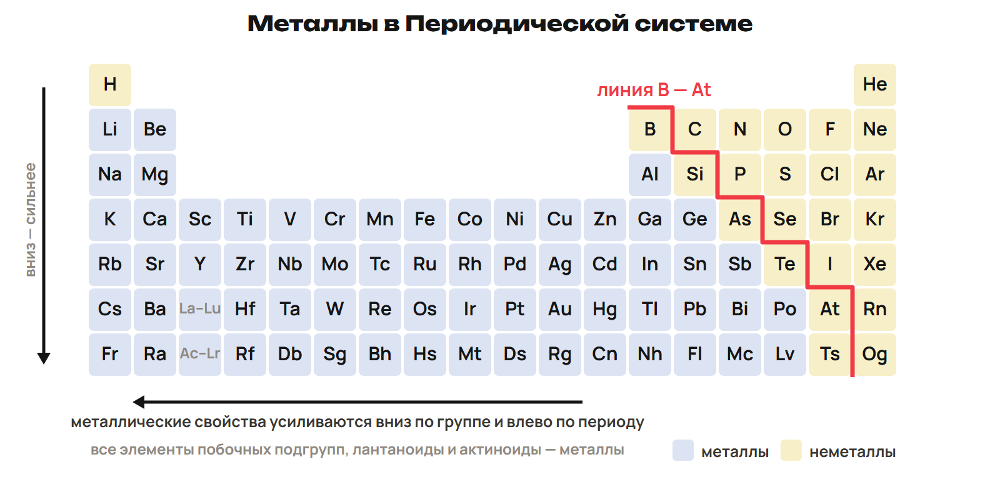
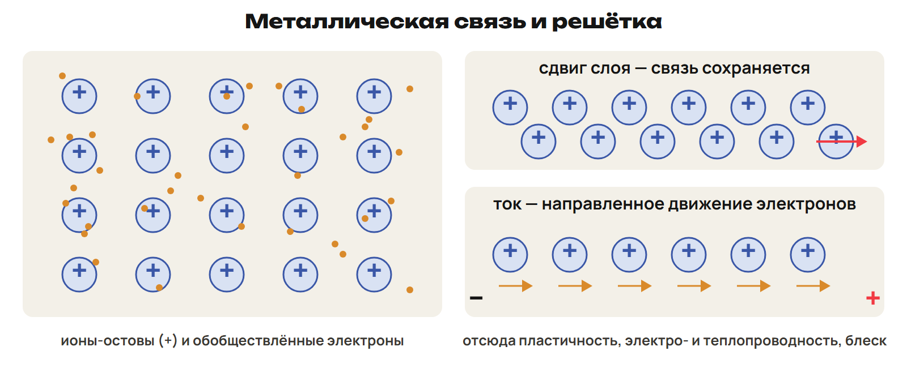
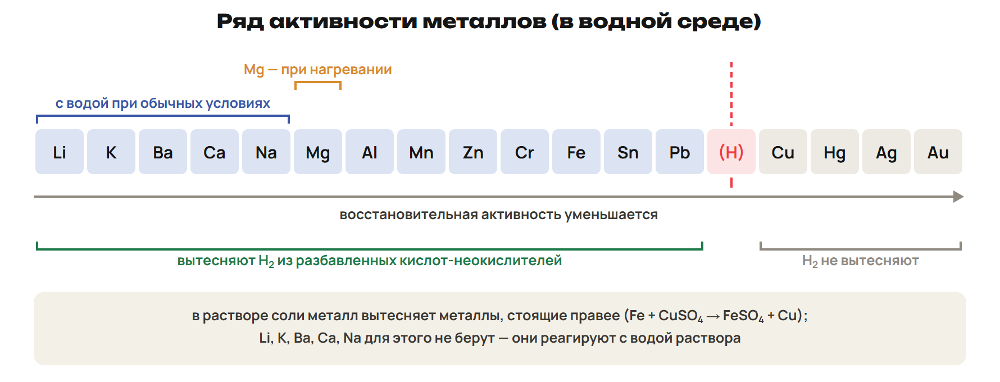
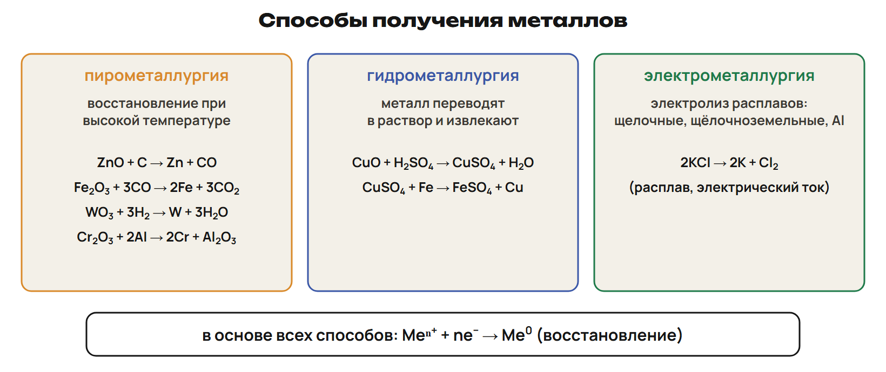
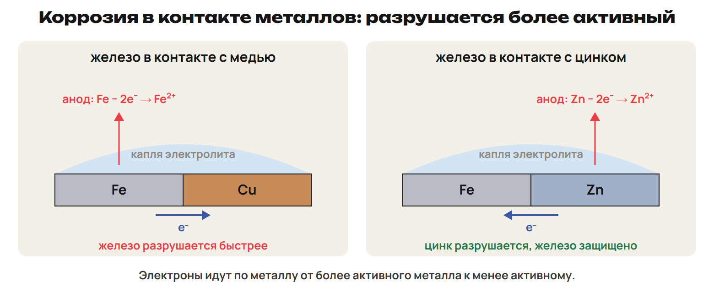

# Положение и металлическая связь
? Что связывает место элемента, отдачу электронов и проводимость металла?
↳ Начнём с электронов: они объяснят и реакцию, и свойства простого вещества.
> 0–7 положение, строение атома и связь; 7–10 L1; 10–12 ключ.

## Схема: Металлы в Периодической системе

## Понятие: От атома к катиону
К металлам относят более 90 элементов.
На внешнем уровне у их атомов часто 1–3 электрона; это не правило без исключений.
В периоде металлические свойства в целом ослабевают слева направо, в группе усиливаются вниз.
Атом металла отдаёт электроны: Me⁰ − ne⁻ → Meⁿ⁺.
Простое вещество-металл в таких реакциях — восстановитель.
> Не превращать условную границу в точную классификацию каждого пограничного элемента. Отдача электронов — окисление самого металла.

## Схема: Решётка и свободные электроны

## Практика: L1
У Na один внешний электрон, у Mg два, у Al три.
Запиши отдачу электронов атомом магния с образованием Mg²⁺.
Как называется этот процесс и роль магния?
Какие частицы переносят заряд в куске металлической проволоки?
Ответы:
Mg⁰ − 2e⁻ → Mg²⁺: окисление, магний — восстановитель.
В металлической проволоке заряд переносят подвижные электроны.
Ионные остовы связаны с ними металлической связью.
> 7–10 попытка, 10–12 ключ.

# Физические свойства и рекорды
? Почему провод не делают из самого электропроводного металла во всех случаях?
↳ Свободные электроны объясняют общие свойства. Выбор материала зависит ещё и от его доступности и прочности.
> 12–18 связь со свойствами и рекорды; 18–21 L2; 21–24 ключ.

## Понятие: Три следствия связи
Подвижные электроны обеспечивают высокую электро- и теплопроводность.
Отражение света связано с металлическим блеском.
При сдвиге слоёв связь с обобществлёнными электронами сохраняется: металл пластичен.
В проводниках часто используют медь и алюминий.
Металлы сильно различаются по плотности, температуре плавления и твёрдости.

## Понятие: Запомни разные рекорды
Серебро — наибольшая электропроводность; золото — наибольшая пластичность.
Вольфрам — самый тугоплавкий металл, около 3400 °C.
Ртуть жидкая при комнатной температуре; её температура плавления около −39 °C.
Литий — наименьшая плотность среди металлов; осмий — наибольшая, около 22,6 г/см³.
Хром — самый твёрдый металл; щелочные металлы мягкие.
Лёгкие металлы: ρ < 5 г/см³; тяжёлые: ρ > 5 г/см³.
> Рекорды относятся к указанному свойству. Не подменять «тяжёлый» большой атомной массой; здесь сравнивают плотность.

## Практика: L2
Соответствие: А — наиболее тугоплавкий металл; Б — металл с наименьшей плотностью.
1 — серебро; 2 — литий; 3 — вольфрам; 4 — ртуть.
Назови два доступных металла для электрических проводов.
Почему способность к ковке не означает слабую связь в металле?
Ответы:
А3 Б2. Для проводов используют медь и алюминий.
При сдвиге слоёв металлическая связь сохраняется благодаря обобществлённым электронам.
> 18–21 попытка, 21–24 ключ.

# Ряд активности: сначала среда
? Почему положения левее другого металла иногда недостаточно для реакции с его солью?
↳ Физические свойства объяснили связь. Теперь используем отдачу электронов для выбора реакции.
> 24–37 ряд, неметаллы, вода, соли и кислоты; 37–42 L3; 42–45 ключ.

## Схема: Ряд и границы школьных правил

## Понятие: Что показывает ряд
Левее — сильнее восстановительная способность металла в водной системе.
Ряд помогает предсказать вытеснение металла из раствора соли и H₂ из кислоты.
Но нужно назвать среду, температуру и возможную защитную плёнку.
Скорость реакции с водой не читается как точная копия ряда.
В частности, положение Li не означает наиболее бурной реакции с холодной водой.
> Не переносить электрохимический ряд напрямую на любую реакцию без воды. Детали гидратации — приложение A.

## Пример: Неметалл и вода
2Fe + 3Cl₂ → 2FeCl₃; Fe + S → FeS — при соответствующем нагревании.
4Li + O₂ → 2Li₂O; 3Mg + N₂ → Mg₃N₂ при нагревании.
2Na + 2H₂O → 2NaOH + H₂↑; Ca + 2H₂O → Ca(OH)₂ + H₂↑.
Mg с горячей жидкой водой: Mg + 2H₂O → Mg(OH)₂ + H₂↑.
Mg с водяным паром при сильном нагревании: Mg + H₂O → MgO + H₂↑.
Zn с паром при нагревании: Zn + H₂O → ZnO + H₂↑.
> Условия различают продукты магния. Не приписывать любому металлу с паром образование гидроксида.

## Пример: Соль и кислота
Zn + Pb(NO₃)₂ → Zn(NO₃)₂ + Pb: цинк активнее свинца.
Cu + ZnSO₄: вытеснения цинка из раствора нет.
Na, K, Ca, Ba в растворах солей прежде всего реагируют с водой.
Zn + 2HCl → ZnCl₂ + H₂↑; медь с разбавленной HCl не выделяет H₂.
Для HNO₃ правило «металл до H даёт H₂» не применяют.
Концентрированная H₂SO₄ тоже окислитель: её не подменяют разбавленной кислотой.
> В рассматриваемой школьной модели HNO₃ с металлами H₂ не выделяет. Не переносить это на все возможные условия специальной химии.

## Понятие: Порядок проверки
Назови реагент: неметалл, вода, раствор соли или кислота.
Для воды проверь температуру; для соли — нет ли реакции металла с водой.
Для кислоты отличи разбавленную неокисляющую кислоту от HNO₃ и концентрированной H₂SO₄.
Примени ряд, запиши продукты и уравняй.
Проверь степени окисления и роль металла.

## Практика: L3
Выбери случаи выделения H₂: Zn + разбавленная HCl; Cu + разбавленная HCl; Mg + водяной пар при нагревании.
Запиши уравнения и продукт магния.
Ученик записал 2Na + CuSO₄ → Na₂SO₄ + Cu для водного раствора.
Почему одного сравнения Na и Cu в ряду здесь недостаточно?
Ответы:
H₂ дают цинк с HCl и магний с паром.
Zn + 2HCl → ZnCl₂ + H₂; Mg + H₂O → MgO + H₂.
Медь с разбавленной HCl H₂ не выделяет.
Натрий прежде всего реагирует с водой раствора: прямое вытеснение меди так не описывают.
> 37–42 попытка, 42–45 ключ.

# Получение металла из соединения
? Как выбрать восстановитель и не перепутать раствор с расплавом?
↳ В природе активные металлы связаны с другими элементами. Чтобы получить простое вещество, нужно вернуть электроны его ионам.
> 45–54 нахождение, три метода и алгоритм расчёта; 54–59 L4; 59–63 ключ.

## Понятие: От руды к металлу
В земной коре среди металлов больше всего алюминия, затем железа.
Золото и платина встречаются самородными; активные металлы — в соединениях.
Руда пригодна для промышленного извлечения металла; полиметаллическая содержит несколько металлов.
Основные этапы: обогащение → восстановление → очистка.
Meⁿ⁺ + ne⁻ → Me⁰ — восстановление.
Чёрная металлургия: железо и его сплавы; цветная — остальные металлы.

## Схема: Три способа получения

## Пример: Выбери среду и восстановитель
Пирометаллургия: Fe₂O₃ + 3CO → 2Fe + 3CO₂.
Водородотермия: WO₃ + 3H₂ → W + 3H₂O.
Алюмотермия: Cr₂O₃ + 2Al → 2Cr + Al₂O₃.
Гидрометаллургия: CuO + H₂SO₄ → CuSO₄ + H₂O, затем Fe + CuSO₄ → FeSO₄ + Cu.
Для натрия: 2NaCl(расплав) → 2Na + Cl₂; на катоде Na⁺ + e⁻ → Na.
Электролиз расплава — важный способ для активных металлов, а не единственный возможный метод.
> Другие способы требуют своих условий: например, KCl восстанавливают натрием; CaO — алюминием при специальных условиях с удалением кальция. Не получать натрий из водного раствора его соли.

## Практика: L4
4,80 г чистого Fe₂O₃ полностью восстановили избытком CO.
Запиши уравнение и найди массу железа при выходе 100 %.
M(Fe₂O₃) = 160 г/моль; M(Fe) = 56 г/моль.
Как изменится первый шаг, если вместо чистого оксида дана руда с инертной примесью?
Ответы:
Fe₂O₃ + 3CO → 2Fe + 3CO₂.
n(Fe₂O₃) = 4,80 / 160 = 0,0300 моль; n(Fe) = 0,0600 моль.
m(Fe) = 0,0600 × 56 = 3,36 г.
Для руды сначала находят массу чистого соединения: m(руды) × (1 − ω примесей).
> 54–59 попытка, 59–63 ключ.

# Сплав: свойства и состав
? Почему состав сплава помогает выбрать материал, но не позволяет сложить его свойства?
↳ Металл получен. Добавки меняют свойства и расширяют применение.
> 63–69 определение, составы и граница стали; 69–73 L5; 73–76 ключ.

## Понятие: Что называют сплавом
Сплав содержит два или более элемента, из которых хотя бы один — металл.
Свойства сплава могут заметно отличаться от свойств исходных компонентов.
Латунь — Cu и Zn; обычная оловянная бронза — Cu и Sn.
Существуют разные бронзы: Zn не обязателен в любой бронзе.
Мельхиор — медно-никелевый сплав; дюралюминий — Al с Cu, Mg, Mn.

## Понятие: Ещё три состава
В чугуне более 2 % углерода; он хрупкий.
В стали менее 2 % углерода; многие стали поддаются ковке и прокатке.
Нержавеющие стали содержат хром, который помогает образовать защитную плёнку.
Нихром содержит Ni и Cr, нередко Fe: материал нагревательных спиралей.
Свойства не считают средним арифметическим свойств чистых компонентов.
> Использовать школьную границу 2 %. Не выдавать 1–2 % углерода за полный диапазон сталей или 8 % Cr за типичный достаточный состав нержавеющей стали.

## Практика: L5
Образец латуни массой 20,0 г содержит только Cu и Zn; массовая доля меди 65 %.
Найди массы обоих металлов.
Какой из них взаимодействует с избытком разбавленной HCl?
Ученик утверждает: «Любая бронза обязательно содержит цинк». Исправь вывод.
Ответы:
m(Cu) = 20,0 × 0,65 = 13,0 г; m(Zn) = 20,0 − 13,0 = 7,0 г.
С разбавленной HCl реагирует цинк: Zn + 2HCl → ZnCl₂ + H₂.
У бронз разные составы; оловянная бронза основана на Cu и Sn, Zn не обязателен.
> 69–73 попытка, 73–76 ключ.

# Коррозия: какая часть пары разрушается
? Почему цинк защищает железо, а медь в сходной паре может ускорить его разрушение?
↳ Разные металлы объединяют в изделиях. Во влажной среде такая пара может работать как электрохимическая система.
> 76–82 виды, контактная пара и защита; 82–86 L6; 86–88 ключ; 88–90 домашний маршрут.

## Понятие: Два механизма разрушения
Коррозия — разрушение металлов и сплавов под действием среды.
Ржавление — коррозия железа; ржавчина не является одной чистой солью.
Газовая химическая коррозия идёт без водного электролита, например при высокой температуре.
Электрохимическая связана с анодным и катодным участками в электролите.
В контактной паре при подходящих условиях анодно разрушается более активный металл.

## Схема: Железо с медью и железо с цинком

## Понятие: Защита зависит от механизма
Краска, эмаль, смазка отделяют металл от среды.
Металлические покрытия: хромирование, никелирование, лужение — покрытие оловом.
Стойкие оксидные плёнки могут защищать Al, Cr и другие металлы.
Используют коррозионностойкие сплавы и ингибиторы в среде.
Защитное действие контактной пары требует электрического контакта и электролита.
> Не считать любой металлический слой одинаково защищающим при царапине. Сравнить активность покрытия и основы.

## Практика: L6
Две пары имеют электрический контакт и находятся в одном влажном электролите: Fe/Cu и Fe/Zn.
Назови разрушающийся металл в каждой паре и запиши его окисление до иона 2+.
В какой паре железо защищено?
Как называется покрытие железа оловом?
Ответы:
Fe/Cu: анод — Fe, Fe − 2e⁻ → Fe²⁺.
Fe/Zn: анод — Zn, Zn − 2e⁻ → Zn²⁺; железо защищено.
Лужение — покрытие оловом.
> 82–86 попытка, 86–88 ключ.

## Дома: После урока 25
Прочитай конспект 1–3 — 25 минут.
Выполни закрепление P1–P6 — 20 минут, затем всю G — 35 минут.
Тест 1–8 отправь строкой, 9–10 — фото, 11 — текстом или голосовым.
Сохрани промежуточные расчёты и объяснения: с них начнём следующий урок.
Вариант A/B/C будет назначен после урока 26.
