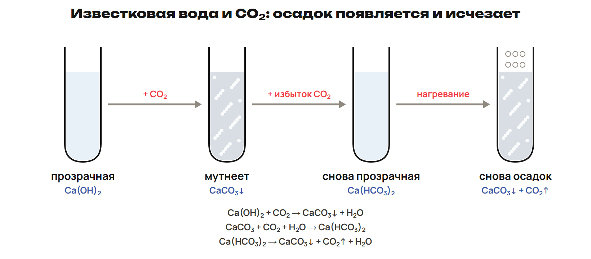
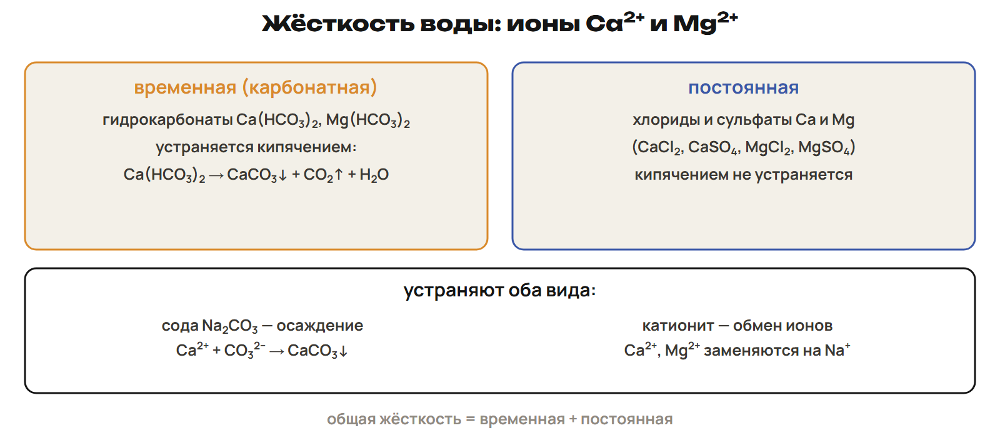

# Возврат: чистое вещество и контактная пара
? В какой строке потерялись примеси, выход или направление окисления?
↳ Разберём две разные причины ошибки и проверим правило на новом условии.
> 0–4 выбрать причины по G; 4–12 G9/G10; 12–17 L7; 17–20 ключ.

## Понятие: Сверяй решение по опорным шагам
В G9 найди массу чистого WO₃, теоретическую массу W и только затем фактическую.
В G10 отметь электрический контакт, электролит и более активный металл.
Сохрани исходную попытку и объясни одну ошибку словами.
Исправленное число должно следовать из исправленного правила.

## Практика: Разбор G9–G10
G9: 29,0 г руды с 20 % инертной примеси; WO₃ восстанавливают избытком H₂, выход W — 75 %.
G10: пары Fe/Mg и Fe/Sn имеют электрический контакт в электролите.
Сверь расчёт и назови анод каждой пары.
M(WO₃) = 232 г/моль; M(W) = 184 г/моль.
Ответы:
G9: m(WO₃) = 29,0 × 0,80 = 23,2 г; n = 23,2 / 232 = 0,100 моль.
WO₃ + 3H₂ → W + 3H₂O; m(W)теор = 0,100 × 184 = 18,4 г.
m(W)факт = 18,4 × 0,75 = 13,8 г.
G10: Fe/Mg — анод Mg, Mg − 2e⁻ → Mg²⁺; железо защищено.
Fe/Sn — анод Fe, Fe − 2e⁻ → Fe²⁺; железо разрушается.
> 4–12 разбор после сданной попытки.

## Практика: L7
В строке Me²⁺ + 2e⁻ → Me ученик написал «окисление металла».
Исправь название процесса.
Почему фразу «электролиз соли натрия даёт натрий» нужно дополнить указанием среды?
Назови катодный продукт в водном растворе NaCl на инертных электродах.
Ответы:
Это восстановление иона металла.
Натрий получают из расплава; в водном растворе на катоде восстанавливается вода.
Катодный газ — H₂; у катода накапливаются OH⁻.
> 12–17 новая попытка, 17–20 ключ.

# Группа IA: натрий и его соединения
? Как один внешний электрон связан с формулами оксида, щёлочи и гидрида?
↳ Вернули роль среды в электролизе. Теперь проследим свойства полученного активного металла.
> 20–30 группа, натрий, NaOH и соли; 30–34 L8; 34–37 ключ.

## Понятие: Щелочные металлы
Li, Na, K, Rb, Cs, Fr — элементы группы 1, или IA; внешний уровень ns¹.
В обычных соединениях степень окисления +1; оксиды R₂O, гидроксиды ROH, гидриды RH.
В природе находятся в соединениях; франций радиоактивен и встречается в следовых количествах.
Вниз по группе металлические свойства и бурность реакции с водой в целом усиливаются.
Натрий и калий мягкие; в лаборатории их хранят под керосином.
Натрий получают электролизом расплава NaCl.
> Не переносить место Li в электрохимическом ряду на скорость реакции с водой. Сведения о хранении — распознавание свойства, не задание проводить опыт.

## Пример: Реакции натрия
4Na + O₂ → 2Na₂O при ограниченном количестве кислорода.
2Na + Cl₂ → 2NaCl; 2Na + S → Na₂S.
2Na + H₂ → 2NaH при нагревании; 3Na + P → Na₃P.
2Na + 2H₂O → 2NaOH + H₂↑.
При других условиях окисления возможен Na₂O₂: Na₂O не единственный продукт.
В реакциях простое вещество Na отдаёт электроны.

## Пример: Оксид и щёлочь
Na₂O + H₂O → 2NaOH; NaOH — едкий натр, или каустическая сода.
NaOH гигроскопичен; растворение в воде выделяет тепло.
NaOH + HCl → NaCl + H₂O; 2NaOH + CO₂ → Na₂CO₃ + H₂O.
CuCl₂ + 2NaOH → Cu(OH)₂↓ + 2NaCl.
Соединения амфотерных металлов тоже могут реагировать со щёлочью при заданных условиях.
Щёлочь окрашивает лакмус в синий, фенолфталеин — в малиновый цвет.

## Понятие: Соли, минералы и пламя
Галит — NaCl; мирабилит — Na₂SO₄·10H₂O; натриевая селитра — NaNO₃.
Криолит — Na₃AlF₆; сильвин — KCl; карналлит — KCl·MgCl₂·6H₂O.
Na₂CO₃ — карбонат натрия, NaHCO₃ — гидрокарбонат натрия.
Соли Na окрашивают пламя в жёлтый цвет, K — в фиолетовый.
Соединения калия широко используют как удобрения.
2Na₂O₂ + 2CO₂ → 2Na₂CO₃ + O₂: пероксид связывает CO₂ и выделяет O₂.

## Практика: L8
В цепочке Na₂O → NaOH → Na₂CO₃ назови реагент для каждой стрелки.
Запиши оба уравнения.
Какое соединение натрия связывает CO₂ с выделением O₂?
Как отличить соли Na и K по окраске пламени?
Ответы:
Na₂O + H₂O → 2NaOH; 2NaOH + CO₂ → Na₂CO₃ + H₂O.
Кислород выделяет пероксид: 2Na₂O₂ + 2CO₂ → 2Na₂CO₃ + O₂.
Na — жёлтое пламя; K — фиолетовое.
> 30–34 попытка, 34–37 ключ.

# Группа IIA: общее правило и исключения
? Почему одинаковые два внешних электрона не делают Be, Mg и Ca одинаковыми?
↳ У группы IA формулы связаны с +1. Для группы IIA начнём с +2 и проверим реакционную способность.
> 37–44 группа, Be, Mg, Ca и пламя; 44–47 L9; 47–50 ключ.

## Понятие: Два внешних электрона
Be, Mg, Ca, Sr, Ba, Ra — группа 2, или IIA; внешний уровень ns².
Обычная степень окисления +2, оксиды RO, гидроксиды R(OH)₂.
Вниз по группе в целом усиливаются металлические и основные свойства.
BeO и Be(OH)₂ амфотерны: бериллий отличается от типичных представителей.
Ca, Sr, Ba реагируют с холодной водой; Mg — с нагреванием, Be не реагирует.
Для получения используют электролиз расплавов; возможны и специальные восстановительные методы.

## Пример: Разные условия — разные продукты
Mg + 2H₂O(горячая жидкая вода) → Mg(OH)₂ + H₂.
Mg + H₂O(пар, нагревание) → MgO + H₂.
Ca + 2H₂O → Ca(OH)₂ + H₂; Ca + 2HCl → CaCl₂ + H₂.
При нагревании: 3Ca + N₂ → Ca₃N₂; Ca + H₂ → CaH₂.
2Mg + SiO₂ → 2MgO + Si при нагревании.
В HNO₃ продукты восстановления азота зависят от условий; H₂ в школьной модели не получают.

## Понятие: Минерал и окраска
Магнезит — MgCO₃; доломит — CaCO₃·MgCO₃.
Кальцит, мел, известняк, мрамор содержат CaCO₃.
Флюорит — CaF₂; барит — BaSO₄.
Окраска пламени: Ca — кирпично-красная, Sr — карминно-красная, Ba — жёлто-зелёная.
Кальций в природе находится в соединениях; ионы Ca²⁺ участвуют в свёртывании крови.

## Практика: L9
Укажи, кто реагирует с холодной водой: Be, Mg, Ca.
Для магния сравни продукты с горячей жидкой водой и с паром при сильном нагревании.
Какое исключение у BeO и Be(OH)₂?
Соотнеси Ca и Ba с кирпично-красным и жёлто-зелёным пламенем.
Ответы:
С холодной водой реагирует Ca.
Mg с горячей жидкой водой даёт Mg(OH)₂, с паром при сильном нагревании — MgO; в обоих случаях H₂.
BeO и Be(OH)₂ амфотерны.
Ca — кирпично-красное, Ba — жёлто-зелёное пламя.
> 44–47 попытка, 47–50 ключ.

# Кальций: известь, карбонат и CO₂
? Почему один и тот же газ сначала создаёт осадок, а затем убирает его?
↳ Вода превратила металл в основание. Продолжим цепочку соединений кальция.
> 50–58 названия и известковая вода; 58–62 L10; 62–65 ключ.

## Понятие: Кальций и известь
2Ca + O₂ → 2CaO; CaO — негашёная, или жжёная, известь.
CaCO₃ → CaO + CO₂ при нагревании.
CaO + H₂O → Ca(OH)₂ с выделением теплоты: гашение извести.
Ca(OH)₂ — гашёная известь; сильное, но малорастворимое основание.
Прозрачный насыщенный раствор — известковая вода, взвесь — известковое молоко.
При нагревании кальций образует также CaS, Ca₃P₂, CaC₂ и CaSi₂.
> Малая растворимость не равна слабой диссоциации растворившейся части. Не смешивать прозрачный раствор и взвесь.

## Схема: Три состояния известковой воды

## Пример: Три уравнения
Ca(OH)₂ + CO₂ → CaCO₃↓ + H₂O: помутнение.
CaCO₃ + CO₂ + H₂O → Ca(HCO₃)₂: осадок растворяется при избытке газа.
Ca(HCO₃)₂ → CaCO₃↓ + H₂O + CO₂↑ при нагревании: новое помутнение.
Такие превращения участвуют в образовании карбонатных отложений.
В задачах всегда уточняй недостаток или избыток CO₂.

## Понятие: Названия соединений
Гипс — CaSO₄·2H₂O; алебастр — CaSO₄·0,5H₂O.
При нагревании гипса примерно до 150–180 °C получают алебастр.
Хлорная известь: условная школьная запись CaOCl₂; используют для отбеливания и дезинфекции.
Соли кальция и известняк применяют в строительстве.
Кальций используют как восстановитель в металлургии.

## Практика: L10
15,0 г чистого CaCO₃ полностью разложили нагреванием.
Найди объём CO₂ при н.у.; M(CaCO₃) = 100 г/моль, Vₘ = 22,4 л/моль.
Полученный CO₂ пропускают через избыток известковой воды: запиши уравнение.
Что произойдёт с осадком, если затем подать избыток CO₂?
Ответы:
CaCO₃ → CaO + CO₂; n(CO₂) = 15,0 / 100 = 0,150 моль.
V(CO₂) = 0,150 × 22,4 = 3,36 л при н.у.
Ca(OH)₂ + CO₂ → CaCO₃↓ + H₂O.
Избыток CO₂ растворит осадок: CaCO₃ + CO₂ + H₂O → Ca(HCO₃)₂.
> 58–62 попытка, 62–65 ключ.

# Жёсткость: ион, вид и способ устранения
? Почему после кипячения вода может остаться жёсткой?
↳ Гидрокарбонат распадается при нагревании. Проверим, все ли соли кальция ведут себя так же.
> 65–69 два вида и способы устранения; 69–72 L11 и ключ; 72–76 L12; 76–78 ключ.

## Схема: Виды жёсткости

## Понятие: Выбирай по составу соли
Жёсткость обусловлена ионами Ca²⁺ и Mg²⁺; её признаки — накипь и плохое пенообразование мыла.
Временная: гидрокарбонаты, разлагающиеся при кипячении.
Постоянная: хлориды и сульфаты; обычное кипячение её не устраняет.
Na₂CO₃ и K₂CO₃ осаждают CaCO₃; Na₃PO₄ осаждает фосфат кальция.
Катионит заменяет Ca²⁺ и Mg²⁺ на Na⁺; общая жёсткость — сумма двух видов.
Для временной жёсткости применяют также известковое молоко.

## Практика: L11
Соответствие: А — Ca(HCO₃)₂; Б — CaSO₄.
1 — временная жёсткость; 2 — постоянная; 3 — не вызывает жёсткость; 4 — простое вещество.
Какая часть исчезнет при кипячении смеси этих растворов?
Какой реагент из NaCl и Na₂CO₃ осадит Ca²⁺?
Ответы:
А1 Б2. Кипячение устраняет временную, но не постоянную жёсткость.
Осаждение даёт Na₂CO₃: Ca²⁺ + CO₃²⁻ → CaCO₃↓.
> 69–71 попытка, 71–72 ключ.

## Практика: L12
Жёсткость порции воды вызвана 5,55 г растворённого безводного CaCl₂; других солей Ca и Mg нет.
Найди теоретически необходимую массу безводного Na₂CO₃ для полного осаждения Ca²⁺.
Найди массу CaCO₃ при полном осаждении и выходе 100 %.
M(CaCl₂) = 111; M(Na₂CO₃) = 106; M(CaCO₃) = 100 г/моль.
Ответы:
CaCl₂ + Na₂CO₃ → CaCO₃↓ + 2NaCl.
n(CaCl₂) = 5,55 / 111 = 0,0500 моль.
n(Na₂CO₃) = n(CaCO₃) = 0,0500 моль.
m(Na₂CO₃) = 5,30 г; m(CaCO₃) = 5,00 г.
> 72–76 попытка, 76–78 ключ.

# Контроль и домашний маршрут
? Можешь ли ты выбрать реакцию, среду и способ устранения жёсткости без подсказки?
↳ Сравнили свойства металлов и их соединений. Проверь перенос правил на новое условие.
> 78–88 Q1–Q6 без подсказок; 88–90 назначить один A/B/C и исправления.

## Понятие: Контроль Q1–Q6
Работай самостоятельно 10 минут.
Q1–Q3 — одна буква; Q4 — все верные; Q5 — две пары; Q6 — расчёт с объяснением.
Максимум 10 баллов.
Сдай ответ до разбора и открытия отдельного ключа.
> Ключ отделить от ученической страницы. При выборе маршрута учитывать контроль, G, объяснение ученика и входную диагностику.

## Дома: После урока 26
Выполни один назначенный вариант A/B/C — 30 минут.
Для A прочитай четыре приложения ниже внутри этих 30 минут.
Исправь до двух причин ошибки — 25 минут.
Повтори разделы 4–6 конспекта и факты — 15 минут.
Вместе с работой после урока 25 — 150 минут.

## Понятие: Углубление A · Решётка, ионизация и гидратация
Переход металла в водный раствор связан не только с отдачей электронов.
Нужны затраты на разрушение металлической решётки и ионизацию атома.
Гидратация образованных ионов сопровождается выделением энергии.
Совокупность этих вкладов влияет на восстановительную способность в водной системе.
Поэтому ряд напряжений не является универсальной шкалой скорости реакций.
Li в начале ряда и бурность реакции с холодной водой — разные характеристики.
> Приложение A внутри его 30 минут; не добавлять время к уроку.

## Понятие: Углубление A · Три вида сплавов
Механическая смесь: кристаллы разных компонентов.
Твёрдый раствор: компоненты входят в однородные кристаллы.
Интерметаллическое соединение: возникает новое соединение металлов.
Монель-металл на основе Ni и Cu используют в агрессивных средах.
Никелевые суперсплавы сохраняют полезные свойства при высоких температурах.

## Понятие: Углубление A · Цена способа получения
Металлотермия позволяет получать металл без внесения углерода и водорода восстановителем.
Гидрометаллургия помогает комплексно использовать сырьё и уменьшить пыль и газовые выбросы.
Её ограничения — производительность и очистка сточных вод.
Электролиз расплава даёт высокую чистоту, но требует много электроэнергии.
Способ выбирают по металлу, сырью, чистоте продукта и затратам.
В специальном восстановлении CaO алюминием важны условия и удаление паров Ca.

## Понятие: Углубление A · Соединения магния и карбонаты
MgO — жжёная магнезия, тугоплавкий материал для огнеупоров.
Тальк и асбест — природные силикаты магния; асбест известен огнестойкостью.
Сплав «электрон» основан на магнии и применяется в технике.
Известковое молоко используют при очистке сахара.
CaCO₃ + CO₂ + H₂O ⇄ Ca(HCO₃)₂ связывает карбонаты с обменом CO₂.
Направление превращения зависит от условий и содержания CO₂.
