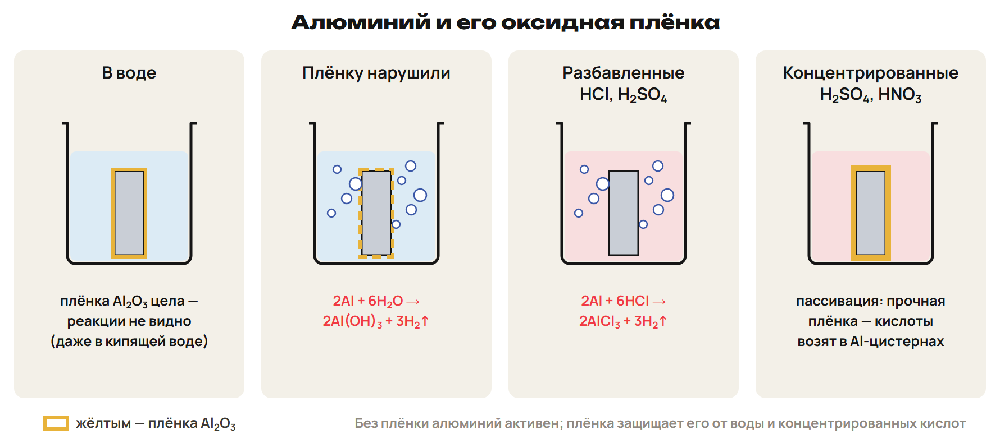
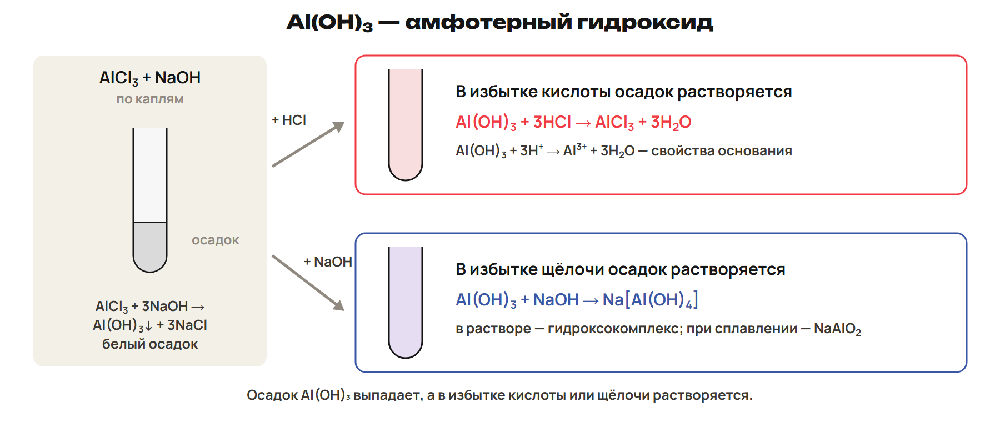

# Урок 27. Алюминий: условия реакции и амфотерность

15 февраля 2027, понедельник; 90 минут. Группы 18:00–19:30 и 19:30–21:00.

Причина → алгоритм → разные примеры → ловушка → самостоятельная попытка. Ключи L показывать после попытки. Предварительное чтение перед первым уроком не требуется.

## План на 90 минут

| Время | Действие |
|---|---|
| 0–12 | 0–7 строение, минералы, свойства и применение; 7–10 L1; 10–12 ключ. |
| 12–27 | 12–20 плёнка, вода и кислоты; 20–24 L2; 24–27 ключ. |
| 27–44 | 27–37 электролиз, неметаллы, щёлочь, соли и алюмотермия; 37–41 L3; 41–44 ключ. |
| 44–59 | 44–51 смысл амфотерности и условия; 51–56 L4; 56–59 ключ. |
| 59–78 | 59–69 образование и растворение Al(OH)₃; 69–74 L5; 74–78 ключ. |
| 78–90 | 78–81 нагревание гидроксида; 81–85 L6; 85–88 ключ; 88–90 домашний маршрут. |

## 1. Алюминий: строение, природа и свойства · 0–12 минут

**Вопрос:** Как три внешних электрона связаны с обычной степенью окисления алюминия?

**Связка:** Общие свойства металлов знакомы. Применим их к одному p-элементу.

**Место элемента объясняет формулы.** Al: Z = 13, третий период, группа 13, главная подгруппа III группы. Электронная конфигурация: 1s²2s²2p⁶3s²3p¹; на внешнем уровне три электрона. В рассматриваемых соединениях обычная степень окисления +3. Алюминий — первый по распространённости металл и третий элемент земной коры. В природе находится в соединениях; основное сырьё — бокситы. Корунд Al₂O₃: рубин красный, сапфир синий; алюминиевое производство есть в Павлодаре.

**Лёгкий проводник.** Алюминий серебристо-белый и пластичный; ρ = 2,7 г/см³, t плавления 660 °C. Он хорошо проводит электрический ток и тепло. Провода, фольга и сплавы используют разные сочетания этих свойств. Сплавы Al с Cu, Mg и Si применяют в транспортном строительстве. Алитирование — насыщение поверхностного слоя железного сплава алюминием для защиты от коррозии. У Al₂O₃ температура плавления около 2050 °C: металл и оксид — разные вещества.

Не давать алюминию безусловное третье место среди всех металлов по электропроводности. Распространённость относится к земной коре, не ко всей планете.

### L1

Запиши конфигурацию Al и число внешних электронов. Укажи обычную степень окисления Al в Al₂O₃. Рубин и сапфир: какая общая формула их основы? Почему для фольги важна пластичность, а для провода — проводимость?

**Ответ и решение:** 1s²2s²2p⁶3s²3p¹: три внешних электрона, Al в Al₂O₃ имеет +3. Основа рубина и сапфира — корунд Al₂O₃. Пластичность позволяет получить тонкий лист; подвижные электроны переносят заряд.

**Типичная ошибка и новая проверка:** Посчитать электроны всех уровней внешними или назвать рубин отдельным простым веществом.

## 2. Плёнка и условия реакции · 12–27 минут

**Вопрос:** Почему активный металл можно поместить в воду без заметного выделения газа?

**Связка:** Свойства атома предсказывают отдачу электронов. Теперь проверим, доступна ли поверхность металла.

**Металл с плёнкой и без неё.** 

**Сначала поверхность и среда.** На воздухе поверхность Al защищена тонкой прочной оксидной плёнкой. При обычных условиях вода не даёт заметной реакции с защищённой поверхностью. После удаления плёнки: 2Al + 6H₂O → 2Al(OH)₃ + 3H₂↑. Разбавленная HCl растворяет Al: 2Al + 6HCl → 2AlCl₃ + 3H₂↑. С разбавленной H₂SO₄: 2Al + 3H₂SO₄ → Al₂(SO₄)₃ + 3H₂↑. Холодные концентрированные HNO₃ и H₂SO₄ пассивируют Al.

Обязательно сохранять слово «холодные»: нагревание меняет поведение концентрированной кислоты. Не приравнивать HNO₃ к разбавленной неокисляющей кислоте.

**Алгоритм для алюминия.** Назови реагент: вода, кислота, щёлочь или неметалл. Для воды проверь состояние оксидной плёнки. Для кислоты назови саму кислоту, концентрацию и температуру. Для щёлочи отличи водный раствор от сплавления. Затем запиши продукты, расставь коэффициенты и проверь атомы. Отсутствие заметной реакции из-за плёнки не делает Al малоактивным металлом.

### L2

Сравни четыре условия: вода и целая плёнка; вода после удаления плёнки; разбавленная HCl; холодная концентрированная HNO₃. Где ожидаются H₂ и растворение металла, а где — защитное действие плёнки? Запиши уравнение реакции с водой после удаления плёнки. Почему фраза «Al не реагирует с водой» требует уточнения?

**Ответ и решение:** Целая плёнка препятствует заметной реакции с водой; холодная концентрированная HNO₃ пассивирует. После удаления плёнки вода даёт H₂; разбавленная HCl тоже выделяет H₂. 2Al + 6H₂O → 2Al(OH)₃ + 3H₂↑. Уточнение — состояние поверхности и условия, а не запрет реакции вообще.

**Типичная ошибка и новая проверка:** Предсказать H₂ с любой кислотой или убрать температуру из условия пассивации.

## 3. Получение и реакции алюминия · 27–44 минут

**Вопрос:** Почему алюминий получают электричеством, а затем используют как восстановитель другого металла?

**Связка:** Плёнка объяснила устойчивость поверхности. Без её ограничения алюминий проявляет восстановительные свойства.

**Получение из оксида.** Промышленный электролит — Al₂O₃, растворённый в расплавленном криолите. На катоде: Al³⁺ + 3e⁻ → Al; это восстановление. С инертным анодом школьная суммарная модель: 2Al₂O₃ → 4Al + 3O₂. Промышленный угольный анод расходуется: 2Al₂O₃ + 3C → 4Al + 3CO₂. Водный раствор соли не заменяет этот расплав: на катоде вместо Al восстанавливается вода.

Разделить инертный и угольный аноды: промышленный процесс нельзя описывать выделением одного лишь O₂ на расходуемом углероде.

**Неметаллы и растворы солей.** 4Al + 3O₂ → 2Al₂O₃; порошок при поджигании ярко горит. При нагревании: 2Al + 3Cl₂ → 2AlCl₃; 2Al + 3S → Al₂S₃. При нагревании: 2Al + N₂ → 2AlN; 4Al + 3C → Al₄C₃. При доступной поверхности: 2Al + 3CuCl₂ → 2AlCl₃ + 3Cu. Аналогично: 2Al + 3ZnSO₄ → Al₂(SO₄)₃ + 3Zn. В этих реакциях простое вещество Al отдаёт электроны.

Для растворов солей учитывать защитную плёнку. Реакции с нагреванием — распознавание условий, не домашняя инструкция к опыту.

**Щёлочь и алюмотермия.** В водном растворе: 2Al + 2NaOH + 6H₂O → 2Na[Al(OH)₄] + 3H₂↑. В продукте раствора записывай гидроксокомплекс, не безводный NaAlO₂. Алюмотермия — восстановление оксидов металлов алюминием. 8Al + 3Fe₃O₄ → 4Al₂O₃ + 9Fe при высокой температуре. Al⁰ → Al³⁺ + 3e⁻; алюминий — восстановитель. При расчёте сначала уравнение, затем отношение количеств веществ.

### L3

8,1 г Al полностью растворили в избытке водного раствора NaOH. Запиши уравнение и найди объём H₂ при н. у. M(Al) = 27 г/моль; Vₘ = 22,4 л/моль. Почему в растворе продукт нельзя обозначить просто NaAlO₂?

**Ответ и решение:** 2Al + 2NaOH + 6H₂O → 2Na[Al(OH)₄] + 3H₂↑. n(Al) = 8,1 / 27 = 0,300 моль; n(H₂) = 0,300 × 3/2 = 0,450 моль. V(H₂) = 0,450 × 22,4 = 10,08 л при н. у. В водном растворе образуется тетрагидроксоалюминат.

**Типичная ошибка и новая проверка:** Взять отношение Al : H₂ равным 1 : 1 или перепутать раствор с безводным сплавлением.

## 4. Амфотерный оксид: кислота и щёлочь · 44–59 минут

**Вопрос:** Почему один оксид реагирует и с кислотой, и со щёлочью?

**Связка:** Металл дал оксид. Проверим две стороны его кислотно-основных свойств.

**Al₂O₃: две стороны свойств.** Al₂O₃ — белое твёрдое тугоплавкое вещество, амфотерный оксид. С кислотой: Al₂O₃ + 6HCl → 2AlCl₃ + 3H₂O. При сплавлении со щёлочью: Al₂O₃ + 2NaOH → 2NaAlO₂ + H₂O. В водной щёлочи: Al₂O₃ + 2NaOH + 3H₂O → 2Na[Al(OH)₄]. Амфотерность — способность реагировать и с кислотами, и с основаниями. Продукт зависит от среды: сплавление и раствор записывают по-разному.

**Круг амфотерных соединений.** В школьном круге амфотерности: соединения Be, Zn, Al и Cr(III). Амфотерны BeO, ZnO, Al₂O₃ и Cr₂O₃, а также соответствующие гидроксиды. У Cr важно указать +3: CrO и CrO₃ имеют другой характер. Для оксида с кислотой получаются соль и вода. Для избытка водной щёлочи часто записывают гидроксокомплекс. Одного слова «металл» недостаточно, чтобы назвать любой его оксид основным.

### L4

13,6 г чистого Al₂O₃ полностью растворили в избытке HCl. Найди массу чистого HCl, вступившего в реакцию. M(Al₂O₃) = 102 г/моль; M(HCl) = 36,5 г/моль. Отдельно запиши продукт Al₂O₃ со щёлочью при сплавлении и в водном растворе.

**Ответ и решение:** Al₂O₃ + 6HCl → 2AlCl₃ + 3H₂O. n(Al₂O₃) = 13,6 / 102 = 2/15 моль; n(HCl) = 6 × 2/15 = 0,800 моль. m(HCl) = 0,800 × 36,5 = 29,2 г. При сплавлении продукт NaAlO₂; в водной щёлочи — Na[Al(OH)₄].

**Типичная ошибка и новая проверка:** Использовать коэффициент 3 вместо 6 или назвать найденную массу HCl массой всего раствора.

## 5. Осадок и избыток реагента · 59–78 минут

**Вопрос:** Почему прозрачный раствор сначала мутнеет, а затем снова становится прозрачным?

**Связка:** Амфотерность оксида уже видна в уравнениях. У гидроксида её можно проследить по осадку.

**Один осадок — два пути растворения.** 

**Сначала осаждение, затем растворение.** AlCl₃ + 3NaOH → Al(OH)₃↓ + 3NaCl при достаточном количестве щёлочи без её избытка. Сокращённо: Al³⁺ + 3OH⁻ → Al(OH)₃↓. Al(OH)₃ — белый желеобразный осадок, в воде практически нерастворим. В избытке щёлочи: Al(OH)₃ + OH⁻ → [Al(OH)₄]⁻. В избытке кислоты: Al(OH)₃ + 3H⁺ → Al³⁺ + 3H₂O. Отсутствие осадка в конце ещё не доказывает, что он не появлялся раньше.

**Кислота к гидроксокомплексу.** Малое количество кислоты может сначала вернуть осадок Al(OH)₃. [Al(OH)₄]⁻ + H⁺ → Al(OH)₃↓ + H₂O. Следующие 3H⁺ растворяют этот осадок. Суммарно в избытке кислоты: [Al(OH)₄]⁻ + 4H⁺ → Al³⁺ + 4H₂O. Для другой записанной формы: Na₃[Al(OH)₆] + 3HCl → 3NaCl + Al(OH)₃↓ + 3H₂O. При 6HCl: Na₃[Al(OH)₆] + 6HCl → 3NaCl + AlCl₃ + 6H₂O.

Начать с отсутствия свободной щёлочи; в растворе с её избытком первые порции кислоты расходуются на нейтрализацию OH⁻.

### L5

К раствору AlCl₃ медленно добавляют NaOH: сначала образуется белый осадок, затем в избытке щёлочи он исчезает. Запиши сокращённые ионные уравнения обоих этапов. Часть промежуточного осадка до добавления избытка NaOH отдельно растворили в избытке HCl: запиши ионное уравнение. Почему щёлочь нужно добавлять с указанием количества?

**Ответ и решение:** Al³⁺ + 3OH⁻ → Al(OH)₃↓. Al(OH)₃ + OH⁻ → [Al(OH)₄]⁻. Al(OH)₃ + 3H⁺ → Al³⁺ + 3H₂O. Недостаток, достаточное количество и избыток щёлочи дают разные составы смеси.

**Типичная ошибка и новая проверка:** Остановить решение на осадке независимо от избытка OH⁻ или сократить недиссоциирующий осадок до ионов.

## 6. Проверка условий и домашний маршрут · 78–90 минут

**Вопрос:** Как связать осадок, оксид и расчёт, не потеряв коэффициенты?

**Связка:** Сравнили реакцию в растворе и при сплавлении. Осталось проверить превращение при нагревании.

**Гидроксид даёт оксид.** При нагревании: 2Al(OH)₃ → Al₂O₃ + 3H₂O. Три атома кислорода в одном гидроксиде не означают один моль оксида на моль гидроксида. На два моль Al(OH)₃ получается один моль Al₂O₃. Для любого расчёта: масса → моль → коэффициенты → нужная величина. Отметь в условии плёнку, температуру, среду и избыток реагента.

### L6

15,6 г чистого Al(OH)₃ полностью разложили нагреванием. Какова масса Al₂O₃ при выходе 100 %? M(Al(OH)₃) = 78 г/моль; M(Al₂O₃) = 102 г/моль. Какие реагенты позволят растворить полученный амфотерный оксид?

**Ответ и решение:** 2Al(OH)₃ → Al₂O₃ + 3H₂O. n(Al(OH)₃) = 15,6 / 78 = 0,200 моль; n(Al₂O₃) = 0,100 моль. m(Al₂O₃) = 0,100 × 102 = 10,2 г. Оксид реагирует с кислотой, например HCl, и с водной щёлочью при подходящих условиях.

**Типичная ошибка и новая проверка:** Взять отношение 1 : 1 и получить 20,4 г или считать амфотерный оксид растворимым в чистой воде.

После урока 27: конспект 1–3 — 25 минут, P — 20, G — 35. После урока 28: один A/B/C — 30, исправления — 25, повторение 4–6 и фактов — 15, расчётный трек — 15. Всего 165 минут.

План насыщенный. На пробном занятии измерить время объяснений и самостоятельных попыток. При замедлении сокращать повторное чтение таблиц и повторные примеры, сохраняя самостоятельные L и контроль. Базовые определения сначала объяснить на уроке, затем закреплять дома.
