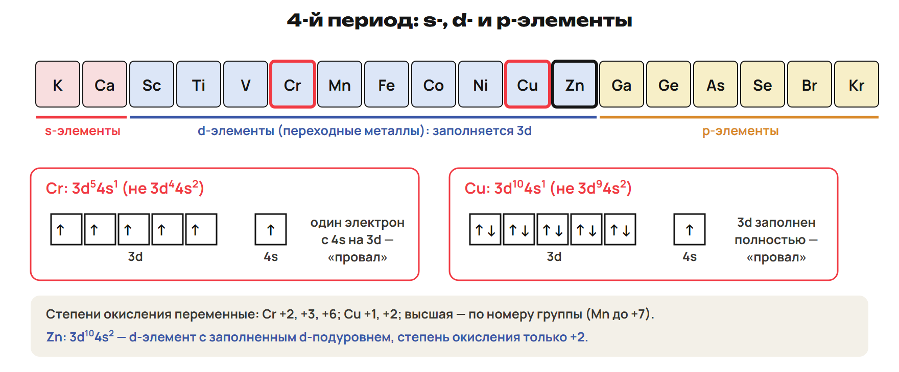
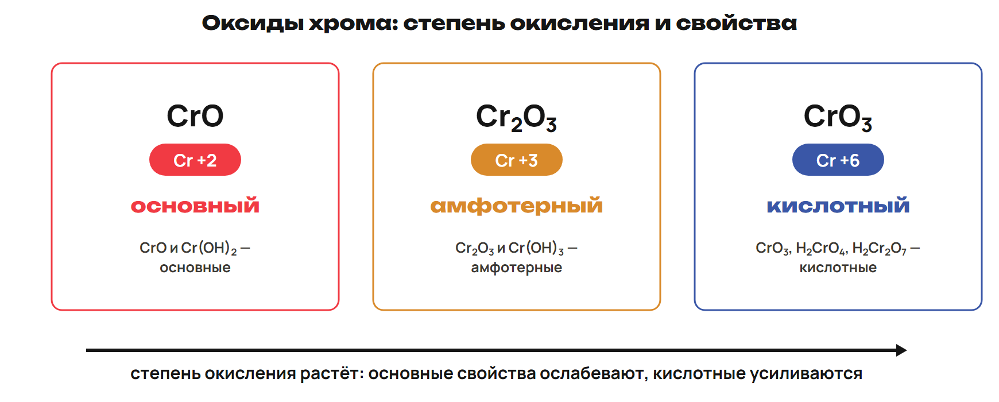
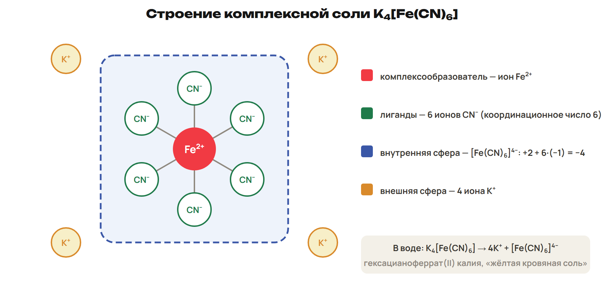
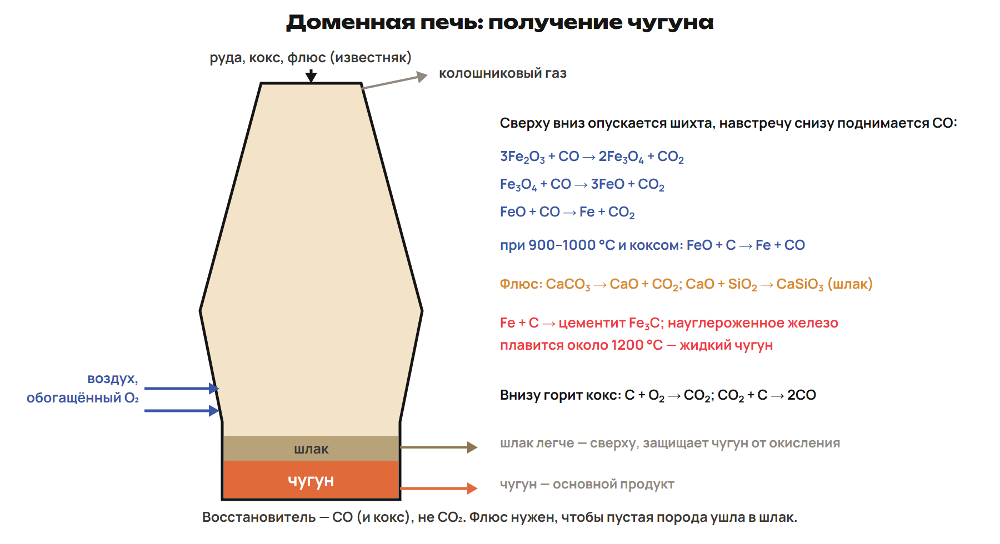
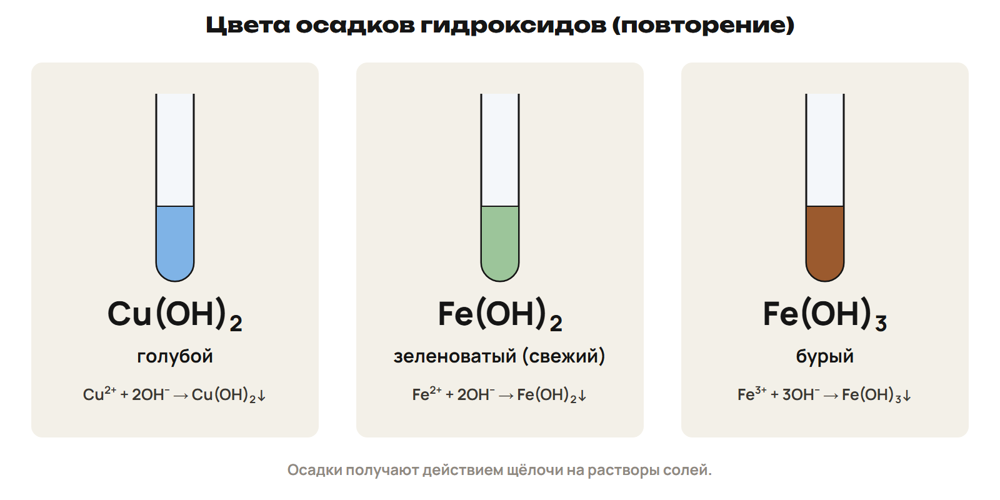

# Возврат: коэффициенты и избыток щёлочи
? В какой строке потерялось отношение веществ или условие растворения осадка?
↳ Разберём две причины ошибки и перенесём знакомый алгоритм на новую реакцию.
> 0–12 G9–G10; 12–17 L7; 17–20 ключ и перенос правила.

## Понятие: Сверяй способ, затем ответ
В G9 проверь уравнение алюмотермии и отношения Fe₃O₄ : Al : Fe.
В G10 отдели образование осадка от его растворения в следующей порции щёлочи.
Проверь не только атомы, но и заряд ионного уравнения.
Сохрани первую попытку и объясни одну исправленную причину ошибки.

## Практика: Разбор G9–G10
G9: 46,4 г чистого Fe₃O₄ полностью восстановили алюминием при высокой температуре.
Найди массу Fe и минимальную массу Al; M(Fe₃O₄) = 232, M(Al) = 27, M(Fe) = 56 г/моль.
G10: к 0,150 моль AlCl₃ добавили сначала 0,450 моль NaOH в растворе, затем ещё 0,150 моль.
Найди массу осадка после каждого этапа; M(Al(OH)₃) = 78 г/моль.
Запиши два сокращённых ионных уравнения.
Ответы:
G9: 8Al + 3Fe₃O₄ → 4Al₂O₃ + 9Fe; n(Fe₃O₄) = 46,4 / 232 = 0,200 моль.
n(Fe) = 0,200 × 3 = 0,600 моль; m(Fe) = 33,6 г; m(Al) = 0,200 × 8/3 × 27 = 14,4 г.
G10: Al³⁺ + 3OH⁻ → Al(OH)₃↓; образуется 0,150 моль, или 11,7 г осадка.
Al(OH)₃ + OH⁻ → [Al(OH)₄]⁻; ещё 0,150 моль OH⁻ растворят весь осадок.
После второго этапа осадка 0 г, получено 0,150 моль гидроксокомплекса.
> Первые 12 минут — объяснить причины ошибок, а не переписать два ключа.

## Практика: L7
11,2 г Fe внесли в раствор с 48,0 г безводного CuSO₄; реакция завершилась.
Определи ограничивающий реагент, массы Cu и FeSO₄.
M(Fe) = 56; M(CuSO₄) = 160; M(Cu) = 64; M(FeSO₄) = 152 г/моль.
Сначала запиши уравнение и сравни количества обоих реагентов.
Ответы:
Fe + CuSO₄ → FeSO₄ + Cu.
n(Fe) = 11,2 / 56 = 0,200 моль; n(CuSO₄) = 48,0 / 160 = 0,300 моль.
Fe в недостатке: образуется по 0,200 моль Cu и FeSO₄.
m(Cu) = 12,8 г; m(FeSO₄) = 30,4 г.
> 12–17 попытка, 17–20 ключ.

# d-Элементы: строение и свойства
? Как степень окисления одного металла меняет характер его оксида?
↳ Ряд активности описал реакцию простого вещества. Теперь различим соединения одного d-элемента.
> 20–27 d-блок, конфигурации и свойства; 27–30 L8; 30–33 ключ.

## Схема: Место d-элементов

## Понятие: Внешний s и предвнешний d
В d-блоке заполняется предвнешний (n−1)d-подуровень; все его элементы — металлы.
У многих d-металлов в связях участвуют внешние s- и предвнешние d-электроны.
Cr: [Ar]3d⁵4s¹; Cu: [Ar]3d¹⁰4s¹ — особое распределение вместо ожидаемого ns².
Cu обычно имеет +1 и +2; Cr — +2, +3, +6; Zn в обычных соединениях +2.
У d-металлов часто высокая твёрдость, плотность, температуры плавления и проводимость.
Соединения многих d-металлов окрашены и способны образовывать комплексы.
> Первый ряд d-блока Sc–Zn не тождествен строгому определению переходного элемента: Zn с заполненной d-оболочкой выделить. Твёрдость и окраска не безусловны для каждого вещества.

## Схема: Хром: степень окисления и характер

## Понятие: Не смешивай два сравнения
CrO, Cr(OH)₂ — основные; Cr₂O₃, Cr(OH)₃ — амфотерные.
CrO₃ — кислотный оксид; ему соответствуют H₂CrO₄ и H₂Cr₂O₇.
У Cr основные свойства ослабевают, кислотные усиливаются с ростом степени окисления.
KMnO₄ с Mn(+7) и K₂Cr₂O₇ с Cr(+6) — сильные окислители.
Ион в низкой степени окисления может быть восстановителем, но это проверяют по реакции.
Для активности конкретных d-металлов используй ряд; правило усиления вниз для группы 1 не переносится автоматически.
> Тенденция ослабления восстановительных свойств вниз проявляется, например, в Cu–Ag–Au; не объявлять её законом каждой побочной подгруппы. CuO не называть обязательным восстановителем.

## Практика: L8
Запиши внешние фрагменты конфигураций Cr и Cu.
Соответствие: А — CrO; Б — CrO₃.
1 — амфотерный; 2 — основный; 3 — кислотный; 4 — нейтральный.
Укажи степень окисления Cr в Cr₂O₃ и K₂Cr₂O₇.
Какую роль обычно проявляет дихромат в школьных ОВР?
Ответы:
Cr: 3d⁵4s¹; Cu: 3d¹⁰4s¹.
А2 Б3. В Cr₂O₃ хром +3; в K₂Cr₂O₇ хром +6.
Дихромат — окислитель: Cr(+6) принимает электроны, переходя в более низкую степень.
> 27–30 попытка, 30–33 ключ.

# Комплекс: скобки, заряд и лиганды
? Почему шесть лигандов не означают заряд комплекса −6?
↳ Переменные степени окисления важны внутри сложного иона. Разберём его строение по частям.
> 33–43 строение, типы и свойства комплексов; 43–46 L9; 46–49 ключ.

## Схема: Внутренняя и внешняя сферы

## Понятие: Читай формулу в четыре шага
Координационную теорию предложил А. Вернер в 1893 году.
Внутри квадратных скобок — центральный атом и связанные с ним лиганды.
Снаружи находятся противоионы внешней сферы, если комплекс заряжен.
Заряд внутренней сферы равен сумме степени окисления центра и зарядов лигандов.
Координационное число — число непосредственно связанных донорных атомов.
У всех рассматриваемых монодентатных лигандов оно равно числу лигандов.

## Пример: Нейтральный лиганд тоже считается
[Ag(NH₃)₂]Cl: Ag(+1), два NH₃, к. ч. 2; внешняя сфера Cl⁻.
[Co(NH₃)₆]Cl₃: Co(+3), шесть NH₃, к. ч. 6; снаружи три Cl⁻.
[Pt(NH₃)₂Cl₂]: Pt(+2), к. ч. 4; комплекс нейтрален, внешней сферы нет.
H₂O даёт аквакомплексы; OH⁻ — гидроксокомплексы; NH₃ — аммиакаты.
Анионы кислот как лиганды характерны для ацидокомплексов.
По заряду различают комплексный катион, анион и нейтральную частицу.

## Пример: Что меняется в растворе и при нагревании
K₂[PtCl₄] → 2K⁺ + [PtCl₄]²⁻: первичная диссоциация по внешней сфере.
В этой записи комплексный ион сохраняется целиком.
Нейтральный комплекс не обязан давать внешние ионы: их у него нет.
Кислота разрушает гидроксокомплекс; количество кислоты определяет конечный продукт.
При нагревании: [Cu(NH₃)₄]SO₄ → CuSO₄ + 4NH₃↑.
Комплексы важны в биологических молекулах и при извлечении некоторых металлов.
> Не объявлять любой комплекс сильным электролитом или абсолютно устойчивым ионом при любых условиях.

## Практика: L9
Для K₄[Fe(CN)₆] назови центральный атом, лиганды и обе сферы.
Найди степень окисления Fe, заряд внутренней сферы и координационное число.
Запиши первичную диссоциацию в растворе.
Почему нельзя раскрыть скобки как шесть свободных CN⁻ при этой диссоциации?
Ответы:
Центр Fe, шесть монодентатных CN⁻; внутренняя сфера [Fe(CN)₆]⁴⁻, внешняя — четыре K⁺.
Fe имеет +2: +2 + 6 × (−1) = −4; к. ч. 6.
K₄[Fe(CN)₆] → 4K⁺ + [Fe(CN)₆]⁴⁻.
Первичная диссоциация отделяет противоионы, а не разрушает внутреннюю сферу.
> 43–46 попытка, 46–49 ключ.

# Домна, чугун и сталь
? Почему руда, кокс и известняк выполняют в печи разные задачи?
↳ В комплексе мы различили роли частиц. В производстве тоже важно отделить восстановитель от флюса.
> 49–59 руды, домна, восстановление и сталь; 59–62 L10; 62–65 ключ.

## Понятие: Четыре руды и два сплава
Гематит, красный железняк — Fe₂O₃; магнетит, магнитный — Fe₃O₄.
Бурый железняк — nFe₂O₃·mH₂O; сидерит, шпатовый железняк — FeCO₃.
Чугун: C > 2 %; сталь: C < 2 % в принятой школьной границе.
В чугуне также есть Si, Mn, P и S; передельный чугун используют для стали.
Казахстанские железорудные районы: Качарское, Соколовско-Сарыбайское, Аятское, Лисаковское.
Сарыбайское месторождение связано с полётом М. Сургутанова и отклонением компаса.
> Исторические числа запасов и места стран из учебника не выдавать за актуальную статистику. Точный ответ 1,98 % C не округлять до граничных 2 %.

## Схема: Печь: сверху сырьё, снизу горячий газ

## Пример: Где образуется восстановитель
C + O₂ → CO₂; CO₂ + C → 2CO с поглощением теплоты.
3Fe₂O₃ + CO → 2Fe₃O₄ + CO₂.
Fe₃O₄ + CO → 3FeO + CO₂.
FeO + CO → Fe + CO₂.
При высокой температуре возможно FeO + C → Fe + CO.
Железо науглероживается; цементит — Fe₃C; образуется жидкий чугун.
> В домне CO и кокс восстанавливают, а CO₂ сам по себе восстановителем железа не является.

## Пример: Флюс и переработка чугуна
CaCO₃ → CaO + CO₂; CaO + SiO₂ → CaSiO₃: пустая порода переходит в шлак.
В стали уменьшают содержание C и примесей окислением: 2C + O₂ → 2CO; Si + O₂ → SiO₂.
2Mn + O₂ → 2MnO; 4P + 5O₂ → 2P₂O₅; C + FeO → Fe + CO.
FeS + CaO → CaS + FeO; 3CaO + P₂O₅ → Ca₃(PO₄)₂: примеси связывает известь.
S и P усиливают хрупкость; для раскисления применяют ферросплавы.
Способы: кислородный конвертер, мартеновская и электродуговая печи; нержавеющую сталь защищает оксидная плёнка Cr.
> Мартеновский процесс рассматривать как учебный исторический способ. Прямое восстановление без домны: Fe₃O₄ + 4H₂ → 3Fe + 4H₂O; промышленный продукт не обязан быть готовой сталью.

## Практика: L10
В FeO + CO → Fe + CO₂ укажи, кто отдаёт и кто принимает электроны.
Запиши электронные переходы для Fe и C.
В цепочке CaCO₃ → CaO → CaSiO₃ назови роль известняка.
Что нужно уменьшить, превращая чугун в сталь? Какова формула цементита?
Ответы:
Fe(+2) + 2e⁻ → Fe⁰: восстановление; C(+2) − 2e⁻ → C(+4): окисление.
CO — восстановитель, FeO — окислитель.
Известняк — флюс: полученный CaO связывает SiO₂ в шлак CaSiO₃.
Уменьшают избыток C и примесей; цементит Fe₃C.
> 59–62 попытка, 62–65 ключ.

# Цвет, комплекс и биологическая роль
? Как узнаваемая окраска связана с ионом, а не просто с названием металла?
↳ Закончили производство металла. Вернём короткие качественные признаки и свяжем комплексы с живыми системами.
> 65–69 краткое повторение качественных признаков; 69–72 L11 и ключ; 72–75 роль металлов и CO; 75–77 L12; 77–78 ключ.

## Схема: Три гидроксида: повторение

## Понятие: Коротко верни реактив и результат
Cu²⁺ + 2OH⁻ → Cu(OH)₂↓: голубой; Fe²⁺ + 2OH⁻ → Fe(OH)₂↓: зеленоватый.
Fe³⁺ + 3OH⁻ → Fe(OH)₃↓: бурый; свежий Fe(OH)₂ на воздухе меняется.
Жёлтая кровяная соль K₄[Fe(CN)₆] выявляет Fe³⁺: берлинская лазурь.
Красная кровяная соль K₃[Fe(CN)₆] выявляет Fe²⁺: турнбулева синь.
Fe³⁺ с SCN⁻ даёт кроваво-красную окраску.
Cu²⁺ с аммиаком сначала может дать голубой осадок, с избытком — интенсивно-синий раствор комплекса.
> Это возврат признаков, а не полный новый блок качественного анализа и не инструкция проводить опыты дома.

## Практика: L11
Соответствие: А — K₄[Fe(CN)₆]; Б — K₃[Fe(CN)₆].
1 — выявляет Fe²⁺ с образованием турнбулевой сини; 2 — осаждает AgCl; 3 — выявляет Fe³⁺ с образованием берлинской лазури; 4 — выделяет H₂.
Назови цвета свежих осадков Cu(OH)₂, Fe(OH)₂ и Fe(OH)₃.
Почему цвет осадка Fe(OH)₂ лучше указывать для свежего образца?
Ответы:
А3 Б1. Cu(OH)₂ голубой, свежий Fe(OH)₂ зеленоватый, Fe(OH)₃ бурый.
Fe(OH)₂ окисляется кислородом воздуха и буреет: цвет меняется со временем.
> 69–71 попытка, 71–72 ключ.

## Понятие: Металл в молекуле и опасность CO
Гемоглобин содержит Fe, хлорофилл — Mg, витамин B₁₂ — Co.
Fe входит в ферменты; недостаток может приводить к анемии; Mn участвует в работе ферментов.
Угарный газ CO возникает при неполном сгорании, не имеет цвета и запаха.
CO связывается с гемоглобином и мешает переносу кислорода: образуется HbCO.
Схема: HbO₂ + CO ⇄ HbCO + O₂; возникает кислородное голодание.
Связывание CO нельзя обнаружить по запаху газа.
> Схема Hb условна и показывает конкуренцию связывания, а не полное описание равновесий белка. Не давать медицинские нормы Cr или советы применять KMnO₄.

## Практика: L12
Назови металлы в гемоглобине, хлорофилле и витамине B₁₂.
При неполном сгорании образовался газ без цвета и запаха, который связался с гемоглобином.
Назови газ и продукт его связывания.
Объясни, почему наличие кислорода в воздухе само по себе не гарантирует его доставку тканям.
Ответы:
Гемоглобин — Fe; хлорофилл — Mg; витамин B₁₂ — Co.
Газ CO, продукт связывания — карбоксигемоглобин HbCO.
CO занимает места связывания и мешает нормальному переносу O₂: ткани испытывают гипоксию.
> 75–77 попытка, 77–78 ключ.

# Контроль и домашний маршрут
? Можешь ли ты выбрать условия реакции, разобрать комплекс и рассчитать выход без подсказки?
↳ Сравнили металл, оксид, сложный ион и промышленный процесс. Проверь правило на новом условии.
> 78–88 Q1–Q6 без подсказок; 88–90 назначить один A/B/C и исправления.

## Понятие: Контроль Q1–Q6
Работай самостоятельно 10 минут.
Q1–Q3 — одна буква; Q4 — все верные; Q5 — две пары; Q6 — расчёт с объяснением.
Максимум 10 баллов.
Сдай ответ до разбора и открытия отдельного ключа.
> Ключ отделить от ученической страницы. При выборе маршрута учитывать контроль, G, объяснение ученика и входную диагностику.

## Дома: После урока 28
Выполни один назначенный вариант A/B/C — 30 минут.
Для A прочитай четыре приложения ниже внутри этих 30 минут.
Исправь до двух причин ошибки — 25 минут.
Повтори разделы 4–6 конспекта и факты — 15 минут.
Вместе с работой после урока 27 — 165 минут с расчётным треком.

## Понятие: Углубление A · Один s-электрон, разная химия
K: [Ar]4s¹; Cu: [Ar]3d¹⁰4s¹ — по одному электрону на внешнем уровне.
У Cu есть заполненный предвнешний d-подуровень.
K в обычных соединениях имеет +1; Cu — +1 и +2.
Число внешних s-электронов не определяет одинаковую активность.
K реагирует с водой; Cu не вытесняет H₂ из разбавленной HCl.
Сравнивай конфигурацию, ряд активности и конкретные условия.
> Приложение A внутри его 30 минут; не добавлять время к уроку.

## Понятие: Углубление A · Названия и внешняя сфера
K₄[Fe(CN)₆] — гексацианоферрат(II) калия.
[Co(NH₃)₆]Cl₃ — хлорид гексаамминкобальта(III).
[Pt(NH₃)₂Cl₂] — дихлородиамминплатина(II).
K₂[Be(OH)₄] — тетрагидроксобериллат калия.
0,020 моль [Co(NH₃)₆]Cl₃ при полной первичной диссоциации дают 0,060 моль Cl⁻.
Шесть NH₃ не дают шесть Cl⁻: число противоионов читается вне скобок.

## Понятие: Углубление A · Три способа получения стали
Конвертер: чугун продувают кислородом, примеси окисляются.
Известь связывает SiO₂; в учебной характеристике удаляют до 90 % Si.
Мартеновская печь использует тепло топлива и допускает большую долю металлолома.
Мартеновский процесс длительный, до 14 часов; это историческая технология.
Электродуговая печь нагревает шихту теплом электрической дуги.
В учебном примере ток может достигать 100 000 А; это характеристика установки, не постоянная любого процесса.

## Практика: Углубление A · Два расчёта по коэффициентам
Смесь Al и Cu массой 16,0 г дала с избытком разбавленной HCl 8,96 л H₂ при н. у. Найди массы металлов.
M(Al) = 27 г/моль; Vₘ = 22,4 л/моль; Cu с такой кислотой H₂ не выделяет.
Отдельно: при восстановлении 1 моль Fe₂O₃ алюминием выделяется 762 кДж.
Какое количество теплоты выделится для 64,0 г чистого Fe₂O₃ при полной реакции? M(Fe₂O₃) = 160 г/моль.
Ответы:
2Al + 6HCl → 2AlCl₃ + 3H₂; n(H₂) = 8,96 / 22,4 = 0,400 моль.
n(Al) = 0,400 × 2/3 моль; m(Al) = 7,2 г; m(Cu) = 16,0 − 7,2 = 8,8 г.
Fe₂O₃ + 2Al → Al₂O₃ + 2Fe; n(Fe₂O₃) = 64,0 / 160 = 0,400 моль.
Qвыдел = 0,400 × 762 = 304,8 кДж; знак ΔH реакции отрицательный.
> Самопроверка только A внутри его 30 минут, после собственной попытки.
