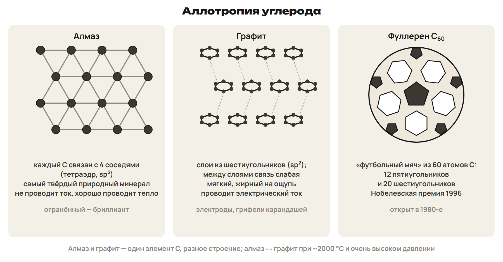
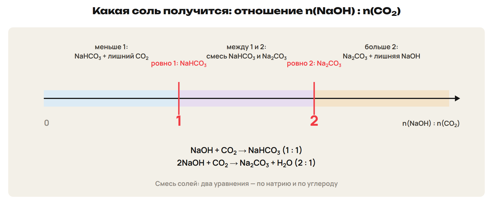
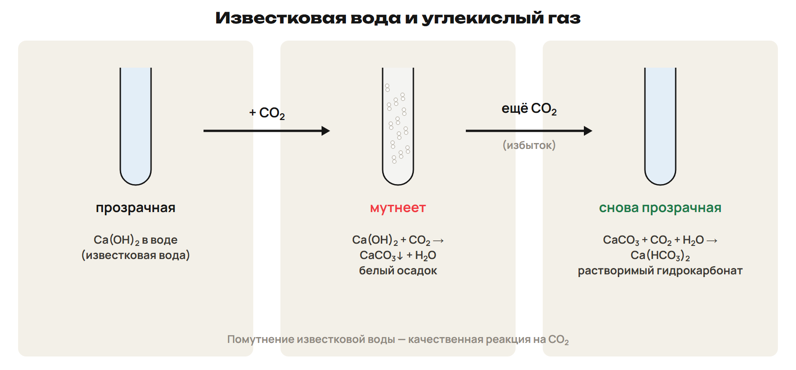

# Углерод: одно ядро, разные вещества
? Почему алмаз твёрдый и не проводит ток, а графит мягкий и проводит?
↳ Строение атома знакомо. Теперь свяжем расположение атомов с наблюдаемым свойством.
> 0–13 строение, аллотропия, адсорбция и реакции C; 13–16 L1; 16–18 ключ.

## Понятие: Место и нахождение углерода
C: Z = 6; второй период, группа 14; конфигурация 1s²2s²2p².
Четыре внешних электрона; обычные степени окисления −4, +2, +4.
Валентность C чаще IV, в CO — II; валентность и степень окисления различаются.
Углерод входит в органические вещества, уголь, нефть и природный газ.
Кальцит CaCO₃, магнезит MgCO₃, доломит CaCO₃·MgCO₃ — природные карбонаты.
В Казахстане — Карагандинский и Экибастузский угольные бассейны.
> В CaC₂ средняя степень окисления углерода −1, а не −4. Исторические оценки доли углерода не превращать в актуальную статистику.

## Схема: Решётка определяет свойство

Алмаз, графит, карбин, фуллерены — простые вещества одного элемента.
Алмаз: твёрдый, электрический изолятор, хорошо проводит тепло.
Графит: слабая связь между слоями, мягкость, электропроводность.
Карбин — линейные цепи; C₆₀ — замкнутый каркас.
Нанотрубки — полые трубчатые структуры из атомов C.
> Ошибку о плохой теплопроводности алмаза не переносить. Алмаз и графит взаимопревращаются при специальных условиях, а не от обычного нагревания.

## Понятие: Адсорбция — на поверхности
Адсорбция — удерживание газов или растворённых веществ поверхностью.
Обратный процесс — десорбция; поглощающее вещество — адсорбент.
У пористого активированного угля большая доступная поверхность.
Его применяют для очистки растворов и газов, в угольных фильтрах.
Противогаз Н. Д. Зелинского связан с активированным углём.
Поглощение поверхностью не равно поглощению всем объёмом.

## Пример: Углерод и условия реакции
При избытке O₂: C + O₂ → CO₂; при недостатке: 2C + O₂ → 2CO.
При нагревании C + H₂O → CO + H₂; C + CO₂ → 2CO.
Восстановление оксида: Fe₂O₃ + 3C → 2Fe + 3CO.
В карбиде алюминия C принимает электроны: 4Al + 3C → Al₄C₃.
В Ca + 2C → CaC₂ углерод тоже окислитель, но его средняя степень −1.
C + 2H₂ ⇄ CH₄ требует Ni, нагревания и давления.
> Примеры — выбор продуктов по условиям. Образование карбидов зависит от металла; нельзя обещать металл при восстановлении любого оксида.

## Понятие: CO и CO₂: одинаковые элементы, разная химия
CO бесцветен, без запаха, ядовит; мешает гемоглобину переносить O₂.
CO — несолеобразующий оксид, восстановитель: CuO + CO → Cu + CO₂.
2CO + O₂ → 2CO₂; для двух молей CO выделяется около 566 кДж.
CO₂ — кислотный оксид; твёрдый CO₂ называют сухим льдом.
CO₂ + 2Mg → 2MgO + C: здесь C(+4) восстанавливается.
Высокая концентрация CO₂ опасна; отсутствие запаха не означает безопасность.

## Практика: L1
Для алмаза и графита назови общий элемент и причину различия твёрдости.
Кто проводит ток, а кто хорошо проводит тепло, оставаясь изолятором?
Сколько пятиугольников в C₆₀? Что делает активированный уголь адсорбентом?
В CuO + CO → Cu + CO₂ найди степень окисления C до и после и роль CO.
Ответы:
Оба вещества состоят из C; у алмаза пространственная сеть, у графита слои.
Графит проводит ток; алмаз плохо проводит ток, но хорошо проводит тепло.
В C₆₀ 12 пятиугольников; пористость даёт углю большую поверхность.
C(+2) → C(+4): CO отдаёт электроны и служит восстановителем.
> 13–16 самостоятельная попытка, 16–18 объяснение причины.

# CO₂ и щёлочь: сначала соотношение
? Почему одна и та же пара реагентов даёт две разные соли?
↳ Кислотный оксид реагирует с основанием. Количество основания определяет степень нейтрализации.
> 18–26 угольная кислота, карбонаты и алгоритм; 26–30 L2; 30–33 ключ.

## Понятие: Кислотный оксид и угольная кислота
CO₂ + H₂O ⇄ H₂CO₃; угольная кислота очень слабая и неустойчивая.
CaCO₃ + 2HCl → CaCl₂ + CO₂↑ + H₂O — получение CO₂ из карбоната.
CO₃²⁻ + 2H⁺ → CO₂↑ + H₂O — сокращённое ионное уравнение.
CO₂ + 2NaOH → Na₂CO₃ + H₂O; CO₂ + NaOH → NaHCO₃.
Na₂CO₃ + CO₂ + H₂O → 2NaHCO₃.
При нагревании 2NaHCO₃ → Na₂CO₃ + CO₂ + H₂O.

## Схема: Соль по отношению NaOH : CO₂

Модель: полная стехиометрическая реакция, без потерь и иных процессов.
r = n(NaOH) / n(CO₂); при r = 2 карбонат, при r = 1 гидрокарбонат.
При 1 < r < 2: x = n(Na₂CO₃), y = n(NaHCO₃).
x + y = n(CO₂); 2x + y = n(NaOH).
При r > 2 остаётся NaOH; при r < 1 весь CO₂ не связывается в соль.
> Условие полного поглощения нельзя одновременно задавать при нехватке щёлочи и отсутствии иных поглотителей. В L2 отношение строго между 1 и 2.

## Практика: L2
Раствор содержит 0,35 моль NaOH; полностью поглощено 0,25 моль CO₂.
В идеализированной стехиометрической модели образуются только соли и вода.
Определи обе соли и их количества вещества.
Составь два баланса и проверь число атомов Na и C в ответе.
Ответы:
r = 0,35 / 0,25 = 1,4: смесь Na₂CO₃ и NaHCO₃.
x + y = 0,25; 2x + y = 0,35.
x = 0,10 моль Na₂CO₃; y = 0,15 моль NaHCO₃.
Проверка: C 0,10 + 0,15 = 0,25; Na 0,20 + 0,15 = 0,35 моль.
> 26–30 попытка, 30–33 сверка системы.

# Известковая вода: осадок растёт и исчезает
? Почему добавление того же газа сначала увеличивает, затем уменьшает массу осадка?
↳ Карбонат может стать гидрокарбонатом. Для кальция это ещё и переход из осадка в раствор.
> 33–40 две стадии и связь с жёсткостью; 40–44 L3; 44–47 ключ.

## Схема: Два этапа пропускания CO₂

Ca(OH)₂ + CO₂ → CaCO₃↓ + H₂O.
CaCO₃ + CO₂ + H₂O → Ca(HCO₃)₂.
Одна дополнительная молекула CO₂ растворяет одну формульную единицу CaCO₃.
При кипячении Ca(HCO₃)₂ → CaCO₃↓ + CO₂↑ + H₂O.
Это возврат к временной жёсткости воды.

## Понятие: Алгоритм двух стадий
Обозначь a = начальное n(Ca(OH)₂), b = поглощённое n(CO₂).
При b ≤ a образуется b моль CaCO₃; часть основания может остаться.
При a < b < 2a сначала образуется a моль осадка.
Избыток b − a растворяет столько же осадка.
Остаток осадка: a − (b − a) = 2a − b.
При b = 2a весь CaCO₃ переходит в Ca(HCO₃)₂.
> Это школьная количественная модель полного протекания двух стадий, не точное описание всех равновесий раствора.

## Практика: L3
Начальное количество Ca(OH)₂ — 0,12 моль, поглощено 0,18 моль CO₂.
Две стадии идут количественно; потерь и других реакций нет.
Найди массу оставшегося осадка и количество Ca(HCO₃)₂.
M(CaCO₃) = 100 г/моль. Покажи, какая порция CO₂ расходуется второй.
Ответы:
Первая стадия: 0,12 моль CO₂ образуют 0,12 моль CaCO₃.
Вторая порция: 0,18 − 0,12 = 0,06 моль CO₂.
Она растворяет 0,06 моль осадка и даёт 0,06 моль Ca(HCO₃)₂.
Остаётся 0,06 моль CaCO₃; m = 0,06 × 100 = 6 г.
> 40–44 попытка, 44–47 две стадии на доске.

# Кремний: получение и роль в реакции
? Почему полупроводник реагирует со щёлочью, хотя углерод в такой смеси остаётся?
↳ Одинаковые четыре внешних электрона не делают простые вещества одинаковыми реагентами.
> 47–55 Si, минералы, применение и получение; 55–60 L4; 60–63 ключ.

## Понятие: Si в природе и технике
Si: Z = 14; третий период, группа 14; 1s²2s²2p⁶3s²3p².
Второй после O элемент земной коры; свободным в природе не встречается.
Кремнезём SiO₂: кварц, песок, кремень, горный хрусталь.
Силикаты и алюмосиликаты — основа многих горных пород.
Кристаллический Si имеет решётку типа алмаза и является полупроводником.
Применение: электроника, солнечные батареи, кремнистые стали, силумин.
> Формулы полевого шпата и каолинита разобрать по конспекту; не заучивать противоречащие друг другу проценты Si в коре.

## Пример: Два целевых продукта из SiO₂
Получение Si по заданной схеме: SiO₂ + 2C → Si + 2CO.
Получение SiC: SiO₂ + 3C → SiC + 2CO.
Карборунд — SiC, абразив; боразон — BN, нитрид бора.
Лабораторное восстановление: SiO₂ + 2Mg → Si + 2MgO.
Особо чистый Si: SiCl₄ + 2Zn → Si + 2ZnCl₂.
Уравнение и целевой продукт определяют расчёт; одного слова «углерод» мало.
> В задаче на выход Si явно фиксируется первая схема. В реальной печи избыток C может вести к SiC.

## Понятие: Окислитель и восстановитель
Si + 2NaOH + H₂O → Na₂SiO₃ + 2H₂↑.
Si(0) → Si(+4): кремний служит восстановителем.
2Mg + Si → Mg₂Si: Si(0) → Si(−4), кремний окислитель.
При нагревании Si реагирует с O₂; с C образует SiC, с N₂ — Si₃N₄.
С обычными неокисляющими кислотами Si заметно не реагирует.
Кристаллический Si и бурый аморфный порошок различаются активностью.

## Практика: L4
36,0 г песка содержат 75 % SiO₂; остальные примеси инертны.
Si получают только по схеме SiO₂ + 2C → Si + 2CO, углерод в избытке.
Выход выделенного Si — 80 % относительно этой схемы.
Найди массу чистого SiO₂, теоретическую и фактическую массу Si.
M(SiO₂) = 60 г/моль; M(Si) = 28 г/моль.
Ответы:
m(SiO₂) = 36,0 × 0,75 = 27,0 г; n = 27,0 / 60 = 0,45 моль.
По уравнению n(Si)теор = 0,45 моль.
m(Si)теор = 0,45 × 28 = 12,6 г.
m(Si)факт = 12,6 × 0,80 = 10,08 г.
> 55–60 попытка, 60–63 проверка двух множителей.

# SiO₂ и силикаты: условия важнее внешнего сходства
? Как кислотный оксид может не реагировать с водой?
↳ Тип оксида определяется реакциями с основаниями, а не обязательным растворением в воде.
> 63–71 SiO₂, кислота и силикаты; 71–75 L5; 75–78 ключ.

## Понятие: SiO₂ — твёрдый кислотный оксид
У SiO₂ атомная сетка: он твёрдый, тугоплавкий, с водой не реагирует.
При сплавлении SiO₂ + 2NaOH → Na₂SiO₃ + H₂O.
При нагревании CaO + SiO₂ → CaSiO₃.
При сплавлении SiO₂ + Na₂CO₃ → Na₂SiO₃ + CO₂↑.
Травление стекла: SiO₂ + 4HF → SiF₄ + 2H₂O.
При избытке HF: SiF₄ + 2HF → H₂[SiF₆].
> Для Na₂CO₃ сохранить условие сплавления. HF здесь только реагент для свойства SiO₂; отдельную тему галогенов не вводить.

## Понятие: Гель из раствора соли
Среди изученных силикатов Na₂SiO₃ и K₂SiO₃ растворимы.
Их называют растворимым стеклом, водные растворы — жидким стеклом.
K₂SiO₃ + 2HCl → H₂SiO₃↓ + 2KCl.
H₂SiO₃ — условная школьная запись гидратированного кремнезёма.
Гель при полном прокаливании даёт SiO₂; его влажная масса не задана формулой.
Гидролиз силикат-ионов делает раствор щелочным.

## Пример: Почему две реакции не противоречат друг другу
В растворе: K₂SiO₃ + CO₂ + H₂O → H₂SiO₃↓ + K₂CO₃.
Угольная кислота сильнее кремниевой; образуется гель.
При сплавлении: SiO₂ + Na₂CO₃ → Na₂SiO₃ + CO₂↑.
Здесь CO₂ уходит как газ, а SiO₂ нелетуч.
Раствор и сплавление — разные условия.
K₂SiO₃ + CaCl₂ → CaSiO₃↓ + 2KCl — обмен с образованием осадка.

## Практика: L5
К раствору с 15,4 г чистого K₂SiO₃ добавили избыток HCl.
Полученный гель отделили без потерь и полностью прокалили до SiO₂.
Найди массу сухого SiO₂; M(K₂SiO₃) = 154 г/моль, M(SiO₂) = 60 г/моль.
Запиши две стадии. Почему по этим данным не надо искать массу влажного геля?
Ответы:
K₂SiO₃ + 2HCl → H₂SiO₃↓ + 2KCl; условно H₂SiO₃ → SiO₂ + H₂O.
n(K₂SiO₃) = 15,4 / 154 = 0,10 моль.
На каждой стадии один атом Si: n(SiO₂) = 0,10 моль; m = 6,0 г.
Влажный гель содержит переменное количество воды; его масса не определена.
> 71–75 попытка, 75–78 проверка сохранения Si.

# Собери алгоритм без подсказки
? Какие два уточнения нужно прочитать прежде, чем расставлять коэффициенты?
↳ Мы различили вещества и условия. Теперь перенесём этот способ на короткие новые вопросы.
> 78–81 алгоритм; 81–85 L6; 85–88 ключ; 88–90 маршрут после урока.

## Понятие: Сначала условие, затем расчёт
Назови вещество: C, CO, CO₂, Si или SiO₂.
Найди среду и условие: раствор, нагревание, сплавление, избыток.
Выбери реакцию и проверь атомы; для ОВР — изменение степеней окисления.
Переведи данные в моли и сравни отношение реагентов.
Для двух солей составь балансы; для осадка раздели стадии.
В конце примени чистоту и выход, если они даны.

## Практика: L6
Сравни CO, CO₂ и SiO₂: где кислотный оксид, где несолеобразующий?
Какой из трёх оксидов не реагирует с водой, но при сплавлении даёт силикат?
Запиши реакцию CO₂ с Mg и назови роль CO₂.
Исправь вывод: «Если CaCO₃ уже выпал, дополнительный CO₂ только увеличит осадок».
Ответы:
CO — несолеобразующий; CO₂ и SiO₂ — кислотные.
SiO₂ с водой не реагирует, но даёт силикат при сплавлении со щёлочью.
CO₂ + 2Mg → 2MgO + C; C(+4) принимает электроны, CO₂ — окислитель.
Избыток CO₂ растворяет CaCO₃: образуется растворимый Ca(HCO₃)₂.
> 81–85 попытка, 85–88 правило своими словами.

## Дома: После урока 29
Повтори разделы 1–3 конспекта — 25 минут.
Выполни закрепление P1–P6 — 20 минут, затем всю G — 35 минут.
Сохрани первую попытку; пришли тест строкой, G9–G10 фото решения.
Отметь одну причину ошибки, которую хочешь разобрать на уроке 30.
Предварительно читать разделы 4–6 перед уроком 30 не требуется.
