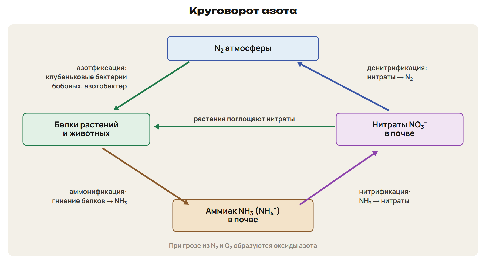
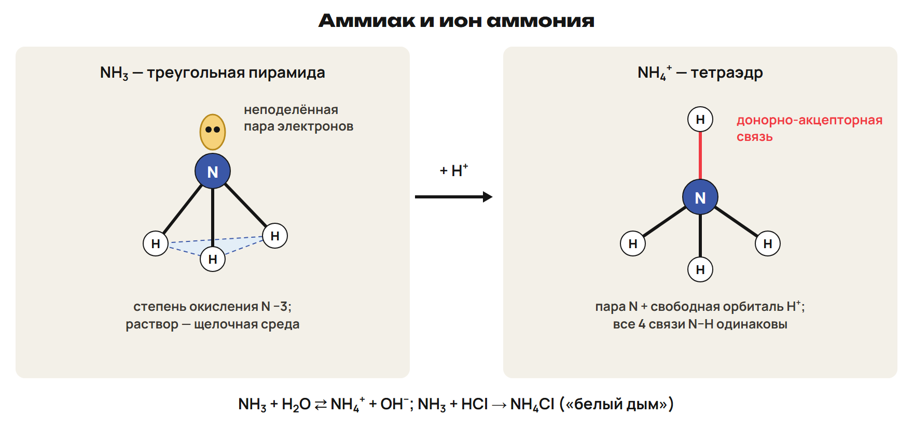
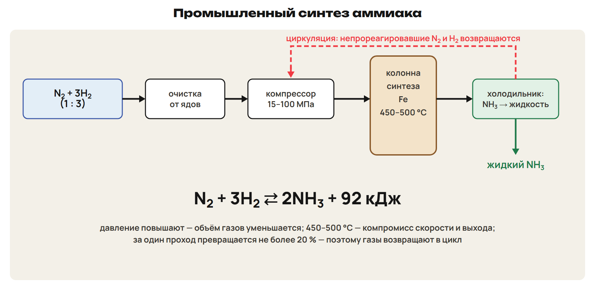
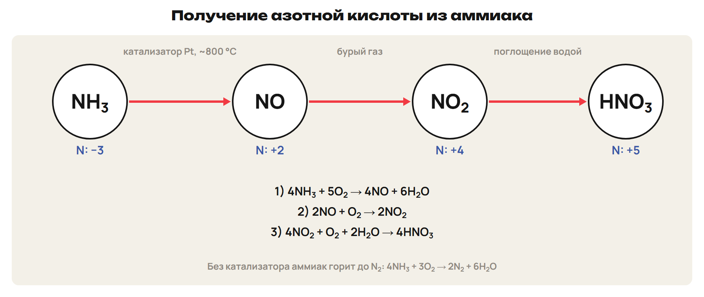
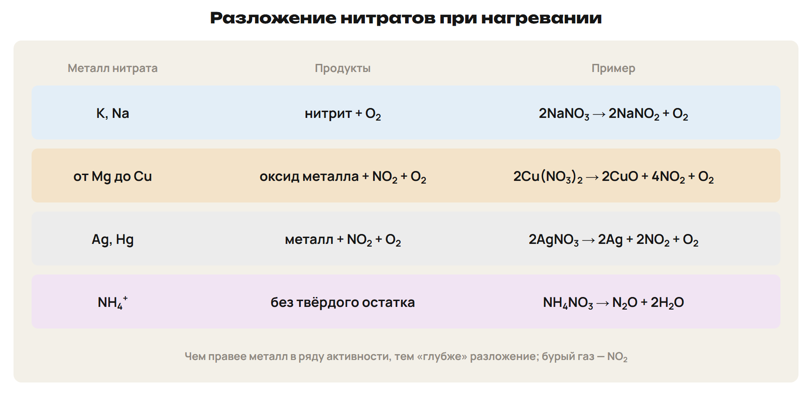
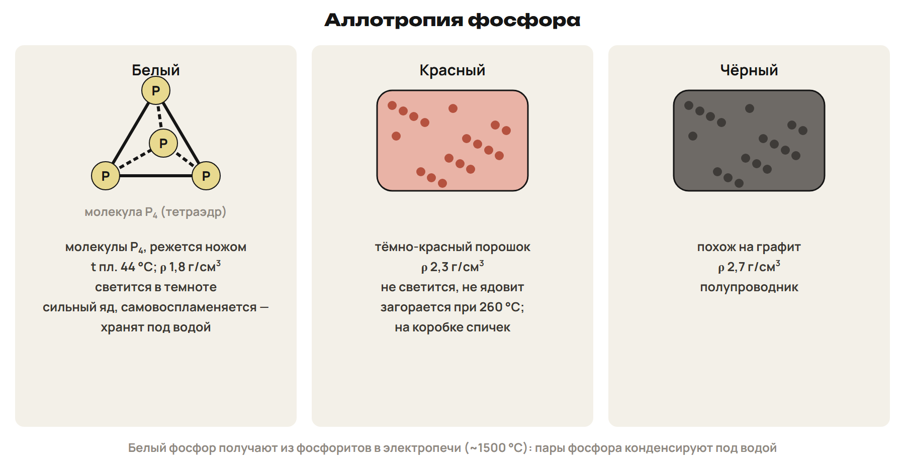
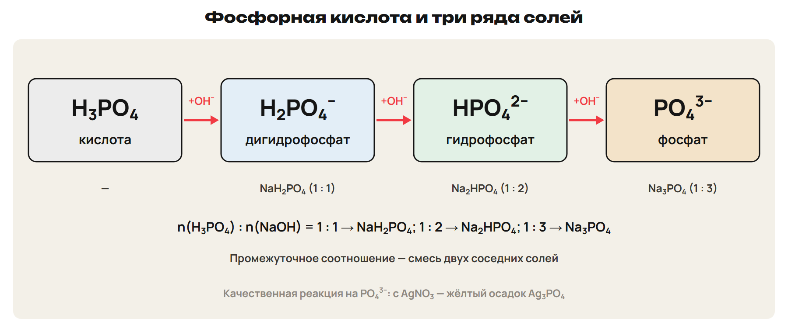
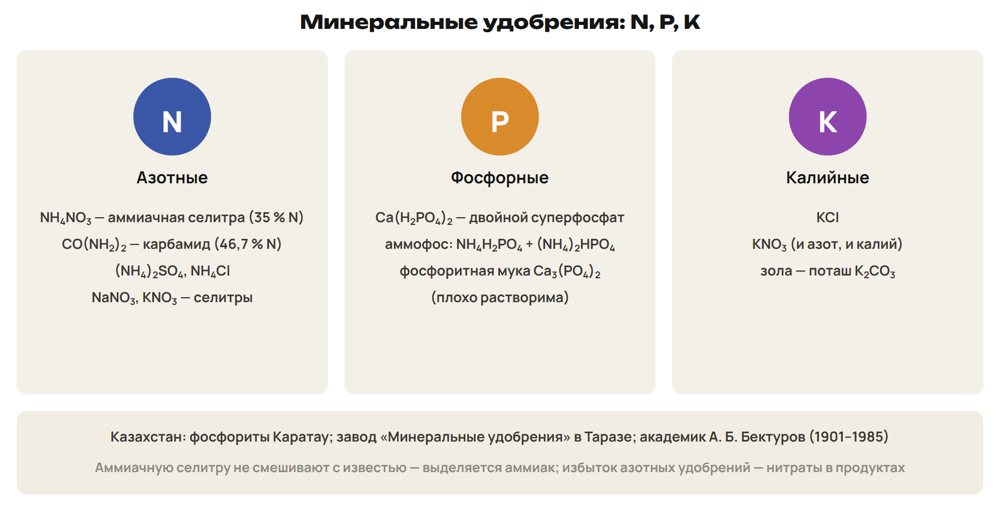

# Возврат: две соли и один реагирующий компонент
? Где ответ зависит от системы балансов, а где — от избирательности реакции?
↳ Сравним два способа из G и вернём знакомое равновесие для дальнейшей технологии.
> 0–12 G9–G10; 12–17 L7 по равновесию; 17–20 объяснение причин.

## Понятие: Сверяй первую причину ошибки
В G9 отношение NaOH : CO₂ находится между 1 и 2: нужны две соли.
В G10 в заданных условиях H₂ выделяет Si, углерод остаётся.
Проверяй коэффициенты до подстановки чисел.
При н. у. для газов используй Vₘ = 22,4 л/моль.
Сохрани исходное решение и объясни исправленное правило.

## Практика: Разбор G9–G10
G9: 0,450 моль NaOH полностью поглощают 0,300 моль CO₂ по стехиометрической модели.
Найди количества и массы двух солей; M(Na₂CO₃) = 106, M(NaHCO₃) = 84 г/моль.
G10: смесь C и Si массой 20,0 г с избытком водного NaOH даёт 6,72 л H₂ при н. у.
В этих условиях реагирует только Si, потерь нет; M(Si) = 28 г/моль.
Найди массы Si и C; Vₘ = 22,4 л/моль.
Ответы:
G9: x + y = 0,300; 2x + y = 0,450; x = y = 0,150 моль.
m(Na₂CO₃) = 15,9 г; m(NaHCO₃) = 12,6 г.
G10: Si + 2NaOH + H₂O → Na₂SiO₃ + 2H₂.
n(H₂) = 6,72 / 22,4 = 0,300 моль; n(Si) = 0,150 моль.
m(Si) = 4,2 г; m(C) = 20,0 − 4,2 = 15,8 г.
> 0–12 обсуждение ошибок G, ключ после объяснения учеником.

## Практика: L7
Для N₂ + 3H₂ ⇄ 2NH₃ + Q выбери изменение давления и температуры, увеличивающее равновесную долю NH₃.
Как катализатор влияет на положение равновесия и время его достижения?
Почему промышленная температура не обязана быть минимальной?
Чем удаление NH₃ отличается от действия катализатора?
Ответы:
Давление повышают: справа меньше молей газа; температуру понижают: прямое направление экзотермично.
Катализатор ускоряет оба направления и достижение равновесия, не меняя его положения.
Очень низкая температура замедляет реакцию: нужен компромисс скорости и выхода.
Удаление NH₃ сдвигает равновесие вправо; катализатор такого сдвига не создаёт.
> 12–17 самостоятельный возврат к равновесию, 17–20 ключ.

# Азот и аммиак: связь, основание и производство
? Почему молекула N₂ малоактивна, а NH₃ связывает протон и легко окисляется?
↳ Условия равновесия вернули. Теперь свяжем их с молекулами и промышленной схемой.
> 20–29 азот, аммиак, соли и синтез; 29–32 L8; 32–34 ключ.

## Схема: N₂ и круговорот азота

N≡N — прочная тройная связь; при обычных условиях N₂ малоактивен.
Воздух содержит около 78 % N₂ по объёму; жидкий N₂ — хладагент.
6Li + N₂ → 2Li₃N при обычных условиях.
При нагревании 3Mg + N₂ → Mg₃N₂; при разряде N₂ + O₂ ⇄ 2NO.
Азот нужен для NH₃ и удобрений, а также защитной атмосферы.

## Схема: От пирамиды к иону аммония

NH₃ — бесцветный газ с резким запахом, легче воздуха, хорошо растворим в воде.
NH₃ + H₂O ⇄ NH₄⁺ + OH⁻: раствор щелочной.
NH₃ + H⁺ → NH₄⁺: донорно-акцепторное образование связи.
NH₃ + HCl → NH₄Cl; степень окисления N остаётся −3.
Соль аммония + щёлочь при нагревании выделяет NH₃.
> Растворимость около 700 объёмов — учебный ориентир при соответствующих условиях, не универсальная постоянная. Избыток NH₃ с Cu²⁺ может дать комплекс вместо сохранения осадка.

## Пример: Две роли NH₃ различаются по N
NH₄Cl + NaOH → NaCl + NH₃↑ + H₂O — получение и выявление NH₄⁺.
Без катализатора: 4NH₃ + 3O₂ → 2N₂ + 6H₂O.
С Pt–Rh: 4NH₃ + 5O₂ → 4NO + 6H₂O.
При нагревании 2NH₃ + 3CuO → 3Cu + N₂ + 3H₂O.
В этих ОВР азот в NH₃ повышает степень окисления: NH₃ — восстановитель.
2NH₃ → N₂ + 3H₂ при нагревании; NH₃ служит сырьём HNO₃ и удобрений.
> Восстановительный характер относится к N(−3) в изученных реакциях; абсолютное «молекула NH₃ никогда не бывает окислителем» неверно.

## Схема: Синтез аммиака с циркуляцией

N₂ + 3H₂ ⇄ 2NH₃ + 92 кДж; Fe ускоряет достижение равновесия.
450–500 °C — компромисс скорости и выхода; давление повышенное.
Газы очищают от катализаторных ядов; NH₃ отделяют охлаждением.
За один проход превращается лишь часть смеси; оставшиеся газы возвращают.
Габер — синтез 1908; Бош — промышленная установка 1913.
> Диапазоны относятся к учебной технологической схеме; не называть их единственными режимами всех установок. Чтение противотока, теплообменника и циркуляционного компрессора — только A.

## Практика: L8
16,05 г NH₄Cl реагируют с избытком NaOH при нагревании.
Выход собранного NH₃ — 75 % относительно уравнения NH₄Cl + NaOH → NaCl + NH₃ + H₂O.
Найди объём NH₃ при н. у.
M(NH₄Cl) = 53,5 г/моль; Vₘ = 22,4 л/моль.
Ответы:
n(NH₄Cl) = 16,05 / 53,5 = 0,300 моль.
n(NH₃)теор = 0,300 моль; n(NH₃)факт = 0,300 × 0,75 = 0,225 моль.
V(NH₃) = 0,225 × 22,4 = 5,04 л.
> 29–32 попытка, 32–34 проверка отношения и выхода.

# HNO₃: цепочка производства и выбор продукта
? Почему с медью кислота не даёт обычную схему выделения H₂?
↳ При окислении аммиака получаем оксиды азота, а затем кислоту с азотом в высшей степени окисления.
> 34–42 производство, свойства и пассивация; 42–46 L9; 46–48 ключ.

## Схема: Три стадии получения HNO₃

4NH₃ + 5O₂ → 4NO + 6H₂O; Pt–Rh, нагревание.
2NO + O₂ → 2NO₂.
4NO₂ + O₂ + 2H₂O → 4HNO₃.
По суммарному балансу один N в NH₃ даёт один N в HNO₃.
Потери стадий учитывают через выходы, а не меняют коэффициенты.

## Понятие: Общие свойства и устойчивость кислоты
HNO₃ — сильная одноосновная кислота; N имеет +5, валентность IV.
Лакмус красный; реагирует с основаниями и основными или амфотерными оксидами.
Na₂CO₃ + 2HNO₃ → 2NaNO₃ + CO₂↑ + H₂O.
На свету и при нагревании: 4HNO₃ → 4NO₂ + O₂ + 2H₂O; кислота желтеет.
HNO₃ окрашивает белки в жёлтый цвет.
Лабораторная схема: NaNO₃ + H₂SO₄(конц.) → NaHSO₄ + HNO₃ при слабом нагревании.

## Пример: Cu и два режима кислоты
Cu + 4HNO₃(конц.) → Cu(NO₃)₂ + 2NO₂↑ + 2H₂O.
3Cu + 8HNO₃(разб.) → 3Cu(NO₃)₂ + 2NO↑ + 4H₂O.
NO₂ бурый; NO бесцветный и окисляется на воздухе: 2NO + O₂ → 2NO₂.
В этих реакциях восстанавливается N(+5), а Cu(0) окисляется до Cu(+2).
Холодная концентрированная HNO₃ пассивирует Fe, Al, Cr.
Для продукта нужны металл, концентрация и температура, а не только название кислоты.
> Не расширять правила Cu на любой металл и любую концентрацию; абсолютное «H₂ никогда ни при каких условиях» не использовать.

## Практика: L9
Запиши реакции Cu отдельно с концентрированной и разбавленной HNO₃.
В каждом случае покажи электронный баланс Cu и N.
Назови цвет первичного газа и объясни побурение газа из разбавленной кислоты на воздухе.
Что ожидается для Fe в холодной концентрированной HNO₃?
Ответы:
Конц.: Cu + 4HNO₃ → Cu(NO₃)₂ + 2NO₂ + 2H₂O.
Cu(0) − 2e⁻ → Cu(+2); два N(+5) принимают по 1e⁻ до N(+4).
Разб.: 3Cu + 8HNO₃ → 3Cu(NO₃)₂ + 2NO + 4H₂O.
Три Cu отдают 6e⁻; два N(+5) принимают по 3e⁻ до N(+2).
NO₂ бурый, NO бесцветный, затем окисляется O₂; холодная концентрированная HNO₃ пассивирует Fe.
> 42–46 попытка, 46–48 сверка баланса.

# Нитраты: металл определяет твёрдый остаток
? Почему нагревание разных нитратов не даёт один и тот же тип остатка?
↳ Кислота даёт растворимые соли. Для их разложения нужно отдельно выбрать металл и уравнение.
> 48–54 ряды нитратов и качественная реакция; 54–58 L10; 58–60 ключ.

## Схема: Три ряда и отдельный NH₄NO₃

2KNO₃ → 2KNO₂ + O₂.
2Mg(NO₃)₂ → 2MgO + 4NO₂ + O₂.
2AgNO₃ → 2Ag + 2NO₂ + O₂.
NH₄NO₃ → N₂O + 2H₂O — отдельная учебная схема.
Сначала выбери ряд, затем проверь коэффициенты.
> Литий в тестовые задания не включать. Нагревание нитрата аммония дано как распознавание школьной реакции, без инструкции к опыту.

## Понятие: Распознавание и названия
Изученные нитраты хорошо растворимы в воде; цвет зависит от катиона.
Для NO₃⁻ учебная качественная реакция: медь, концентрированная H₂SO₄, нагревание — бурый NO₂.
Чилийская селитра — NaNO₃; калийная — KNO₃; аммиачная — NH₄NO₃.
Избыток нитратов опасен: продукты их превращения нарушают перенос O₂ гемоглобином.
Уравнение разложения показывает количество газов и состав остатка.
Для объёма NO₂ нужно явно задать модель: газ склонен образовывать N₂O₄.

## Практика: L10
29,6 г безводного Mg(NO₃)₂ полностью разлагаются по указанной схеме до MgO, NO₂ и O₂.
Найди массу твёрдого остатка и суммарный расчётный объём NO₂ и O₂ при н. у.
Модель газов идеальная: димеризацию NO₂ в N₂O₄ и конденсацию не учитывай.
M(Mg(NO₃)₂) = 148; M(MgO) = 40 г/моль; Vₘ = 22,4 л/моль.
Ответы:
2Mg(NO₃)₂ → 2MgO + 4NO₂ + O₂; n соли = 29,6 / 148 = 0,200 моль.
n(MgO) = 0,200 моль; m = 0,200 × 40 = 8,0 г.
n(NO₂) = 0,400 моль; n(O₂) = 0,100 моль.
Vсум = (0,400 + 0,100) × 22,4 = 11,2 л в заданной модели.
> 54–58 попытка, 58–60 проверка числа молей газов.

# Фосфор, три ряда солей и питание растений
? Почему три кислотных H не означают, что при любом количестве щёлочи получится одна средняя соль?
↳ У карбонатов нейтрализация дала два ряда. Для трёхосновной кислоты проверим три ступени.
> 60–68 фосфор и кислота; 68–71 L11; 71–75 удобрения; 75–77 L12; 77–78 ключ.

## Схема: Белый и красный фосфор

Фосфор открыл Х. Бранд в 1669 году; свободным в природе он не встречается.
Фосфориты и апатиты — фосфатное сырьё; Каратау — район фосфоритов.
Белый P₄ — ядовит; красный менее опасен и не светится как белый.
Чёрный фосфор имеет графитоподобное строение и полупроводниковые свойства.
Минералы апатитов не сводятся к одной формуле Ca₃(PO₄)₂.

## Пример: Получение и превращения P
В электропечи: 2Ca₃(PO₄)₂ + 10C + 6SiO₂ → 6CaSiO₃ + P₄ + 10CO.
С кислородом: 4P + 5O₂ → 2P₂O₅; P — восстановитель.
С металлами образуются фосфиды: 3Ca + 2P → Ca₃P₂; P — окислитель.
PH₃ — ядовитый газ; самовоспламенение технического газа связано с примесями.
P₂O₅ + 3H₂O → 2H₃PO₄.
Ca₃(PO₄)₂ + 3H₂SO₄ → 3CaSO₄ + 2H₃PO₄.
> P₂O₅ — принятая школьная формула состава оксида. Не объявлять чистый PH₃ безусловно самовоспламеняющимся.

## Схема: Три ряда Na-фосфатов

H₃PO₄ — трёхосновная кислота средней силы, диссоциирует ступенчато.
H₂PO₄⁻ — дигидрофосфат, HPO₄²⁻ — гидрофосфат, PO₄³⁻ — фосфат.
H₃PO₄ + 2NH₃ → (NH₄)₂HPO₄; с 1NH₃ получается NH₄H₂PO₄.
Na₂HPO₄ + NaOH → Na₃PO₄ + H₂O.
3Ag⁺ + PO₄³⁻ → Ag₃PO₄↓ — жёлтый осадок в подходящей некислой среде.
> Не обещать устойчивый (NH₄)₃PO₄ в любом растворе. Непосредственно в кислой H₃PO₄ осадок Ag₃PO₄ не гарантируется.

## Практика: L11
В идеализированной стехиометрической модели 0,12 моль H₃PO₄ нейтрализуют 0,30 моль NaOH.
Обе порции реагируют полностью; образуются две соседние соли, других процессов нет.
Назови соли и найди количества вещества.
Почему NaH₂PO₄ не подходит для этой пары соседних ступеней?
Ответы:
r = n(NaOH) / n(H₃PO₄) = 0,30 / 0,12 = 2,5.
Соли — Na₂HPO₄ (x) и Na₃PO₄ (y).
x + y = 0,12; 2x + 3y = 0,30.
x = y = 0,06 моль; отношение лежит между второй и третьей ступенью.
> 68–71 попытка, сверить ответ до перехода к удобрениям.

## Схема: Удобрение узнают по элементам питания

Основные элементы удобрений — N, P, K; Fe относится к микроэлементам.
Карбамид CO(NH₂)₂ содержит 28/60 × 100 % = 46,7 % N.
Аммофос содержит NH₄H₂PO₄ и (NH₄)₂HPO₄; двойной суперфосфат — Ca(H₂PO₄)₂.
А. Б. Бектуров — химия минеральных удобрений; производство связано с Таразом.
Избыточное внесение азотных удобрений загрязняет воду нитратами.

## Пример: От NH₃ к двум удобрениям
NH₃ + HNO₃ → NH₄NO₃; нейтрализация, упаривание и грануляция.
2NH₃ + CO₂ → NH₂COONH₄ — карбамат аммония.
NH₂COONH₄ → CO(NH₂)₂ + H₂O — карбамид.
Первая стадия экзотермическая, вторая эндотермическая.
Для доли N считай все атомы N, затем дели на молярную массу вещества.
Аммиачную селитру не смешивают с известью: выделяется NH₃.
> В суммарной схеме два атома N из двух молекул NH₃ переходят в одну молекулу карбамида; CO₂ поставляет атом C.

## Практика: L12
Сравни массовую долю N в (NH₄)₂SO₄ и NH₄NO₃.
M((NH₄)₂SO₄) = 132 г/моль; M(NH₄NO₃) = 80 г/моль; Aᵣ(N) = 14.
Какое удобрение содержит больше N в одинаковой массе чистого вещества?
Почему оба атома N в NH₄NO₃ входят в числитель, хотя находятся в разных ионах?
Ответы:
В каждой формуле два атома N: масса N на моль вещества равна 28 г.
ω(N) в (NH₄)₂SO₄ = 28/132 × 100 % ≈ 21,2 %.
ω(N) в NH₄NO₃ = 28/80 × 100 % = 35,0 %.
В одинаковой массе чистого NH₄NO₃ азота больше; массовая доля учитывает N в обоих ионах.
> 75–77 попытка, 77–78 ключ.

# Контроль и домашний маршрут
? Можешь ли ты выбрать продукт по условиям, обосновать соотношение и рассчитать выход без подсказки?
↳ Сопоставили кислотно-основные реакции, ОВР и технологию. Проверь способ на самостоятельной работе.
> 78–88 Q1–Q6 без подсказок; 88–90 назначить один A/B/C и исправления.

## Понятие: Контроль Q1–Q6
Работай самостоятельно 10 минут, максимум 10 баллов.
Q1–Q3 — одна буква; Q4 — все верные; Q5 — две пары; Q6 — расчёт с объяснением.
Сдай попытку до открытия отдельного ключа.
Сохрани уравнение и промежуточные числа в контексте Q6.
> Ключ отделить до выдачи. Маршрут назначать по G, контролю, объяснению ученика и входной диагностике.

## Дома: После урока 30
Выполни один назначенный A/B/C — 30 минут.
Для A прочитай четыре приложения ниже внутри этих 30 минут.
Исправь до двух причин ошибки — 25 минут.
Повтори разделы 4–6 конспекта и факты — 15 минут.
Вместе с работой после урока 29 — 150 минут.

## Понятие: Углубление A · Ge, Sn, Pb и их оксиды
Ge — полупроводник: GeO₂ + 2H₂ → Ge + 2H₂O.
Касситерит — SnO₂; галенит — PbS; Sn и Pb — металлы.
SnO₂ + 4HCl → SnCl₄ + 2H₂O; SnO₂ + 2NaOH → Na₂SnO₃ + H₂O при сплавлении.
PbO₂ + 4HCl → PbCl₂ + Cl₂ + 2H₂O: Pb(+4) восстанавливается до Pb(+2).
Оксиды Sn и Pb амфотерны; свойства нельзя определять одной цифрой степени окисления.
Свинец поглощает рентгеновское и γ-излучение и токсичен.
> Приложение только A внутри его 30 минут. У тенденций группы есть исключения: температура плавления Pb выше Sn; низкая степень не означает только восстановительные свойства.

## Понятие: Углубление A · Оксиды азота и экология
Двигатели и тепловые установки — источники оксидов азота.
2NO + O₂ → 2NO₂; 2NO₂ + H₂O → HNO₃ + HNO₂.
Эти превращения связаны с кислотными дождями и фотохимическим смогом.
N₂O участвует в процессах разрушения стратосферного озона.
Избыточный приток соединений N в воду усиливает рост водорослей.
Разложение их массы расходует O₂ и может создавать зоны с его недостатком.

## Понятие: Углубление A · Технология как система
В синтезе NH₃ теплообменник использует тепло выходящей смеси для нагрева входящей.
Противоток поддерживает эффективный обмен теплом между потоками.
Охлаждение отделяет NH₃; циркуляционный компрессор возвращает N₂ и H₂.
Непрерывная циркуляция повышает общее использование сырья, а не равновесный выход за проход.
Если потери последовательных стадий заданы отдельно, соответствующие выходы перемножают.
Массу раствора находят по массе чистого продукта: mраствора = mвещества / ω.

## Практика: Углубление A · Параллельные реакции
11,0 г смеси Al и Fe полностью реагируют с избытком разбавленной HCl.
Выделилось 8,96 л H₂ при н. у.; найди массы металлов.
M(Al) = 27; M(Fe) = 56 г/моль; Vₘ = 22,4 л/моль.
Обозначь x = n(Al), y = n(Fe) и составь систему по массе и газу.
Ответы:
2Al + 6HCl → 2AlCl₃ + 3H₂; Fe + 2HCl → FeCl₂ + H₂.
n(H₂) = 8,96 / 22,4 = 0,400 моль.
27x + 56y = 11,0; 1,5x + y = 0,400.
x = 0,200 моль, y = 0,100 моль.
m(Al) = 5,4 г; m(Fe) = 5,6 г.
> Самопроверка только A внутри его 30 минут, после самостоятельной попытки.
