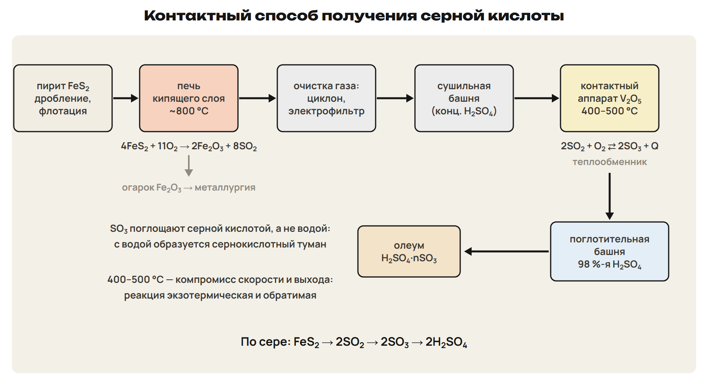

# Урок 32. Сера, серная кислота и контактный способ; рубеж неорганики

11 марта 2027, четверг; 90 минут. Группы 18:00–19:30 и 19:30–21:00.

Причина → алгоритм → разные примеры → ловушка → самостоятельная попытка. Ответы практики открывать после попытки. Все задания L авторские, тренировочные.

## План на 90 минут

| Время | Действие |
|---|---|
| 0–20 | 0–4 вопросы; 4–6 возврат алгоритма; 6–13 G9; 13–20 G10. |
| 20–37 | 20–29 сера, H₂S и сульфиды; 29–32 L7 с ключом; 32–37 L8 с ключом. |
| 37–49 | 37–44 оксиды серы и кислотные дожди; 44–47 L9; 47–49 ключ. |
| 49–63 | 49–57 свойства H₂SO₄, соли и условия; 57–61 L10; 61–63 ключ. |
| 63–78 | 63–70 стадии и олеум; 70–73 L11 с ключом; 73–78 L12 с ключом. |
| 78–88 | Рубеж Q1–Q6 по неделям 13–16: 10 минут, 10 баллов, без подсказок. |
| 88–90 | Назначить один вариант A/B/C и исправления. |

## 1. Возврат: коэффициенты, выход и вытеснение · 0–20 минут

**Вопрос:** Где в решении появляется выход собранного газа, а где — отношение коэффициентов?

**Мост:** Дома ты применил реакции первого урока. Сначала проверим моли и направление вытеснения, затем перейдём к сере.

**Проверь причину ошибки.** Сначала выбери уравнение по веществам и условиям. Переходи от массы или объёма к количеству вещества. Отношение коэффициентов относится к конкретной паре веществ. Выход собранного продукта применяй к теоретическому результату один раз. В вытеснении сравни окислительную силу галогенов.

### Разбор G9

6,32 г KMnO₄ реагируют с избытком концентрированной HCl. Выход собранного Cl₂ — 75 % от теоретического. Найди его объём при н. у. M(KMnO₄) = 158 г/моль; M(Cl₂) = 71 г/моль; Vₘ = 22,4 л/моль. Используй уравнение 2KMnO₄ + 16HCl → 2KCl + 2MnCl₂ + 5Cl₂ + 8H₂O.

**Ответ и решение:** n(KMnO₄) = 6,32 / 158 = 0,040 моль. n(Cl₂)теор = 0,040 × 5 / 2 = 0,100 моль. n(Cl₂)собрано = 0,100 × 0,75 = 0,075 моль. V(Cl₂) = 0,075 × 22,4 = 1,68 л.

**Типичная ошибка и новая проверка:** Разделить на выход или взять отношение KMnO₄ : Cl₂ как 1 : 1. Новая проверка: подписать 2 : 5 над соответствующими формулами.

6–11 восстановить ход G9; 11–13 открыть решение. Сначала выслушать вопросы учеников по их попыткам.

### Разбор G10

3,36 л Cl₂ при н. у. полностью прореагировали с избытком NaI. Потерь I₂ нет. Найди его массу. M(Cl₂) = 71 г/моль; M(I₂) = 254 г/моль; Vₘ = 22,4 л/моль. Покажи, какой элемент восстанавливается и почему вытеснение возможно.

**Ответ и решение:** Cl₂ + 2NaI → 2NaCl + I₂: хлор окисляет иодид. n(Cl₂) = 3,36 / 22,4 = 0,150 моль; n(I₂) = 0,150 моль. m(I₂) = 0,150 × 254 = 38,1 г. Cl(0) → Cl(−1): хлор восстанавливается; I(−1) → I(0).

**Типичная ошибка и новая проверка:** Взять молярную массу атомов I вместо I₂. Новая проверка: назвать частицы в исходном и конечном простом веществе.

13–18 решение по первой попытке G10; 18–20 сверка и объяснение направления.

## 2. Сера и H₂S: строение и степень окисления · 20–37 минут

**Вопрос:** Как сера в простом веществе может быть и окислителем, и восстановителем?

**Мост:** У галогенов часто рассматривали принятие электронов. У серы сравним движение степени окисления вверх и вниз.

**Кольца S₈ и пластическая сера.**  Обычная кристаллическая сера состоит из циклических молекул S₈. Пластическая сера имеет цепное строение; её получают быстрым охлаждением расплава. Порошок плохо смачивается водой; плавание не доказывает плотность меньше воды. Во флотации несмачиваемые частицы связаны с пузырьками и поднимаются в пену.

Рисунок образования пластической серы — схема свойства, не задание на домашний опыт. Не назначать одну температуру плавления универсальной для всех форм.

**Нахождение и применение серы.** Сера встречается самородной; её доля в земной коре около 0,05 %. Сульфиды: ZnS — цинковая обманка, FeS₂ — пирит, HgS — киноварь. PbS — свинцовый блеск; в пирите средняя степень окисления S равна −1. Сульфаты: CaSO₄·2H₂O — гипс, Na₂SO₄·10H₂O — глауберова соль. Применение: серная кислота, вулканизация каучука, спички, удобрения. Роли S: H₂ + S → H₂S при нагревании; S + O₂ → SO₂; Hg + S → HgS.

В первой и третьей реакциях S — окислитель, при горении — восстановитель. Связывание Hg серой называется демеркуризацией; практических поручений с ртутью не давать.

**H₂S и сероводородная кислота.** H₂S — бесцветный ядовитый газ с запахом тухлых яиц, немного тяжелее воздуха. Встречается в вулканических газах, минеральных водах; возникает при гниении белков. Раствор — слабая двухосновная кислота; возможны ионы HS⁻ и S²⁻. H₂S + NaOH → NaHS + H₂O; H₂S + 2NaOH → Na₂S + 2H₂O. Кислота реагирует с основными оксидами, щёлочами и активными металлами. Лабораторная схема: FeS + 2HCl → FeCl₂ + H₂S↑.

Свойства газа описывать без вдыхания. H₂S образует примерно 2,5 объёма растворённого газа на объём воды в приведённых в учебнике условиях; не смешивать это число с молярным объёмом.

**Сульфиды и восстановительная роль серы.** В H₂S степень окисления S равна −2: по сере в изученных ОВР он восстановитель. Это не отменяет кислотных реакций H₂S с активными металлами. Сульфиды щелочных металлов и аммония растворимы; гидролиз даёт щелочную среду. CuS, PbS, NiS — чёрные нерастворимые сульфиды; MnS — розовый. H₂S + CuSO₄ → CuS↓ + H₂SO₄. Обжиг сульфида: 2CuS + 3O₂ → 2CuO + 2SO₂.

Подробные превращения H₂S с окислителями — приложение A2. Формулу CuS надёжно использовать для осадка из Cu²⁺ и S²⁻, не как единственный продукт любых условий Cu + S.

### L7

В H₂ + S → H₂S и S + O₂ → SO₂ укажи изменение степени окисления S. Назови роль простого вещества S в каждом случае. Какую роль по сере выполняет H₂S в изученных ОВР и почему?

**Ответ и решение:** H₂ + S → H₂S: S 0 → −2, принимает электроны, окислитель. S + O₂ → SO₂: S 0 → +4, отдаёт электроны, восстановитель. В H₂S сера уже имеет −2; в изученных ОВР её степень повышается. По сере H₂S выступает восстановителем; кислотные свойства рассматриваются отдельно.

**Типичная ошибка и новая проверка:** Назвать любое вещество с S окислителем. Новая проверка: сначала подписать степень S, затем направление передачи электронов.

29–31 самостоятельная попытка; 31–32 ключ.

### L8

17,6 г FeS полностью реагируют с избытком разбавленной HCl. Найди объём H₂S при н. у.; потерь газа нет. M(FeS) = 88 г/моль; Vₘ = 22,4 л/моль. Запиши уравнение; это расчёт по кислотной реакции сульфида.

**Ответ и решение:** FeS + 2HCl → FeCl₂ + H₂S↑. n(FeS) = 17,6 / 88 = 0,200 моль. n(H₂S) = 0,200 моль; V(H₂S) = 0,200 × 22,4 = 4,48 л. Коэффициент 2 перед HCl не меняет отношение FeS : H₂S = 1 : 1.

**Типичная ошибка и новая проверка:** Принять коэффициент перед HCl за коэффициент H₂S. Новая проверка: выделить пару исходное вещество — искомый газ.

32–35 попытка; 35–37 ключ по отношению FeS : H₂S.

## 3. SO₂ и SO₃: степень окисления задаёт роль · 37–49 минут

**Вопрос:** Почему SO₂ может окисляться кислородом и восстанавливаться сероводородом?

**Мост:** Для H₂S степень серы была −2. Промежуточная степень +4 допускает оба направления изменения.

**Три степени — разные возможности.**  SO₂ — бесцветный токсичный газ с резким запахом, кислотный оксид. SO₂ + H₂O ⇄ H₂SO₃; H₂SO₃ — слабая неустойчивая кислота в растворе. Её соли — сульфиты и гидросульфиты. SO₂ используют для отбеливания и обработки хранилищ; пищевая добавка E220.

H₂SO₃ — условная школьная формула кислоты в растворе. Формулировка об окислителе SO₃ относится к ОВР, а не к любой кислотно-основной реакции.

**SO₂ отдаёт или принимает электроны.** 2SO₂ + O₂ ⇄ 2SO₃: S +4 → +6, SO₂ — восстановитель. SO₂ + 2H₂S → 3S + 2H₂O: S в SO₂ +4 → 0, SO₂ — окислитель. В той же реакции S в H₂S меняет −2 → 0. SO₃ — кислотный оксид со степенью S +6, в ОВР — окислитель. При комнатной температуре SO₃ может быть жидким, ниже примерно 17 °C — кристаллическим. SO₃ + H₂O → H₂SO₄ + Q: реакция сопровождается сильным разогревом.

Реакция SO₂ с H₂S здесь иллюстрирует двойственную роль SO₂; отдельные расчёты окисления H₂S относятся к A.

**От выброса к кислотным осадкам.** SO₂ поступает при сжигании топлива, в металлургии и сернокислотном производстве. Окисление соединений серы и взаимодействие с водой дают кислоты в осадках. Кислотные дожди вредят лесам, почвам, водоёмам, каменным памятникам. SO₂ из газов связывают, например, известковым методом с Ca(OH)₂. SO₂ и SO₃ — разные вещества; кислотные осадки не объясняются одним растворением SO₃.

### L9

В 2SO₂ + O₂ ⇄ 2SO₃ найди роль SO₂ по степени окисления S. В SO₂ + 2H₂S → 3S + 2H₂O найди роль SO₂ тем же способом. Сопоставь H₂SO₃ и H₂SO₄ по силе; какая существует как слабая неустойчивая кислота в растворе?

**Ответ и решение:** При переходе S +4 → +6 SO₂ отдаёт электроны, служит восстановителем. При переходе S +4 → 0 SO₂ принимает электроны, служит окислителем. H₂SO₃ — слабая неустойчивая кислота в растворе; H₂SO₄ — сильная. Промежуточная степень +4 объясняет двойственную роль SO₂.

**Типичная ошибка и новая проверка:** Назвать SO₂ только восстановителем, перепутав его с H₂S. Новая проверка: поставить стрелку от +4 к 0 и определить, принимаются ли электроны.

44–47 попытка; 47–49 ключ с двумя направлениями стрелки.

## 4. Серная кислота: концентрация и температура · 49–63 минут

**Вопрос:** Почему Zn с разбавленной H₂SO₄ даёт H₂, а Cu с горячей концентрированной — SO₂?

**Мост:** Сера в степени +6 может принимать электроны. Различим действие H⁺ и окисление за счёт серы кислоты.

**Что нужно прочитать в условии.**  H₂SO₄ — бесцветная маслянистая нелетучая жидкость без запаха. Плотность концентрированной кислоты около 1,84 г/см³. Смешивание с водой сопровождается сильным разогревом: кислоту приливают в воду. В школьном описании концентрированный раствор имеет ω(H₂SO₄) > 70 %.

Условия — часть химического ответа. Правило разбавления прочитать как факт; домашнюю работу с концентрированной кислотой не назначать.

**Разбавленная кислота.** Разбавленная H₂SO₄ — сильная двухосновная кислота. Zn + H₂SO₄ → ZnSO₄ + H₂↑. Cu с разбавленной H₂SO₄ водород не вытесняет. CuO + H₂SO₄ → CuSO₄ + H₂O. H₂SO₄ + 2NaOH → Na₂SO₄ + 2H₂O. Na₂CO₃ + H₂SO₄ → Na₂SO₄ + CO₂↑ + H₂O.

**Концентрированная кислота.** При нагревании Cu + 2H₂SO₄(конц.) → CuSO₄ + SO₂↑ + 2H₂O. Cu 0 → +2; S в части кислоты +6 → +4: окислитель — H₂SO₄. Холодная концентрированная H₂SO₄ пассивирует Fe и Al. C + 2H₂SO₄(конц.) → CO₂ + 2SO₂ + 2H₂O при нагревании. Водоотнимающее действие объясняет обугливание органических веществ. H₂SO₄ применяют как осушитель совместимых с ней газов.

Продукт SO₂ не переносить на все металлы и режимы. NH₃ и H₂S реагируют с концентрированной кислотой, поэтому таким способом их не осушают. Au и Pt с кислотой не реагируют в школьной модели.

**Сульфаты и купоросы.** H₂SO₄ + NaOH → NaHSO₄ + H₂O: кислая соль — гидросульфат. H₂SO₄ + 2NaOH → Na₂SO₄ + 2H₂O: средняя соль — сульфат. Ba²⁺ + SO₄²⁻ → BaSO₄↓: белый практически нерастворимый осадок. CuSO₄·5H₂O — медный купорос. FeSO₄·7H₂O — железный купорос. MgSO₄·7H₂O — горькая, или английская, соль.

### L10

6,40 г Cu полностью реагируют при нагревании с избытком концентрированной H₂SO₄. Найди объём SO₂ при н. у. и массу израсходованной чистой H₂SO₄. Потерь газа нет; M(Cu) = 64 г/моль, M(H₂SO₄) = 98 г/моль. Vₘ = 22,4 л/моль. Покажи электронный переход Cu и S.

**Ответ и решение:** Cu + 2H₂SO₄ → CuSO₄ + SO₂↑ + 2H₂O. n(Cu) = 6,40 / 64 = 0,100 моль; n(SO₂) = 0,100 моль. V(SO₂) = 0,100 × 22,4 = 2,24 л. n(H₂SO₄) = 0,200 моль; m(H₂SO₄) = 0,200 × 98 = 19,6 г. Cu 0 → +2 отдаёт 2e⁻; S +6 → +4 принимает 2e⁻.

**Типичная ошибка и новая проверка:** Посчитать только кислоту, восстановившуюся до SO₂, и забыть сульфат Cu. Новая проверка: найти оба атома S справа в уравнении.

57–61 попытка; 61–63 ключ: два коэффициента H₂SO₄ на один Cu.

## 5. Контактный способ: аппарат и причина условия · 63–78 минут

**Вопрос:** Почему SO₃ превращают в кислоту, но не поглощают непосредственно водой?

**Мост:** Реакция и технологический способ — разные уровни описания. Для каждой стадии выберем аппарат и объясним условие.

**От сырья к поглотительной башне.**  Сырьё: сера, пирит FeS₂, H₂S, сульфиды цветных металлов. Дробление увеличивает поверхность; флотация обогащает сырьё. 4FeS₂ + 11O₂ → 2Fe₂O₃ + 8SO₂ + Q. Печь кипящего слоя: около 800 °C, воздух подаётся снизу. Огарок Fe₂O₃ используют в металлургии.

Потоки сырья и газа на схеме подписать. Примеси руды нельзя считать FeS₂; FeS₂ содержит два атома S.

**Подготовка газа и контактный аппарат.** Циклон и электрофильтр удаляют пыль; сушильная башня с H₂SO₄ удаляет влагу. В контактном аппарате: 2SO₂ + O₂ ⇄ 2SO₃ + Q. Катализатор V₂O₅; школьный температурный режим 400–500 °C. Охлаждение выгодно равновесию, но замедляет реакцию: температуру выбирают как компромисс. Катализатор ускоряет установление равновесия, не сдвигая его. Теплообменник использует тепло процесса.

Уменьшение числа молей газа объясняет пользу давления для равновесия, но высокое давление не задавать обязательным промышленным режимом. Pt дорога и чувствительна к примесям, в том числе мышьяку.

**Поглощение и понятие олеума.** В поглотительной башне SO₃ поглощают 98 %-й H₂SO₄. При контакте SO₃ с водой образуется трудноулавливаемый сернокислотный туман. В 98 %-й кислоте сначала расходуется вода, затем накапливается свободный SO₃. Олеум — раствор SO₃ в 100 %-й H₂SO₄; условная запись H₂SO₄·nSO₃. Олеум дымит на влажном воздухе; с водой образует H₂SO₄ с сильным разогревом. Стехиометрическая схема: FeS₂ → 2H₂SO₄; S → H₂SO₄.

Расчёты с олеумом — только приложение и вариант A. Здесь нужны определение и технологическая причина поглощения кислотой.

### L11

В контактный аппарат поступило 32,0 г SO₂; O₂ в избытке. Выход SO₃ — 85 % от теоретического. Найди теоретическую и фактическую массы SO₃. M(SO₂) = 64 г/моль; M(SO₃) = 80 г/моль. Назови катализатор, температурный интервал и причину выбора температуры.

**Ответ и решение:** 2SO₂ + O₂ ⇄ 2SO₃; n(SO₂) = 32,0 / 64 = 0,500 моль. n(SO₃)теор = 0,500 моль; m(SO₃)теор = 0,500 × 80 = 40,0 г. m(SO₃)факт = 40,0 × 0,85 = 34,0 г. V₂O₅, 400–500 °C: компромисс скорости и равновесного выхода.

**Типичная ошибка и новая проверка:** Применить выход к массе SO₂, а затем пересчитать массу как SO₃ без коэффициентов. Новая проверка: подписать теоретический продукт до применения выхода.

70–72 попытка; 72–73 ключ.

### L12

60,0 г чистого FeS₂ переработали в H₂SO₄; общий выход чистой кислоты — 80 %. Найди теоретическую и фактическую массы H₂SO₄. M(FeS₂) = 120 г/моль; M(H₂SO₄) = 98 г/моль. Объясни схему FeS₂ → 2H₂SO₄ сохранением серы.

**Ответ и решение:** n(FeS₂) = 60,0 / 120 = 0,500 моль. В FeS₂ два атома S: n(H₂SO₄)теор = 2 × 0,500 = 1,00 моль. m(H₂SO₄)теор = 1,00 × 98 = 98,0 г. m(H₂SO₄)факт = 98,0 × 0,80 = 78,4 г.

**Типичная ошибка и новая проверка:** Взять соотношение 1 : 1 или умножить общий выход на каждой стадии. Новая проверка: проследить два атома S до двух молекул H₂SO₄.

73–76 попытка; 76–78 ключ. Общий выход применяется один раз ко всей цепочке.

## 6. Рубеж неорганики и маршрут по результату · 78–90 минут

**Вопрос:** Сможешь ли ты выбрать реакцию и провести расчёт, когда смешаны темы четырёх недель?

**Мост:** В уроках мы разделяли вещества и условия. Теперь этот алгоритм понадобится для всего блока неорганики.

**Рубеж Q1–Q6: недели 13–16.** Работай самостоятельно 10 минут; максимум 10 баллов. Темы: металлы и ряд активности; Al и амфотерность; C/Si/N/P; O/S/галогены. Q1–Q3 — одна буква; Q4 — все верные; Q5 — две пары. Q6 — расчёт по контексту производства с выходом и переходом к раствору. Сдай попытку до открытия отдельного ключа.

Выдать quiz.md без ключа. Не объяснять условие Q6 через численный пример L12 до сдачи. Q1–Q3 по 1 баллу, Q4 и Q5 по 2, Q6 — 3; всего 10.

**После урока.** Выполни один назначенный вариант A/B/C — 30 минут. Четыре приложения A читаются внутри его 30 минут. Выбери до двух причин ошибки и исправь их — 25 минут. Повтори разделы 4–6 конспекта и факты — 15 минут. В решении сохраняй уравнение, моли, выход и единицы.

## Четыре приложения к варианту A

Читать самостоятельно внутри его 30 минут; приложения не увеличивают 90 минут урока.

### Углубление A1. Фтор и HClO

F₂ — самый активный неметалл; реагирует даже с ксеноном. 2F₂ + 2H₂O → 4HF + O₂; SiO₂ + 2F₂ → SiF₄ + O₂. F₂ реагирует с металлами; непосредственно не реагирует с O₂, N₂ и алмазом. С H₂ фтор реагирует со взрывом: H₂ + F₂ → 2HF. На свету 2HClO → 2HCl + O₂. Для хлорной воды учитывают равновесие Cl₂ + H₂O ⇄ HCl + HClO.

Самостоятельное чтение вместе с вариантом A внутри его 30 минут. Водный раствор галогенида не описывать одним вытеснением при действии F₂: он реагирует с водой. Уравнения описывают свойства, опытов не назначать.

### Углубление A2. H₂S и окислители

Степень S в H₂S равна −2; продукт окисления зависит от окислителя и условий. При полном сгорании: 2H₂S + 3O₂ → 2SO₂ + 2H₂O. Заданная модель: 3H₂S + 8HNO₃(конц.) → 3H₂SO₄ + 8NO + 4H₂O. В этой модели S −2 → +6; N +5 → +2. 2KMnO₄ + 3K₂S + 4H₂O → 3S + 2MnO₂ + 8KOH. Нерастворимые сульфиды можно переводить в раствор действием концентрированной HNO₃.

Читать с вариантом A. NO в модели с HNO₃ задан уравнением: не выводить его только из слова «концентрированная» и правила реакции Cu прошлой недели.

### Углубление A3. Что считать в олеуме

ω(SO₃) в олеуме — массовая доля свободного SO₃. SO₃ + H₂O → H₂SO₄: на 80 г SO₃ расходуется 18 г воды, получается 98 г кислоты. При разбавлении сначала свяжи SO₃, затем найди массу всей H₂SO₄. Для заданной доли кислоты m(раствора) = m(H₂SO₄) / ω(H₂SO₄). При добавлении SO₃ к 98 %-й кислоте сначала учти реакцию с исходной водой. После этого свободный SO₃ дели на всю массу полученного олеума.

Читать перед A9–A10 внутри 30 минут варианта A. Не смешивать свободный SO₃ с общим содержанием серы или эквивалентной массой H₂SO₄.

### Углубление A4. Производство и окружающая среда

Выбросы SO₂ и соединений серы связаны с кислотными осадками. Кислоты повреждают известняк и мрамор, содержащие карбонаты. CaCO₃ + H₂SO₄ → CaSO₄ + CO₂↑ + H₂O — схема взаимодействия. Пыль улавливают до контактного аппарата: циклон и электрофильтр. Из газов SO₂ удаляют известковым или аммиачным методом. Использование огарка и теплоты процесса уменьшает потери ресурсов.

Читать с вариантом A внутри 30 минут. Отделить причину загрязнения, химический процесс и технологическую меру.

Самостоятельная работа: после урока 31 конспект 1–3 — 25 минут, P — 20, G — 35; после урока 32 один вариант A/B/C — 30, исправления — 25, повторение разделов 4–6 и фактов — 15, расчётный трек — 15. Всего 165 минут.

Рубеж Q1–Q6: 10 минут, 10 баллов; ключ отделить до выдачи. Охват — металлы и ряд активности, Al и амфотерность, C/Si/N/P, O/S/галогены, условия производства. Выбор A/B/C учитывать вместе с G и объяснением ученика. A — уверенная база, B — отдельные ошибки, C — нужна опора на таблицы. При нехватке времени сокращать повторные объяснения, сохраняя попытки L и весь рубеж.
