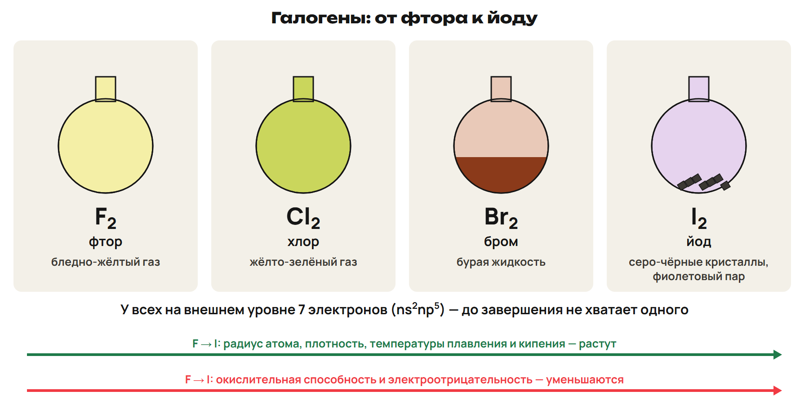
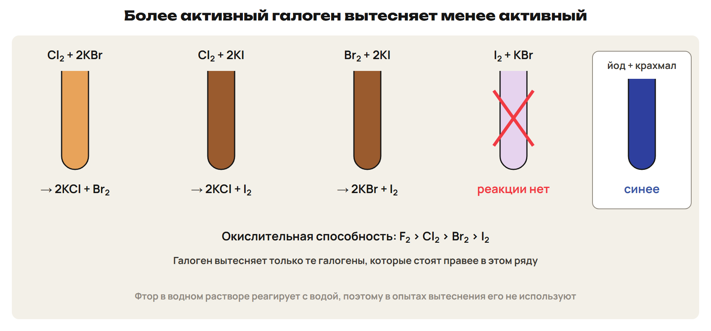
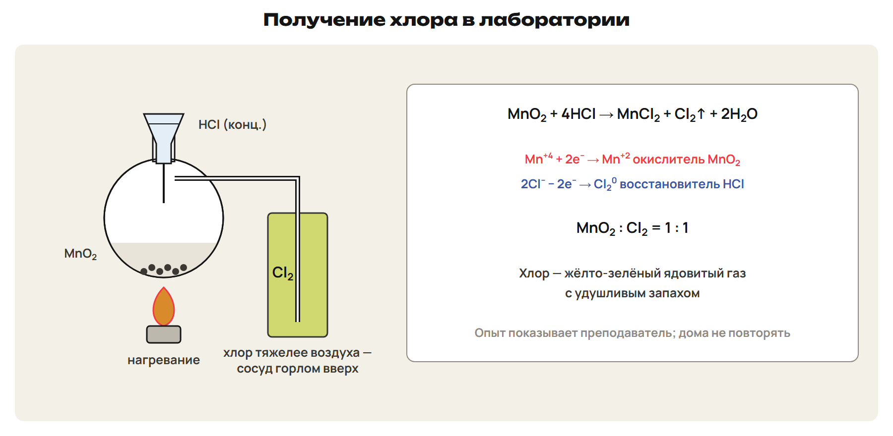
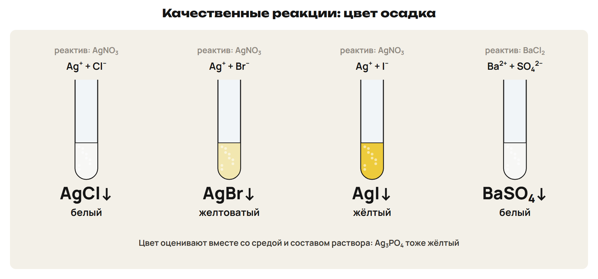
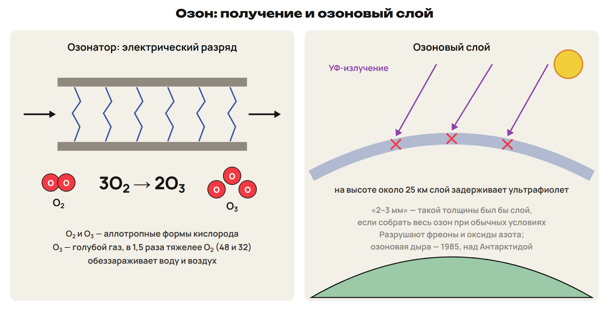
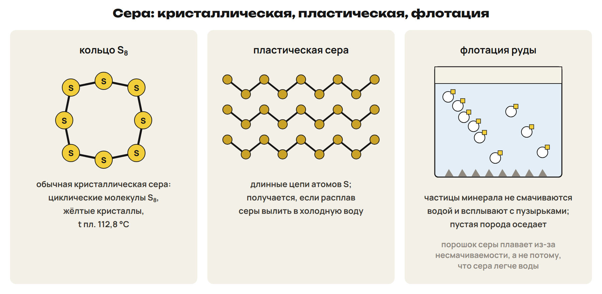
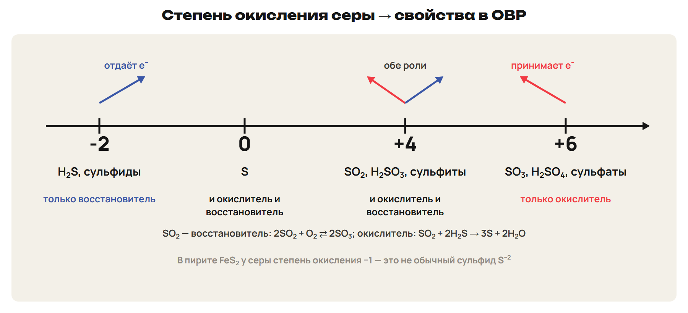
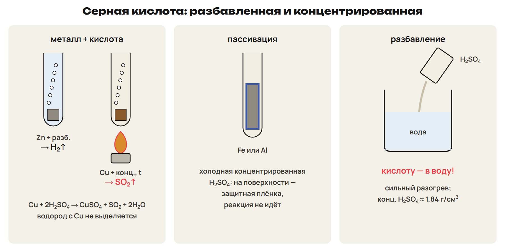

Хлор вытесняет бром из бромида, а йод такой реакции не даёт. Медь реагирует с горячей концентрированной H₂SO₄, хотя стоит после водорода. В обоих случаях ответ начинается с вопроса: кто принимает электроны и при каких условиях?

После урока 31 прочитай разделы 1–3 за 25 минут, выполни P1–P6 и всю G. Разделы 4–6 разберём на уроке 32. После него выполни назначенный вариант A/B/C; на чтение второй части конспекта отведи 15 минут. Для объёмов газов при н. у. используй Vₘ = 22,4 л/моль.

## 1. Галогены: строение, цвет и вытеснение

Галогены F, Cl, Br, I относятся к группе 17 (VIIA). Их внешний уровень имеет строение ns²np⁵: семь электронов, до завершения не хватает одного. Поэтому простые вещества галогенов легко принимают электроны и проявляют окислительные свойства. В природе эти элементы практически не встречаются свободными, входят в соли.

Название «галогены» означает «солероды»; термин ввёл И. Швейггер в 1811 году. Фтор получил А. Муассан, отмеченный Нобелевской премией; бром открыл А. Балар, йод — Б. Куртуа. Название брома связано со значением «зловонный», йода — «фиолетовый».

> [!rule] Как меняются свойства
> От F к I растёт радиус атома, уменьшаются электроотрицательность и окислительная способность простых веществ. У галогенид-ионов восстановительная способность растёт от F⁻ к I⁻. В ряду простых веществ растут плотность, температуры плавления и кипения, усиливается окраска.

| Простое вещество | Состояние и цвет при обычных условиях |
|---|---|
| F₂ | Бледно-жёлтый газ |
| Cl₂ | Жёлто-зелёный ядовитый газ с удушливым запахом |
| Br₂ | Бурая летучая жидкость, единственный жидкий неметалл; пары ядовиты |
| I₂ | Серо-чёрные кристаллы с металлическим блеском; при возгонке получается фиолетовый пар |

Молекулы двухатомные, связь в них ковалентная неполярная. В твёрдом состоянии решётка молекулярная. У простого вещества степень окисления 0; в соединениях с водородом и металлами галоген обычно имеет −1. Для Cl, Br, I возможны также +1, +3, +5, +7; у F в соединениях только −1.

Cl₂, Br₂ и I₂ ограниченно растворяются в воде, лучше — в органических растворителях. В одном объёме воды при 20 °C растворяется около 2,5 объёма Cl₂. Водные растворы называют хлорной и бромной водой; аптечный раствор йода — спиртовой. Йод с крахмалом даёт тёмно-синее окрашивание.

> [!rule] Алгоритм вытеснения
> Найди свободный галоген и галогенид-ион → сравни окислительную силу Cl₂ > Br₂ > I₂ → более сильный окислитель переводит галогенид-ион в простое вещество → уравняй реакцию. Для водных растворов пользуйся этим рядом трёх галогенов.

> [!example] Почему хлор вытесняет бром
> Cl₂ + 2KBr → 2KCl + Br₂. Хлор 0 → −1 принимает электроны; бром −1 → 0 отдаёт их. Аналогично Cl₂ + 2KI → 2KCl + I₂, а Br₂ + 2KI → 2KBr + I₂. Добавление I₂ к KBr такой реакции не вызывает: йод слабее брома как окислитель.

С водородом Cl₂ реагирует при ярком свете или поджигании, возможен взрыв; Br₂ — при нагревании без взрыва; I₂ — медленно при нагревании. Уравнение для хлора: H₂ + Cl₂ → 2HCl.

> [!trap] Уточняй вещество и среду
> В F₂ степень окисления 0; −1 относится к соединениям F. Ряд окислителей и ряд восстановителей-ионов направлены противоположно. Фраза «йод никого не вытесняет» здесь относится к Cl⁻ и Br⁻ из рассмотренного ряда.

> [!try] Объясни выбор продукта
> Может ли Br₂ выделить йод из KI? Что изменится, если вместо KI взять KCl? Назови цвет, который поможет обнаружить йод с крахмалом.

## 2. Хлор, хлороводород и хлориды

Хлор открыл К. В. Шееле в 1774 году; chloros означает «жёлто-зелёный». Cl находится в 3-м периоде, группе 17, внешний уровень 3s²3p⁵. Характерна валентность I, возможны III, V, VII; степени окисления −1, 0, +1, +3, +5, +7.

Природные источники: галит NaCl, сильвин KCl, бишофит MgCl₂·6H₂O, морская вода. В Казахстане галит встречается у Аральского моря. Cl₂ тяжелее воздуха, его плотность около 3,214 г/л; газ сжижают при давлении около 0,6 МПа.

В промышленности Cl₂ получают электролизом раствора или расплава NaCl. В лабораторной схеме концентрированная HCl реагирует с окислителем. Эти уравнения служат для анализа и расчётов; токсичные газы самостоятельно не получают.

- MnO₂ + 4HCl → MnCl₂ + Cl₂↑ + 2H₂O, нагревание;
- 2KMnO₄ + 16HCl → 2KCl + 2MnCl₂ + 5Cl₂↑ + 8H₂O;
- KClO₃ + 6HCl → KCl + 3Cl₂↑ + 3H₂O.

> [!example] Объём хлора по уравнению
> Полностью реагируют 26,1 г чистого MnO₂ и избыток HCl; выход Cl₂ — 100 %. M(MnO₂) = 87 г/моль. Сначала n(MnO₂) = 26,1 / 87 = 0,30 моль. Коэффициенты дают n(Cl₂) = 0,30 моль. При н. у. V(Cl₂) = 0,30 × 22,4 = 6,72 л. Для любого другого заданного выхода умножь теоретический объём на η / 100 %.

Хлор окисляет металлы и ряд неметаллов. Сначала запиши степень окисления образующегося элемента, затем формулу продукта и коэффициенты:

- 2Fe + 3Cl₂ → 2FeCl₃; появляется бурый дым;
- Cu + Cl₂ → CuCl₂;
- Si + 2Cl₂ → SiCl₄; 2P + 5Cl₂ → 2PCl₅;
- 2FeCl₂ + Cl₂ → 2FeCl₃.

С O₂, C и N₂ хлор непосредственно не реагирует. Его используют для получения HCl, полимеров, синтетических волокон, средств защиты растений; хлорирование воды и гипохлориты связаны с обеззараживанием и отбеливанием.

С водой устанавливается равновесие: Cl₂ + H₂O ⇄ HCl + HClO. HClO — хлорноватистая кислота. Окислительное действие HClO и её форм объясняет отбеливание хлорной водой.

> [!rule] Щёлочь: прочитай два условия
> Холодный разбавленный раствор: Cl₂ + 2NaOH → NaCl + NaClO + H₂O. Горячий концентрированный раствор: 3Cl₂ + 6KOH → 5KCl + KClO₃ + 3H₂O. В обоих случаях хлор 0 одновременно переходит в −1 и положительную степень окисления: это диспропорционирование.

NaClO — гипохлорит, раствор связан с названием «жавелевая вода»; KClO₃ — хлорат, бертолетова соль. В холодной щёлочи хлор получает +1 в ClO⁻, в горячей +5 в ClO₃⁻.

HCl — бесцветный газ с резким удушливым запахом, ковалентная полярная молекула. Он в 1,26 раза тяжелее воздуха; при 0 °C в одном объёме воды растворяется до 500 объёмов HCl. Лабораторный способ — нагревание твёрдого NaCl с концентрированной H₂SO₄; промышленный — сжигание H₂ в Cl₂.

Соляная кислота — водный раствор HCl; концентрированный содержит около 37 % HCl. Это сильная одноосновная кислота. Она реагирует с металлами до водорода, основными и амфотерными оксидами, основаниями, солями при образовании газа, осадка или слабого электролита. Примеры: Fe + 2HCl → FeCl₂ + H₂↑; CuO + 2HCl → CuCl₂ + H₂O.

Большинство хлоридов растворимы. Ag⁺ + Cl⁻ → AgCl↓ даёт белый творожистый осадок. NaCl используют как пищевую соль и консервант, KCl — удобрение, ZnCl₂ — для пропитки древесины и при пайке.

> [!trap] Железо с хлором и с кислотой
> Cl₂ окисляет железо до +3: FeCl₃. Разбавленная HCl даёт FeCl₂, железо +2. Для щёлочи нельзя выбирать соль без условий. Отбеливание хлорной водой связывай с HClO.

> [!try] Назови условие
> Какая соль получится при действии Cl₂ на горячий концентрированный KOH? Почему уравнение Fe + 2HCl → FeCl₂ + H₂ не подходит для реакции железа с Cl₂?

## 3. Анионы, кислород и озон

При качественном анализе нужен не только цвет. Сначала узнай состав раствора и среду, затем выбери реактив, после — наблюдаемый признак. Реактив не должен вносить тот ион, который ищешь.

| Анион | Реактив и условия | Признак |
|---|---|---|
| Cl⁻ | AgNO₃; при необходимости подкисление HNO₃ | Белый творожистый AgCl |
| Br⁻ | AgNO₃ в подходящей среде | Желтоватый, кремовый AgBr |
| I⁻ | AgNO₃ в подходящей среде | Жёлтый AgI |
| SO₄²⁻ | Раствор соли Ba²⁺, проверка устойчивости осадка к разбавленной сильной кислоте | Белый BaSO₄ не растворяется |
| CO₃²⁻ | Разбавленная сильная кислота | CO₂; вызывает помутнение известковой воды |
| NO₃⁻ | Cu, концентрированная H₂SO₄, нагревание | Бурый NO₂, голубой раствор; только лабораторная схема |
| S²⁻ | Раствор соли Pb²⁺ или Ag⁺ | Чёрный PbS или Ag₂S |
| SO₃²⁻ | Сильная кислота | Выделяется SO₂; запах жжёной спички — справочное свойство |
| PO₄³⁻ | AgNO₃ в фосфатном растворе без сильного подкисления | Жёлтый Ag₃PO₄ |

> [!example] Из признака к ионному уравнению
> Для хлорида: Ag⁺ + Cl⁻ → AgCl↓. Для сульфата: Ba²⁺ + SO₄²⁻ → BaSO₄↓. Для карбоната: CO₃²⁻ + 2H⁺ → CO₂↑ + H₂O. В расчёте осадка сначала получи количество определяемого иона, затем используй коэффициенты и молярную массу осадка.

> [!trap] Один цвет не доказывает состав
> AgI и Ag₃PO₄ жёлтые: учитывай возможные ионы. BaCO₃ и BaSO₃ тоже белые, но реагируют с кислотой; BaSO₄ сохраняется. HCl вносит Cl⁻ и мешает его обнаружению. Газы при анализе не пробуют по запаху.

Элементы группы 16 (VIA) — O, S, Se, Te, Po, халькогены. На внешнем уровне шесть электронов. Сверху вниз неметаллические свойства ослабевают; теллур имеет металлический блеск. Окислительные свойства группы в целом слабее, чем у галогенов; O и S встречаются также свободными.

Обычно у кислорода степень окисления −2. В пероксидах, например H₂O₂, она −1; в OF₂ кислород имеет +2, потому что F более электроотрицателен. O₂ — бесцветный газ с плотностью около 1,429 г/л и температурой кипения −183 °C.

> [!rule] Аллотропия кислорода
> O₂ и O₃ — разные простые вещества одного элемента. Это аллотропные формы, а не изотопы. Аллотропия характерна также для серы, углерода и фосфора.

O₃ — голубой газ с резким запахом, сильный окислитель. При одинаковых температуре и давлении отношение плотностей равно отношению молярных масс: 48 / 32 = 1,5. Озон активнее O₂: при обычных условиях окисляет серебро и ртуть, обесцвечивает красители. Его применяют для обеззараживания воды и воздуха, очистки стоков и отбеливания.

В озонаторе электрический разряд вызывает 3O₂ ⇄ 2O₃. В природе озон появляется при грозе и окислении смолы хвойных. Общий баланс распада: 2O₃ → 3O₂; школьная запись O₃ → O₂ + O показывает упрощённое образование атомарного кислорода.

> [!rule] Объём после озонатора
> По коэффициентам 3 объёма превратившегося O₂ дают 2 объёма O₃ при одинаковых температуре и давлении. К полученному O₃ прибавь непревратившийся O₂. Начальный объём и объём израсходованного O₂ — разные величины.

Озоновый слой в стратосфере, около 25 км, поглощает ультрафиолет. Условные «2–3 мм» — приведённая толщина столба озона при заданных условиях, а не толщина всей области в атмосфере. Фреоны дают атомы хлора, разрушающие озон; один атом может разрушить до 100 тысяч молекул O₃. Участвуют также оксиды азота. Крупную озоновую дыру над Антарктидой обнаружили в 1985 году. Приземный озон опасен как сильный окислитель.

> [!try] Различи две причины
> Почему озоновый слой защищает живые организмы, а наличие O₃ у поверхности не означает чистый воздух? Почему объём газа уменьшается при превращении части O₂ в O₃?

## 4. Сера и её соединения: степень окисления подсказывает роль

Сера составляет около 0,05 % массы земной коры. Она встречается самородной, в сульфидах и сульфатах. Обычная кристаллическая сера жёлтая, состоит из циклических молекул S₈. Пластическая сера имеет цепное строение; в учебной схеме её получают быстрым охлаждением расплава в холодной воде. Температуру плавления связывают с конкретной формой серы.

| Минерал | Формула и класс |
|---|---|
| Цинковая обманка | ZnS, сульфид |
| Пирит | FeS₂, дисульфид железа |
| Киноварь | HgS, сульфид |
| Свинцовый блеск | PbS, сульфид |
| Гипс | CaSO₄·2H₂O, кристаллогидрат сульфата |
| Глауберова соль | Na₂SO₄·10H₂O, кристаллогидрат сульфата |

Сера не смачивается водой. Порошок может удерживаться на поверхности, хотя это не доказывает плотность меньше плотности воды. Флотация использует различие смачивания частиц: несмачиваемые частицы закрепляются на пузырьках воздуха и поднимаются с ними.

У S характерны степени окисления −2, +4, +6; у простого вещества 0. Сера принимает электроны в реакциях Hg + S → HgS и H₂ + S → H₂S при нагревании. Связывание ртути в HgS называют демеркуризацией. В школьной модели Cu + S → CuS; фактический состав сульфидов меди зависит от условий. При горении S + O₂ → SO₂ сера отдаёт электроны и служит восстановителем.

Серу используют для производства H₂SO₄, вулканизации каучука, получения спичек, пиротехники, удобрений, средств защиты растений и лекарственных средств для кожи. Вулканизация связывает получение резины с серой.

H₂S — бесцветный ядовитый газ с запахом тухлых яиц, немного тяжелее воздуха. Он образуется при гниении белков, встречается в минеральных водах и вулканических газах. В одном объёме воды растворяется около 2,5 объёма H₂S. Его раствор — слабая двухосновная сероводородная кислота, с ионами HS⁻ и S²⁻.

В лабораторной схеме FeS + 2HCl → FeCl₂ + H₂S↑. Сероводородная кислота реагирует с активными металлами, основными оксидами, основаниями и солями. Количество щёлочи задаёт соль: H₂S + NaOH → NaHS + H₂O; H₂S + 2NaOH → Na₂S + 2H₂O. С солью меди: H₂S + CuSO₄ → CuS↓ + H₂SO₄.

Растворимы сульфиды щелочных металлов и аммония; из-за гидролиза их растворы имеют щелочную среду. CuS, PbS и NiS — чёрные осадки, MnS — розовый. При обжиге в заданной схеме: 2CuS + 3O₂ → 2CuO + 2SO₂.

> [!rule] Сравни степени окисления серы
> В H₂S сера −2: в изученных ОВР она может только отдавать электроны. В SO₂ сера +4: может как отдавать, так и принимать. В SO₃ и концентрированной H₂SO₄ сера +6: её восстановление объясняет окислительные свойства. Роль всегда подтверждай конкретной реакцией.

SO₂ — бесцветный токсичный газ с резким запахом жжёных спичек, кислотный оксид. SO₂ + H₂O ⇄ H₂SO₃: H₂SO₃ — условная формула слабой неустойчивой сернистой кислоты в растворе. Её соли — сульфиты и гидросульфиты. С щёлочью получают, например, Na₂SO₃ или NaHSO₃ в зависимости от соотношения реагентов.

> [!example] Два направления для SO₂
> В 2SO₂ + O₂ ⇄ 2SO₃ сера +4 → +6, поэтому SO₂ — восстановитель. В SO₂ + 2H₂S → 3S + 2H₂O сера в SO₂ меняется +4 → 0, поэтому SO₂ — окислитель; сера в H₂S меняется −2 → 0. При полном сгорании 2H₂S + 3O₂ → 2SO₂ + 2H₂O сероводород выступает восстановителем за счёт серы.

SO₂ используют для обработки хранилищ и плодов, отбеливания соломы, шерсти и бумаги; пищевая добавка имеет код E220. Выбросы при сжигании топлива, в металлургии и сернокислотном производстве связаны с кислотными дождями: SO₂ окисляется, в осадках появляются кислоты. Они вредят лесам, почвам, водоёмам и памятникам. Для очистки газов применяют известковый метод с Ca(OH)₂ и аммиачный метод.

SO₃ — кислотный оксид, при обычных условиях бесцветная жидкость, ниже 17 °C — белые кристаллы. Он обладает окислительными свойствами и энергично реагирует с водой: SO₃ + H₂O → H₂SO₄ + Q.

> [!trap] Не переноси одну степень на все соединения
> В пирите FeS₂ средняя степень окисления серы −1. H₂SO₃ — слабая и неустойчивая, H₂SO₄ — сильная. Фраза «H₂S — только восстановитель» относится к сере −2 в изучаемых ОВР: водород при реакции с активным металлом может восстанавливаться.

> [!try] Покажи переход
> В какой реакции SO₂ принимает электроны: с O₂ или с H₂S? Назови формулы чёрного сульфида свинца и розового сульфида марганца. Что связывает флотацию со смачиванием?

## 5. Серная кислота: концентрация, температура и соли

H₂SO₄ — бесцветная маслянистая нелетучая жидкость без запаха. Плотность концентрированной кислоты около 1,84 г/см³. При смешивании с водой выделяется много теплоты. Концентрированными в школьном описании называют растворы с массовой долей H₂SO₄ выше 70 %.

> [!rule] Кислоту приливают в воду
> При разбавлении кислоту добавляют к воде небольшими порциями с перемешиванием. Добавление воды к концентрированной кислоте вызывает сильный местный нагрев и разбрызгивание.

Разбавленная H₂SO₄ — сильная двухосновная кислота. Она реагирует с металлами до водорода, основными оксидами, основаниями, солями слабых кислот. Примеры: Zn + H₂SO₄ → ZnSO₄ + H₂↑; CuO + H₂SO₄ → CuSO₄ + H₂O; Na₂CO₃ + H₂SO₄ → Na₂SO₄ + CO₂↑ + H₂O.

| Условие | Пример и результат |
|---|---|
| Разбавленная H₂SO₄ и Zn | Образуются ZnSO₄ и H₂; восстанавливается водород |
| Горячая концентрированная H₂SO₄ и Cu | Cu + 2H₂SO₄ → CuSO₄ + SO₂↑ + 2H₂O; восстанавливается сера +6 → +4 |
| Холодная концентрированная H₂SO₄ и Fe или Al | Пассивация, поверхность защищена плёнкой |

Концентрированная кислота реагирует и с рядом металлов после H; Au и Pt служат исключениями в изучаемой схеме. Продукт восстановления зависит от металла и условий, поэтому пример с Cu нельзя автоматически переносить на все металлы. Холодную концентрированную кислоту перевозят в стальных цистернах благодаря пассивации Fe.

> [!example] Медь и горячая концентрированная кислота
> Полностью реагируют 12,8 г Cu и избыток H₂SO₄; выход SO₂ — 100 %. M(Cu) = 64 г/моль, M(H₂SO₄) = 98 г/моль. n(Cu) = 12,8 / 64 = 0,20 моль. По уравнению n(SO₂) = 0,20 моль и n(H₂SO₄) = 0,40 моль. При н. у. V(SO₂) = 0,20 × 22,4 = 4,48 л; m(H₂SO₄) = 0,40 × 98 = 39,2 г. Это масса израсходованной кислоты, не всего её раствора.

Концентрированная H₂SO₄ окисляет и неметаллы: C + 2H₂SO₄ → CO₂ + 2SO₂ + 2H₂O при нагревании. Она отнимает воду, обугливает бумагу и древесину, разрушает ткани и кожу. Как осушитель её применяют для газов, с которыми она не реагирует; NH₃ и H₂S для такого осушения не подходят.

При частичной нейтрализации образуются гидросульфаты: H₂SO₄ + NaOH → NaHSO₄ + H₂O. При полной — сульфаты: H₂SO₄ + 2NaOH → Na₂SO₄ + 2H₂O. Ba²⁺ осаждает SO₄²⁻ в практически нерастворимый белый BaSO₄.

Названия кристаллогидратов связывай с числом молекул воды: медный купорос CuSO₄·5H₂O, железный купорос FeSO₄·7H₂O, горькая, или английская, соль MgSO₄·7H₂O. Вода кристаллизации входит в состав и молярную массу соли.

> [!trap] Прочитай концентрацию и температуру
> Cu с горячей концентрированной H₂SO₄ даёт SO₂, а не H₂. Пассивация Fe и Al относится к холодной концентрированной кислоте. Разбавленную кислоту нельзя считать подходящей для хранения в стали только потому, что концентрированную перевозят в стальных цистернах.

> [!try] Сначала продукт, потом число
> Назови газ для Zn с разбавленной H₂SO₄ и для Cu с горячей концентрированной H₂SO₄. Сколько молей NaOH требуется на моль H₂SO₄, чтобы получить NaHSO₄ или Na₂SO₄?

## 6. Контактный способ: от сырья к кислоте и олеуму

Сырьём служат самородная сера, пирит FeS₂, H₂S и сульфиды цветных металлов, например ZnS и Cu₂S. Для пирита сначала проводят дробление и флотацию. Дробление увеличивает поверхность и скорость реакции, флотация обогащает сырьё.

> [!rule] Три химические стадии
> Получить SO₂ → окислить его до SO₃ → поглотить SO₃ серной кислотой. Для каждой стадии называй реакцию, аппарат, условия и причину их выбора.

| Участок | Что происходит и почему |
|---|---|
| Печь кипящего слоя, около 800 °C | 4FeS₂ + 11O₂ → 2Fe₂O₃ + 8SO₂ + Q. Воздух подают снизу навстречу сырью; частицы перемешиваются и хорошо контактируют с газом |
| Циклон → электрофильтр → сушильная башня | Удаляют пыль, мелкие примеси, затем влагу концентрированной H₂SO₄; очищают газ перед катализатором |
| Контактный аппарат, V₂O₅, 400–500 °C | 2SO₂ + O₂ ⇄ 2SO₃ + Q. Катализатор ускоряет реакцию, теплообменник использует выделяемую теплоту |
| Поглотительная башня, 98 %-я H₂SO₄ | Поглощают SO₃; прямое поглощение водой создаёт сернокислотный туман |

Огарок Fe₂O₃ направляют в металлургию. Использование побочного продукта и теплоты снижает отходы производства. Платина дороже V₂O₅ и легко отравляется примесями мышьяка, поэтому в школьной схеме катализатор контактного аппарата — V₂O₅.

Реакция образования SO₃ обратима и экзотермична. Понижение температуры выгодно равновесному выходу, но замедляет процесс; 400–500 °C — компромисс. Число молей газа уменьшается с трёх до двух, поэтому повышение давления сдвигает равновесие вправо. Высокое давление при этом не является обязательным условием промышленной схемы. Катализатор не меняет положение равновесия.

Олеум — раствор SO₃ в безводной, 100 %-й H₂SO₄; состав обозначают H₂SO₄·nSO₃. При подаче SO₃ в 98 %-ю кислоту сначала связывается содержащаяся в ней вода. Затем накапливается свободный SO₃ и образуется олеум. Он дымит на воздухе, обладает сильным водоотнимающим и окислительным действием. С водой SO₃ образует H₂SO₄ с большим выделением теплоты.

> [!rule] Считай по сохраняющемуся элементу
> В одном FeS₂ два атома серы, поэтому FeS₂ → 2H₂SO₄. Для серы S → H₂SO₄. Аналогично в цепочках прошлой недели N₂ → 2HNO₃ и NH₃ → HNO₃. Сначала масса чистого сырья, затем теоретический продукт, затем выход, затем масса раствора.

> [!example] Цепочка без расчёта каждой стадии
> Взяли 300 кг чистого FeS₂, общий выход H₂SO₄ — 70 %. M(FeS₂) = 120 кг/кмоль, M(H₂SO₄) = 98 кг/кмоль. n(FeS₂) = 300 / 120 = 2,50 кмоль, теоретически n(H₂SO₄) = 5,00 кмоль и m(H₂SO₄) = 5,00 × 98 = 490 кг. Фактически 490 × 0,70 = 343 кг H₂SO₄. Масса 98 %-го раствора: 343 / 0,98 = 350 кг.

Для одной стадии 2SO₂ + O₂ → 2SO₃ количества SO₂ и SO₃ равны. Найди n(SO₂) = m / M, затем теоретическую массу SO₃ и только после этого учти выход. Если исходное сырьё с примесями, начни с массы чистого вещества.

> [!trap] Не умножай один выход несколько раз
> Общий выход всей цепочки применяют один раз. Не путай массу H₂SO₄ с массой её раствора. SO₃ в технологии поглощают кислотой: прямая подача в воду даёт туман. Для NH₃ катализатор синтеза — Fe, окисления — Pt–Rh; V₂O₅ относится к SO₂.

> [!try] Проверь схему целиком
> Что удаляет сушильная башня? Почему нельзя просто снизить температуру контактного аппарата до комнатной? Откуда коэффициент 2 в FeS₂ → 2H₂SO₄? На каком шаге расчёта учитывают примеси, а на каком — массовую долю раствора?

> [!rule] Факты ЕНТ недели
> - У F, Cl, Br, I по 7 внешних электронов; F₂ — бледно-жёлтый газ, Cl₂ — жёлто-зелёный газ, Br₂ — бурая жидкость, I₂ — серо-чёрные кристаллы с фиолетовым паром.
> - Хлор открыл К. В. Шееле в 1774 году; галит — NaCl, сильвин — KCl.
> - Йод с крахмалом даёт синее окрашивание; AgCl — белый, AgBr — желтоватый, AgI — жёлтый осадок; BaSO₄ — белый.
> - O₃ — голубой газ, в 1,5 раза тяжелее O₂; его получают в озонаторе; озоновую дыру над Антарктидой обнаружили в 1985 году.
> - Кристаллическая сера состоит из S₈; пирит — FeS₂, киноварь — HgS; медный купорос — CuSO₄·5H₂O, железный — FeSO₄·7H₂O.
> - H₂S пахнет тухлыми яйцами; сера −2 в нём в изученных ОВР только отдаёт электроны; SO₂ бывает окислителем и восстановителем, его код — E220.
> - Плотность концентрированной H₂SO₄ — около 1,84 г/см³; кислоту приливают в воду; холодная концентрированная кислота пассивирует Fe и Al.
> - Контактный способ: V₂O₅, 400–500 °C, поглощение SO₃ 98 %-й H₂SO₄ → олеум; для синтеза NH₃ нужен Fe, для окисления NH₃ — Pt–Rh.

## Расчёт недели: олеум

> [!rule] Олеум в расчёте
> 1. Раздели олеум на части: m(SO₃) = ω(SO₃) · m(олеума); m(H₂SO₄) = m(олеума) − m(SO₃).
> 2. Свободный SO₃ реагирует с водой: SO₃ + H₂O → H₂SO₄. n(SO₃) = m/80; столько же моль воды расходуется и кислоты образуется.
> 3. Вся кислота = исходная H₂SO₄ + образовавшаяся. Масса раствора = масса олеума + вся добавленная вода.

> [!example] Олеум → 100 %-я кислота
> 200 г олеума с ω(SO₃) = 8 %: SO₃ 16 г = 0,2 моль, H₂SO₄ 184 г.
> Чтобы весь SO₃ стал кислотой, нужно 0,2 × 18 = 3,6 г воды; образуется 0,2 × 98 = 19,6 г H₂SO₄.
> Получится 184 + 19,6 = 203,6 г 100 %-й H₂SO₄ — ровно масса олеума и воды: 200 + 3,6.

> [!trap] Свободный оксид — это ещё не кислота
> ω(SO₃) — доля свободного SO₃. При разбавлении часть добавленной воды вступает в реакцию, остальная становится растворителем. Массу раствора считают как олеум плюс вся добавленная вода.
