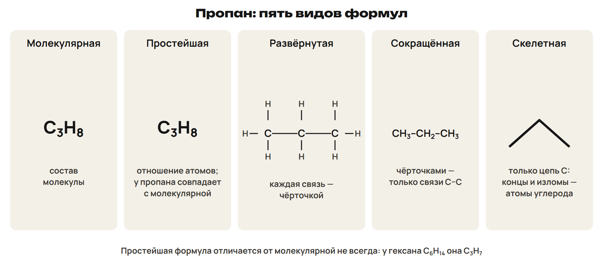
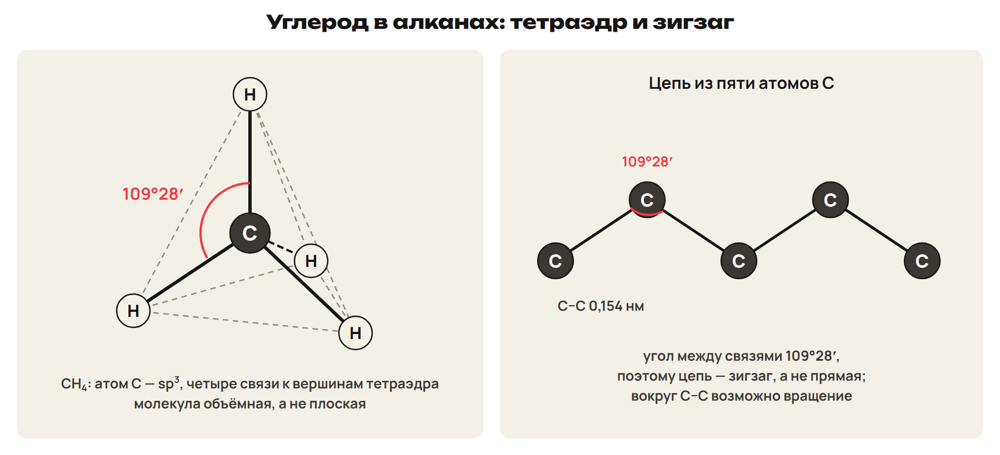
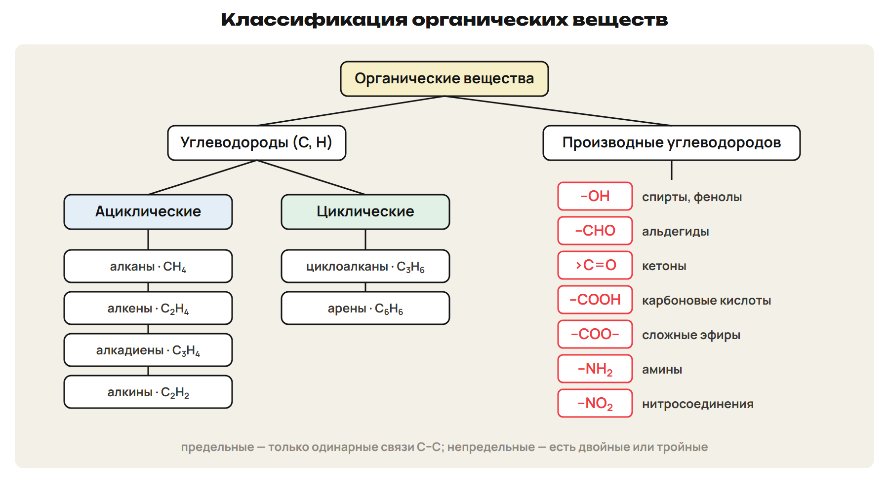
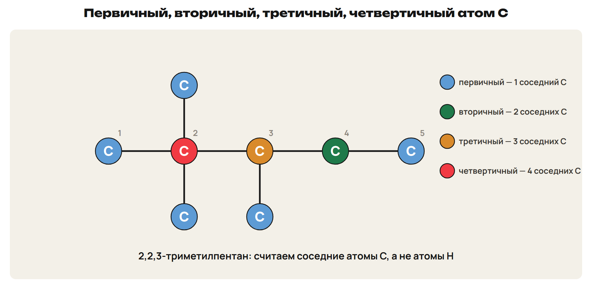
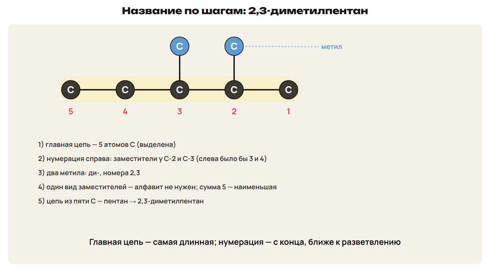
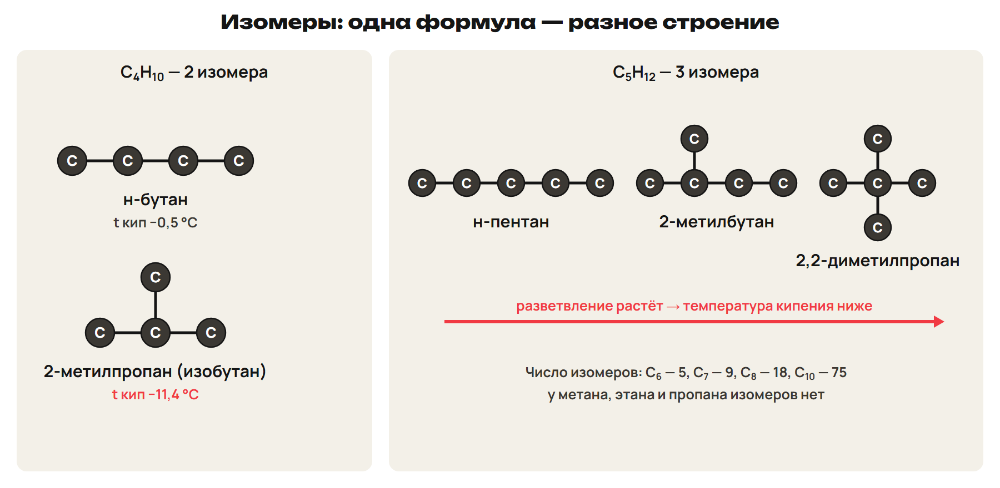

# Что изучает органическая химия
? Почему соединений углерода больше 20 млн — больше, чем всех остальных элементов вместе?
↳ Весь дальнейший курс — соединения одного элемента: углерода.
> 0–8 определение, органогены, особенности; 8–10 L1; 10–12 ключ.

## Понятие: Органические вещества
Органическая химия изучает соединения углерода и их превращения.
Термин ввёл Й. Я. Берцелиус в 1807 году.
Органогены: C, H, O, N; реже S, P, галогены.
Углеводороды — только C и H; производные — CH₃Cl, CH₃OH, CH₃NH₂.
CO, CO₂, H₂CO₃, CaCO₃ изучают с неорганическими веществами.

## Понятие: Особенности органических веществ
Цепи и кольца из атомов C: одинарные, двойные, тройные связи.
Широко распространена изомерия.
Связи ковалентные, малополярные; большинство — неэлектролиты.
Низкие температуры плавления; при нагревании обугливаются, в кислороде горят.
Сахар плавится и обугливается, поваренная соль — нет.

## Практика: L1
Выбери органические вещества: CH₃Br, CO, C₂H₂, Na₂CO₃, C₆H₁₂O₆.
Какое из них — углеводород?
Назови одно отличие органических веществ от неорганических.
Ответы:
Органические — CH₃Br, C₂H₂, C₆H₁₂O₆; углеводород — C₂H₂.
CO и Na₂CO₃ изучают с неорганическими.
Отличие: обугливаются и горят, большинство — неэлектролиты.
> 8–10 попытка, 10–12 ключ.

# Формулы и строение
? Почему цепь атомов углерода — зигзаг, а не прямая?
> 12–20 виды формул и тетраэдр; 20–23 L2; 23–25 ключ.

## Схема: Пять формул пропана

Молекулярная — состав; простейшая — только отношение атомов.
Развёрнутая — все связи; сокращённая — только связи C–C.
Скелетная — только углеродная цепь зигзагом.
Ловушка: у гексана C₆H₁₄ простейшая формула C₃H₇.

## Схема: Углерод четырёхвалентен

В органических веществах C всегда образует четыре связи.
В алканах атом C — sp³: связи к вершинам тетраэдра, угол 109°28′.
Цепь — зигзаг; расстояние C–C 0,154 нм.
Молекула метана объёмная, а не плоская.

## Практика: L2
Для пентана C₅H₁₂ запиши простейшую и сокращённую формулы.
Чем простейшая формула гексана отличается от молекулярной?
Назови угол между связями атома C в алкане.
Ответы:
Простейшая пентана — C₅H₁₂; сокращённая CH₃–CH₂–CH₂–CH₂–CH₃.
Гексан: молекулярная C₆H₁₄, простейшая C₃H₇.
Угол 109°28′.
> 20–23 попытка, 23–25 ключ.

# Классификация
? По каким двум признакам делят органические вещества?
> 25–32 скелет, связи, функциональные группы; 32–35 L3; 35–37 ключ.

## Схема: Классы органических веществ

По скелету: ациклические и циклические (карбо- и гетероциклические).
По связям: предельные — только одинарные; непредельные — есть кратные.
Углеводороды: алканы, алкены, алкадиены, алкины, арены, циклоалканы.

## Понятие: Функциональная группа → класс
–OH — спирты; –CHO — альдегиды; >C=O — кетоны.
–COOH — карбоновые кислоты; –COO– — сложные эфиры.
–NH₂ — амины; –NO₂ — нитросоединения; –NH₂ и –COOH — аминокислоты.
Функциональная группа определяет свойства и класс; запись R–X.
> На этой неделе — только узнать класс по группе.

## Практика: L3
Определи класс: C₂H₅–NH₂; CH₃–CO–CH₃; CH₃–COO–CH₃; C₃H₇–OH; циклопропан.
Какие из них углеводороды?
Ответы:
Амин; кетон; сложный эфир; спирт; циклоалкан.
Углеводород — только циклопропан.
> 32–35 попытка, 35–37 ключ.

# Гомологи и ряд алканов
? Что общего у метана, этана и пропана?
> 37–44 гомологи, ряд, радикалы; 44–48 L4; 48–50 ключ.

## Понятие: Гомологический ряд
Гомологи сходны по строению и свойствам и отличаются на CH₂.
Ряд описывает одна общая формула; алканы — CₙH₂ₙ₊₂.
Ближайшие гомологи пропана — этан и бутан.
M(CₙH₂ₙ₊₂) = 14n + 2.

## Понятие: Первые десять алканов
Метан CH₄, этан C₂H₆, пропан C₃H₈, бутан C₄H₁₀, пентан C₅H₁₂.
Гексан C₆H₁₄, гептан C₇H₁₆, октан C₈H₁₈, нонан C₉H₂₀, декан C₁₀H₂₂.
Радикалы -ил: метил –CH₃, этил –C₂H₅, пропил –C₃H₇, бутил –C₄H₉.
C₁–C₄ — газы, C₅–C₁₅ — жидкости, с C₁₆ — твёрдые.
Неполярны, в воде нерастворимы, легче воды.

## Практика: L4
Запиши формулу декана и найди его молярную массу.
Какой алкан имеет M = 72 г/моль?
Назови ближайшие гомологи бутана.
Ответы:
C₁₀H₂₂, M = 142 г/моль.
14n + 2 = 72 → n = 5, пентан.
Пропан и пентан.
> 44–48 попытка, 48–50 ключ.

# Названия по IUPAC
? Как одним названием описать, где стоит каждый заместитель?
> 50–61 номенклатура и алгоритм; 61–67 L5; 67–70 ключ.

## Схема: Типы атомов углерода

Первичный — один соседний атом C; вторичный — два.
Третичный — три; четвертичный — четыре.
Ловушка: считаем соседние атомы C, а не атомы H.

## Схема: Алгоритм названия

1) Самая длинная цепь — главная.
2) Нумерация с конца, ближе к которому разветвление.
3) Заместители с номерами; одинаковые — ди-, три-.
4) Разные — по алфавиту; сумма номеров наименьшая.
5) В конце — название алкана главной цепи.

## Понятие: Ловушки названий
«2-этилбутан» — неверно: цепь через этил длиннее, это 3-метилпентан.
«3-метилбутан» — неверно: нумерация с ближнего конца, это 2-метилбутан.
Примеры: 3-метилгексан, 3,3-диметилпентан, 2,3,5-триметилгексан.
Номенклатура: тривиальная, рациональная, систематическая (IUPAC).

## Практика: L5
Назови по IUPAC:
а) CH₃–CH(CH₃)–CH₂–CH(CH₃)–CH₃
б) CH₃–C(CH₃)₂–CH(CH₃)–CH₃
Ответы:
а) 2,4-диметилпентан.
б) 2,2,3-триметилбутан.
> 61–67 попытка, 67–70 ключ.

# Изомерия
? Может ли у двух разных веществ быть одна формула?
> 70–78 изомеры, виды изомерии; 78–82 L6; 82–85 ключ.

## Схема: Изомеры бутана и пентана

Изомеры — одна молекулярная формула, разное строение и свойства.
Бутан — 2 изомера, пентан — 3; C₆ — 5, C₇ — 9, C₈ — 18, C₁₀ — 75.
Разветвлённый изомер кипит ниже.

## Понятие: Виды изомерии
Структурная: скелета, положения связи или группы, межклассовая.
Пространственная: цис-транс и оптическая.
У алканов — только изомерия скелета.
CₙH₂ₙ — алкены и циклоалканы; CₙH₂ₙ₋₂ — алкины и алкадиены.
CₙH₂ₙ₊₂O — спирты и простые эфиры; CₙH₂ₙO — альдегиды и кетоны.
Ловушка: гомологи — разные формулы, изомеры — одна формула.

## Практика: L6
Сколько структурных изомеров у C₇H₁₆?
Какой изомер C₄H₁₀ кипит ниже?
Назови межклассовый изомер циклопентана.
Ответы:
9 изомеров.
2-метилпропан (−11,4 °C).
Алкен C₅H₁₀, например пентен-1.
> 78–82 попытка, 82–85 ключ.

## Дома: После урока 33
Прочитай разделы 1–6 конспекта: 25 минут.
Реши P1–P6: 20 минут.
Выполни всю G: 35 минут.
Тест — строкой; G9–G10 — фото; G11 — текст или голосовое.
Запиши вопрос к началу следующего урока.
