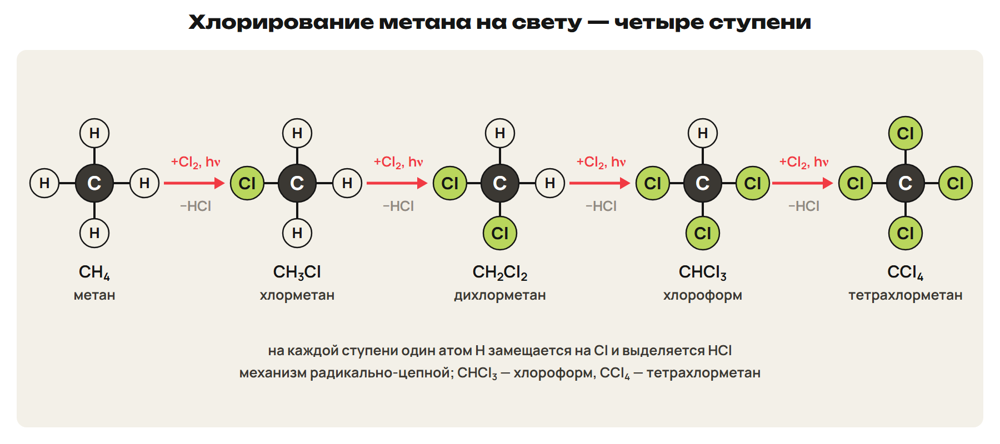
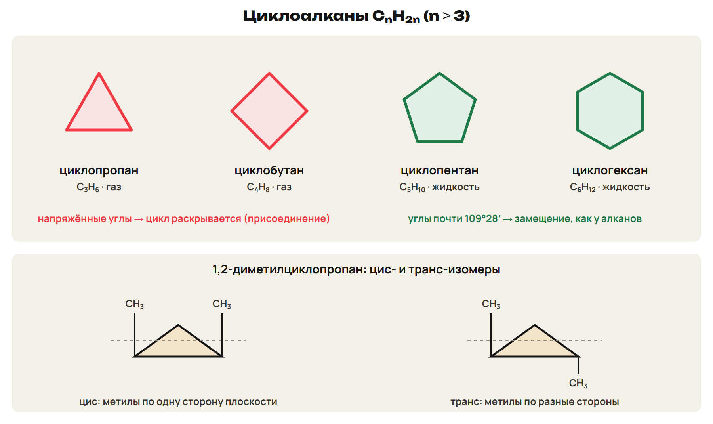
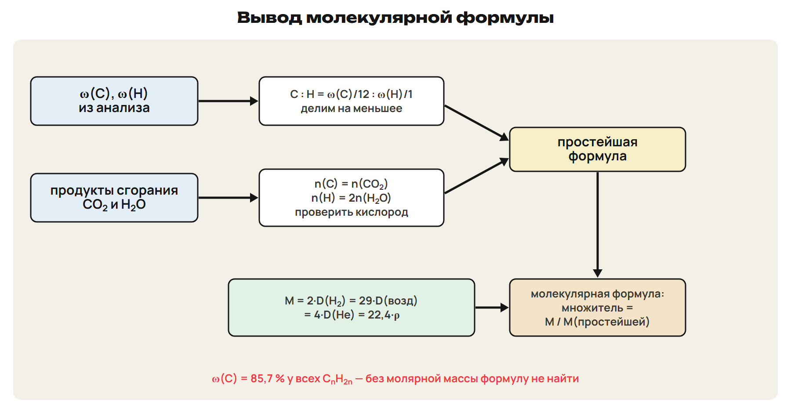

# Возврат
? Какие названия и пары «изомер — гомолог» вызвали трудности?
> 0–3 вопросы; 3–10 разбор G9 и G10; 10–13 L7; 13–15 ключ.

## Понятие: Разбор G9 и G10
G9: M = 72; C : H = 6,94 : 16,7 = 1 : 2,4 = 5 : 12 → C₅H₁₂.
Отношение 1 : 2,4 не округлять до 1 : 2.
G10: 5,6 л CH₄ → O₂ 11,2 л, CO₂ 5,6 л, вода 9 г.
Метан без запаха — пахнет одорант.

## Практика: L7
Назови по IUPAC: CH₃–CH₂–CH(CH₃)–CH(CH₃)–CH₃.
Ответы:
Главная цепь — 5 атомов C.
Слева номера 3 и 4, справа — 2 и 3: берём меньшие.
2,3-диметилпентан.
> 10–13 попытка, 13–15 ключ.

# Алканы: свойства и применение
? Почему алканы называют парафинами — «малоактивными»?
> 15–28 свойства и реакции; 28–32 L8; 32–35 ключ.

## Понятие: Метан
Бесцветный газ без запаха, легче воздуха, t кип −161,5 °C.
Главная часть природного газа; болотный и рудничный газ.
Источники алканов: газ, нефть, уголь, сланцы, газовые гидраты, биогаз.
Связи C–C и C–H прочные и малополярные — алканы малоактивны.

## Схема: Хлорирование метана на свету

CH₄ → CH₃Cl → CH₂Cl₂ → CHCl₃ (хлороформ) → CCl₄.
На каждой ступени выделяется HCl; механизм радикально-цепной.
Хлороформ — медицина, CCl₄ — тушение пожаров; оба токсичны.
Фреоны — хладагенты, разрушают озоновый слой.
Ловушка: CHCl₃ — хлороформ, CCl₄ — тетрахлорметан.

## Понятие: Разложение, горение, синтез-газ
1000 °C: CH₄ → C + 2H₂; 1500 °C: 2CH₄ → C₂H₂ + 3H₂.
CH₄ + 2O₂ → CO₂ + 2H₂O + Q; 2C₂H₆ + 7O₂ → 4CO₂ + 6H₂O + Q.
CₙH₂ₙ₊₂ + (3n + 1)/2 O₂ → nCO₂ + (n + 1)H₂O.
Синтез-газ: 2CH₄ + O₂ → 2CO + 4H₂ (~850 °C).
Изомеризация: н-пентан → 2-метилбутан (AlCl₃).

## Понятие: Взрыв и запах
Метан в воздухе взрывается при 5–15 %, сильнее всего — при 9,5 %.
CH₄ : O₂ = 1 : 2 — очень сильный взрыв.
Метан не пахнет — пахнут одоранты (меркаптаны); газовая служба 104.
Неполное сгорание — CO и сажа.
Применение: топливо, вазелин, парафин, растворители, сырьё для пластмасс.

## Практика: L8
Запиши горение пропана.
Запиши первую ступень хлорирования этана.
Что образуется из метана при 1000 °C? Что такое синтез-газ?
Ответы:
C₃H₈ + 5O₂ → 3CO₂ + 4H₂O.
C₂H₆ + Cl₂ → C₂H₅Cl + HCl (свет).
C + 2H₂; синтез-газ — смесь CO и H₂.
> 28–32 попытка, 32–35 ключ.

# Циклоалканы
? Почему циклопропан реагирует иначе, чем циклогексан?
> 35–44 названия, изомерия, свойства; 44–48 L9; 48–50 ключ.

## Схема: Циклоалканы C₃–C₆

CₙH₂ₙ (n ≥ 3); названия с приставкой цикло-.
C₅ и C₆ из нефти — нафтены; впервые выделил В. В. Марковников.
Изомерия: размер цикла, заместители, межклассовая с алкенами.
У 1,2-диметилциклопропана есть цис- и транс-изомеры.

## Понятие: Свойства циклоалканов
C₃, C₄ — газы; C₅, C₆ — жидкости.
Малые циклы напряжены — раскрываются, присоединение.
С C₅ — замещение, как у алканов: C₆H₁₂ + Cl₂ → C₆H₁₁Cl + HCl.
Циклогексан → бензол + 3H₂; метилциклогексан → толуол + 3H₂.
Циклопропан — средство для наркоза.
Ловушка: CₙH₂ₙ — и алкены, и циклоалканы.

## Практика: L9
Какие циклоалканы при обычных условиях газы?
Запиши дегидрирование метилциклогексана.
Почему у 1,2-диметилциклопропана есть цис-транс, а у бутана нет?
Ответы:
Циклопропан и циклобутан.
Метилциклогексан → толуол + 3H₂.
В цикле нет вращения: метилы по одну или по разные стороны плоскости.
> 44–48 попытка, 48–50 ключ.

# Вывод молекулярной формулы
? Как по анализу вещества узнать его формулу?
> 50–56 правила; 56–60 L10; 60–62 ключ; 62–66 L11; 66–68 ключ.

## Схема: От анализа к формуле

M = 2 · D(H₂) = 29 · D(возд) = 4 · D(He) = 22,4 · ρ.
ω/Aᵣ, делим на меньшее → простейшая формула.
Множитель = M(истинная) / M(простейшая).
n(C) = n(CO₂); n(H) = 2n(H₂O); проверить кислород.
Ловушка: ω(C) = 85,7 % у всех CₙH₂ₙ — нужна ещё M.

## Практика: L10
ω(C) = 85,7 %, D(H₂) = 35.
Выведи формулу.
Назови два вещества разных классов с этой формулой.
Ответы:
M = 70; C : H = 1 : 2 → CH₂ (14); 70 : 14 = 5.
C₅H₁₀: циклопентан и пентен-1.
> 56–60 попытка, 60–62 ключ.

## Практика: L11
При сгорании 1,4 г углеводорода — 4,4 г CO₂ и 1,8 г воды.
D(возд) = 1,93. Найди формулу.
Ответы:
n(C) = 0,10 моль (1,2 г); n(H) = 0,20 моль (0,2 г); кислорода нет.
Простейшая CH₂; M = 1,93 × 29 = 56 → C₄H₈.
> 62–66 попытка, 66–68 ключ.

# Практика в формате ЕНТ
? Где ловушка в каждом задании?
> 68–74 L12; 74–78 ключ.

## Практика: L12
1) Соответствие: А — CH₃Cl; Б — CCl₄.
1 — хлороформ; 2 — хлорметан; 3 — тетрахлорметан; 4 — дихлорметан.
2) Сколько литров O₂ нужно для сгорания 1 л этана?
3) Какой изомер C₅H₁₂ даёт одно монохлорпроизводное?
Ответы:
1) А2 Б3.
2) 2C₂H₆ + 7O₂ → 4CO₂ + 6H₂O — 3,5 л.
3) 2,2-диметилпропан.
> 68–74 попытка, 74–78 ключ.

# Контроль
? Без конспекта: 10 минут, 10 баллов.
> 78–88 контроль; 88–90 назначить вариант.

## Понятие: Дополнительно для A: радикально-цепной механизм
Инициирование: Cl₂ → 2Cl· на свету.
Рост цепи: Cl· + CH₄ → HCl + ·CH₃; ·CH₃ + Cl₂ → CH₃Cl + Cl·.
Обрыв: ·CH₃ + ·CH₃ → C₂H₆; ·CH₃ + Cl· → CH₃Cl.
Радикал — частица с неспаренным электроном.

## Понятие: Дополнительно для A: монохлорпроизводные и названия
Пропан — 2; бутан — 2; 2-метилпропан — 2; н-гексан — 3; 2-метилпентан — 5.
2,2-диметилпропан — 1: все атомы H равноценны.
Заместительные названия: бромэтан, этанол, 2-хлорпропан.
Радикально-функциональные: этилбромид, этиловый спирт, метилэтилкетон.

## Понятие: Дополнительно для A: получение малых циклов
1,3-дихлорпропан + 2Na → циклопропан + 2NaCl.
Дегидрирование: гептан → метилциклогексан + H₂.
Метилциклогексан → толуол + 3H₂.

## Дома: После урока 34
Повтори разделы 7–9 конспекта и факты: 15 минут.
Выполни назначенный вариант A, B или C: 30 минут.
Тест — строкой; задачи 9–10 — фото; № 11 — текст или голосовое.
После проверки — 25 минут исправлений по двум причинам.
