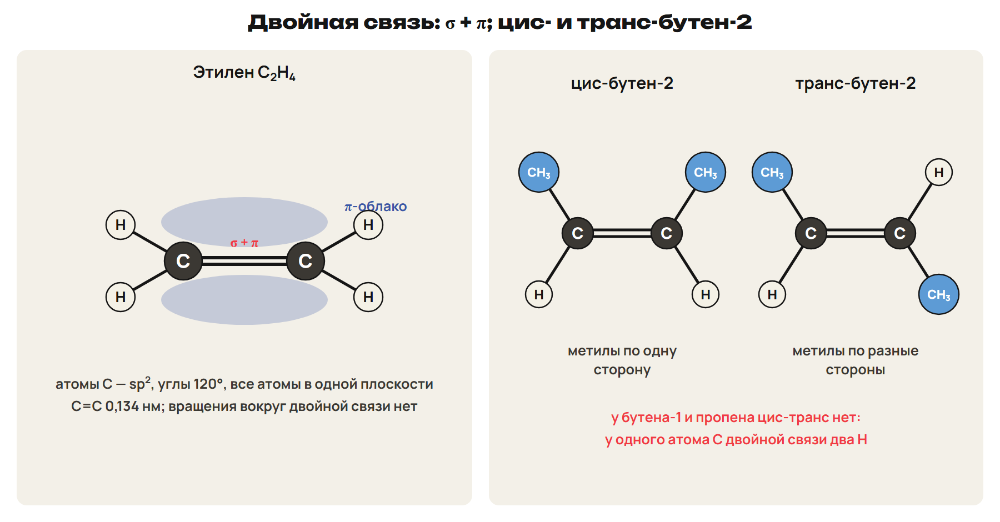
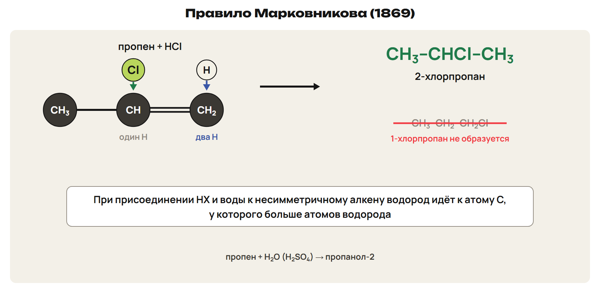
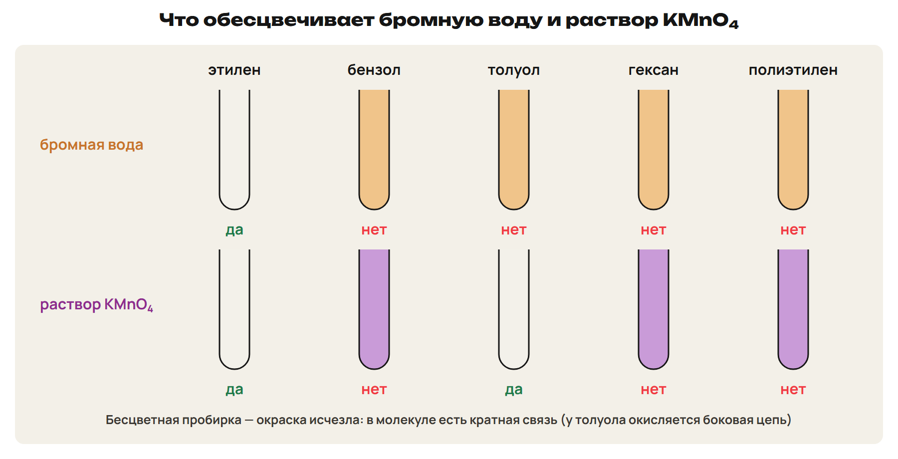
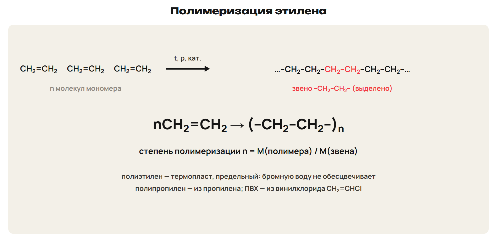
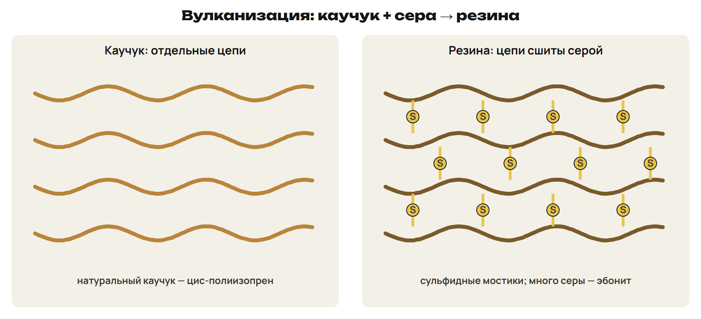
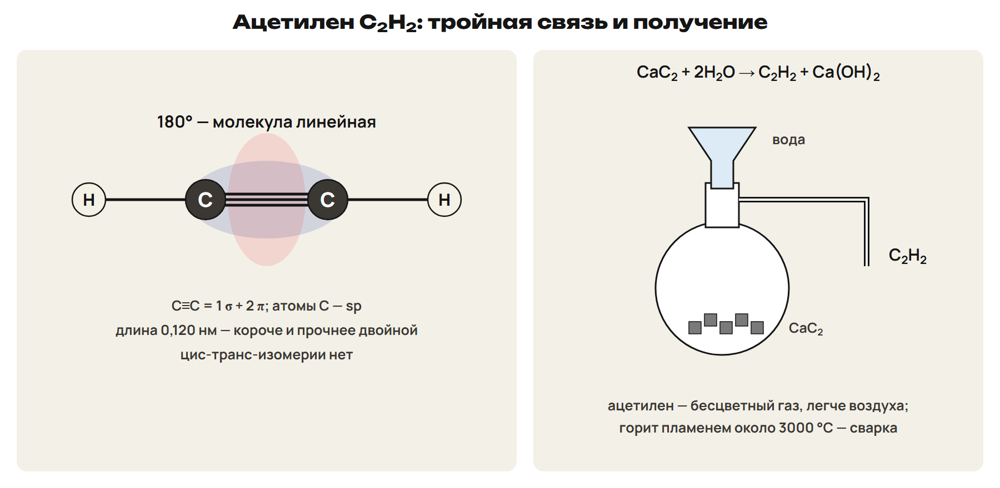
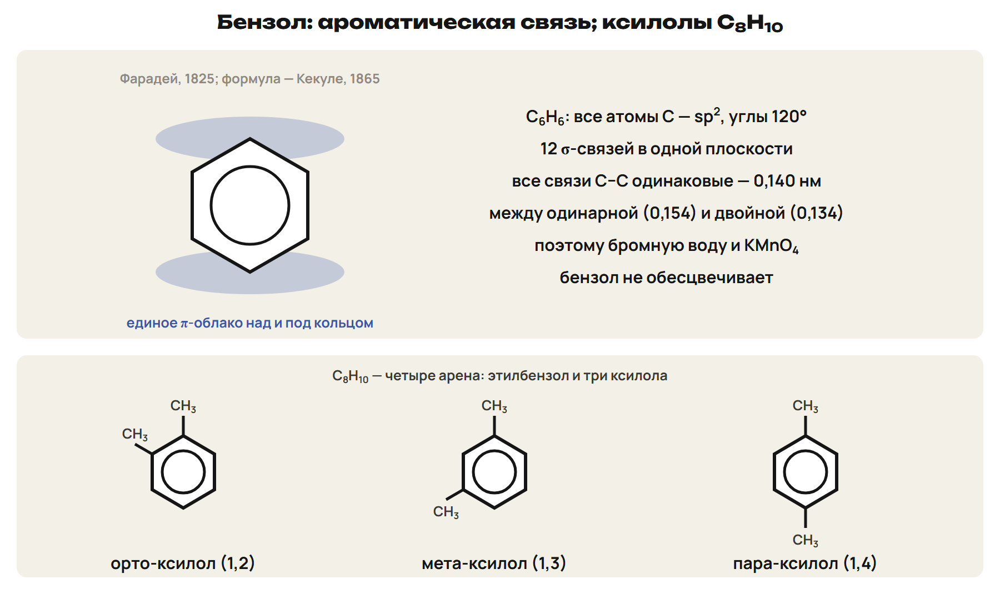
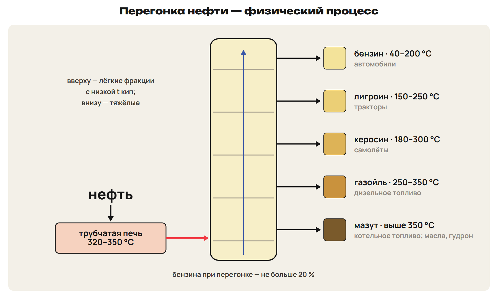
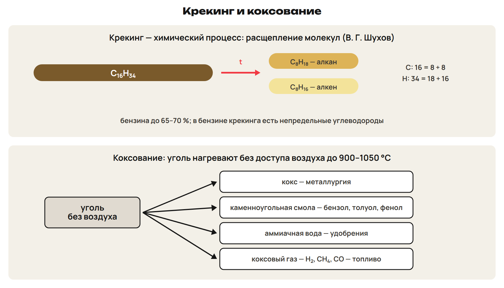
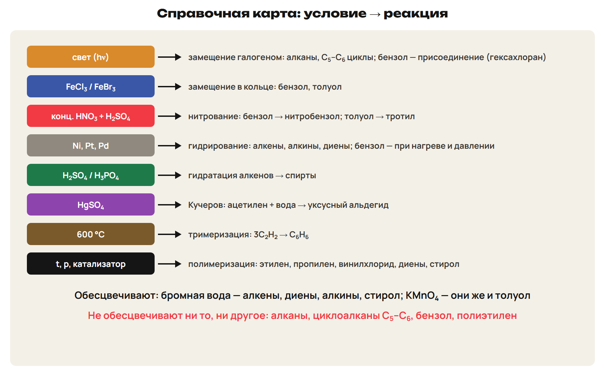

После урока 35 прочитай разделы 1–4, реши P и общую часть G. После урока 36 повтори разделы 5–8, справочную карту и факты, выполни один назначенный вариант A/B/C. Сначала попытка, затем ключ.

## 1. Алкены: строение и названия

Почему этилен обесцвечивает бромную воду, а этан — нет? В этилене есть двойная связь, и одна её часть легко разрывается.

**Непредельные углеводороды** содержат меньше водорода, чем алканы с тем же числом атомов C, потому что в молекуле есть кратные связи. **Алкены** — одна двойная связь C=C; общая формула **CₙH₂ₙ**; первый — **этен (этилен) C₂H₄**.

> [!rule] Двойная связь
> C=C = σ-связь + π-связь. Атомы C при двойной связи — sp², длина C=C 0,134 нм.
> Вращение вокруг двойной связи невозможно; π-связь легко разрывается.

Названия: суффикс **-ан → -ен**: этен (этилен), пропен (пропилен), бутен (бутилен). Радикал CH₂=CH– — **винил**. Главная цепь — самая длинная **с двойной связью**; нумерация — с конца, ближнего к двойной связи; номер двойной связи — после названия цепи: бутен-1, 3-метилбутен-1.

Изомерия начинается с C₄H₈:

- положения двойной связи: бутен-1 и бутен-2;
- углеродной цепи: 2-метилпропен;
- межклассовая — с циклоалканами: циклобутан, метилциклопропан;
- **цис-транс** — у бутена-2: цис — метилы по одну сторону двойной связи, транс — по разные.

Этилен — бесцветный газ со слабым сладковатым запахом, немного легче воздуха, малорастворим в воде. C₂–C₄ — газы. В природе алкены в свободном виде не встречаются.

> [!trap] Цис-транс
> Цис-транс есть у бутена-2; у бутена-1 и пропена его нет — у одного атома C двойной связи два одинаковых заместителя (два H).

## 2. Алкены: получение, реакции, полимеризация

Получение: **дегидрирование алканов** на катализаторе: C₂H₆ → C₂H₄ + H₂. В лаборатории этилен получают нагреванием этилового спирта с концентрированной H₂SO₄.

> [!rule] Присоединение по двойной связи
> Гидрирование (Ni, Pt, Pd): C₂H₄ + H₂ → C₂H₆.
> Бромирование: C₂H₄ + Br₂ → CH₂Br–CH₂Br — бромная вода обесцвечивается.
> Гидрогалогенирование: C₂H₄ + HCl → C₂H₅Cl (хлорэтан).
> Гидратация (H₂SO₄ или H₃PO₄): C₂H₄ + H₂O → C₂H₅OH — промышленный способ получения этанола.

**Правило Марковникова** (В. В. Марковников, 1869): при присоединении HX и воды к несимметричному алкену **водород присоединяется к атому C, у которого больше атомов водорода**.

> [!example] Разберём: пропен и HCl
> CH₃–CH=CH₂ + HCl → CH₃–CHCl–CH₃.
> H присоединяется к CH₂= (два H), Cl — к соседнему атому.
> Продукт — 2-хлорпропан; 1-хлорпропан не образуется. Гидратация пропена даёт пропанол-2.

**Окисление:** с разбавленным раствором KMnO₄ этилен даёт этиленгликоль HO–CH₂–CH₂–OH, фиолетовая окраска исчезает. **Горение:** C₂H₄ + 3O₂ → 2CO₂ + 2H₂O; этилен горит светящимся пламенем.

> [!rule] Качественные реакции на кратные связи
> Обесцвечивание бромной воды и обесцвечивание раствора KMnO₄.

Применение этилена: полиэтилен, этанол, этиленгликоль (антифриз), растворители; этилен ускоряет созревание плодов. Из пропена — полипропилен, ацетон.

**Полимеризация** — соединение многих одинаковых молекул в макромолекулу: nCH₂=CH₂ → (–CH₂–CH₂–)ₙ. **Мономер** — исходное вещество, **структурное звено** — повторяющаяся группа, **степень полимеризации n** = M(полимера) / M(звена).

Полиэтилен — белое твёрдое вещество, при ~110 °C размягчается (термопласт), в воде не растворяется. Он предельный, поэтому **не обесцвечивает бромную воду и KMnO₄**. Полипропилен получают из пропилена, ПВХ — из винилхлорида CH₂=CHCl. Пластики годами не разлагаются в природе.

> [!trap] Этилен и полиэтилен
> Этилен обесцвечивает бромную воду, полиэтилен — нет: двойные связи раскрылись при полимеризации.

## 3. Алкадиены, каучук и резина

**Алкадиены (диены)** — две двойные связи; общая формула **CₙH₂ₙ₋₂ (n ≥ 3)**. Важнейшие — **сопряжённые** (двойные связи разделены одной одинарной): **бутадиен-1,3** CH₂=CH–CH=CH₂ и **изопрен** (2-метилбутадиен-1,3) — мономеры синтетического каучука.

- **С. В. Лебедев (1932)** получил бутадиен из этилового спирта и синтетический бутадиеновый каучук. В промышленности бутадиен получают дегидрированием бутана.
- Диены присоединяют по 2 моль H₂ или галогена и обесцвечивают бромную воду.
- **Натуральный каучук** — сок дерева гевеи; это **цис-полиизопрен**, эластичный, хороший диэлектрик.
- **Вулканизация** — нагревание каучука с серой (2–3 %) → **резина**: между цепями образуются сульфидные мостики. Много серы → **эбонит**.
- Хлоропреновый каучук почти негорюч. В мире получают больше 10 млн т каучука в год, 2/3 — синтетический.

## 4. Алкины и ацетилен

**Алкины** — одна тройная связь C≡C; общая формула **CₙH₂ₙ₋₂**. Главный представитель — **ацетилен (этин) C₂H₂**; названия **-ан → -ин**.

> [!rule] Тройная связь
> C≡C = 1 σ + 2 π; атомы C — sp; молекула линейная (180°); длина 0,120 нм — короче и прочнее двойной.
> Изомерия: положения тройной связи, скелета, межклассовая с алкадиенами; цис-транс-изомерии нет.

Получение: 2CH₄ → C₂H₂ + 3H₂ (1500 °C); **CaC₂ + 2H₂O → C₂H₂ + Ca(OH)₂**. Ацетилен — бесцветный газ, легче воздуха; хранят в баллонах, растворённым в ацетоне.

Присоединение идёт **в две ступени**: тройная → двойная → одинарная.

- Гидрирование: C₂H₂ + H₂ → C₂H₄; C₂H₄ + H₂ → C₂H₆.
- Бромирование: C₂H₂ + Br₂ → CHBr=CHBr; + Br₂ → CHBr₂–CHBr₂; бромная вода обесцвечивается.
- C₂H₂ + HCl → CH₂=CHCl — **винилхлорид**, мономер ПВХ.
- **Реакция Кучерова** (М. Г. Кучеров, 1881; катализатор HgSO₄): C₂H₂ + H₂O → **CH₃CHO** (уксусный альдегид). Казахстанский химик А. Ш. Шарифканов предложил вместо солей ртути соли Fe³⁺.
- **Тримеризация:** 3C₂H₂ → C₆H₆ (600 °C).
- KMnO₄ обесцвечивается. Горение 2C₂H₂ + 5O₂ → 4CO₂ + 2H₂O даёт пламя около 3000 °C — сварка и резка металлов.

> [!trap] Две гидратации
> Этилен + вода (H₂SO₄) → спирт. Ацетилен + вода (HgSO₄) → альдегид.
> Ацетилен получают из карбида кальция CaC₂, а не из CaCO₃.

## 5. Арены: бензол и толуол

**Арены** содержат бензольное кольцо; общая формула гомологов бензола **CₙH₂ₙ₋₆ (n ≥ 6)**. Бензол открыл **М. Фарадей (1825)**, циклическую формулу предложил **Ф. А. Кекуле (1865)**.

> [!rule] Строение бензола
> Все 6 атомов C — sp², σ-связи в одной плоскости под углом 120°, 12 σ-связей.
> p-облака образуют единое π-облако над и под кольцом.
> Все связи C–C одинаковые, 0,140 нм — между одинарной (0,154) и двойной (0,134).
> Поэтому бензол **не обесцвечивает** бромную воду и KMnO₄.

- Гомологи: толуол C₆H₅–CH₃; C₈H₁₀ — 4 изомера: этилбензол и три ксилола (орто-, мета-, пара-). Радикал C₆H₅– — фенил.
- Получение: из каменноугольной смолы и нефти; тримеризация ацетилена; дегидрирование циклогексана: C₆H₁₂ → C₆H₆ + 3H₂ (Н. Д. Зелинский).
- Бензол — жидкость (t кип 80,1 °C), в воде нерастворим, хороший растворитель; огнеопасен и ядовит.

> [!rule] Свойства бензола: замещение легче присоединения
> С Cl₂ и FeCl₃ — замещение: C₆H₆ + Cl₂ → C₆H₅Cl + HCl.
> Нитрующая смесь (конц. HNO₃ + конц. H₂SO₄): C₆H₆ + HNO₃ → C₆H₅NO₂ + H₂O; толуол → 2,4,6-тринитротолуол (тротил).
> Присоединение — в жёстких условиях: гидрирование (Ni, нагрев, давление) → циклогексан; Cl₂ на свету → C₆H₆Cl₆ (гексахлоран).
> Толуол обесцвечивает KMnO₄ (образуется бензойная кислота), бромную воду — нет.
> На воздухе бензол горит коптящим пламенем.

Стирол C₆H₅–CH=CH₂ ведёт себя и как арен, и как алкен (обесцвечивает бромную воду); его полимер — полистирол.

> [!trap] Хлор: свет или FeCl₃
> Метан + Cl₂ на свету — замещение. Бензол + Cl₂ на свету — присоединение (гексахлоран). Бензол + Cl₂ с FeCl₃ — замещение (хлорбензол).

## 6. Природный газ, попутный газ, коксование

Природные источники углеводородов: **природный газ, попутный нефтяной газ, нефть, каменный уголь** — невозобновляемые ресурсы.

- **Природный газ** — до 98 % метана. Сгорает без копоти, дёшев; сырьё для сажи, водорода, ацетилена, синтез-газа. Месторождения Казахстана: Карачаганак, Жетыбай, Каламкас, Кумколь.
- **Попутный газ** растворён в нефти; метана в нём 30–60 %, больше этана, пропана, бутана. Фракции: сухой газ, пропан-бутановая (топливо для автомобилей), газовый бензин.
- **Коксование** — нагревание угля **без доступа воздуха** до 900–1050 °C. Продукты: **кокс** (металлургия), **каменноугольная смола** (бензол, толуол, фенол, нафталин), **аммиачная вода**, **коксовый газ** (H₂, CH₄, CO). Угольные бассейны Казахстана — Карагандинский, Экибастузский.

## 7. Нефть и её переработка

**Нефть** — сложная смесь углеводородов (алканы, циклоалканы, арены) с примесью соединений S, O, N; формулы у неё нет. Маслянистая жидкость, легче воды, в воде не растворяется. Месторождения Казахстана: Эмба, Доссор, Макат, Узень, Жетыбай.

**Перегонка (ректификация)** — **физический** процесс: нефть нагревают в трубчатой печи до 320–350 °C, пары идут в ректификационную колонну; вверху конденсируются летучие фракции, внизу — тяжёлые. Бензина при перегонке получают не больше 20 %.

| Фракция | t кип | Применение |
|---|---|---|
| Бензин | 40–200 °C | топливо для автомобилей |
| Лигроин | 150–250 °C | топливо для тракторов |
| Керосин | 180–300 °C | авиационное топливо |
| Газойль | 250–350 °C | дизельное топливо |
| Мазут | выше 350 °C | котельное топливо; масла, вазелин, парафин; остаток — гудрон |

**Крекинг** — **химический** процесс: расщепление крупных молекул на более мелкие; бензина до 65–70 %. Изучил и применил В. Г. Шухов. Термический крекинг — 470–550 °C: C₁₆H₃₄ → C₈H₁₈ + C₈H₁₆ (алкан + алкен). Каталитический — на алюмосиликатах, 450–500 °C, с изомеризацией. Риформинг даёт ароматические углеводороды.

**Октановое число** показывает стойкость бензина к детонации: н-гептан — 0, изооктан (2,2,4-триметилпентан) — 100.

> [!trap] Нефть
> Перегонка — физический процесс (разделение по температурам кипения); крекинг — химический (расщепление молекул).
> Керосин — самолёты, газойль — дизельные двигатели, лигроин — тракторы, мазут — котельные.
> Октановое число 100 — изооктан, 0 — н-гептан. Коксование — нагрев без воздуха, а не горение.

## 8. Справочная карта условий

| Реакция | Условие | Кто вступает |
|---|---|---|
| Замещение галогеном | свет | алканы, циклоалканы C₅–C₆ |
| Замещение в кольце | FeCl₃ / FeBr₃ | бензол, толуол |
| Нитрование | конц. HNO₃ + конц. H₂SO₄ | бензол, толуол |
| Бромная вода обесцвечивается | обычные условия | алкены, диены, алкины, стирол; не алканы, не бензол |
| KMnO₄ обесцвечивается | обычные условия | алкены, алкины, диены, толуол; не алканы, не бензол |
| Гидрирование | Ni, Pt, Pd | алкены, алкины, диены; бензол — при нагреве и давлении |
| Гидратация | H₂SO₄ / H₃PO₄; HgSO₄ | алкены → спирты; ацетилен → уксусный альдегид |
| Полимеризация | t, p, катализатор | этилен, пропилен, винилхлорид, диены, стирол |
| Тримеризация | 600 °C | ацетилен → бензол |
| Ацетиленид серебра | аммиачный раствор Ag₂O | алкины с концевой тройной связью |

> [!rule] Факты ЕНТ недели
> - Алкены CₙH₂ₙ: σ + π, sp², 0,134 нм; цис-транс у бутена-2; бромная вода и KMnO₄ — качественные реакции на кратные связи.
> - Марковников, 1869: H — к атому C с большим числом H; пропен + HCl → 2-хлорпропан.
> - Полиэтилен — термопласт, не обесцвечивает бромную воду; n = M(полимера) / M(звена).
> - Лебедев, 1932 — бутадиен из спирта, синтетический каучук; натуральный каучук — цис-полиизопрен; вулканизация серой → резина, эбонит.
> - Алкины CₙH₂ₙ₋₂: sp, 180°, 0,120 нм; CaC₂ + 2H₂O → C₂H₂; Кучеров, 1881 (HgSO₄) → уксусный альдегид; 3C₂H₂ (600 °C) → бензол; сварка ~3000 °C.
> - Бензол: Фарадей 1825, Кекуле 1865; sp², 120°, 0,140 нм; не обесцвечивает бромную воду; толуол → тротил; C₈H₁₀ — 4 изомера.
> - Природный газ — до 98 % CH₄, попутный — 30–60 %; коксование без воздуха: кокс, смола, аммиачная вода, коксовый газ.
> - Перегонка нефти — физический процесс, крекинг — химический (Шухов); октановое число: н-гептан 0, изооктан 100.
