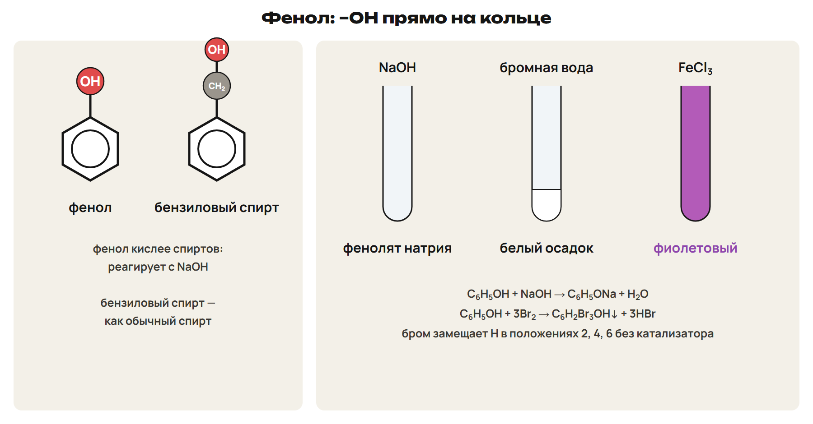
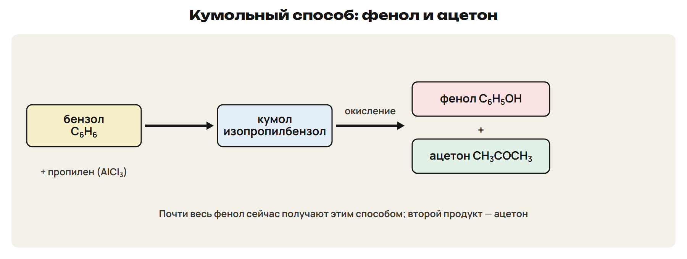
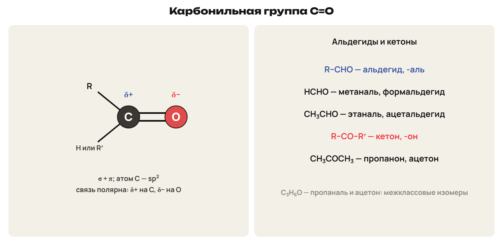
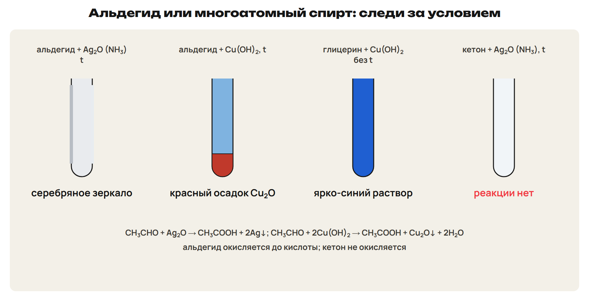
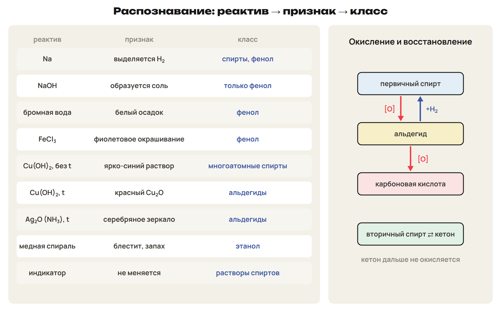

# Возврат
? Какие условия реакций спиртов путаются?
> 0–3 вопросы; 3–12 разбор G9 и G10.

## Понятие: Разбор G9 и G10
G9: 13,8 г этанола → 0,30 моль → 6,72 л; выход 75 % → 5,04 л.
Условие — конц. H₂SO₄ и сильный нагрев.
G10: Cu(OH)₂ без нагрева — глицерин; с нагревом — этаналь.
Бромная вода — белый осадок — фенол.

# Фенол
? Почему фенол реагирует со щёлочью, а этанол — нет?
> 12–24 строение и свойства; 24–29 L7; 29–32 ключ.

## Схема: Фенол и его реакции

Фенол C₆H₅OH: –OH прямо на кольце; бензиловый спирт — –OH в боковой цепи.
Кольцо делает O–H полярнее — фенол кислее спиртов.
C₆H₅OH + NaOH → C₆H₅ONa + H₂O.
С бромной водой — белый осадок 2,4,6-трибромфенола.
С FeCl₃ — фиолетовое окрашивание.

## Схема: Кумольный способ

Из бензола и пропилена через кумол — сразу фенол и ацетон.
Фенол — смолы, лекарства, красители, антисептики.
Фенол ядовит и вызывает ожоги кожи.
Ловушка: со щёлочью реагирует фенол, а не этанол.

## Практика: L7
Запиши уравнения: фенол + NaOH; фенол + бромная вода.
Чем бензиловый спирт отличается от фенола по свойствам?
Ответы:
C₆H₅OH + NaOH → C₆H₅ONa + H₂O.
C₆H₅OH + 3Br₂ → C₆H₂Br₃OH↓ + 3HBr.
Бензиловый спирт с NaOH не реагирует — как обычный спирт.
> 24–29 попытка, 29–32 ключ.

# Альдегиды и кетоны
? Чем альдегид отличается от кетона?
> 32–41 строение, названия, получение; 41–45 L8; 45–48 ключ.

## Схема: Карбонильная группа

C=O: σ + π; атом C — sp²; δ+ на C, δ− на O.
Альдегиды R–CHO (-аль): метаналь HCHO, этаналь CH₃CHO.
Кетоны R–CO–R' (-он): пропанон — ацетон.
C₃H₆O — пропаналь и ацетон: межклассовые изомеры.

## Понятие: Получение
Окисление спиртов: первичный → альдегид, вторичный → кетон.
Формальдегид — из метанола и воздуха над раскалённой медью.
Кучеров: ацетилен → этаналь, пропин → ацетон.
Окисление этилена кислородом → ацетальдегид; кумольный способ → ацетон.
Ловушка: метаналь = формальдегид, этаналь = ацетальдегид, пропанон = ацетон.

## Практика: L8
Назови: HCHO; CH₃CH₂CHO; CH₃COCH₂CH₃.
Назови межклассовый изомер пропаналя.
Ответы:
Метаналь (формальдегид); пропаналь; бутанон.
Ацетон (C₃H₆O).
> 41–45 попытка, 45–48 ключ.

# Свойства альдегидов и кетонов
? Почему кетон не даёт серебряного зеркала?
> 48–56 восстановление и окисление; 56–60 L9; 60–62 ключ.

## Схема: Качественные реакции альдегидов

Альдегид + H₂ → первичный спирт; кетон + H₂ → вторичный.
CH₃CHO + Ag₂O → CH₃COOH + 2Ag↓ — серебряное зеркало.
CH₃CHO + 2Cu(OH)₂ → CH₃COOH + Cu₂O↓ + 2H₂O — красный осадок.
Кетоны с Ag₂O и Cu(OH)₂ не реагируют.
Формалин — 35–40 %-й раствор формальдегида.

## Практика: L9
Запиши продукты: пропаналь + H₂ (Ni); пропаналь + Ag₂O (t); ацетон + Ag₂O.
Ответы:
Пропанол-1.
Пропановая кислота и серебро.
Реакции нет.
> 56–60 попытка, 60–62 ключ.

# Распознавание
? Как одним-двумя реактивами различить пять классов?
> 62–66 таблица; 66–72 L10; 72–78 L11.

## Схема: Таблица распознавания

Na → H₂: спирты и фенол. NaOH: только фенол.
Бромная вода — белый осадок; FeCl₃ — фиолетовый: фенол.
Cu(OH)₂ без нагрева — синий раствор: многоатомные спирты.
Cu(OH)₂ при нагреве — красный осадок; Ag₂O — зеркало: альдегиды.
Ловушка: Cu(OH)₂ — две разные реакции.

## Практика: L10
В склянках: этанол, глицерин, фенол, этаналь.
Составь план распознавания минимальным числом реактивов.
Ответы:
FeCl₃ — фиолетовый у фенола.
Cu(OH)₂ без нагрева — синий раствор у глицерина.
Нагреть оставшиеся с Cu(OH)₂ — красный осадок у этаналя; оставшийся — этанол.
> 66–71 попытка, 71–72 ключ.

## Практика: L11
5,8 г пропаналя нагрели с избытком Cu(OH)₂.
Найди массу красного осадка.
Ответы:
n = 5,8 : 58 = 0,10 моль.
Cu₂O 0,10 × 144 = 14,4 г.
> 72–76 попытка, 76–78 ключ.

# Контроль
? 10 минут, 10 баллов, таблица распознавания разрешена.
> 78–88 контроль; 88–90 назначить вариант.

## Понятие: Дополнительно для A: механизмы
Нуклеофил атакует атом C с δ+ в галогеналкане.
Sɴ2 — одна стадия, первичные и вторичные.
Sɴ1 — через карбокатион, третичные.
Водная щёлочь — замещение; спиртовая — отщепление (E1, E2).

## Понятие: Дополнительно для A: присоединение и гидратация
Альдегиды присоединяют HCN (оксинитрилы) и NaHSO₃.
Гидратация этилена: обратимая, экзотермическая, меньше молекул газа.
Поэтому 7–8 МПа и H₃PO₄; побочно — диэтиловый эфир.

## Дома: После урока 38
Повтори разделы 7–10 конспекта, таблицу распознавания и факты: 15 минут.
Выполни назначенный вариант A, B или C: 30 минут.
Тест — строкой; задачи 9–10 — фото; № 11 — текст или голосовое.
После проверки — 25 минут исправлений по двум причинам.
