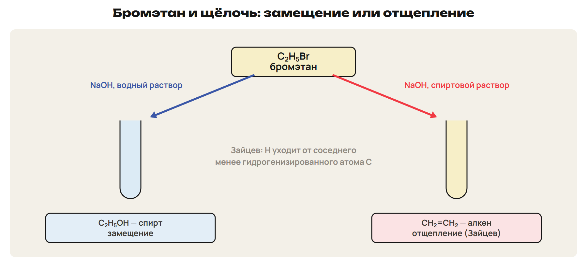
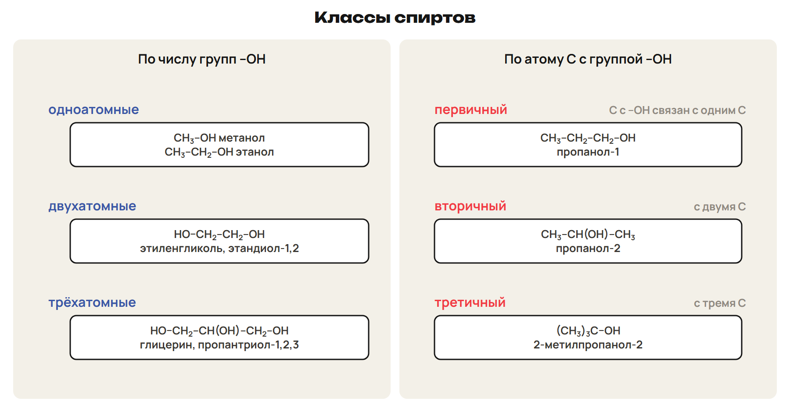
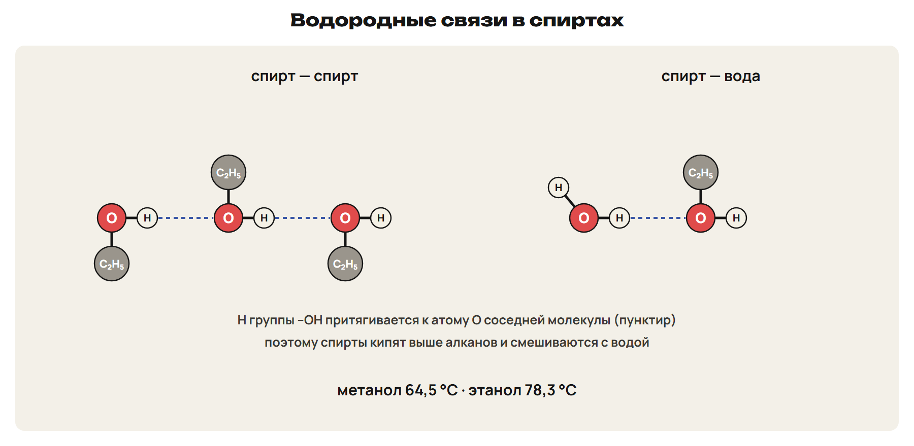
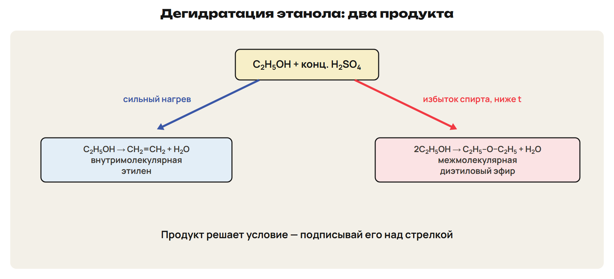
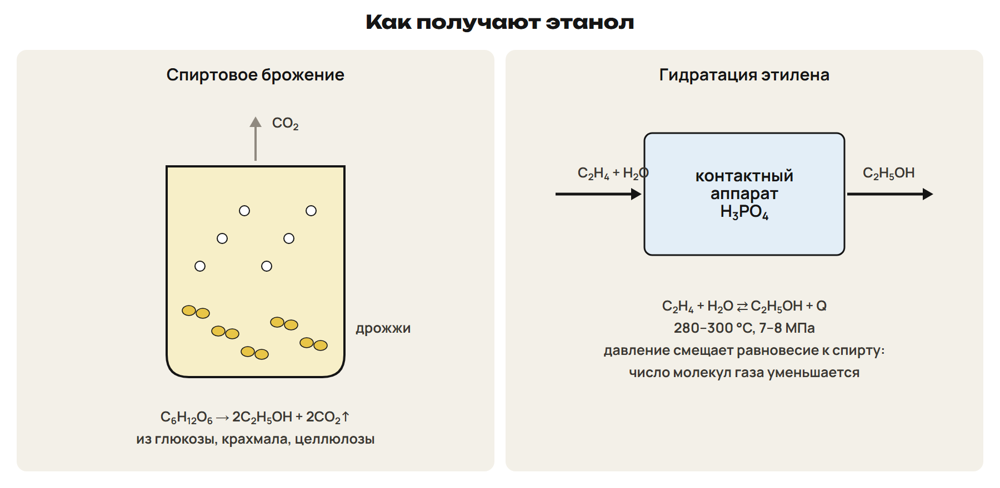

После урока 37 прочитай разделы 1–6, реши P и общую часть G. После урока 38 повтори разделы 7–10, таблицу распознавания и факты, выполни один назначенный вариант A/B/C. Сначала попытка, затем ключ.

## 1. Галогеналканы — мост от углеводородов к спиртам

Как из этана получить спирт? Через галогеналкан: сначала заменить H на галоген, потом галоген — на группу –OH.

Галогеналканы получают замещением в алканах на свету (C₂H₆ + Cl₂ → C₂H₅Cl + HCl), присоединением HX к алкенам (пропен + HCl → 2-хлорпропан по Марковникову) и из спиртов: ROH + HX → RX + H₂O. Связь C–Hal полярна, поэтому галоген легко замещается.

> [!rule] Водная или спиртовая щёлочь
> C₂H₅Br + NaOH (водный раствор) → C₂H₅OH + NaBr — замещение, получается спирт.
> C₂H₅Br + NaOH (спиртовой раствор) → CH₂=CH₂ + NaBr + H₂O — отщепление, получается алкен.
> Правило Зайцева (1875): при отщеплении H уходит от соседнего, **менее гидрогенизированного** атома C.

**Фреоны** — хлорфторуглероды, хладагенты; под ультрафиолетом на высоте 20–25 км они дают атомы хлора, которые разрушают озон. Монреальский протокол (1987) ограничил их выпуск. Йодоформ CHI₃ — антисептик, тетрафторэтилен → тефлон.

> [!trap] Марковников и Зайцев
> Марковников — присоединение к алкенам: H идёт к атому C с большим числом H.
> Зайцев — отщепление: H уходит от атома C с меньшим числом H.

## 2. Спирты: строение, классы, названия

**Спирты** — производные углеводородов, в которых атомы H замещены гидроксильными группами **–OH**. Общая формула ROH; предельные одноатомные — **CₙH₂ₙ₊₁OH**.

- По числу –OH: **одноатомные** (метанол CH₃OH, этанол C₂H₅OH) и **многоатомные**: этиленгликоль (этандиол-1,2), глицерин (пропантриол-1,2,3). У многоатомных –OH стоят при разных атомах C.
- По атому C с –OH: **первичные**, **вторичные**, **третичные** — по числу атомов C, связанных с этим атомом.
- Названия: суффикс **-ол** и номер атома C с –OH; нумерация с конца, ближнего к –OH; многоатомные — -диол, -триол.

Изомерия спиртов: углеродного скелета и положения –OH; у C₄H₉OH четыре спирта: бутанол-1, бутанол-2, 2-метилпропанол-1, 2-метилпропанол-2. Межклассовые изомеры спиртов — простые эфиры (этанол и диметиловый эфир).

## 3. Физические свойства и водородная связь

Метанол, этанол, пропанол смешиваются с водой в любых соотношениях; с ростом молекулярной массы растворимость падает. Спирты кипят **выше**, чем алканы с близкой молярной массой: между молекулами спирта образуются **водородные связи**.

- **Метанол** — t кип 64,5 °C, **очень ядовит**: малая доза вызывает слепоту или смерть.
- **Этанол** — t кип 78,3 °C, бесцветная жидкость с характерным запахом.
- **Этиленгликоль** — вязкая сладкая жидкость, очень ядовит; его водный раствор — **антифриз**.
- **Глицерин** — сиропообразная сладкая жидкость, t кип 290 °C.

## 4. Химические свойства одноатомных спиртов

Кислотные свойства спиртов выражены слабо: их растворы **не меняют окраску индикаторов**.

> [!rule] Реакции спиртов
> С натрием: 2C₂H₅OH + 2Na → 2C₂H₅ONa + H₂↑ (этилат натрия).
> С галогеноводородом: C₂H₅OH + HCl → C₂H₅Cl + H₂O.
> Дегидратация (конц. H₂SO₄): сильный нагрев → алкен; избыток спирта и ниже температура → простой эфир.
> Окисление: первичный спирт → альдегид; вторичный → кетон.
> Горение: C₂H₅OH + 3O₂ → 2CO₂ + 3H₂O.

Опыт: раскалённая медная спираль, покрытая чёрным CuO, в этаноле становится блестящей, появляется запах уксусного альдегида: C₂H₅OH + CuO → CH₃CHO + Cu + H₂O.

С карбоновыми кислотами спирты образуют сложные эфиры (этерификация) — подробно на следующей неделе.

> [!trap] Две дегидратации
> Внутримолекулярная (сильный нагрев) → алкен: этилен.
> Межмолекулярная (избыток спирта) → простой эфир: диэтиловый эфир C₂H₅–O–C₂H₅.

## 5. Получение спиртов

- **Метанол** — из синтез-газа: CO + 2H₂ → CH₃OH (220–300 °C, давление).
- **Этанол** — больше всего среди органических веществ:
  - **спиртовое брожение** глюкозы (ферменты дрожжей): C₆H₁₂O₆ → 2C₂H₅OH + 2CO₂↑; из целлюлозы древесины — гидролизный спирт;
  - **гидратация этилена**: CH₂=CH₂ + H₂O ⇄ C₂H₅OH + 46 кДж; 280–300 °C, 7–8 МПа, катализатор H₃PO₄. Реакция обратимая, экзотермическая, число молекул газа уменьшается — поэтому давление повышают.
- **Этиленгликоль** — окислением этилена раствором KMnO₄; **глицерин** — из жиров или из пропилена.

Применение: метанол — формальдегид, растворитель; этанол — синтетический каучук, уксусная кислота, медицина, пищевая промышленность; этиленгликоль — антифриз, волокно лавсан; глицерин — нитроглицерин, динамит, мази. Этанол — ядовитое наркотическое вещество: в печени он окисляется в ядовитый уксусный альдегид.

## 6. Многоатомные спирты

Этиленгликоль и глицерин, как одноатомные спирты, реагируют с натрием (выделяется H₂) и с HCl.

> [!rule] Качественная реакция на многоатомные спирты
> Свежий осадок Cu(OH)₂ (CuSO₄ + избыток NaOH) с глицерином или этиленгликолем **растворяется без нагревания** → ярко-синий раствор.
> Это показывает слабые кислотные свойства многоатомных спиртов.

**Нитроглицерин** — продукт реакции глицерина с азотной кислотой (H₂SO₄). Несмотря на название, это **сложный эфир**; его раствор расширяет сосуды.

## 7. Фенол

**Фенолы** — у них группа –OH **непосредственно связана с бензольным кольцом**; простейший — фенол C₆H₅OH. Если –OH в боковой цепи (бензиловый спирт C₆H₅CH₂OH) — это ароматический спирт со свойствами обычных спиртов.

**Взаимное влияние атомов:** кольцо делает связь O–H полярнее — фенол **кислее спиртов**; группа –OH облегчает замещение в кольце в положениях 2, 4, 6.

Фенол — бесцветные кристаллы с характерным запахом, на воздухе розовеет; t пл 40,9 °C; ядовит, вызывает ожоги кожи.

> [!rule] Свойства фенола
> С натрием: 2C₆H₅OH + 2Na → 2C₆H₅ONa + H₂↑.
> Со щёлочью (спирты не реагируют): C₆H₅OH + NaOH → C₆H₅ONa + H₂O — фенолят натрия.
> С бромной водой без катализатора: белый осадок 2,4,6-трибромфенола + 3HBr.
> С FeCl₃ — фиолетовое окрашивание.
> Нитрование → 2,4,6-тринитрофенол (пикриновая кислота) — взрывчатое вещество.

Получение: из каменноугольной смолы; **кумольный способ** — из бензола и пропилена через кумол получают сразу **фенол и ацетон**. Применение: фенолформальдегидные смолы, лекарства, красители, антисептики.

> [!trap] Фенол и спирт
> С натрием реагируют и спирты, и фенол. Со щёлочью — **только фенол**.
> Фенол — –OH прямо на кольце; бензиловый спирт — –OH в боковой цепи.

## 8. Альдегиды и кетоны: строение и названия

**Карбонильная группа C=O** = σ + π; атом C — sp²; связь полярна: δ+ на C, δ− на O.

- **Альдегиды** R–CHO — карбонил связан с атомом H; суффикс **-аль**: **метаналь** (формальдегид, муравьиный альдегид) HCHO, **этаналь** (ацетальдегид, уксусный альдегид) CH₃CHO.
- **Кетоны** R–CO–R' — карбонил связан с двумя радикалами; суффикс **-он**: **пропанон (ацетон)** CH₃COCH₃.
- Межклассовые изомеры: C₃H₆O — пропаналь и ацетон.

Получение: окисление спиртов (первичный → альдегид, вторичный → кетон); формальдегид — из метанола и воздуха над раскалённой медью; реакция Кучерова (ацетилен → этаналь, пропин → ацетон); окисление этилена кислородом с катализатором; кумольный способ (ацетон).

## 9. Свойства альдегидов и кетонов

Альдегиды и кетоны кипят ниже спиртов. **Формальдегид** — ядовитый газ с резким запахом; **формалин** — 35–40 %-й водный раствор формальдегида. Ацетон — летучая жидкость, растворитель.

> [!rule] Восстановление и окисление
> Гидрирование (Ni): альдегид → первичный спирт; кетон → вторичный спирт.
> Серебряное зеркало: CH₃CHO + Ag₂O → CH₃COOH + 2Ag↓ (аммиачный раствор, нагревание).
> С Cu(OH)₂ при нагревании: голубой осадок → красный Cu₂O: CH₃CHO + 2Cu(OH)₂ → CH₃COOH + Cu₂O + 2H₂O.
> Кетоны с Ag₂O и Cu(OH)₂ не реагируют — так альдегид отличают от кетона.

Применение: формальдегид — фенолформальдегидные смолы; формалин — консервирование препаратов, дезинфекция; ацетальдегид — уксусная кислота; ацетон — растворитель лаков и красок.

> [!rule] Спирт ⇄ альдегид → кислота
> Первичный спирт ⇄ альдегид → карбоновая кислота. Вторичный спирт ⇄ кетон (дальше Ag₂O и Cu(OH)₂ не окисляют).

> [!trap] Три названия
> Метаналь = формальдегид = муравьиный альдегид; этаналь = ацетальдегид = уксусный альдегид; пропанон = ацетон. Формалин — раствор, а не газ.

## 10. Распознавание

| Реактив, условие | Признак | Кто даёт |
|---|---|---|
| Na | выделяется H₂ | спирты, фенол |
| NaOH (раствор) | реагирует, образуется соль | фенол (спирты — нет) |
| Бромная вода | белый осадок | фенол |
| FeCl₃ | фиолетовое окрашивание | фенол |
| Cu(OH)₂ без нагревания | ярко-синий раствор | многоатомные спирты |
| Cu(OH)₂ при нагревании | красный осадок Cu₂O | альдегиды |
| Ag₂O (аммиачный раствор), нагревание | серебряное зеркало | альдегиды (кетоны — нет) |
| Раскалённая медная спираль | спираль блестит, запах альдегида | этанол (первичные спирты) |
| Индикатор | окраска не меняется | растворы спиртов |

> [!trap] Cu(OH)₂ — две разные реакции
> Без нагревания, синий раствор — многоатомные спирты. При нагревании, красный осадок — альдегиды.

> [!rule] Факты ЕНТ недели
> - Спирты ROH, предельные одноатомные CₙH₂ₙ₊₁OH; метанол очень ядовит (64,5 °C), этанол — 78,3 °C; спирты кипят выше алканов из-за водородных связей.
> - 2C₂H₅OH + 2Na → 2C₂H₅ONa + H₂; растворы спиртов не меняют окраску индикатора.
> - Дегидратация: сильный нагрев → этилен, избыток спирта → диэтиловый эфир; первичный спирт → альдегид, вторичный → кетон.
> - Метанол — из CO + 2H₂; этанол — брожение глюкозы и гидратация этилена (H₃PO₄, 7–8 МПа).
> - Этиленгликоль — антифриз, лавсан; глицерин — нитроглицерин; Cu(OH)₂ + глицерин → ярко-синий раствор.
> - Фенол: с NaOH реагирует; бромная вода → белый осадок; FeCl₃ — фиолетовый; кумольный способ → фенол + ацетон.
> - Альдегиды -аль, кетоны -он; формалин 35–40 %; серебряное зеркало и красный Cu₂O — альдегиды, кетоны нет.
> - Галогеналкан + водная щёлочь → спирт, + спиртовая → алкен (Зайцев); фреоны разрушают озон.
