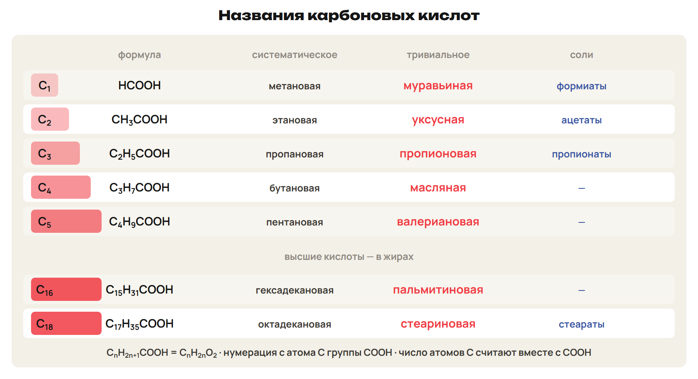
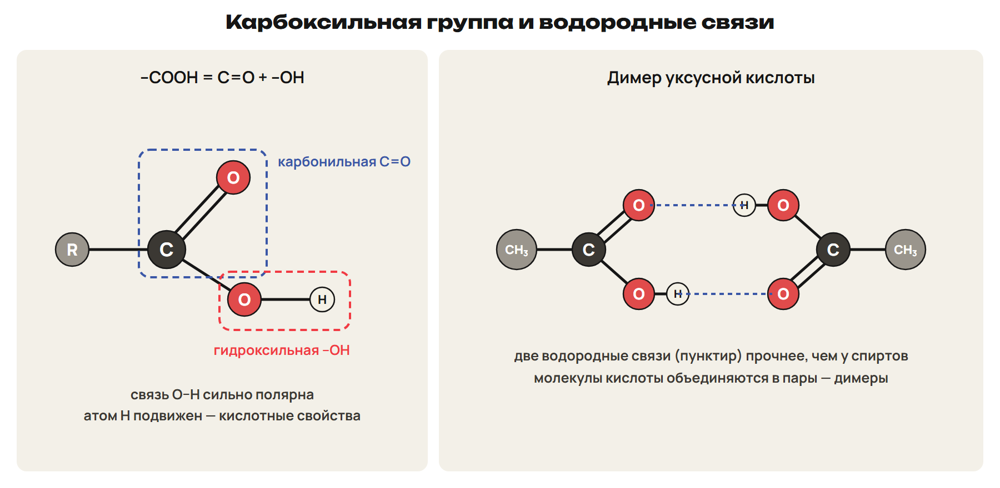
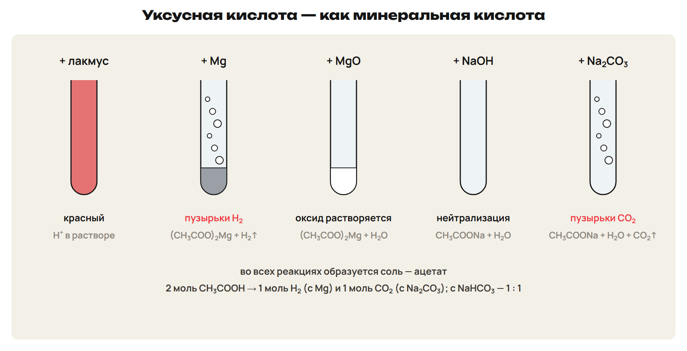
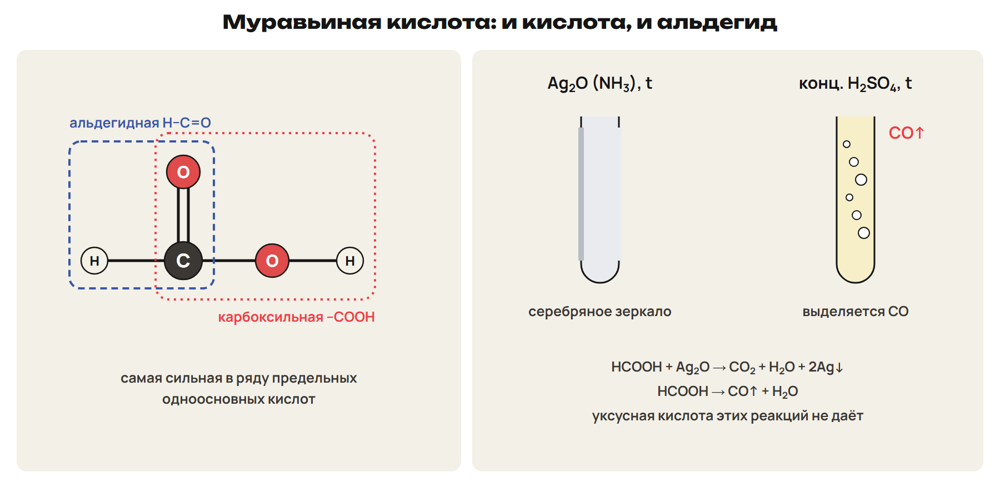

# Строение и названия
? Что общего у уксуса, жжения крапивы и мыла?
↳ Альдегид мы окисляли до кислоты. Сегодня — сами кислоты.
> 0–10 карбоксильная группа, классы, названия; 10–13 L1; 13–14 ключ.

## Схема: Названия кислот

R–COOH; –COOH = карбонильная C=O + гидроксильная –OH.
Одноосновные, двухосновные (щавелевая), трёхосновные (лимонная).
Предельные одноосновные: CₙH₂ₙ₊₁COOH = CₙH₂ₙO₂.
Названия: -овая кислота; нумерация с атома C группы COOH.
Соли: формиаты, ацетаты, пропионаты, стеараты.
Ловушка: C=O — альдегиды, –COOH — кислоты, –COO– — эфиры.

## Практика: L1
Назови HCOOH и C₂H₅COOH систематически и тривиально.
Как называются соли HCOOH?
Ответы:
Метановая (муравьиная); пропановая (пропионовая).
Формиаты.
> 10–13 попытка, 13–14 ключ.

# Изомерия и свойства
? Почему уксусная кислота при 16,6 °C похожа на лёд?
> 14–22 изомерия, димеры, физические свойства; 22–26 L2; 26–28 ключ.

## Схема: Водородные связи и димер

Изомерия скелета: бутановая и 2-метилпропановая; C₅H₁₀O₂ — четыре кислоты.
Межклассовая: C₃H₆O₂ — пропановая кислота, метилацетат, этилформиат.
Водородные связи прочнее, чем у спиртов, — димеры.
Низшие — жидкие, резкий запах; C₄–C₉ — маслянистые; выше C₉ — твёрдые.

## Практика: L2
Какие вещества изомерны бутановой кислоте:
этилацетат, бутаналь, 2-метилпропановая кислота?
Ответы:
Этилацетат и 2-метилпропановая кислота — C₄H₈O₂.
Бутаналь C₄H₈O — не изомер.
> 22–26 попытка, 26–28 ключ.

# Муравьиная и уксусная кислоты
? Откуда берётся уксус?
> 28–36 две кислоты и получение; 36–40 L3; 40–42 ключ.

## Понятие: Две главные кислоты
HCOOH: муравьи, крапива; ожоги; самая сильная в ряду предельных.
CH₃COOH: слабая; эссенция 70–80 %; «ледяная» — 16,6 °C.
Уксуснокислое брожение спиртосодержащих жидкостей.

## Понятие: Получение кислот
Окисление: R–CH₂OH → R–CHO → R–COOH.
Промышленность: 2C₄H₁₀ + 5O₂ → 4CH₃COOH + 2H₂O (t, кат.).
Гидролиз эфиров; из солей: 2CH₃COONa + H₂SO₄ (конц.) → Na₂SO₄ + 2CH₃COOH.

## Практика: L3
Запиши окисление этаналя до уксусной кислоты.
Получи уксусную кислоту из ацетата натрия.
Ответы:
CH₃CHO + [O] → CH₃COOH (Ag₂O в аммиачном растворе, t).
2CH₃COONa + H₂SO₄ (конц.) → Na₂SO₄ + 2CH₃COOH (t).
> 36–40 попытка, 40–42 ключ.

# Химические свойства
? Чем уксусная кислота похожа на соляную?
> 42–53 пять пробирок, газы, радикал; 53–59 L4; 59–62 ключ.

## Схема: Пять пробирок

Металлы до H: 2CH₃COOH + Mg → (CH₃COO)₂Mg + H₂↑.
Оксиды и основания: MgO, NaOH — соль и вода.
2CH₃COOH + Na₂CO₃ → 2CH₃COONa + H₂O + CO₂↑.
Ловушка: 2 моль кислоты → 1 моль H₂ и 1 моль CO₂; с NaHCO₃ — 1 : 1.

## Понятие: Реакции по радикалу
CH₃COOH + Cl₂ → ClCH₂COOH + HCl (свет) — монохлоруксусная.
H замещается у атома C рядом с COOH.
CH₃COONa + NaOH → CH₄↑ + Na₂CO₃ (сплавление).

## Практика: L4
Сколько литров CO₂ даст 0,30 моль CH₃COOH с избытком Na₂CO₃?
С чем реагирует уксусная кислота: Cu, Zn, CaO, KOH, NaCl?
Ответы:
0,15 моль CO₂ = 3,36 л.
Zn, CaO, KOH.
> 53–59 попытка, 59–62 ключ.

# Муравьиная и высшие кислоты
? Почему муравьиная кислота похожа на альдегид?
> 62–69 особая HCOOH и высшие кислоты; 69–74 L5; 74–76 ключ.

## Схема: Муравьиная кислота

В H–COOH есть альдегидная группа.
HCOOH + Ag₂O → CO₂ + H₂O + 2Ag (NH₃, t) — серебряное зеркало.
HCOOH → CO↑ + H₂O (конц. H₂SO₄, t).
Ловушка: уксусная кислота зеркала не даёт.

## Понятие: Высшие кислоты
Пальмитиновая C₁₅H₃₁COOH, стеариновая C₁₇H₃₅COOH — предельные.
Олеиновая C₁₇H₃₃COOH — 1 C=C; линолевая C₁₇H₃₁COOH — 2; линоленовая C₁₇H₂₉COOH — 3.
Каждая C=C — минус 2 атома H; непредельные обесцвечивают бромную воду.
Акриловая CH₂=CH–COOH — свойства COOH и C=C.

## Практика: L5
Чем отличить муравьиную кислоту от уксусной?
Сколько связей C=C в C₁₇H₃₁COOH?
Ответы:
Аммиачный Ag₂O при нагревании — зеркало только у HCOOH.
Две.
> 69–74 попытка, 74–76 ключ.

# Проверка в формате ЕНТ
? Где ловушка в каждом задании?
> 76–83 L6; 83–88 ключ; 88–90 маршрут.

## Практика: L6
1) Масса ацетата натрия из 0,10 моль CH₃COOH и NaOH? 2) Двухосновная кислота?
3) Верные: А) HCOOH даёт зеркало; Б) уксусная сильнее муравьиной; В) кислоты с карбонатами дают CO₂;
Г) стеариновая непредельная; Д) олеиновая — C₁₇H₃₃COOH; Е) спирты меняют лакмус.
Ответы:
1) 8,2 г. 2) Щавелевая. 3) АВД.
> 76–83 попытка, 83–88 ключ.

## Дома: После урока 39
Прочитай разделы 1–6 конспекта: 25 минут.
Реши P1–P6: 20 минут.
Выполни всю G: 35 минут.
Тест — строкой; G9–G10 — фото; G11 — текст или голосовое.
Запиши вопрос к началу следующего урока.
