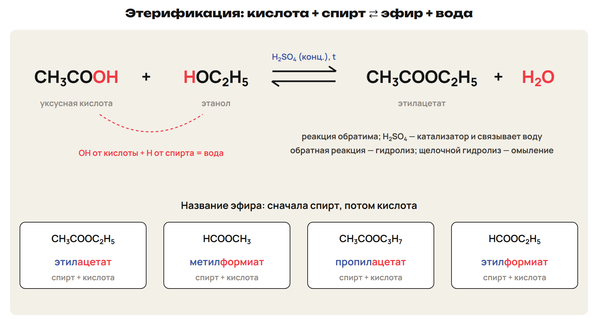
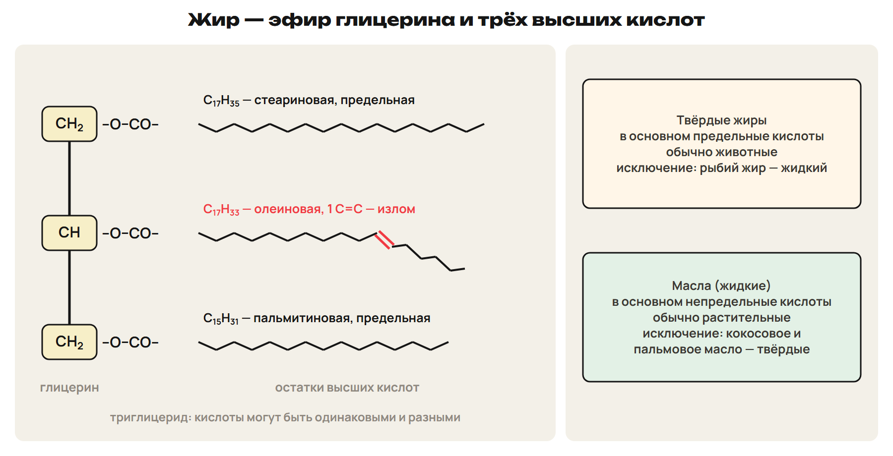
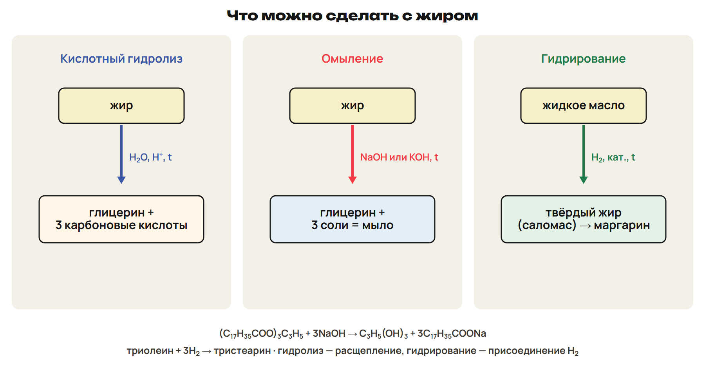
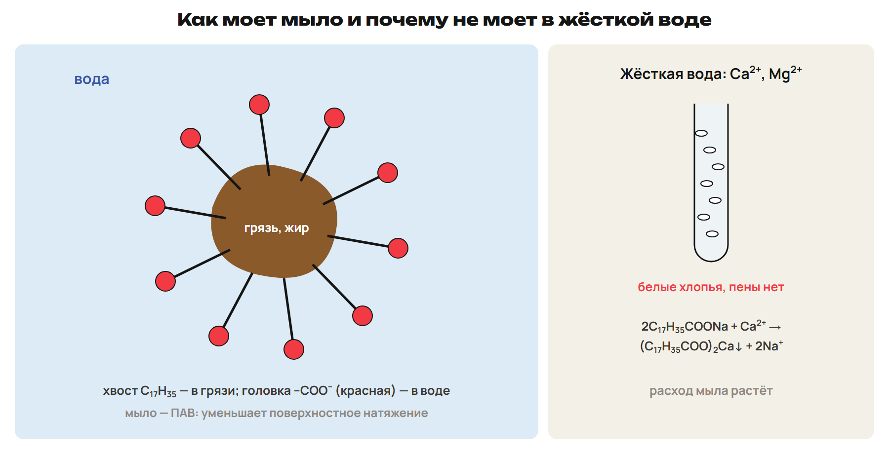
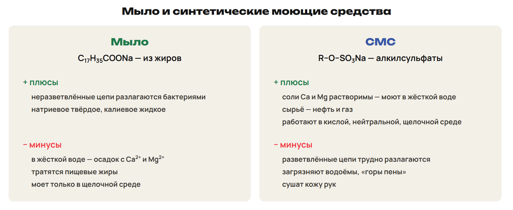
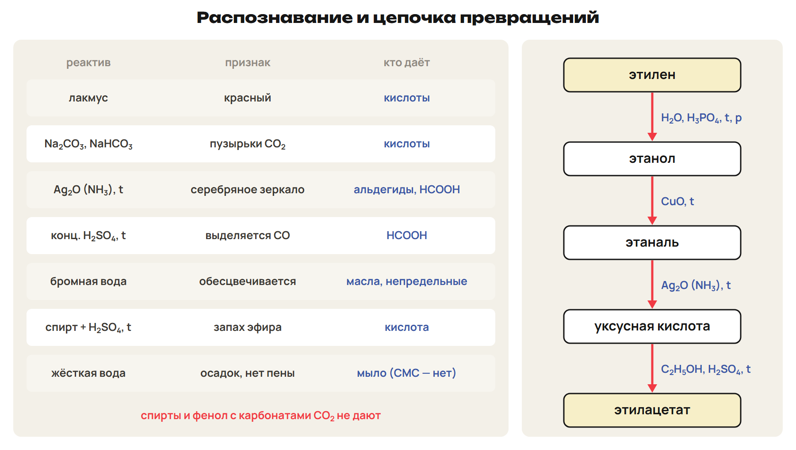

# Возврат
? Где было трудно — в избытке или в коэффициентах?
> 0–3 вопросы; 3–12 разбор G9 и G10.

## Понятие: Разбор G9 и G10
G9: этанол 0,15 моль, кислота 0,20 — в избытке; эфир 13,2 г; выход 75 %.
G10: жир 0,50 моль + NaOH 1,5 моль = 60 г; мыло 459 г × 0,80 = 367,2 г.
Ловушка: на 1 моль жира — 3 моль щёлочи.

# Сложные эфиры
? Откуда запах груши в лабораторной работе?
> 12–22 названия, этерификация, гидролиз; 22–27 L7; 27–30 ключ.

## Схема: Этерификация

R–COO–R′: –OH кислоты заменён остатком спирта.
CH₃COOH + HOC₂H₅ ⇄ CH₃COOC₂H₅ + H₂O (H₂SO₄ конц., t).
Название: спирт + кислота — этилацетат, метилформиат, пропилацетат.
Гидролиз: в кислой среде обратим; в щелочной — омыление.
Ловушка: этерификация обратима, H₂SO₄ — катализатор.

## Понятие: Свойства эфиров
Летучие жидкости с приятным запахом, легче воды.
Кипят ниже кислот — нет водородных связей.
Изоамилацетат — запах груши; растворители, парфюмерия, лаки.
Этилнитрат и нитроглицерин — эфиры азотной кислоты.

## Практика: L7
Назови CH₃COOC₃H₇ и запиши его получение.
Что даёт его гидролиз раствором NaOH?
Ответы:
Пропилацетат: CH₃COOH + C₃H₇OH ⇄ CH₃COOC₃H₇ + H₂O (H₂SO₄ конц., t).
CH₃COONa и пропанол-1 — омыление.
> 22–27 попытка, 27–30 ключ.

# Жиры
? Почему сливочное масло твёрдое, а подсолнечное — жидкое?
> 30–39 состав, гидролиз, гидрирование; 39–44 L8; 44–46 ключ.

## Схема: Строение жира

Жиры — эфиры глицерина и высших кислот (триглицериды).
Твёрдые — в основном предельные кислоты, обычно животные.
Масла — в основном непредельные, обычно растительные.
Исключения: рыбий жир жидкий; кокосовое и пальмовое масло твёрдые.

## Схема: Гидролиз и гидрирование

Кислотный гидролиз: глицерин + 3 кислоты.
(C₁₇H₃₅COO)₃C₃H₅ + 3NaOH → C₃H₅(OH)₃ + 3C₁₇H₃₅COONa.
Триолеин + 3H₂ → тристеарин (t, кат.) → маргарин.
1 г жира — около 39 кДж.
Ловушка: гидролиз — расщепление, гидрирование — присоединение H₂.

## Практика: L8
Омыление тристеарина гидроксидом калия: уравнение и вид мыла.
Что даёт гидрирование триолеина?
Ответы:
(C₁₇H₃₅COO)₃C₃H₅ + 3KOH → C₃H₅(OH)₃ + 3C₁₇H₃₅COOK; мыло жидкое.
Тристеарин — твёрдый жир.
> 39–44 попытка, 44–46 ключ.

# Мыла и СМС
? Почему в жёсткой воде мыло не пенится?
> 46–52 мыла, ПАВ, жёсткая вода, СМС; 52–56 L9; 56–58 ключ.

## Схема: Как моет мыло

Мыла — соли Na (твёрдые) и K (жидкие) высших кислот.
Головка –COO⁻ — в воду, углеводородный хвост — к грязи.
2C₁₇H₃₅COONa + Ca²⁺ → (C₁₇H₃₅COO)₂Ca↓ + 2Na⁺.

## Схема: Мыло и СМС

СМС — алкилсульфаты R–O–SO₃Na; соли Ca и Mg растворимы.
Плюсы: моют в жёсткой воде, сырьё — нефть и газ.
Минусы: трудно разлагаются, загрязняют водоёмы.

## Практика: L9
Сколько граммов стеарата натрия свяжут 0,010 моль Ca²⁺?
Назови плюс и минус СМС.
Ответы:
0,020 моль × 306 = 6,12 г.
Моют в жёсткой воде; плохо разлагаются бактериями.
> 52–56 попытка, 56–58 ключ.

# Распознавание и цепочки
? Как одним опытом отличить кислоту от спирта?
> 58–62 таблица; 62–67 L10; 67–69 ключ; 69–75 L11; 75–78 ключ.

## Схема: Таблица распознавания

Na₂CO₃ — CO₂: кислоты. Лакмус — красный: кислоты.
Ag₂O — зеркало: альдегиды и HCOOH.
Бромная вода — обесцвечивание: масла, непредельные кислоты.
Жёсткая вода — осадок: мыло.
Ловушка: спирты и фенол с карбонатами CO₂ не дают.

## Практика: L10
Уксусная кислота, муравьиная кислота, этанол — как распознать?
Ответы:
Na₂CO₃: CO₂ у двух кислот, этанол — нет.
Аммиачный Ag₂O, t: зеркало у муравьиной.
> 62–67 попытка, 67–69 ключ.

## Практика: L11
CH₃COOH → CH₃COONa → CH₄.
Этаналь → уксусная кислота → метилацетат.
Ответы:
NaOH; затем NaOH при сплавлении → CH₄ + Na₂CO₃.
Ag₂O (NH₃, t); CH₃OH + H₂SO₄ конц., t.
> 69–75 попытка, 75–78 ключ.

# Контроль
? 10 минут, 10 баллов, таблицы разрешены.
> 78–88 контроль; 88–90 назначить вариант.

## Понятие: Дополнительно для A: радикал и кратная связь
HCOOH сильнее CH₃COOH — радикал ослабляет кислоту.
Хлор замещает H у атома C рядом с COOH: ClCH₂COOH.
Акриловая кислота + HBr → 3-бромпропановая — против Марковникова.

## Понятие: Дополнительно для A: равновесие этерификации
Вправо: избыток спирта или кислоты, отгонка эфира, связывание воды.
Катализатор равновесие не смещает.

## Понятие: Дополнительно для A: йодное число и смеси
Йодное число — г I₂ на 100 г жира; 1 моль I₂ на 1 моль C=C.
Смесь HCOOH и CH₃COOH: щёлочь — обе, серебро — только HCOOH (1 : 2).

## Дома: После урока 40
Повтори разделы 7–10 конспекта, таблицы и факты: 15 минут.
Выполни назначенный вариант A, B или C: 30 минут.
Тест — строкой; задачи 9–10 — фото; № 11 — текст или голосовое.
После проверки — 25 минут исправлений по двум причинам.
