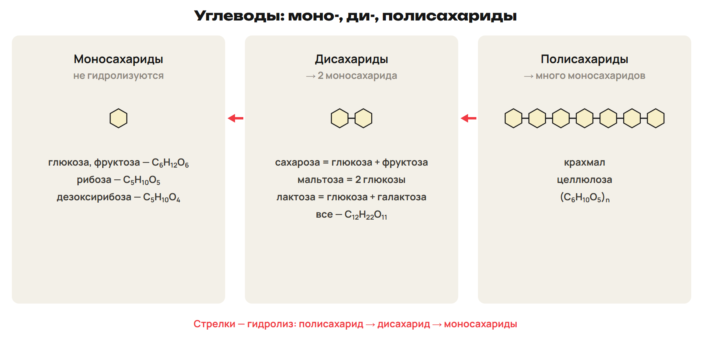
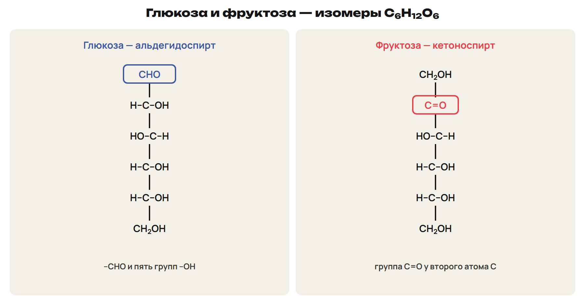
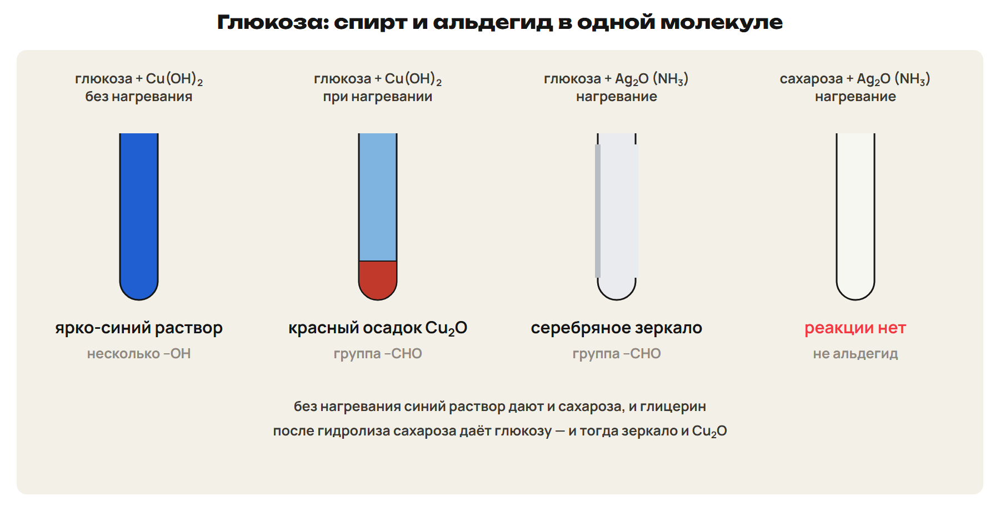
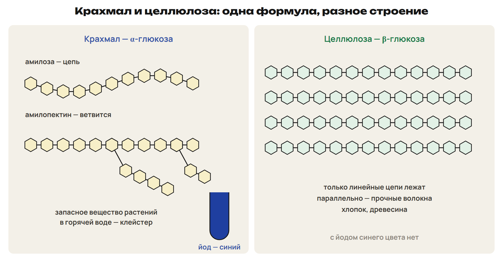
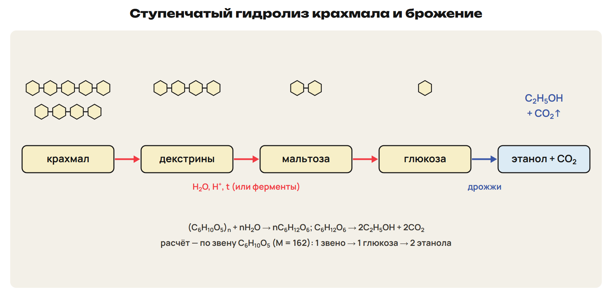

# Классификация углеводов
? Что общего у сахара, картофельного крахмала и хлопка?
↳ Спирты, альдегиды и эфиры изучены. Углеводы соединяют эти группы.
> 0–8 моно-, ди-, полисахариды; 8–11 L1; 11–12 ключ.

## Схема: Классификация

Общая формула Cₙ(H₂O)ₘ; есть исключения.
Моносахариды не гидролизуются: глюкоза, фруктоза, рибоза.
Дисахариды → 2 моносахарида: сахароза, мальтоза, лактоза.
Полисахариды → много моносахаридов: крахмал, целлюлоза.
Ловушка: формула не определяет класс — уксусная кислота не углевод.

## Практика: L1
Распредели: лактоза, рибоза, целлюлоза, фруктоза, мальтоза.
Почему уксусная кислота не углевод?
Ответы:
Моно — рибоза, фруктоза; ди — лактоза, мальтоза; поли — целлюлоза.
Это карбоновая кислота: формула не определяет класс.
> 8–11 попытка, 11–12 ключ.

# Глюкоза и фруктоза
? Почему глюкоза даёт и синий раствор, и серебряное зеркало?
> 12–24 строение, свойства, брожение; 24–29 L2; 29–32 ключ.

## Схема: Строение

Глюкоза — альдегидоспирт: –CHO и пять –OH.
Фруктоза — изомер, кетоноспирт: C=O.
Фотосинтез: 6CO₂ + 6H₂O → C₆H₁₂O₆ + 6O₂.
В крови около 0,1 % глюкозы; Бутлеров (1861) — сахаристые вещества из CH₂O.

## Схема: Реакции глюкозы

Cu(OH)₂ без нагревания — синий раствор (спирт).
Cu(OH)₂ при нагревании — красный Cu₂O; Ag₂O — зеркало (альдегид).
H₂ → сорбит. Брожение: C₆H₁₂O₆ → 2C₂H₅OH + 2CO₂.
Молочнокислое: C₆H₁₂O₆ → 2CH₃–CH(OH)–COOH, без газа.
Ловушка: без нагревания — –OH, при нагревании — –CHO.

## Практика: L2
Запиши: глюкоза + Ag₂O (NH₃, t); спиртовое брожение.
Какая группа у фруктозы на месте –CHO?
Ответы:
C₆H₁₂O₆ + Ag₂O → C₆H₁₂O₇ + 2Ag; C₆H₁₂O₆ → 2C₂H₅OH + 2CO₂.
Кетогруппа C=O — фруктоза кетоноспирт.
> 24–29 попытка, 29–32 ключ.

# Сахароза
? Почему сахар не даёт зеркала, а после кипячения с кислотой — даёт?
> 32–39 сахароза и гидролиз; 39–44 L3; 44–46 ключ.

## Понятие: Сахароза и дисахариды
Сахароза C₁₂H₂₂O₁₁ — свёкла и тростник.
С Cu(OH)₂ — синий раствор; зеркала нет — не альдегид.
C₁₂H₂₂O₁₁ + H₂O → глюкоза + фруктоза (H⁺, ферменты).
Мальтоза — 2 глюкозы; лактоза — глюкоза + галактоза.

## Практика: L3
Запиши гидролиз сахарозы.
Сколько граммов глюкозы получится из 34,2 г сахарозы?
Ответы:
C₁₂H₂₂O₁₁ + H₂O → C₆H₁₂O₆ + C₆H₁₂O₆.
0,10 моль → 18 г глюкозы.
> 39–44 попытка, 44–46 ключ.

# Крахмал и целлюлоза
? Почему хлопок — волокно, а крахмал — порошок?
> 46–57 сравнение, йод, гидролиз, эфиры; 57–63 L4; 63–66 ключ.

## Схема: Крахмал и целлюлоза

Одна формула (C₆H₁₀O₅)ₙ.
Крахмал — α-глюкоза, цепи линейные и разветвлённые; йод — синий.
Целлюлоза — β-глюкоза, только линейные цепи — волокна.
Пироксилин — тринитрат целлюлозы; ацетаты — ацетатный шёлк.

## Схема: Гидролиз крахмала

Крахмал → декстрины → мальтоза → глюкоза (H⁺, t).
(C₆H₁₀O₅)ₙ + nH₂O → nC₆H₁₂O₆.
Глюкоза → крахмал + вода — поликонденсация.
Ловушка: считать по звену 162, а не по глюкозе 180.

## Практика: L4
Сравни крахмал и целлюлозу: звено, строение, йод.
Запиши гидролиз крахмала.
Ответы:
Крахмал — α, ветвится, синий; целлюлоза — β, линейна, нет.
(C₆H₁₀O₅)ₙ + nH₂O → nC₆H₁₂O₆ (H⁺, t).
> 57–63 попытка, 63–66 ключ.

# Расчёты
? Почему из 162 г крахмала получается 180 г глюкозы?
> 66–70 звено и брожение; 70–76 L5; 76–78 ключ.

## Понятие: Как считать
n(звеньев) = m : 162 = n(глюкозы).
Брожение: 1 глюкоза → 2 этанола + 2 CO₂.
Общий выход — умножить в конце.
Пример: 81 г крахмала → 0,50 моль → этанол 1,0 моль = 46 г.

## Практика: L5
Сколько этанола получится из 64,8 г крахмала
при общем выходе 50 %?
Ответы:
0,40 моль → этанол 0,80 моль = 36,8 г.
36,8 × 0,50 = 18,4 г.
> 70–76 попытка, 76–78 ключ.

# Проверка в формате ЕНТ
? Где ловушка в каждом задании?
> 78–84 L6; 84–88 ключ; 88–90 маршрут.

## Практика: L6
1) Какой углевод синеет с йодом? 2) Сколько моль CO₂ даёт 1 моль глюкозы при брожении?
3) Верные: А) фруктоза — кетоноспирт; Б) сахароза даёт зеркало; В) целлюлоза — β-глюкоза;
Г) крахмал не гидролизуется; Д) глюкоза + H₂ → сорбит; Е) лактоза — моносахарид.
Ответы:
1) Крахмал. 2) 2 моль. 3) АВД.
> 78–84 попытка, 84–88 ключ.

## Дома: После урока 41
Прочитай разделы 1–4 конспекта: 25 минут.
Реши P1–P6: 20 минут.
Выполни всю G: 35 минут.
Тест — строкой; G9–G10 — фото; G11 — текст или голосовое.
Запиши вопрос к началу следующего урока.
