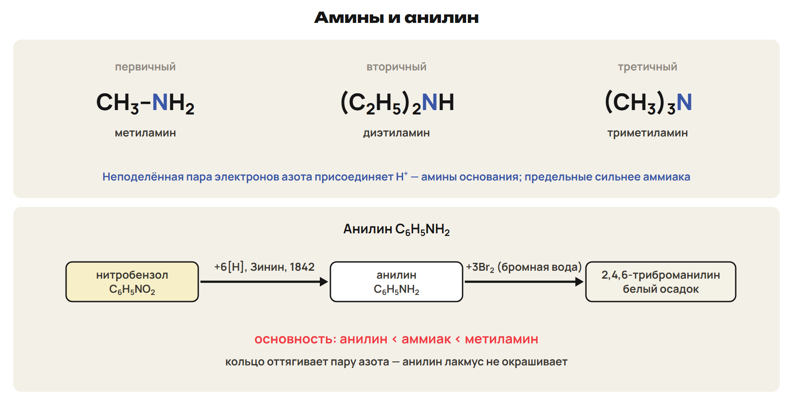
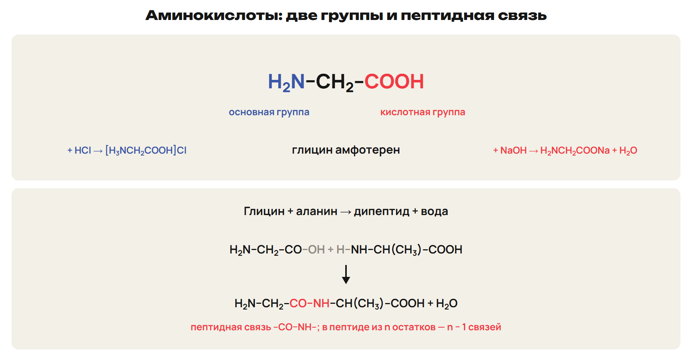
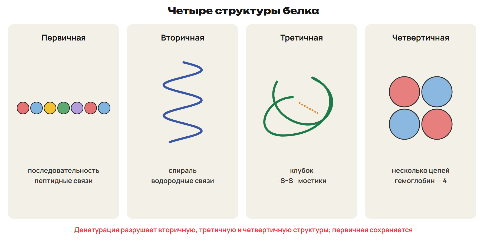
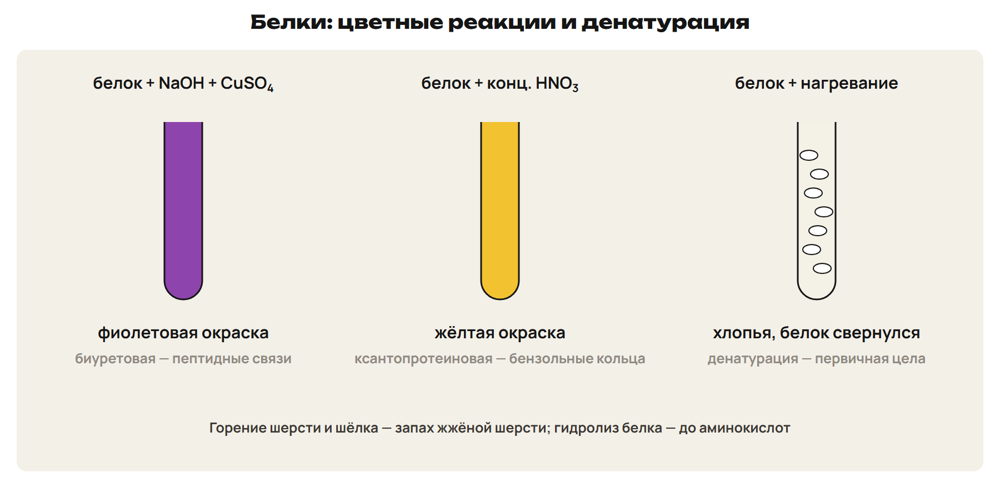
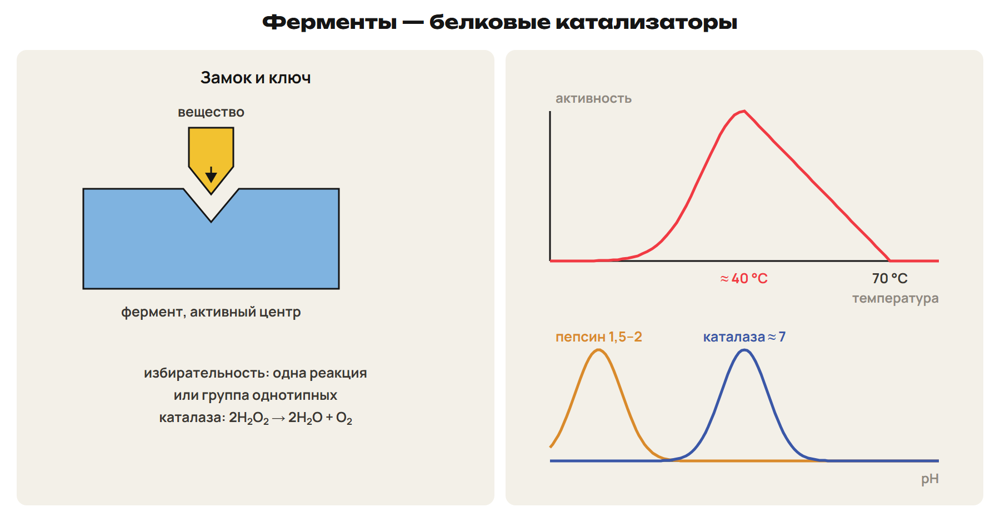
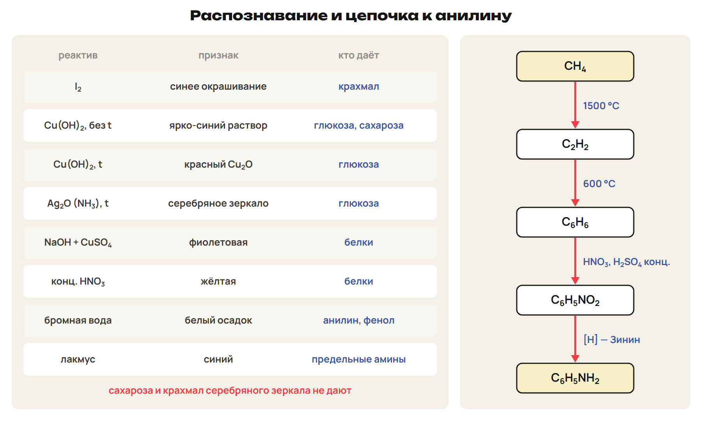

# Возврат
? Где ошибались — в звене 162 или в условиях Cu(OH)₂?
> 0–3 вопросы; 3–12 разбор G9 и G10.

## Понятие: Разбор G9 и G10
G9: 243 : 162 = 1,5 моль → этанол 3,0 моль = 138 г → 110,4 г.
G10: йод — крахмал; NaOH + CuSO₄ — белок.
Cu(OH)₂ при нагревании: красный осадок — глюкоза, нет — сахароза.
Ловушка: синий раствор без нагревания дают обе.

# Амины и анилин
? Почему рыба пахнет аммиаком?
> 12–22 амины и анилин; 22–27 L7; 27–30 ключ.

## Схема: Амины

Амины — производные аммиака: R–NH₂, R₂NH, R₃N.
Неподелённая пара азота — основные свойства.
CH₃NH₂ + HCl → [CH₃NH₃]Cl; раствор — лакмус синий.
Предельные амины сильнее аммиака.

## Понятие: Анилин
Зинин (1842): C₆H₅NO₂ + 6[H] → C₆H₅NH₂ + 2H₂O.
Слабее аммиака: кольцо оттягивает пару азота; лакмус не меняет.
C₆H₅NH₂ + HCl → [C₆H₅NH₃]Cl.
C₆H₅NH₂ + 3Br₂ → C₆H₂Br₃NH₂↓ + 3HBr — белый осадок.
Ловушка: белый осадок с бромной водой — и фенол, и анилин.

## Практика: L7
Запиши: метиламин + HCl; анилин + бромная вода;
получение анилина из нитробензола.
Ответы:
CH₃NH₂ + HCl → [CH₃NH₃]Cl; C₆H₅NH₂ + 3Br₂ → C₆H₂Br₃NH₂↓ + 3HBr.
C₆H₅NO₂ + 6[H] → C₆H₅NH₂ + 2H₂O.
> 22–27 попытка, 27–30 ключ.

# Аминокислоты
? Как одно вещество реагирует и с кислотой, и со щёлочью?
> 30–38 амфотерность и пептиды; 38–43 L8; 43–46 ключ.

## Схема: Аминокислота и пептид

Глицин H₂N–CH₂–COOH; аланин CH₃–CH(NH₂)–COOH.
+ NaOH → H₂NCH₂COONa; + HCl → [H₃NCH₂COOH]Cl.
ClCH₂COOH + 2NH₃ → глицин + NH₄Cl.
Пептидная связь –CO–NH–; в n-пептиде n − 1 связей.

## Практика: L8
Реакции глицина с NaOH и с HCl.
Сколько связей и какова M глицил-глицина?
Ответы:
H₂NCH₂COONa + H₂O; [H₃NCH₂COOH]Cl.
Одна связь; M = 75 + 75 − 18 = 132.
> 38–43 попытка, 43–46 ключ.

# Белки
? Почему сваренное яйцо не становится снова жидким?
> 46–54 структуры и свойства; 54–58 L9; 58–60 ключ.

## Схема: Четыре структуры

Первичная — последовательность, пептидные связи.
Вторичная — спираль, водородные связи.
Третичная — клубок, –S–S– мостики; определяет активность.
Четвертичная — несколько цепей: гемоглобин.

## Схема: Свойства белков

Гидролиз → аминокислоты.
Денатурация: нагрев, соли тяжёлых металлов — первичная цела.
Биуретовая — фиолетовая; ксантопротеиновая — жёлтая.
Ловушка: денатурация не рвёт пептидные связи.

## Практика: L9
Какая структура сохраняется при денатурации?
Какой признак даст белок с конц. HNO₃?
Ответы:
Первичная.
Жёлтая окраска — ксантопротеиновая реакция.
> 54–58 попытка, 58–60 ключ.

# Ферменты
? Почему при жаре ферменты работают хуже?
> 60–64 свойства ферментов; 64–67 L10; 67–68 ключ.

## Схема: Ключ и замок

Ферменты — белковые катализаторы; простые и сложные (кофермент).
Избирательны: активный центр — как замок к ключу.
Оптимум около 40 °C; пепсин — pH 1,5–2, каталаза — около 7.
Каталаза: 2H₂O₂ → 2H₂O + O₂.

## Практика: L10
Чем фермент отличается от неорганического катализатора?
Какой фермент работает в кислой среде желудка?
Ответы:
Белок, высокая избирательность, работает при температуре тела.
Пепсин, pH 1,5–2.
> 64–67 попытка, 67–68 ключ.

# Распознавание и процессы
? Как одним набором реактивов различить углеводы и белки?
> 68–71 таблицы; 71–76 L11; 76–78 ключ.

## Схема: Таблица распознавания

I₂ — крахмал; Cu(OH)₂ при нагревании, Ag₂O — глюкоза.
NaOH + CuSO₄ — белки; бромная вода — анилин.
Гидролиз, брожение, поликонденсация, денатурация, восстановление.

## Практика: L11
Процесс: глюкоза → сорбит; аминокислоты → пептид; яйцо в кипятке.
Условия: CH₄ → C₂H₂ → C₆H₆ → C₆H₅NO₂ → C₆H₅NH₂.
Ответы:
Восстановление; поликонденсация; денатурация.
1500 °C; 600 °C; HNO₃ + H₂SO₄ конц.; восстановление [H].
> 71–76 попытка, 76–78 ключ.

# Контроль
? 10 минут, 10 баллов, таблицы разрешены.
> 78–88 контроль; 88–90 назначить вариант.

## Понятие: Дополнительно для A: α и β
Глюкоза существует в циклических формах α и β.
Крахмал — α-глюкоза, цепи свёрнуты и ветвятся.
Целлюлоза — β-глюкоза, прямые параллельные цепи — волокна.

## Понятие: Дополнительно для A: основность и пептиды
Анилин < аммиак < предельные амины; дифениламин ещё слабее.
M пептида = сумма M − 18(n − 1).

## Понятие: Дополнительно для A: пироксилин
На звено целлюлозы — 3HNO₃; M звена тринитрата 297.
Считать по звену целлюлозы 162.

## Дома: После урока 42
Повтори разделы 5–9 конспекта, таблицы и факты: 15 минут.
Выполни назначенный вариант A, B или C: 30 минут.
Тест — строкой; задачи 9–10 — фото; № 11 — текст или голосовое.
После проверки — 25 минут исправлений по двум причинам.
