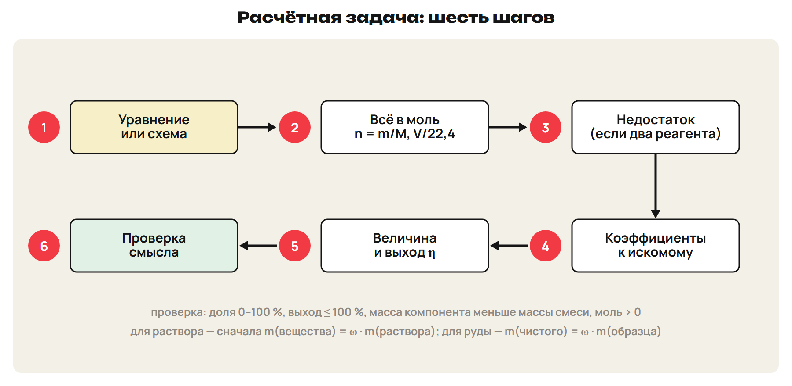
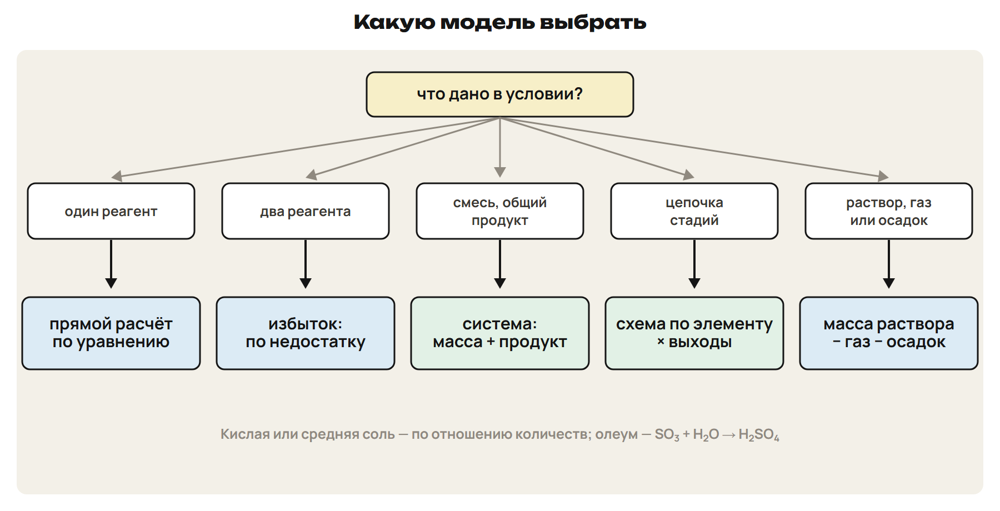
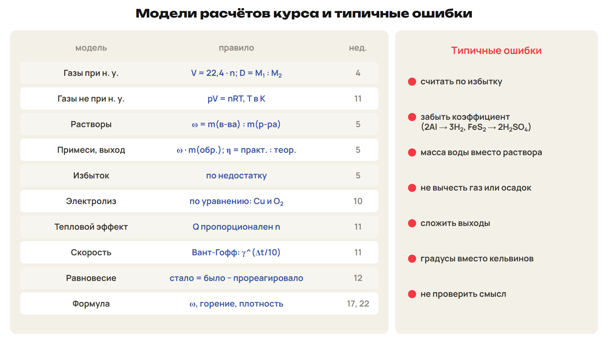

Перед пробниками полезно не решать новое, а уметь выбрать модель. Здесь — общий алгоритм, все модели курса с неделями, где они разобраны, и ловушки, на которых теряют баллы.

## 1. Общий алгоритм

> [!rule] Шесть шагов
> 1) **Уравнение** с коэффициентами; для цепочки — **стехиометрическая схема**.
> 2) Всё — в **моль**: n = m/M; n = V/22,4 (н. у.); n = c·V; для раствора — сначала m = ω·m(р-ра); для примеси — m(чистого) = ω·m(образца).
> 3) Даны оба реагента — найти **недостаток** и считать по нему.
> 4) По **коэффициентам** перейти к искомому веществу.
> 5) Перевести в нужную величину и учесть **выход**: m(практ.) = η·m(теор.).
> 6) **Проверить смысл:** доля от 0 до 100 %, масса компонента меньше массы смеси, выход ≤ 100 %, моль не отрицательны.

## 2. Модели курса

| Модель | Формула, правило | Неделя |
|---|---|---|
| Газы при н. у. | V = n · 22,4; D = M₁/M₂; M(воздуха) = 29 | 4 |
| Газы не при н. у. | pV = nRT (R = 8,314; p — кПа, V — л, T — К) | 11 |
| Растворы | ω = m(в-ва)/m(р-ра); при разбавлении масса вещества не меняется | 5 |
| Примеси, выход | m(чист.) = ω·m(обр.); η = m(практ.)/m(теор.) | 5 |
| Избыток | считать по недостатку | 5 |
| Смеси | система: уравнение по массе смеси и по общему продукту; нереагирующий компонент | 6 |
| Раствор после реакции | m(р-ра) = сумма масс − газ − осадок | 8 |
| Схема и выход по стадиям | по сохраняющемуся элементу; общий выход = произведение выходов | 9 |
| Электролиз | по уравнению: CuSO₄ — Cu на катоде, O₂ на аноде | 10 |
| Тепловой эффект | Q пропорционален количеству вещества | 11 |
| Скорость | Вант-Гофф: v₂/v₁ = γ^((t₂−t₁)/10), γ = 2–4 | 11 |
| Равновесие | Ле Шателье; «было — прореагировало — стало» | 12 |
| Кислые соли | CO₂ : NaOH = 1 : 1 → NaHCO₃; 1 : 2 → Na₂CO₃ | 15 |
| Олеум | SO₃ в 100 %-й H₂SO₄; SO₃ + H₂O → H₂SO₄ (80 г → 98 г) | 16 |
| Формула | по ω, горению, плотности, реакции | 17, 22 |

> [!example] Быстрые модели
> pV = nRT: 4,99 л при 100 кПа и 300 К → n = 100 · 4,99 / (8,314 · 300) = 0,2 моль.
> Электролиз CuSO₄: на катоде 12,8 г Cu (0,2 моль) → на аноде O₂ 0,1 моль = 2,24 л.
> Вант-Гофф: γ = 3, нагрев с 20 до 50 °C → скорость × 3³ = 27.
> C + O₂ → CO₂ + 393,5 кДж: 36 г угля (3 моль) → 1180,5 кДж.

## 3. Типичные ловушки

- Считать по **избытку** вместо недостатка.
- Забыть **коэффициенты**: 2Al → 3H₂; FeS₂ → 2H₂SO₄.
- Взять массу **воды** вместо массы **раствора**; забыть вычесть **газ или осадок**.
- **Сложить** выходы вместо умножения.
- Подставить в pV = nRT температуру в **°C** (нужно t + 273).
- Не проверить смысл: доля больше 100 % или отрицательное x — ошибка в решении.

> [!try] Проверь себя
> 1) Общий выход стадий 95 % и 80 %? 2) Сколько H₂SO₄ даёт 40 г SO₃? 3) Какая соль при 0,2 моль NaOH и 0,1 моль CO₂?
> Ответы: 1) 76 %; 2) 49 г; 3) Na₂CO₃.
