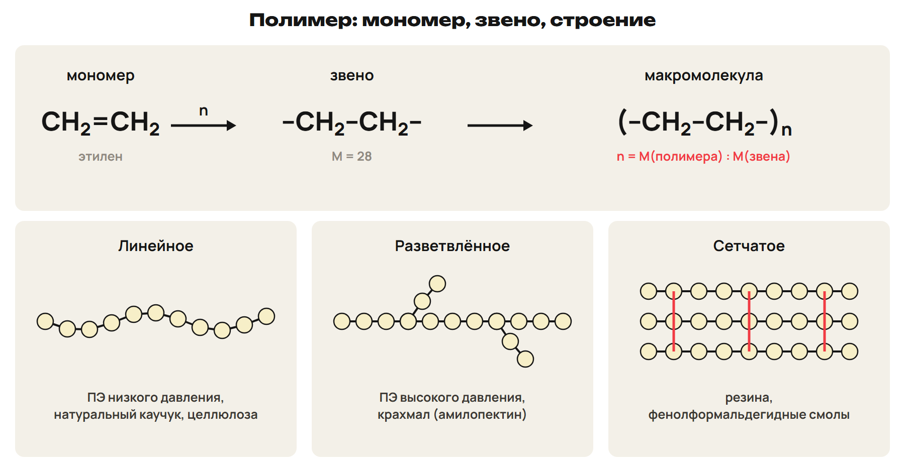
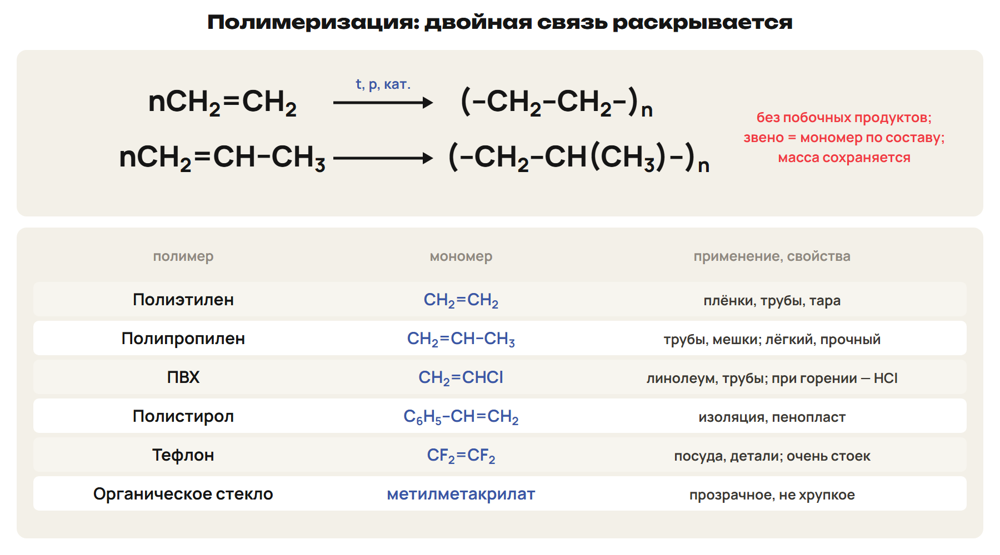
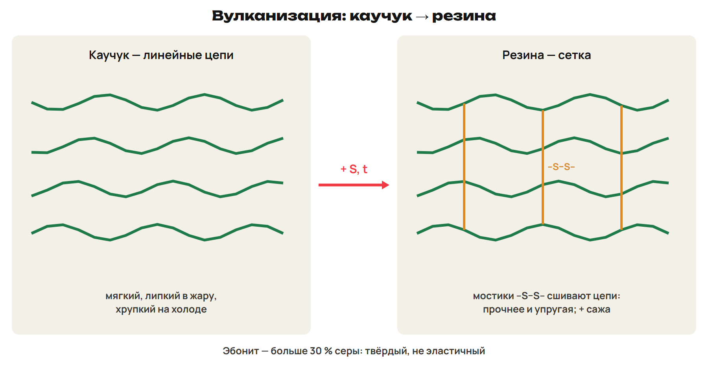
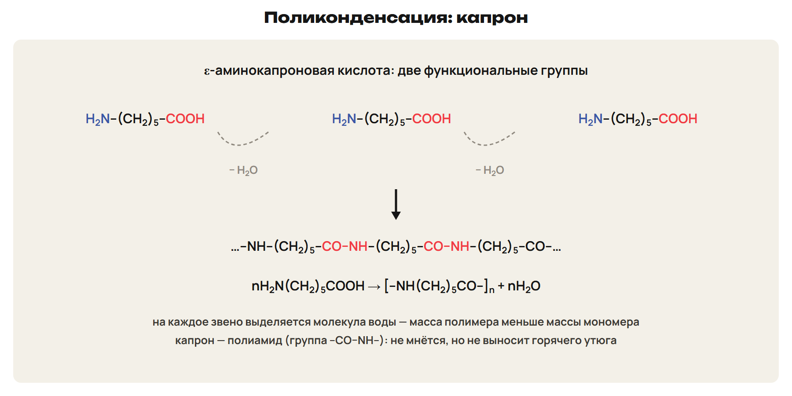
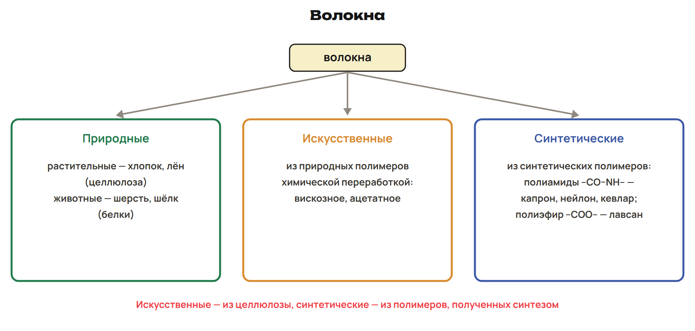
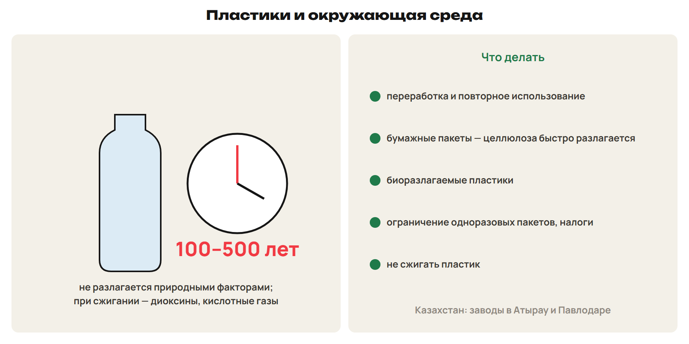

# Полимеры: понятия и строение
? Что общего у пакета, капроновых колготок, шины и белка?
↳ Полимеризацию этилена и пептиды мы уже встречали. Сегодня — полимеры целиком.
> 0–10 мономер, звено, строение; 10–13 L1; 13–14 ключ.

## Схема: Мономер, звено, макромолекула

n = M(полимера) : M(звена); олигомеры — Mr 500–5000.
Природные: крахмал, целлюлоза, белки, натуральный каучук; синтетические: ПЭ, ПП, ПС.
Линейные, разветвлённые, сетчатые.
Термопласт — размягчается многократно; реактопласт — твердеет необратимо.

## Практика: L1
n полистирола с M = 208 000 (звено C₈H₈)?
Термопласт или реактопласт?
Ответы:
M(C₈H₈) = 104; n = 2000.
Термопласт.
> 10–13 попытка, 13–14 ключ.

# Полимеризация
? Почему из этилена получается полимер, а из этана — нет?
> 14–25 полимеризация и таблица полимеров; 25–30 L2; 30–32 ключ.

## Схема: Полимеризация

Разрыв кратной связи, без побочных продуктов; звено = мономер.
Полиэтилен, полипропилен, ПВХ (CH₂=CHCl), полистирол, тефлон (CF₂=CF₂).
Сополимеризация: бутадиен + стирол.
Ловушка: в звене двойной связи уже нет.

## Практика: L2
Полимеризация тетрафторэтилена.
Мономеры ПВХ и полистирола?
Ответы:
nCF₂=CF₂ → (–CF₂–CF₂–)ₙ — тефлон.
Винилхлорид CH₂=CHCl; стирол C₆H₅–CH=CH₂.
> 25–30 попытка, 30–32 ключ.

# Каучуки и резина
? Почему шина не плавится летом, как каучук?
> 32–40 Лебедев и вулканизация; 40–44 L3; 44–46 ключ.

## Схема: Вулканизация

Лебедев: 2C₂H₅OH → CH₂=CH–CH=CH₂ + 2H₂O + H₂.
Сера сшивает молекулы мостиками → сетка.
Резина = каучук + сера + сажа; эбонит — больше 30 % серы.
Ловушка: резина — не синоним каучука.

## Практика: L3
Получение бутадиена по Лебедеву.
Чем резина отличается от каучука?
Ответы:
2C₂H₅OH → C₄H₆ + 2H₂O + H₂ (450 °C, ZnO, Al₂O₃).
Резина — вулканизованная, сетчатая, прочнее.
> 40–44 попытка, 44–46 ключ.

# Поликонденсация и волокна
? Почему из аминокислоты получается капрон, хотя двойной связи нет?
> 46–57 поликонденсация, волокна; 57–63 L4; 63–66 ключ.

## Схема: Капрон

Две функциональные группы; выделяется вода (HCl, NH₃).
nH₂N(CH₂)₅COOH → [–NH(CH₂)₅CO–]ₙ + nH₂O.
Состав звена отличается от мономера.
Ловушка: капрон — поликонденсация.

## Схема: Волокна

Природные: хлопок, лён, шерсть, шёлк.
Искусственные — из природных полимеров: вискоза, ацетат.
Синтетические: полиамиды (капрон, кевлар), полиэфир (лавсан).

## Практика: L4
Полимеризация или поликонденсация: лавсан, полиэтилен, кевлар, бутадиеновый каучук.
К каким волокнам относится вискоза?
Ответы:
Поликонденсация; полимеризация; поликонденсация; полимеризация.
Искусственное.
> 57–63 попытка, 63–66 ключ.

# Пластики и окружающая среда
? Сколько лет пролежит в земле пластиковая бутылка?
> 66–70 вред и меры; 70–74 L5; 74–76 ключ.

## Схема: Пластик и природа

Атырау и Павлодар — заводы полиэтилена и полипропилена.
Пластик разлагается 100–500 лет; при сжигании — диоксины.
Меры: переработка, бумага, биоразлагаемые пластики.

## Практика: L5
Почему пластик опасно сжигать?
Два способа уменьшить вред пластиков.
Ответы:
Диоксины и кислотные газы.
Переработка; бумажные пакеты; биоразлагаемые пластики.
> 70–74 попытка, 74–76 ключ.

# Проверка в формате ЕНТ
? Где ловушка в каждом задании?
> 76–83 L6; 83–88 ключ; 88–90 маршрут.

## Практика: L6
1) Звеньев в ПЭ с M = 70 000? 2) Какой ПЭ линейный?
3) Верные: А) лавсан — полиэфир; Б) ПВХ при горении выделяет HCl; В) поликонденсация — без побочных продуктов;
Г) резина — сетчатый полимер; Д) вискоза — синтетическое; Е) олигомеры — Mr больше 5000.
Ответы:
1) 2500. 2) Низкого давления. 3) АБГ.
> 76–83 попытка, 83–88 ключ.

## Дома: После урока 43
Прочитай разделы 1–5 конспекта: 25 минут.
Реши P1–P6: 20 минут.
Выполни всю G: 35 минут.
Тест — строкой; G9–G10 — фото; G11 — текст или голосовое.
Запиши вопрос к началу следующего урока.
