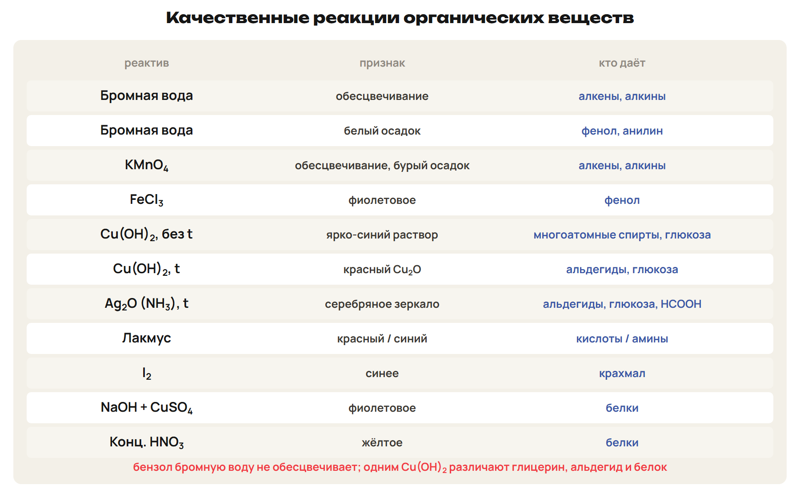
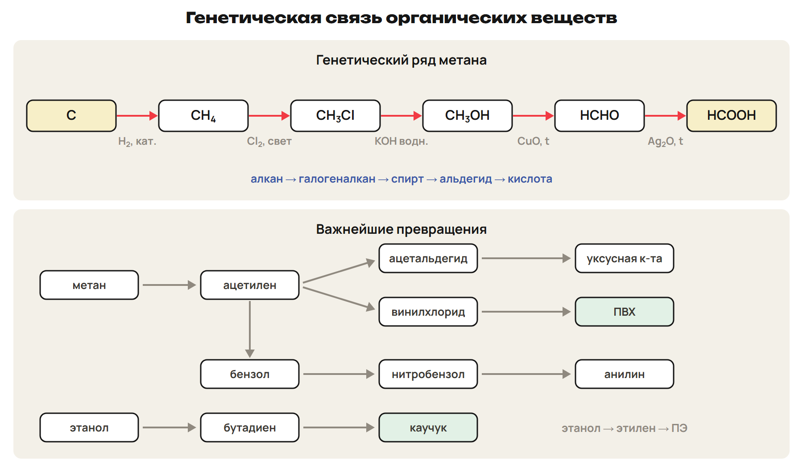
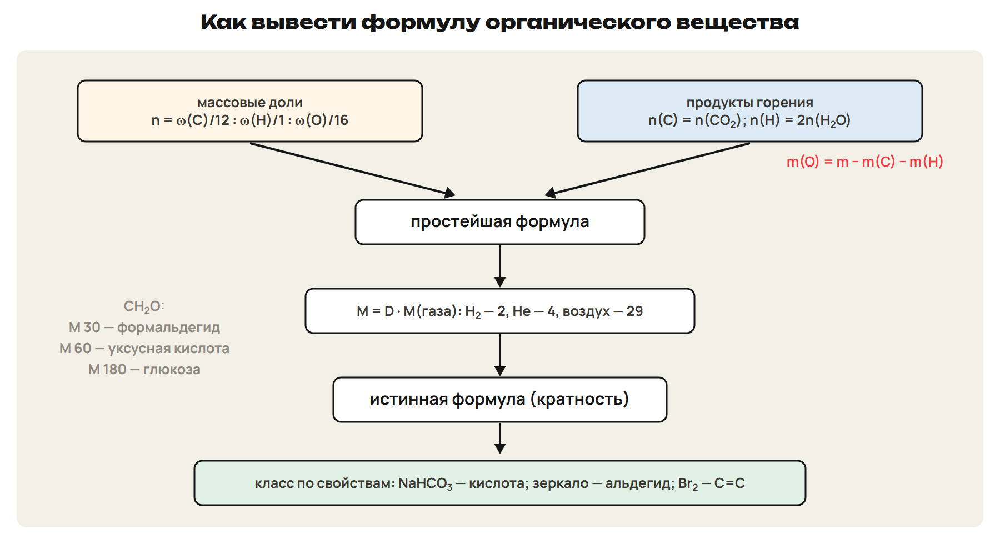

После урока 43 прочитай разделы 1–5, реши P и общую часть G. После урока 44 повтори разделы 6–9, таблицу качественных реакций и алгоритм вывода формулы, выполни один назначенный вариант A/B/C. Сначала попытка, затем ключ.

## 1. Полимеры: понятия и строение

Пакет, капроновые колготки, шина и белок — все полимеры. Чем они отличаются?

**Полимеры (высокомолекулярные соединения)** — вещества из **макромолекул**, построенных из множества повторяющихся **структурных звеньев**. **Мономер** — низкомолекулярное вещество, из которого получают полимер. **Степень полимеризации n** — число звеньев: (–X–)ₙ, n = M(полимера) / M(звена). Молекулы одного полимера разной длины, поэтому говорят о средней степени полимеризации.

- По молекулярной массе: Mr < 500 — низкомолекулярные; 500–5000 — **олигомеры**; > 5000 — высокомолекулярные.
- По происхождению: **природные** (крахмал, целлюлоза, белки, натуральный каучук) и **синтетические** (полиэтилен, полипропилен, полистирол).

| Строение | Примеры |
|---|---|
| Линейное | полиэтилен низкого давления, натуральный каучук, целлюлоза |
| Разветвлённое | полиэтилен высокого давления, крахмал (амилопектин) |
| Сетчатое | резина (вулканизованный каучук), фенолформальдегидные смолы |

- **Термопласты** при нагревании размягчаются и принимают новую форму, при охлаждении сохраняют её — **многократно** (полиэтилен, полипропилен, ПВХ).
- **Реактопласты** при нагревании **необратимо** твердеют (фенолформальдегидные смолы).

> [!trap] Термопласт и реактопласт
> Полиэтилен можно переплавить много раз; фенолформальдегидную смолу — нет.

## 2. Полимеризация; пластмассы

**Полимеризация** — соединение одинаковых молекул мономера за счёт **разрыва кратных связей** **без побочных продуктов**; звено того же состава, что мономер: nCH₂=CH–CH₃ → (–CH₂–CH(CH₃)–)ₙ. **Сополимеризация** — полимеризация разных мономеров: бутадиен + стирол → бутадиен-стирольный каучук.

| Полимер | Мономер | Свойства, применение |
|---|---|---|
| Полиэтилен | CH₂=CH₂ | жирный на ощупь; стоек к кислотам и щелочам; плёнки, трубы, тара |
| Полипропилен | CH₂=CH–CH₃ | лёгкий, прочный, теплостойче полиэтилена; трубы, мешки |
| Поливинилхлорид (ПВХ) | CH₂=CHCl | коптит, вне пламени гаснет, при нагреве — HCl; линолеум, трубы |
| Полистирол | C₆H₅–CH=CH₂ | прозрачный, хрупкий; изоляция, пенопласт |
| Органическое стекло | метилметакрилат | прозрачное, менее хрупкое, чем стекло |
| Тефлон | CF₂=CF₂ | исключительная химическая стойкость; посуда, детали |

## 3. Каучуки и резина

Каучуки — эластичные, водонепроницаемые, электроизоляционные полимеры. Первый промышленный синтетический каучук — бутадиеновый по методу **С. В. Лебедева**: бутадиен из этанола (450 °C, ZnO, Al₂O₃): 2C₂H₅OH → CH₂=CH–CH=CH₂ + 2H₂O + H₂. Изопреновый каучук сходен с натуральным; хлоропреновый стоек к бензину; бутадиен-стирольный газонепроницаем; кремнийорганические тепло- и морозостойки.

> [!rule] Вулканизация
> Каучук нагревают с **серой** → атомы серы сшивают линейные молекулы **дисульфидными мостиками** → **сетчатая** структура: прочнее и упругая.
> **Резина** = вулканизованный каучук + наполнитель (сажа). **Эбонит** — более 30 % серы, твёрдый, не эластичен.

> [!trap] Каучук и резина
> Резина — это каучук после вулканизации (сетка), а не синоним каучука.

## 4. Поликонденсация и волокна

**Поликонденсация** — получение полимера из мономеров с **двумя функциональными группами** с **выделением низкомолекулярного вещества** (вода, HCl, аммиак); состав звена отличается от мономера. Примеры: крахмал и целлюлоза, белки, фенолформальдегидная смола, капрон, лавсан.

> [!rule] Капрон
> nH₂N–(CH₂)₅–COOH → [–NH–(CH₂)₅–CO–]ₙ + nH₂O — из ε-аминокапроновой кислоты.
> Капрон не мнётся и стоек к истиранию, но разрушается кислотами и не выносит высокой температуры.

| Волокна | Группа | Примеры |
|---|---|---|
| Природные | растительные / животные | хлопок, лён (целлюлоза); шерсть, шёлк (белки) |
| Искусственные | химическая переработка природных полимеров | вискозное, ацетатное |
| Синтетические | полиамидные (–CO–NH–) | капрон, нейлон, кевлар |
| | полиэфирные (–COO–) | лавсан (терефталевая кислота + этиленгликоль) |

| | Полимеризация | Поликонденсация |
|---|---|---|
| Мономер | с кратной связью | с двумя функциональными группами |
| Побочный продукт | нет | есть (H₂O, HCl, NH₃) |
| Звено и мономер | состав одинаков | состав различается |
| Примеры | полиэтилен, ПВХ, полистирол, каучуки, тефлон | капрон, лавсан, кевлар, смолы, крахмал, белки |

> [!trap] Капрон — поликонденсация
> Капрон — полимер, но его получают поликонденсацией (выделяется вода). Искусственные волокна делают из природных полимеров, синтетические — из синтетических.

## 5. Пластики и окружающая среда

- В **Атырау** — завод Polymer Production (полиэтиленовая плёнка, полипропиленовые мешки), в **Павлодаре** — завод полипропилена.
- **Фенопласты** — фенолформальдегидная смола с наполнителями (текстолит, древесно-слоистые пластики).
- Пластики **не разлагаются** природными факторами: бутылка — **100–500 лет**; при сжигании — **диоксины**, кислотные газы; микропластик; животные глотают пакеты.
- Меры: ограничение пакетов, бумажные заменители, **биоразлагаемые** пластики, переработка.

## 6. Функциональные группы и классы

| Группа | Класс | Пример |
|---|---|---|
| –OH у sp³-углерода | спирты | C₂H₅OH |
| –OH у бензольного кольца | фенолы | C₆H₅OH |
| –CHO | альдегиды | CH₃CHO |
| >C=O в цепи | кетоны | CH₃COCH₃ |
| –COOH | карбоновые кислоты | CH₃COOH |
| –COO– | сложные эфиры | CH₃COOC₂H₅ |
| –O– | простые эфиры | (C₂H₅)₂O |
| –NO₂ | нитросоединения | CH₃NO₂ |
| –NH₂ | амины | C₆H₅NH₂ |
| –NH₂ и –COOH | аминокислоты | глицин |

**Полифункциональные** вещества содержат две и более группы: одинаковые (этиленгликоль, глицерин) или разные (глицин, глюкоза, молочная кислота). Адреналин содержит группы фенола, спирта и амина. Переход от класса к классу — превращение функциональных групп без изменения углеродного скелета.

## 7. Качественные реакции

| Вещество | Реактив, условие | Признак |
|---|---|---|
| Алкены, алкины | бромная вода; KMnO₄ | обесцвечивание; с KMnO₄ — бурый осадок |
| Бензол | бромная вода | не обесцвечивает; горит коптящим пламенем |
| Фенол | бромная вода; FeCl₃ | белый осадок; фиолетовое окрашивание |
| Спирты | Na; раскалённая медная проволока | H₂; проволока снова красная |
| Многоатомные спирты | свежий Cu(OH)₂ | ярко-синий раствор |
| Альдегиды | Ag₂O (NH₃), t; Cu(OH)₂, t | серебряное зеркало; красный Cu₂O |
| Карбоновые кислоты | лакмус; NaHCO₃ | красный; CO₂ |
| Амины | лакмус | синий |
| Анилин | бромная вода | белый осадок |
| Глюкоза | Cu(OH)₂ без нагревания и при нагревании | синий раствор → красный осадок |
| Крахмал | I₂ | синее окрашивание |
| Белки | конц. HNO₃; NaOH + CuSO₄ | жёлтое; фиолетовое |
| Пластмассы и волокна | горение | полиэтилен — как парафин; ПВХ — коптит, гаснет, HCl; шерсть — запах жжёного пера; хлопок — жжёной бумаги; капрон — плавится, тянутся нити |

> [!trap] Один реактив — разные признаки
> Бромная вода: обесцвечивание — C=C и C≡C; белый осадок — фенол и анилин; бензол не реагирует.
> Cu(OH)₂: синий раствор без нагревания — многоатомные спирты и глюкоза; красный осадок при нагревании — альдегиды и глюкоза; фиолетовый с NaOH — белки.

## 8. Генетическая связь

Из веществ одного класса получают вещества другого. **Генетический ряд метана:** C + 2H₂ → CH₄; CH₄ + Cl₂ → CH₃Cl + HCl (свет); CH₃Cl + KOH (водн.) → CH₃OH + KCl; CH₃OH + CuO → HCHO + Cu + H₂O (t); HCHO + Ag₂O → HCOOH + 2Ag (t). То есть **алкан → галогеналкан → спирт → альдегид → кислота**.

Важнейшие цепочки:
- метан → ацетилен → ацетальдегид → уксусная кислота;
- ацетилен → винилхлорид → ПВХ;
- этанол → бутадиен → бутадиеновый каучук; этанол → этилен → полиэтилен;
- метан → ацетилен → бензол → нитробензол → анилин;
- бензол → хлорбензол → фенол → трибромфенол.

## 9. Вывод формулы органического вещества

> [!rule] Алгоритм
> 1) **По массовым долям:** n(C) : n(H) : n(O) = ω(C)/12 : ω(H)/1 : ω(O)/16 → простейшая формула.
> 2) **По горению:** n(C) = n(CO₂); **n(H) = 2n(H₂O)**; m(O) = m(вещества) − m(C) − m(H); n(N) = 2n(N₂).
> 3) **Молярная масса:** M = D · M(газа) → истинная формула (во сколько раз M больше простейшей).
> 4) **Класс — по свойствам:** NaHCO₃ → кислота; зеркало → альдегид; обесцвечивает бромную воду → C=C.

> [!example] Простейшая и истинная
> 40 % C, 6,7 % H, 53,3 % O → CH₂O. При M = 30 — формальдегид; M = 60 — C₂H₄O₂ (уксусная кислота или метилформиат); M = 180 — глюкоза C₆H₁₂O₆.

> [!trap] Три частые ошибки
> n(H) = 2n(H₂O), а не n(H₂O). Простейшая формула не всегда истинная — решает M. При полимеризации масса сохраняется: масса полимера равна массе прореагировавшего мономера.

> [!try] Проверь себя
> 1) Полимеризацией или поликонденсацией получают лавсан? 2) Чем отличить фенол от бензола? 3) Сколько звеньев в ПВХ с M = 62 500?

> [!rule] Факты ЕНТ недели
> - Мономер, звено, степень полимеризации n; олигомеры — Mr 500–5000, полимеры — больше 5000.
> - Линейные (ПЭ низкого давления, целлюлоза, натуральный каучук), разветвлённые (ПЭ высокого давления, крахмал), сетчатые (резина, фенолформальдегидные смолы).
> - Термопласты размягчаются многократно; реактопласты твердеют необратимо.
> - Полимеризация — по кратной связи, без побочных продуктов; сополимеризация — бутадиен + стирол; ПВХ — винилхлорид; тефлон — CF₂=CF₂.
> - Лебедев: бутадиен из этанола; вулканизация серой — сетка; резина = каучук + сера + сажа; эбонит — больше 30 % серы.
> - Поликонденсация — с выделением воды; капрон и кевлар — полиамиды, лавсан — полиэфир; вискоза и ацетат — искусственные волокна.
> - Пластики разлагаются 100–500 лет; при сжигании — диоксины.
> - Генетический ряд: алкан → галогеналкан → спирт → альдегид → кислота; n(H) = 2n(H₂O).
