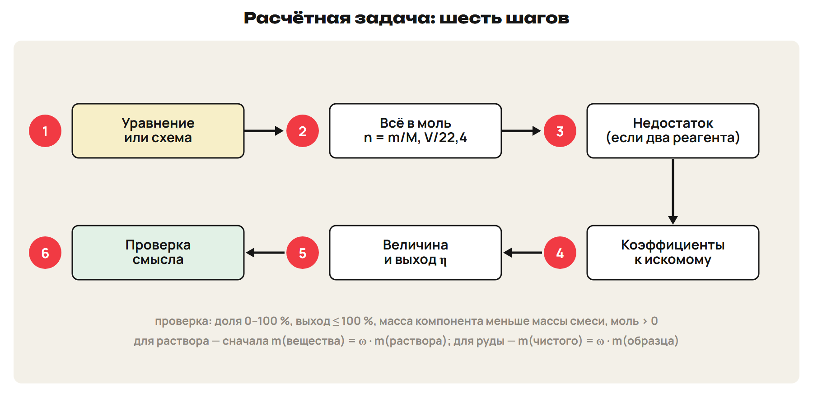
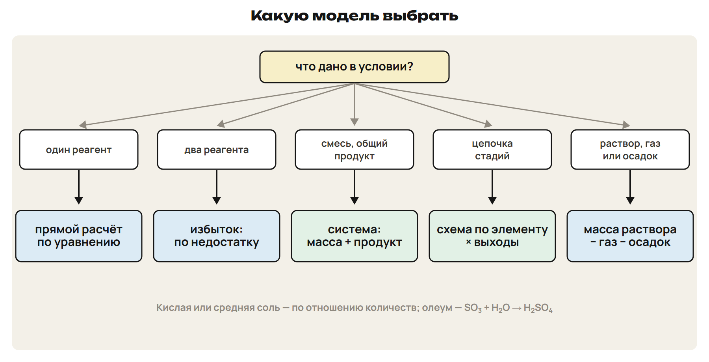
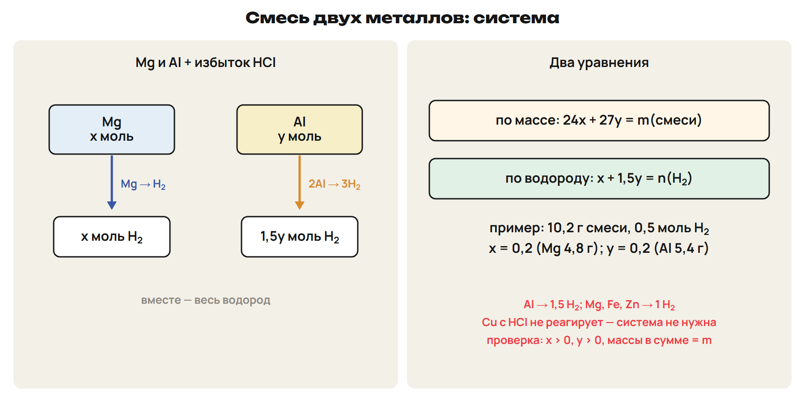
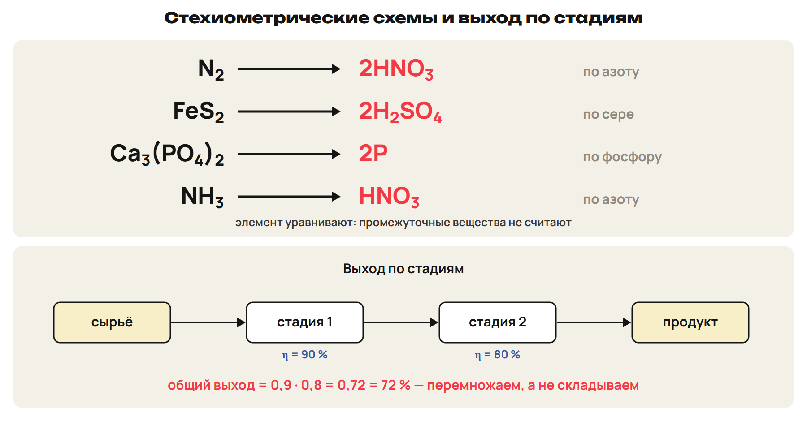

# Общий алгоритм
? Почему одну задачу решают за минуту, а другую не получается начать?
↳ Все расчётные модели курса пройдены. Сегодня — как выбрать нужную.
> 0–9 алгоритм и выбор модели; 9–12 L1; 12–14 ключ.

## Схема: Шесть шагов

1) Уравнение или схема. 2) Всё в моль.
3) Недостаток. 4) Коэффициенты.
5) Величина с выходом. 6) Проверка смысла.
Ловушка: доля больше 100 % или отрицательное x — ошибка.

## Схема: Выбор модели

Один реагент — прямой расчёт.
Оба реагента — избыток и недостаток.
Смесь с общим продуктом — система; цепочка — схема.
Раствор с газом или осадком — масса раствора.

## Практика: L1
Модель: а) 10 г Zn и 0,5 моль HCl — объём H₂; б) смесь Mg и Al с кислотой — состав;
в) из серы — серная кислота через три стадии.
Ответы:
а) Избыток и недостаток; б) система.
в) Схема S → H₂SO₄ и произведение выходов.
> 9–12 попытка, 12–14 ключ.

# Смеси: система
? Как узнать состав сплава, если оба металла выделяют водород?
> 14–24 система; 24–32 L2; 32–36 ключ.

## Схема: Система для смеси

x и y — количества компонентов.
Уравнение по массе: M₁x + M₂y = m.
Уравнение по продукту: Al → 1,5 H₂; Mg, Fe, Zn → 1 H₂.
Пример: 11 г Al и Fe, 0,4 моль H₂ → Al 5,4 г, Fe 5,6 г.

## Практика: L2
10,2 г смеси Mg и Al + избыток HCl → 11,2 л H₂.
Найди массы металлов.
Ответы:
x + 1,5y = 0,5; 24x + 27y = 10,2.
Mg 4,8 г; Al 5,4 г.
> 24–32 попытка, 32–36 ключ.

# Нереагирующий компонент
? Что делать, если один металл смеси не реагирует?
> 36–41 правило; 41–46 L3; 46–48 ключ.

## Понятие: Без системы
Cu с HCl не реагирует; Fe со щёлочью не реагирует.
Массу реагирующего — по газу; остаток — второй компонент.
Ловушка: не строить систему, если продукт даёт один металл.

## Практика: L3
20 г смеси Cu и Zn + избыток HCl → 4,48 л H₂.
Массовая доля цинка?
Ответы:
Zn 0,2 моль × 65 = 13 г.
65 %; Cu 7 г.
> 41–46 попытка, 46–48 ключ.

# Схемы и выход по стадиям
? Зачем считать промежуточные вещества, если элемент сохраняется?
> 48–56 схемы и выход; 56–63 L4; 63–66 ключ.

## Схема: Стехиометрические схемы

N₂ → 2HNO₃; NH₃ → HNO₃; S → H₂SO₄.
FeS₂ → 2H₂SO₄; Ca₃(PO₄)₂ → 2P.
Общий выход = произведение выходов.
Ловушка: выходы не складывают и не берут меньший.

## Практика: L4
17 т NH₃: NH₃ → NO (95 %) → HNO₃ (90 %).
Масса HNO₃?
Ответы:
1 Ммоль → 63 т теоретически.
63 × 0,95 × 0,90 = 53,87 т.
> 56–63 попытка, 63–66 ключ.

# Руда с примесью
? Сколько руды нужно, если в ней не только нужное вещество?
> 66–70 примесь; 70–76 L5; 76–78 ключ.

## Понятие: Сырьё
m(чистого) = ω · m(образца).
Масса сырья = масса чистого : доля : выход.
Пример: 196 т H₂SO₄ ← 120 т FeS₂ ← 160 т колчедана (75 %).

## Практика: L5
Сколько колчедана с 75 % FeS₂ нужно для 196 т H₂SO₄?
Выход 100 %.
Ответы:
H₂SO₄ 2 Ммоль → FeS₂ 1 Ммоль = 120 т.
120 : 0,75 = 160 т.
> 70–76 попытка, 76–78 ключ.

# Проверка в формате ЕНТ
? Где ловушка в каждом задании?
> 78–84 L6; 84–88 ключ; 88–90 маршрут.

## Практика: L6
1) Общий выход 90 % и 90 %? 2) Сколько моль H₂SO₄ даёт 1 моль FeS₂?
3) Верные: А) смесь с общим продуктом — система; Б) Cu с HCl даёт H₂; В) выходы перемножают;
Г) Al даёт 1 моль H₂; Д) Ca₃(PO₄)₂ → 2P; Е) отрицательное x — ответ.
Ответы:
1) 81 %. 2) 2 моль. 3) АВД.
> 78–84 попытка, 84–88 ключ.

## Дома: После урока 45
Прочитай разделы 1–4 конспекта: 25 минут.
Реши P1–P6: 20 минут.
Выполни всю G: 35 минут.
Тест — строкой; G9–G10 — фото; G11 — текст или голосовое.
Запиши вопрос к началу следующего урока.
