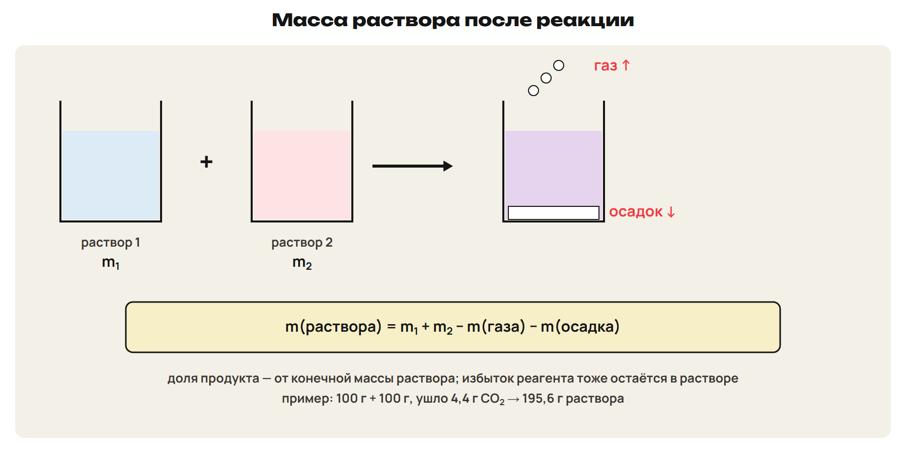
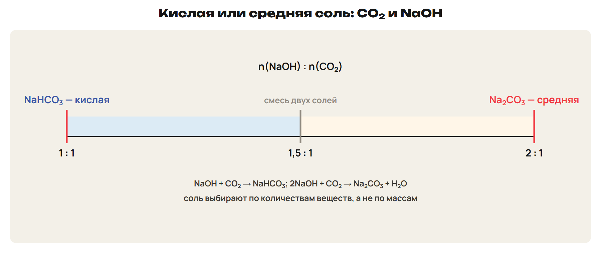
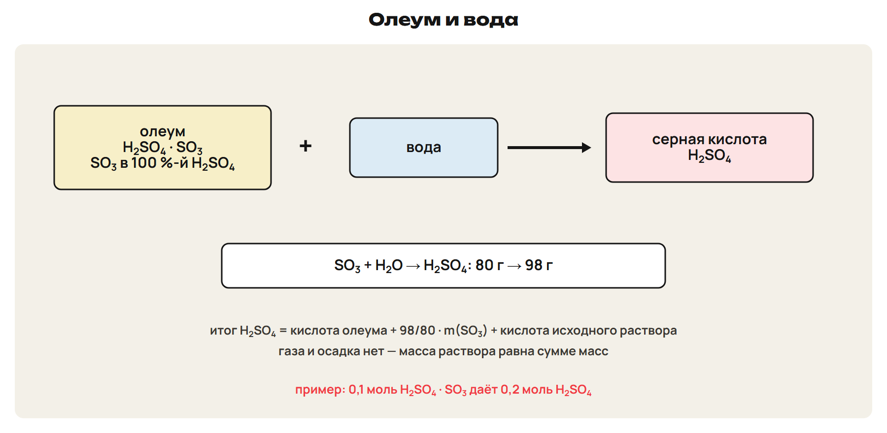
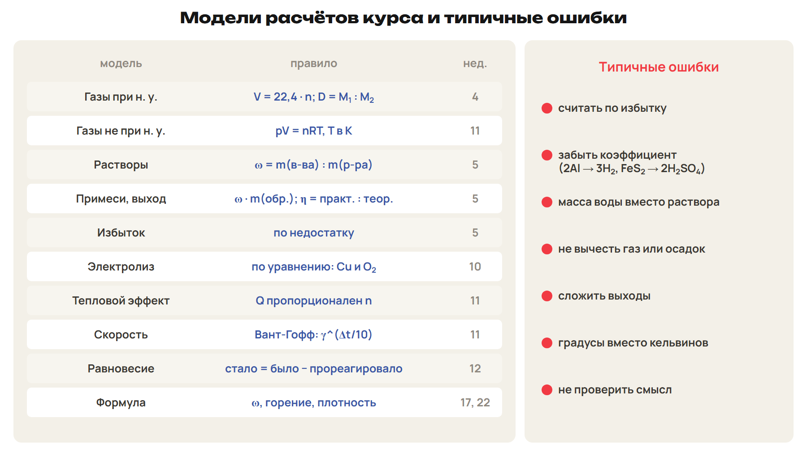

# Возврат
? Где ошибались — в коэффициентах водорода или в выходах?
> 0–3 вопросы; 3–12 разбор G9 и G10.

## Понятие: Разбор G9 и G10
G9: 1,5x + y = 0,35; 27x + 56y = 13,9.
Al 2,7 г; Fe 11,2 г.
G10: 180 т FeS₂ = 1,5 Ммоль → 3 Ммоль H₂SO₄ = 294 т.
294 × 0,9 × 0,8 = 211,68 т.

# Растворы с реакцией
? Почему масса раствора после реакции меньше суммы масс?
> 12–20 правило; 20–26 L7; 26–30 ключ.

## Схема: Масса раствора

Масса раствора = сумма масс − газ − осадок.
Долю считают от конечной массы.
Избыток реагента тоже остаётся в растворе.
Ловушка: масса раствора ≠ масса воды.

## Практика: L7
100 г 10,6 %-го Na₂CO₃ + 100 г 7,3 %-й HCl.
Масса раствора и ω(NaCl)?
Ответы:
NaCl 11,7 г; CO₂ 4,4 г ушёл.
195,6 г; ω ≈ 5,98 %.
> 20–26 попытка, 26–30 ключ.

# Кислая или средняя соль
? От чего зависит, какая соль получится из CO₂ и щёлочи?
> 30–35 отношение количеств; 35–40 L8; 40–42 ключ.

## Схема: Шкала NaOH : CO₂

1 : 1 — кислая соль NaHCO₃.
2 : 1 — средняя соль Na₂CO₃.
Между — смесь двух солей.
Ловушка: соль выбирают по количествам, а не по массам.

## Практика: L8
0,1 моль CO₂ через 4 г NaOH; через 8 г NaOH.
Какие соли и массы?
Ответы:
0,1 : 0,1 → NaHCO₃ 8,4 г.
0,2 : 0,1 → Na₂CO₃ 10,6 г.
> 35–40 попытка, 40–42 ключ.

# Олеум
? Почему из 80 г SO₃ получается 98 г кислоты?
> 42–48 модель олеума; 48–54 L9; 54–56 ключ.

## Схема: Олеум и вода

Олеум — SO₃ в 100 %-й H₂SO₄; H₂SO₄ · SO₃, M = 178.
SO₃ + H₂O → H₂SO₄: 80 г → 98 г.
Итог H₂SO₄ = кислота олеума + 98/80 · m(SO₃) + кислота раствора.
Газа нет — масса раствора равна сумме масс.

## Практика: L9
17,8 г олеума H₂SO₄ · SO₃ + 82,2 г воды.
Массовая доля H₂SO₄?
Ответы:
0,1 моль олеума → 0,2 моль H₂SO₄ = 19,6 г.
19,6 г в 100 г → 19,6 %.
> 48–54 попытка, 54–56 ключ.

# Повторение моделей
? Какие модели курса ещё встретятся на ЕНТ?
> 56–64 таблица моделей; 64–74 L10; 74–78 ключ.

## Схема: Таблица моделей

pV = nRT: R = 8,314; p — кПа, V — л, T — К.
Электролиз CuSO₄: Cu на катоде, O₂ на аноде.
Вант-Гофф: × γ на каждые 10 °C; Q пропорционален n.
Равновесие: стало = было − прореагировало.

## Практика: L10
а) n газа: 4,99 л, 100 кПа, 300 К. б) Катод — 12,8 г Cu: объём O₂?
в) γ = 3, с 20 до 50 °C. г) C + O₂ → CO₂ + 393,5 кДж, 36 г угля.
Ответы:
а) 0,2 моль; б) 2,24 л.
в) В 27 раз; г) 1180,5 кДж.
> 64–74 попытка, 74–78 ключ.

# Итоговый контроль
? 10 минут, 10 баллов, алгоритм и таблица разрешены.
> 78–88 контроль; 88–90 назначить вариант.

## Понятие: Дополнительно для A: три неизвестных
Si, Al, Fe: со щёлочью — Si (2H₂) и Al (1,5H₂).
С кислотой — Al (1,5H₂) и Fe (1H₂).
Три уравнения: масса и два объёма водорода.

## Понятие: Дополнительно для A: олеум H₂SO₄ · nSO₃
H₂SO₄ · SO₃ даёт 2 моль H₂SO₄; при n = 0,5 — 1,5 моль.
Если SO₃ больше, чем воды, избыток SO₃ остаётся.

## Понятие: Дополнительно для A: производство
Сырьё = чистое вещество : доля : выход.
Газ не при н. у. — через pV = nRT в той же системе.

## Дома: После урока 46
Повтори разделы 5–8 конспекта, алгоритм и таблицу: 15 минут.
Выполни назначенный вариант A, B или C: 30 минут.
Тест — строкой; задачи 9–10 — фото; № 11 — текст или голосовое.
После проверки — 25 минут исправлений по двум причинам.
